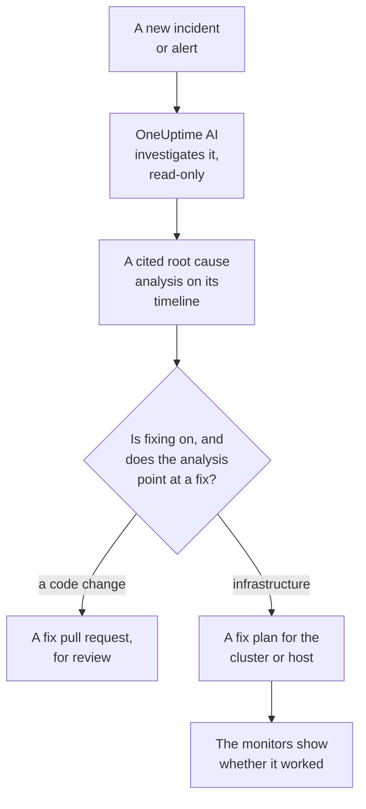
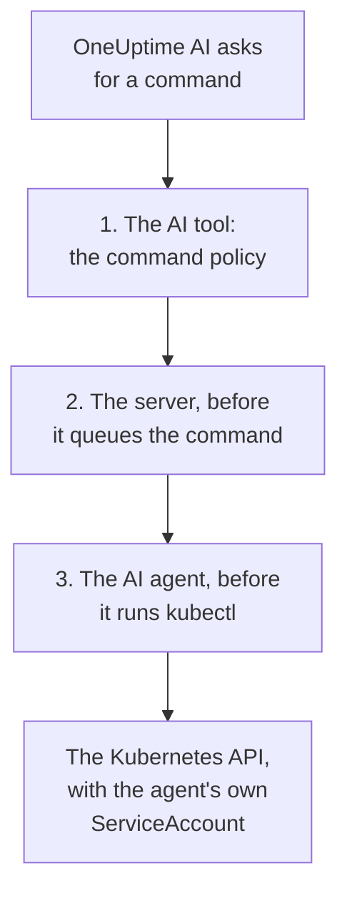

# AI SRE

OneUptime AI is your AI Site Reliability Engineer. The moment a new incident or alert is declared, it wakes up, investigates it across your own telemetry — logs, metrics, traces, exceptions, monitors, and recent changes — and posts a cited root cause analysis to the incident or alert timeline, usually before the on-call engineer has finished reading the page.

Every claim in the analysis carries a citation that deep-links to the exact data that supports it, and the investigation itself is **strictly read-only**: OneUptime AI can never change anything in your project while investigating.

:::cards
- [How it works](#how-it-works): From a new incident to a cited analysis, and a fix when you allow one.
- [Enabling AI investigations](#enabling-ai-investigations): The switches, and what they need.
- [Cluster access — let OneUptime AI run kubectl](#cluster-access-let-oneuptime-ai-run-kubectl): Investigate, and fix, inside Kubernetes.
- [Cost controls](#cost-controls): Limits for incidents, for alerts and for the whole project.
:::

## How it works

OneUptime AI does three things for a new incident or alert, and each has a switch of its own:

- **It investigates** (on by default). It reads your telemetry, and the clusters and hosts where an AI agent runs, and posts a cited root cause analysis. An investigation changes nothing.
- **It fixes** (off by default). When fixing is on, a confident analysis becomes a fix: a pull request for a change to your code, or a plan of commands for a cluster or a host, run the way that cluster's or host's AI agent allows.
- **It learns.** The AI Insights pages say what keeps going wrong, worked out from everything that was recorded.



An analysis that finds no cause is posted quietly, without paging anyone (see [Quiet mode](#quiet-mode)), and nothing is fixed without a cause.

## What the investigation posts

When an investigation finishes, OneUptime AI posts a root cause analysis with these sections:

- **Summary** — one or two sentences a paged engineer can read in five seconds.
- **Most likely root cause** — the hypothesis, with only the confidence the evidence supports, each factual claim cited. If the telemetry is insufficient, the AI says so plainly and lists what it checked instead of guessing.
- **Evidence** — the key findings that support or rule out the hypothesis, each cited.
- **Suggested next steps** — concrete actions for the on-call engineer.

For incidents, the analysis is posted to the incident feed **and** as an incident internal note (where responders collaborate). For alerts, it is posted to the alert feed.

While the investigation runs, the incident or alert page shows a live **AI Investigation** panel that narrates each step — which tools ran, what they found, and how long they took — so you can watch it think. If an investigation fails, the panel shows the failure reason rather than a silent gap.

An investigation runs until it is done: it has **no time limit** and no small query budget, so it can run every query and kubectl or infrastructure command it needs. A long command output (a `kubectl describe node` of a busy node, a pod's logs) is never cut off — OneUptime AI reads it a page at a time. If you want a hard stop, set an **investigation time limit** per signal type (see **Cost controls** below).

## What an investigation reads

An investigation starts from the incident or alert and from the infrastructure it is linked to: the hosts, Docker and Podman hosts, Kubernetes clusters, databases and services its monitors watch. A website, API or synthetic monitor watches what you link it to under **Monitor → Overview → Linked Resources**, so link it to the hosts that serve what it checks, and every investigation of its incidents starts there.

- The alerts on that infrastructure that opened in the 30 minutes before the incident, or are still open, newest first, such as the high CPU alert of the host behind a slow site. Private alerts are left out.
- The infrastructure's own metrics, read the way people read them. Host metrics such as `system.cpu.utilization` and `system.memory.utilization` are reported once per state, and the states add up to 100%, so one average across them says nothing. OneUptime AI reads them one state at a time (busy CPU is user plus system), and any metric per container, per mount point or by any other attribute.
- The containers of a Docker or Podman host: the busiest by CPU, memory or restarts, and the ones that stopped reporting. A stopped container sends nothing rather than zero, so numbers for the whole host hide it.
- The changes recorded in the two hours before the incident or alert - deploys, Kubernetes rollouts, config changes and the fixes OneUptime ran - and which of them its services' telemetry makes suspects: a service that got measurably worse right after a change. See [Deploys and Changes](/docs/telemetry/change-events).

The investigation's activity on the **AI Investigation** card says how many open or recent alerts it read, and on which resources.

### Checked again when a new alert opens

An investigation starts the moment an incident is declared, and a host alert that needs a few minutes of metrics can open after it. When an alert opens on the incident's linked infrastructure within 30 minutes of the incident, after the investigation read it, and the incident is still open, OneUptime AI checks the incident once more with that alert in hand. The new analysis begins with **Checked again** and the alert that made it check, and its activity says so too. If an investigation rule made OneUptime AI wait before investigating the incident, those minutes are counted from when its investigation finished instead (see [Wait before investigating](#wait-before-investigating)).

This happens at most once per incident, under the same switches and limits as a new investigation: **Enable AI**, _Investigate new incidents_, the AI credits, and the daily and concurrency limits. There is nothing to turn on. A follow-up check never runs auto-remediation again and is never followed up itself, and an alert's investigation is not checked again.

## Talk to OneUptime AI about the incident

The **AI Investigation** card ends with a conversation — **Ask OneUptime AI** — shared by everyone who can see the incident or alert. It is one card whatever happened above it: under a report you ask follow-ups, and when no automatic investigation ran (or it stopped before reporting) the first suggestion is **What is the root cause?**, which has OneUptime AI investigate on demand.

- **Ask follow-up questions** — "which pods use the most memory?", "what changed right before this started?", "is anything else affected?". OneUptime AI builds on its report, queries fresh data (and runs read-only kubectl or infrastructure commands where it has access, on the clusters and resources you may view), and cites every claim.
- **Ask it to act** — "acknowledge this incident", "post a status update saying we're investigating", "page the database on-call", "raise the severity". It uses the same actions as Ask AI and always acts **with your own permissions**, so it can never do more than you could.
- **Choose how it acts** with the switch in the message box, which says beside it what the chosen mode means: _Auto-run_ (the default — it acts on a clear request right away), _Ask to act_ (it shows an approval card first, which anyone on the incident can approve or deny), or _Read-only_.
- **One shared thread.** Every question shows who asked it, everyone sees the same conversation live, and anyone can stop an answer in progress. Charts and tables in an answer are shown to the person who asked; everyone else sees the cited answer. Each answer lists its **Sources**, and a source with a page of its own (logs, metrics, a monitor) opens it. A long thread opens on its newest messages, with a button above them (for example **Show 6 earlier messages**) that brings back the rest.

## Enabling AI investigations

Autonomous investigations are **on by default for new projects**. So are postmortem drafts and AI Insights. Fixing starts off, and the pull requests that are part of it open only while it is on (see [Automatic code fixes](#automatic-code-fixes)). A project created before this default keeps its setting; turn investigations on as in step 3, or with **Turn on** on any Kubernetes cluster's **AI agent** page (Project Owner or Project Admin). To check or change them:

:::steps
1. **Configure an LLM provider.** Self-hosted installations bring their own key (or run fully air-gapped with local Ollama) — see [LLM Providers](/docs/ai/llm-provider). OneUptime Cloud users can use the pre-configured global provider, billed as metered AI tokens, so the project needs AI credits: a project owner or someone with **Manage Billing** adds them on **Project Settings → AI → AI Credits**, where **Auto Recharge** keeps them from running out.
2. **Make sure AI is enabled for the project** (it is by default): **Enable AI**, on **Project Settings → AI → AI Features**.
3. **Choose per signal type** (both on for new projects):
   - Incidents: **Incidents → AI → Settings** — turn on _Investigate new incidents_.
   - Alerts: **Alerts → AI → Settings** — turn on _Investigate new alerts_.
:::

Each AI behaviour on those pages is a switch that saves as soon as you flip it; there is no Save button. The incident page has three, under **What OneUptime AI does**: _Investigate new incidents_, _Fix new incidents automatically_ and _Draft a postmortem when an incident resolves_. The alert page has the same, without the postmortem. _Fix new incidents automatically_ (and _Fix new alerts automatically_) starts **off**, for new projects too: it lets OneUptime AI change your infrastructure, so a project turns it on itself — see [Which incidents are investigated and fixed](#which-incidents-are-investigated-and-fixed). The pull requests it opens, a fix to your code and the telemetry an investigation found missing, are part of it, and each auto remediation rule sets them: with no rule both open, and a rule can turn either off under its **More fields** (see [Automatic code fixes](#automatic-code-fixes)). Project Owners and Project Admins can change them; for everyone else each switch is locked and says which permission it needs.

The pages say two things only when they are true. If **Enable AI** is off, nothing on them runs, and the page says so at the top with the Enable AI switch itself for those who may change it (Project Owners, and anyone with Manage Billing); everyone else is told who can. If the project has no LLM provider OneUptime AI can use — none at all, or providers but none set as the default — the page says that too, with a link to **Project Settings → AI → LLM Providers**. On OneUptime Cloud the global provider counts, so nothing is said there.

Incidents and alerts are configured independently, so you can give each signal type its own concurrency cap, daily token budget, fix-task budget, and rules. None of those limits applies until you set it — they are folded under **More settings** at the bottom of each page; see **Cost controls** below. Changing an alert AI setting does not change the corresponding incident setting, or vice versa.

Fixing builds on top of investigations: while **Fix new incidents automatically** (or alerts) is on, an investigation that confidently identifies a repository code change opens a fix pull request automatically — see **Automatic code fixes** below.

## Cluster access — let OneUptime AI run kubectl

Out of the box, an investigation can only use the telemetry your agents ship. For a Kubernetes signal that is often not enough: "pods stuck in Pending" is a scheduling problem you diagnose by describing the pod and reading its events, not by looking at a metric. The **Kubernetes AI agent** lets OneUptime AI do exactly that — and, if you allow it, fix what it finds.

Each cluster's page has an **AI** section in its side menu:

- **Agent** — the cluster's **AI agent** page: whether the agent is connected, what AI may do on the cluster, and anything that needs attention, each with the step that fixes it. The same explanation appears on the incident's investigation panel when AI had to investigate with OneUptime data only.
- **Insights** — the cluster's **AI Insights** page: what OneUptime AI found out about the cluster — what keeps going wrong and why, and what to do about it (see [What AI learned on a cluster](#what-ai-learned-on-a-cluster)).
- **Logs** — the cluster's **AI Logs** page: everything OneUptime AI did on the cluster, newest first (see [Everything AI did on a cluster](#everything-ai-did-on-a-cluster)).

The cluster's **Overview** ends with an **AI agent** card that sums the AI agent page up: whether the agent is connected, whether **Investigate with kubectl** is on, how fixes run (**Off**, **Ask for approval**, **Automatic** or **Bypass approval**) and what needs attention, with a link to the AI agent page, where they are changed.

### The Kubernetes AI agent — on by default, read-only

The [OneUptime Kubernetes agent](/docs/telemetry/kubernetes-agent) chart runs the Kubernetes AI agent by default: one small pod (`component=ai-agent`, image `oneuptime/kubernetes-ai-agent`) with a **read-only** ServiceAccount. It connects with the API key the chart already uses, so there is nothing to set up in the dashboard: within a minute the cluster's AI agent page shows it as **Connected** and **Investigate with kubectl** is on — unless someone already chose AI settings for the cluster there, which are kept as they are.

On an agent installed before the Kubernetes AI agent existed, refresh your chart index first, then upgrade:

```bash
helm repo update
helm upgrade kubernetes-agent oneuptime/kubernetes-agent \
  --namespace oneuptime-agent --reset-then-reuse-values \
  --set aiAgent.enabled=true
```

`kubernetes-agent` in `oneuptime-agent` is the release name and namespace the dashboard's install instructions use; if you installed the agent with other names, use yours (`helm list -A | grep kubernetes-agent` shows them). Without `helm repo update`, Helm may resolve the chart you installed from, which does not know `aiAgent` and fails with `Additional property aiAgent is not allowed`. On a self-hosted OneUptime, upgrade OneUptime before the chart — see [Upgrading the Agent](/docs/telemetry/kubernetes-agent#upgrading-the-agent). To run the chart without the AI agent, pass `--set aiAgent.enabled=false`.

**Test connection**, in the **⋯** menu next to the agent's status on the AI agent page, runs `kubectl version` and `kubectl auth can-i --list` through the agent and shows the results: what it can reach and what it may do. If the page says the agent is not connected, read its log with `kubectl logs -n oneuptime-agent -l component=ai-agent --tail=100`. A key with a **Pinned Service Name** cannot register the agent — give the chart a key without one. When the server refuses a registration, the log says whether the refusal clears on its own (a previous agent pod that still reports in, or the old in-cluster Runner still shutting down during an upgrade) or what to change. **Reset agent**, in the same menu, makes the server forget the agent's key once you confirm it; the pod reconnects on its own within a few minutes.

The Kubernetes AI agent is not a Runner and never appears under Runbooks → Runners. It only ever uses its own ServiceAccount, so OneUptime never hands it a credential, it is never used as a Bash/SSH host for runbooks, and it is never accepted as an auto-remediation rule's command Runner.

### What AI may do — set by the agent

What OneUptime AI may do on a cluster is set where the agent runs, in the chart, with two values:

- `aiAgent.investigation` — `true`: AI may run read-only kubectl on the cluster while it investigates. `false`: it still investigates, with the data OneUptime already has.
- `aiAgent.fixes` — how AI applies a fix: `off`, `ask-for-approval`, `automatic` or `bypass-approval` (see [How fixes work](#how-fixes-work)). Every level but `off` grants the AI agent write access; with `off` it has none and refuses every write itself.

The AI agent reports both to OneUptime on every heartbeat, and OneUptime applies them to the cluster. **What AI may do** on the cluster's AI agent page shows them — **On** and the fixes level, in green whenever they are on — with no way to change them there; **Change** shows each option with the exact `helm upgrade` that sets it. A change made anywhere else — the AI agent page, the API or Terraform — is refused while the agent sets them.

A release that sets neither value lets the agent use its defaults (investigation on; fixes off, or ask-for-approval with the older `aiAgent.remediation.enabled=true`). OneUptime applies those defaults only to a cluster whose AI settings nobody chose on its AI agent page: settings someone chose there are kept as they are, and the page shows the command that moves them to the chart. So does a cluster whose AI agent is too old to report them — upgrading the chart with the two values moves them.

### Letting AI fix what it finds

Fixes are off until you turn them on with `aiAgent.fixes`, which also grants the AI agent write access — ideally only in the namespaces AI may fix, and with node operations off:

```bash
helm repo update
helm upgrade kubernetes-agent oneuptime/kubernetes-agent \
  --namespace oneuptime-agent --reset-then-reuse-values \
  --set aiAgent.enabled=true \
  --set aiAgent.investigation=true \
  --set aiAgent.fixes=ask-for-approval \
  --set "aiAgent.remediation.namespaces={web,api}" \
  --set aiAgent.remediation.nodeOperations=false
```

Or cluster-wide:

```bash
helm repo update
helm upgrade kubernetes-agent oneuptime/kubernetes-agent \
  --namespace oneuptime-agent --reset-then-reuse-values \
  --set aiAgent.enabled=true \
  --set aiAgent.investigation=true \
  --set aiAgent.fixes=ask-for-approval \
  --set-json 'aiAgent.remediation.namespaces=[]'
```

Replace `{web,api}` with the namespaces AI may fix. Every namespace you list must already exist: the chart creates one RoleBinding in each and never creates a namespace, so a missing one fails the whole install or upgrade — the collector included — with `namespaces "api" not found`. Create it first, or take it off the list; take a namespace off the list before you delete it. Leaving the flag out of an upgrade keeps the list stored on the release, so to go back to cluster-wide pass `--set-json 'aiAgent.remediation.namespaces=[]'` (Helm 3.10+), as the second command does — not `={}`, which Helm reads as one empty name and the chart refuses. `--set aiAgent.remediation.namespaces=null` does not reset a stored list under `--reuse-values`: Helm keeps the stored list. `aiAgent.remediation.nodeOperations=false` keeps fixes off nodes; set it to `true` to let AI cordon, uncordon, drain and taint nodes (a drain, a taint or a patch of a node still waits for a human).

Use `automatic` or `bypass-approval` in place of `ask-for-approval` for more autonomy, and `--set aiAgent.fixes=off` to turn fixes off again, which also removes the write access. Fixes also need two project switches. **Fix new incidents automatically** (on **Incidents → AI → Settings**) and **Fix new alerts automatically** (on **Alerts → AI → Settings**) start off: until one is on, nothing new of that kind is fixed. **Enable AI** (**Project Settings → AI → AI Features**) is on unless someone turned it off; it turns all of AI off for the project, whatever an agent's configuration says.

### Which incidents a cluster's fixes act on

While **Fix new incidents automatically** is on and no auto remediation rule is set up, OneUptime AI fixes every new incident the cluster is linked to, in the mode its AI agent page sets — and the same for alerts with **Fix new alerts automatically**. With rules, it fixes only the incidents a rule that fixes with OneUptime AI matches (see [Which incidents are investigated and fixed](#which-incidents-are-investigated-and-fixed)). What it is not linked to, it does not touch — however clearly the cause sits in the cluster. An incident or alert is linked to a cluster when:

- the telemetry it was raised from names the cluster (a metric, log or trace monitor on the cluster's data);
- its monitor is a Kubernetes monitor of the cluster;
- its monitor is linked to the cluster under **Monitor → Overview → Linked Resources** — the way to link a website, API or synthetic monitor to the cluster that serves what it checks;
- someone picked the cluster under **Other Affected Resources** when declaring it (picking a linked monitor adds it there for you).

Each incident and alert says on its **Remediation** card whether it was linked to a cluster and what the cluster's fixes did; see [What auto-remediation did](#what-auto-remediation-did). The same holds for an infrastructure resource and its AI agent.

### Who may change it

While the Kubernetes AI agent sets investigation and fixes, whoever may change the chart's values on the cluster changes them; OneUptime refuses a change made anywhere else. The rules below hold for what stays in OneUptime — the kubectl allowlist, and the binding to the cluster's previous in-cluster Runner — and for investigation and fixes on a cluster whose settings are still set in OneUptime (see [What AI may do — set by the agent](#what-ai-may-do-set-by-the-agent)).

Turning fixes on — any move from **Off** to another mode — and loosening them — switching to **Automatic** or **Bypass approval**, writing the kubectl allowlist, or binding a Runner — takes a Project Owner, a Project Admin or the **Edit Auto Remediation Rule** permission, the same people who may create a fully automatic remediation rule. **Reset agent** takes the same people as turning fixes on. Tightening it — **Off**, going back to **Ask for approval**, clearing the allowlist or the Runner binding — is open to anyone who may edit the cluster, and so are **Test connection** and approving a fix OneUptime AI proposes for it. All of these take permission to edit that very cluster: a permission limited to some labels, or to the clusters you or your teams own, reaches only those clusters, and a block with labels takes away the clusters that carry them.

### What an investigation may run

With access, an investigation runs **read-only** kubectl through the AI agent — `get`, `describe`, `logs`, `events`, `top`, `rollout status/history`, `auth can-i` — as many commands as it needs, and cites each command like any other evidence. Output is never cut off: the agent keeps up to a megabyte of it, and OneUptime AI reads a long output a page at a time. Three independent checks keep it read-only: the policy that tiers every command, the server that refuses to enqueue anything else for an investigation, and the AI agent, which re-checks the same policy before spawning kubectl. "Read-only — nothing in your systems was changed" stays literally true.



### How fixes work

**Fixes** on the AI agent page have four settings (the chart's `aiAgent.fixes`: `off`, `ask-for-approval`, `automatic`, `bypass-approval`):

- **Off** — AI only investigates.
- **Ask for approval** — after the root cause analysis, OneUptime AI diagnoses with kubectl and composes the smallest kubectl plan that addresses the cause, for example `kubectl rollout restart deployment/web -n web`. The plan appears on the incident with its rationale, expected effect and rollback; a human approves it with one click, and OneUptime runs exactly those commands. If the monitors do not recover, the rollback runs and OneUptime AI composes one more plan — again for approval — with the failed attempt in front of it, so it takes a different approach or says what a human should look at.
- **Automatic** — safe changes run on their own; a riskier change never does. When the round could only find riskier fixes, it ends by proposing exactly those for one-click approval. When it also ran a safe fix, the riskier one stays in the analysis and is proposed only if verification shows the safe fix did not recover the monitors — by the follow-up round, which asks for approval. Allowlist a riskier command's shape on the AI agent page and it runs on its own too. Automatic mode also resolves the signal once verification confirms the monitors recovered, and it is circuit-broken to three unattended fixes per cluster per hour: past that, or while another unattended OneUptime AI round is still changing or verifying the same cluster, a round proposes its plan for approval instead of running it.
- **Bypass approval** — AI does not ask. Every change the policy allows, riskier ones included, runs on its own, and so does the follow-up round after a failed verification; the signal resolves itself once verification confirms recovery. What needs a human in every mode (below) still waits for one. A round also proposes its plan for approval instead of executing it, and says why on the incident, when:
  - the hourly circuit breaker (three unattended fixes per cluster per hour) has tripped, or cannot be checked;
  - another unattended OneUptime AI round is still changing, or still verifying a fix on, the same cluster — an alert and an incident of one monitor are the usual case — or that cannot be checked;
  - it is the follow-up round after a fix whose rollback did not complete.

**Rollback first.** When OneUptime marked a Kubernetes rollout on the cluster a suspect for the incident (see [Deploys and Changes](/docs/telemetry/change-events)), OneUptime AI tries rolling it back before any other fix. OneUptime builds the `kubectl rollout undo` from the recorded change, never from what the model writes, and it runs or waits for approval like any safe change in the cluster's mode. It is not offered when the Deployment changed again after that rollout, because the undo would then undo the later change.

**Workloads Argo CD, Flux or Helm declare.** Many clusters declare their workloads in git and let Argo CD or Flux apply it, or install them with Helm, and a kubectl change to what is declared there does not last: Argo CD puts it back within seconds when the Application has self-heal on (otherwise at its next sync), Flux at its next reconciliation, and a Helm release at its next upgrade. So before OneUptime AI runs or proposes a kubectl change, OneUptime reads, with read-only kubectl through the cluster's AI agent, the object it changes (for a ReplicaSet, its Deployment) and who declares it: Argo CD (the `argocd.argoproj.io/tracking-id` annotation, the `argocd.argoproj.io/instance` label or its field manager), Flux (the `kustomize.toolkit.fluxcd.io/*` or `helm.toolkit.fluxcd.io/*` labels) or a Helm release (the `meta.helm.sh/release-name` annotation or the `app.kubernetes.io/managed-by: Helm` label). A change Argo CD or Flux puts back — `rollout undo` (rollback first included), `scale` (when git sets the replica count), `set image/env/resources`, `patch`, deleting a workload — never runs on its own, in any mode, Bypass approval and the allowlist included: it is proposed for one-click approval as a **temporary fix**, and the plan names the lasting fix, the same change in git (the manifest, Helm values or Kustomize overlay the workload is built from). Argo CD and Helm leave alone what git does not declare, such as a `rollout restart`, a `rollout pause` or an added annotation, so such a change runs as the cluster's mode says. A Flux Kustomization removes even that at its next reconciliation, so there a pause, a label or an annotation is a temporary fix too. A restart still runs as the mode says on Flux: removing its annotation restarts the pods once more, it does not undo the restart. Deleting a failing pod runs as the mode says whoever declares the workload: git never declares a pod, and its ReplicaSet replaces it. A Helm release puts a change back only at its next upgrade, so there the change runs as the cluster's mode says too, and the plan says it is temporary.

**Verification notices a fix that was put back.** OneUptime reads the object a kubectl fix changes just before and just after it runs, and again every couple of minutes while the verification window is open. A fix found back at its old values (put back by Argo CD, Flux, a Helm upgrade, an operator or an autoscaler) fails verification at once, and the note says who put it back and where the lasting change goes. Its rollback is not run: the cluster has already undone it, and the undo could re-apply the fix. A change Argo CD or Flux puts back is judged at the end of its window, not as soon as the monitors recover. A restart leaves nothing to watch: its pods were replaced, whatever later happens to its annotation.

A **safe** change touches exactly one named object: `rollout restart/undo/pause/resume`, `scale` (to anything but 0), deleting a named pod, `cordon`/`uncordon`, and `label`/`annotate` on one named pod, Deployment, StatefulSet, DaemonSet, ReplicaSet, Job or CronJob with an ordinary key (not a reserved one such as `*.kubernetes.io/…` or `*.k8s.io/…`). Everything else the policy allows is **riskier**: the same verbs on a bare kind (`rollout restart deployment`), on several objects, with a selector or with `--all`; `scale` to 0; deleting a job; `taint`; `drain`; `patch`; `set image/env/resources`; `create`; deleting with `--force`; and labels or annotations on any other kind or with a reserved key.

Some lines hold in **every** mode, Bypass approval included, and no allowlist entry changes them:

- A write in **kube-system**, **kube-public** or **kube-node-lease** always needs a human. A custom resource is judged by the namespace it is written in, even one whose name looks like a built-in cluster-scoped kind (`nodes.example.com`, `namespaces.example.com`).
- A `drain`, a `taint` or a `patch` of a node always needs a human. Draining a node evicts pods in every namespace — the three above and the agent's own included — and a `NoExecute` taint evicts them too, whether `kubectl taint` sets it or a `patch` of the node does.
- The AI agent never changes anything in its own namespace — a fix there could scale the Kubernetes agent, or the AI agent itself, away — nor anything outside the namespaces its chart lets it write (`aiAgent.remediation.namespaces`), nor a node when its chart turned node operations off (`aiAgent.remediation.nodeOperations=false`). OneUptime reads that scope from what the AI agent reports and refuses such a fix when OneUptime AI proposes it and again when someone approves it, so it never reaches the AI agent as a failed fix; the AI agent refuses it too, before it spawns `kubectl`.
- Destructive commands (below) never run, even with a human approving them.

The Automatic-mode allowlist is matched word by word against the parsed command, not as free text: `*` stands for exactly one word (an image, a name), never for extra objects, flags or a second `-n`, and every flag the command uses must be written out in the entry. `kubectl set image deployment/web * -n web` allows a new image for `web` in `web`, nothing else. An entry must spell out its verb — and the subcommand of `rollout`, `set` or `create` — rather than use `*` for it, and must be more than one word after the optional leading `kubectl`; an entry that breaks these rules, such as `scale` or `kubectl *`, could never pre-approve a change and is refused when you save it.

:::details Commands that never run, and how a command is read
Some commands **never** run, whatever the mode and even with human approval. The command policy refuses them, and it is enforced three times — by the server's tool, by the server's enqueue chokepoint, and by the AI agent before it spawns `kubectl`: `exec`, `attach`, `cp`, `port-forward`, `proxy`, `debug`, `run`, `edit`, `apply`, `replace`, `diff`, kubectl plugins and any other verb not on its list, any file input (`-f`, `-k`) or file-reading output format (`-o jsonpath-file=`, `-o go-template-file=`, `-o custom-columns-file=`, `--template`, and a bare `-o jsonpath`/`go-template`/`custom-columns` without its inline template), credential, impersonation (`--as`, `--as-group`, `--as-uid`, `--as-user-extra`), cluster-selection, `--kuberc`, raw-API and verbose-logging flags, Secret objects in **any** verb — OneUptime AI never reads, changes, deletes or creates a Secret, and `create secret`, `create token` and `set env --resolve` are refused with them — anything that grants RBAC (`create role`, `create clusterrole`, `create rolebinding`, `create clusterrolebinding`, `set subject`), `certificate approve`, `set serviceaccount`, `create deployment`, `create cronjob` or `create job` with `--image` (`create job --from=cronjob/…` stays a riskier change), `expose --overrides` or `--override-type` (the override can make kubectl create a Job, a ClusterRoleBinding or any other kind of object instead of a Service), a `patch` body that is not JSON (kubectl would read it as YAML, whose tags can spell a field no check sees), patches that change a pod template's ServiceAccount, volumes or security settings (host ports, the user-namespace opt-out `hostUsers` and the runtime class `runtimeClassName` included), patches that replace a whole part of a pod template instead of setting fields in it (a strategic-merge `$patch: replace`, a merge patch that sets a whole `containers` list, or a JSON patch that replaces or removes the pod spec) — which would drop those settings without naming them — a label or annotation on Namespace objects picked by `--all` or a selector instead of by name, any write — `patch`, `label`, `annotate`, `set` — to RBAC objects, CustomResourceDefinitions, APIServices, admission webhook configurations or admission policies, `--all-namespaces` writes, `delete --all`, and deleting namespaces, nodes, volumes, CRDs or cluster roles. Flags are parsed the way kubectl parses them, so a denied flag or kind cannot hide behind another: combined short flags are split letter by letter (`-As` is caught), optional-value flags (`--cascade`, `--dry-run`, `--validate`) never swallow the next word, and every flag except `-n`/`--namespace`, `--request-timeout` and `--match-server-version` must come after the verb (and after the subcommand of `rollout`, `set`, `create`, `auth`, `cluster-info` and `top`), because kubectl picks the command before it parses flags. The AI agent ships its own pinned kubectl (v1.36.5) and turns kuberc off, so a kuberc file cannot add defaults or aliases to a command after the policy has checked it. It hands each command a private kubeconfig for its own ServiceAccount that points at the mounted token file, never a copy of the token.
:::

### What the AI agent's RBAC does, and does not, bound

:::details What the chart's RBAC grants
The chart's RBAC is a separate layer from the policy, and it bounds **where** the AI agent may write, not what a write may do. Read-only access (get/list/watch, pod logs) is granted cluster-wide. `aiAgent.remediation.enabled` adds patch/update on Deployments, StatefulSets, DaemonSets, ReplicaSets and their scale subresource, Jobs, CronJobs, Pods and HPAs; create on Jobs and HPAs; and delete on Pods and Jobs only. `aiAgent.remediation.nodeOperations` (on by default) adds cordon, uncordon, taint and drain on nodes, cluster-wide; set it to `false` and the chart grants no node RBAC and tells the AI agent (`ONEUPTIME_KUBECTL_ALLOW_NODE_OPERATIONS=false`), which then refuses cordon, uncordon, drain, taint and label/annotate/patch on a node before it spawns kubectl — and, since the AI agent reports the switch, OneUptime refuses such a fix already when it is proposed or approved. It never grants Secrets, `exec`, `attach`, `port-forward`, ServiceAccount tokens, impersonation, CRDs or RBAC writes, so deleting any other kind, or labelling a Service, ConfigMap, Ingress, Namespace or PVC, fails at the API server with `Forbidden` even when a human approved it. The two layers are not copies of each other: to RBAC, `apply`, `edit`, `replace`, `--all-namespaces` writes and `delete --all` are ordinary patch, update and delete calls, and only the policy stops them.
:::

:::warning What write access amounts to
Be clear about what that write access amounts to, though: **patch/update on workloads, pods and CronJobs, and create on Jobs, in a namespace is equivalent to running any image as any ServiceAccount in that namespace and reading its Secrets.** A pod template can name any image, ServiceAccount and Secret volume, and RBAC has no "patch, but not the pod template" verb — that no rule names `exec` or Secrets does not change it. That is why the policy refuses changing which ServiceAccount, security settings, volumes, command or Secret wiring a pod runs with (pod-template security patches, patches that replace the pod spec or a whole `containers` list, `set serviceaccount`, `create … --image`, `expose --overrides`, non-JSON patch bodies), why the protected namespaces always need a human, and why `aiAgent.remediation.namespaces` exists. The policy does **not** refuse changing an image: `set image`, or a patch of an image field, is a riskier change — the new image runs as the workload's own ServiceAccount, with its Secrets — that a human approves, unless the cluster bypasses approvals or its allowlist names the command. Without `aiAgent.remediation.namespaces`, the write role is bound cluster-wide — kube-system, kube-public, kube-node-lease and the agent's own namespace included, since RBAC cannot leave namespaces out of a cluster-wide binding — and there the policy and the AI agent hold the line, not RBAC. With it, the chart binds the role in exactly the namespaces you list, OneUptime refuses a write anywhere else when it is proposed or approved, and the AI agent refuses it again before it spawns kubectl.
:::

### What AI learned on a cluster

The cluster's **AI Insights** page (AI → Insights) tells you what is worth knowing about the cluster from the last 30 days — not a record of what AI did, but what it found out:

- **What OneUptime AI found** — the few things that matter most, most important first, each with the incidents and alerts behind it and one next step:
  - a problem that keeps coming back: how often (every incident and alert it raised counts, investigated or not) and how much of everything that is, whether it is new this week or getting worse, the time of day it tends to start (in your own time zone), the parts of the cluster it hits, what the latest investigation found and the first step its report suggests;
  - a fix that did not solve its problem, and fixes waiting for your approval;
  - a risk spotted before anything paged: an open High or Medium [insight](#insights-proactive-detection) about the cluster's own telemetry;
  - the node, pod, namespace or workload behind several different problems, linked to its own page in the cluster;
  - what AI fixed on its own and whether the fix held, and — when your team approved every fix AI proposed — that AI could apply fixes like these on its own;
  - a problem that kept coming back and stopped after a fix.

  When nothing stands out, the page says so.
- **Other problems** — everything else AI looked into, grouped by what raised them (one monitor is one problem, however many pods or nodes it fired for), the most frequent first: how often, which namespaces, workloads, pods or nodes they hit, what the latest investigation found and suggests, what happened to the fixes AI proposed, and what your team and the grader said of the findings. A problem that came up more than once is marked **Recurring**, **New this week** or **Getting worse**.
- **Where problems happen** — the parts of the cluster that came up the most, and in how many different problems.
- **Spotted before anything paged** — the other open insights the detectors filed against the cluster's own telemetry.
- **What OneUptime AI did here** — the footnote: how many investigations, fixes and commands there were and how many of them failed, investigations per day, where the fixes AI proposed ended up and whether the applied ones resolved the problem, and what went wrong with AI's own work (failed investigations, commands the agent never picked up, findings your team rejected), each with where to look.

With **Enable AI** off for the project, or no LLM provider OneUptime AI can use, the page says so at the top: nothing new is investigated, so nothing new shows up.

Everything on the page comes from what OneUptime already recorded — the incidents and alerts, the investigations of them and what they concluded, the verdicts on them, the fixes and the commands — and no model is called to build it: the words that are AI's own (a finding, a suggested step) were written by the investigation that found them, and are shown as its. Anyone who can see the cluster can see the page, and it only names incidents and alerts they may read.

### Everything AI did on a cluster

The cluster's **AI Logs** page (AI → Logs) is the record of everything OneUptime AI did there, newest first: each investigation with its incident or alert and its summary, each fix it proposed or ran with its status, and every kubectl command — investigation or fix — with the command, its status and when it ran. An investigation's summary is its TL;DR or, when no TL;DR could be written, the summary its report opens with. This page used to be called AI Insights; a bookmark of its old address now opens the AI Insights page, which links here.

### Through the previous in-cluster Runner

Clusters set up with an earlier chart (`aiAccess.enabled=true`) reach OneUptime AI through the previous in-cluster Runner until the chart is upgraded. The upgrade replaces that Runner with the Kubernetes AI agent and carries its settings over — see [Upgrading the Agent](/docs/telemetry/kubernetes-agent#upgrading-the-agent).

A Runner outside the cluster no longer reaches it: it did so with a Kubernetes runbook credential, and runbook credentials were removed. A cluster that does not run the Kubernetes agent chart gets OneUptime AI's kubectl by installing it: the chart's Kubernetes AI agent is the way in.

## Infrastructure access — Docker, Podman, Swarm, Proxmox, VMware, Ceph, databases and hosts

The same kind of access exists for the rest of your infrastructure. A resource AI agent (image `oneuptime/resource-ai-agent`) runs next to the collector of a Docker or Podman host, a Docker Swarm cluster, a Proxmox cluster, a VMware vCenter, a Ceph cluster or a database server — or on its own on a Linux host — and lets OneUptime AI run read-only commands there while it investigates (`docker logs`, `pvesh get`, `govc vm.info`, `ceph health detail`, a fixed catalog of database diagnostics, `systemctl status`, `journalctl`, …) and, only when you start the agent with `ONEUPTIME_AI_ALLOW_WRITES=true` and a fixes level (`ONEUPTIME_AI_FIXES`), apply fixes with the same four modes and the same three checks as a Kubernetes cluster. Like a cluster's, what AI may do on such a resource is set where its agent runs (`ONEUPTIME_AI_INVESTIGATION`, `ONEUPTIME_AI_FIXES`) and shown read-only on its AI agent page. Each such resource has the same **AI agent**, **Insights** and **Logs** pages. See [Infrastructure AI Agents](/docs/ai/infrastructure-ai-agents) for how to install them, what each one may run, and its security model.

## Quiet mode

An investigation that cannot determine a cause posts its analysis to the timeline **without** pinging your Slack/Teams workspace or the on-call. A non-answer should never page anyone — the analysis is there when someone looks, but nobody is woken up for "inconclusive". Confident analyses notify the workspace normally.

Whether an analysis counts as confident is decided by a server-verified signal, not by what the analysis text says: an investigation that gathered no evidence (no successful telemetry queries, no citations) is always treated as inconclusive, and otherwise a separate constrained check classifies the analysis. If that check itself fails, OneUptime AI errs on the side of notifying — quiet mode fails louder, never silent.

## Automatic code fixes

A confident analysis that recommends a repository code change can go one step further than notifying: it opens the fix. Fix pull requests are part of fixing: they open only while **Fix new incidents automatically** (on **Incidents → AI → Settings**) or **Fix new alerts automatically** (on **Alerts → AI → Settings**) is on, and fixing starts **off**, for new projects too. With no auto remediation rule they open for every investigation that qualifies; with rules, each rule says for what it matches, with **Fix pull requests** under its **More fields**, on for a new rule. Nothing opens until the project has a GitHub-App-connected repository and a Runner with the code-fix capability. An investigation that qualifies automatically queues the same fix task as the **Open Fix PR from this analysis** button on the investigation panel: an AI agent task that turns the posted analysis into a pull request, ready for review. The button uses the same recommendation and is hidden for analyses whose remedy is operational, infrastructure-only, external, an expected denial, a user error, or inconclusive.

**Telemetry pull requests**, beside it under a rule's **More fields** and on for a new rule too, are for the investigations that end inconclusive because the logs, traces or metrics they needed were missing: OneUptime AI opens a pull request that adds that instrumentation to the code paths involved, for your team to review. They need a connected repository (see [Connect a repository](/docs/ai/ai-agent#connect-a-repository)), and open only while fixing is on too.

A pull request changes nothing until your team merges it, but fixing does more than open them. To get the pull requests without OneUptime AI changing your clusters or hosts, turn fixing on, keep **Fixes** off on each Kubernetes cluster's and host's **AI agent** page (off is their default), and add no auto remediation rule: with fixing on and no rule, OneUptime AI fixes only where an AI agent page allows it. With rules set up, a pull request opens only for an incident (or alert) a rule matches, when a matching rule has that pull request on, and only in the code repositories the matching rules name; a matching rule that names none allows every connected repository.

Through the API or Terraform, fixing is the project's `enableAutomaticIncidentRemediation` (`enableAutomaticAlertRemediation` for alerts), and each auto remediation rule has `openCodeFixPullRequests` and `openTelemetryPullRequests`, both `true` unless you set them, and `codeRepositories`, empty for every connected repository. The project fields that held the two pull requests before are gone; see [the upgrade note](/docs/installation/upgrading#the-pull-request-switches-moved-into-the-auto-remediation-rules).

The same constrained, server-verified classification that decides confidence also decides whether a repository change is appropriate. Only a positive code-fix classification offers or automatically opens the pull request. An investigation that gathered no server-verified evidence, recommends a non-code remedy, or whose classification failed never opens one — PR creation always fails toward doing nothing. Everything else matches the manual button: the pull request opens ready for review, needs a GitHub-App-connected repository and a Runner with the code-fix capability, counts against that signal type's daily fix-task limit and the repository's open-PR cap when either is set, and at most one fix task per incident or alert can be active at a time. The investigation itself stays read-only — the fix runs as a separate, fully-logged agent task. See [Code](/docs/ai/ai-agent) for how fix pull requests work, including the build-and-test verification that runs before each pull request opens.

**Verified in production.** Merging a fix does not fix the exception; running it does. Once an AI fix of an exception merges, OneUptime waits for a recorded deploy of the exception's service that contains the fix's commit (see [Deploys and Changes](/docs/telemetry/change-events)) and then watches the exception in that deploy. If the exception happens again, the fix is marked **Still happening after the fix** and the exception reopens. If it stays away for at least a day, and long enough that at its rate in the week before the fix it would have happened at least 3 times, the fix is marked **Fixed in production** and the exception is resolved. A fix no recorded deploy contains within 14 days, or an exception too rare for 7 quiet days to mean anything, is marked **Not verified in production**. The exception's fix task shows which.

**The other fixes are watched for what they fix.** A fix of a slow trace or of a latency insight, a fix of an investigation's root cause and a telemetry improvement wait for the same deploy, and are then judged by what they were for:

- **A slow operation** — its p99 in the deployed fix against the week before the merge, once the fix has run a day on at least 100 spans, read in the deploy's version when the service's telemetry reports it. At least a fifth faster is **Faster in production**, and the latency insight that asked for the fix is resolved; no faster at all is **Still slow after the fix**, and the insight needs attention again.
- **An incident's or an alert's root cause** — the monitor that raised it. Any incident or alert it raises after the deploy is **Happened again after the fix**, noted on the feed of both; quiet for a day, and long enough that at its rate in the 30 days before the fix it would have raised 3, is **Fixed in production**, noted on the investigated incident's feed. While one of its incidents stays open a monitor raises no other, so that time does not count.
- **Missing telemetry, logging or tracing** — what the fix's changes add that the week before the merge did not carry: a span's name, an attribute's key, a log's message. Once any of it arrives from the deployed fix, or a service that sent no spans or logs starts sending them, and the fix has run a day, it is **Arriving in production**; a service that sent spans or logs steadily and sends none after the deploy is **Telemetry stopped after the fix**.

A fix that cannot be told within 7 days of its deploy (14 for an incident's root cause) is **Not verified in production**. Code shows every fix pull request's verdict, and so do the incident's AI Logs and the insight that asked for the fix.

## Which incidents are investigated and fixed

Two switches on each signal type's AI settings page decide what OneUptime AI does with a new incident on its own: _Investigate new incidents_ (on by default) and _Fix new incidents automatically_ (off by default); alerts have their own pair. Rules, folded under **More settings** on the same page, narrow each one. Most projects need none.

- **Investigation rules** — which new incidents are investigated. With no rule, every one is. With rules, only the incidents that match at least one enabled rule are; the others say so on their **AI Investigation** card (**This incident was outside the investigation rules at creation**), and you can still ask OneUptime AI about them. A rule is a name, its conditions, and when to investigate: right away, or only if the incident is still open after a wait (see [Wait before investigating](#wait-before-investigating)). Rules that cannot be read never stop an investigation: the incident is investigated as if there were none. Under **More fields**, a rule can also name the MCP servers OneUptime AI may use while it investigates what the rule matches (**All MCP servers** when it names none), and the code repositories it may read (**All connected repositories** when it names none). It can also pick the **LLM Provider** OneUptime AI investigates with (see [Which LLM provider a rule uses](#which-llm-provider-a-rule-uses)).
- **Auto remediation rules** — which new incidents are fixed, and how, while _Fix new incidents automatically_ is on. With no rule, OneUptime AI fixes every new incident on the Kubernetes clusters and hosts it is linked to, in the mode each one's AI agent page sets, and may pick the one of the project's runbooks that fits, which it proposes for your approval. With rules, only the incidents that match at least one enabled rule are fixed, each the way its matching rules say.

An auto remediation rule asks two questions, and OneUptime AI fixes what it matches:

1. **Conditions** — which incidents it matches: **All incidents**, where a new rule starts, or **Only incidents that match conditions** on monitors, severities, labels, monitor labels, title and description, the same conditions as the project's other incident and alert rules.
2. **Approval** — OneUptime AI works out each fix; this is whether it waits for someone to approve it. **Ask before fixing**: nothing runs until someone approves the fix with one click. **Fix without asking**: OneUptime AI fixes right away wherever the AI agent's settings allow it — a cluster or host set to ask for approval still asks — and starts the runbooks you picked.

OneUptime AI fixes through the AI agent on the cluster or host the incident affects, with the project's runbook that fits it, when one does, and with a pull request when the fix is a change to your code. What most rules never change is folded under **More fields**, at the end of the rule's last step:

- **Runbooks** — the runbooks OneUptime AI may run for the rule. With none picked (**Any runbook**) it may pick any of the project's enabled runbooks; pick some to let it run only those. A runbook it picks from any of them is always proposed for approval. One it picks from the rule's own runbooks starts right away for a rule that fixes without asking — unless another matching rule asks first, the AI agent is already fixing the incident on a cluster or host, or the rule already started the most runbooks it may start in an hour.
- **Run them every time** — the rule starts every runbook it names for every incident it matches, the same way every time, instead of OneUptime AI deciding. It is shown once the rule names runbooks.
- **LLM Provider** — the LLM provider OneUptime AI fixes with for the rule: the runbooks it picks, the commands it composes, its fixes through MCP servers, its pull requests and the AI agent's work on the cluster or host. With none picked, it is the project's default provider, else the global one (see [Which LLM provider a rule uses](#which-llm-provider-a-rule-uses)). A rule that is set to **Run them every time** uses no AI, so it has none.
- **Runner** — where OneUptime AI runs Bash commands for the rule, inside your network. It lists your own Runners, the project's default first, and a new rule starts on the default; with **No Runner**, OneUptime AI runs no commands of its own for the rule. Commands on the affected Kubernetes cluster or host always go through its AI agent, whatever the rule picks, and a global Runner never runs OneUptime AI's commands. Picking one of your Runners is what lets OneUptime AI run commands on it: a Runner has no switch for that.
- **MCP Servers** — the [external MCP servers](/docs/ai/external-mcp-servers) OneUptime AI may fix through for the rule. With none picked (**All MCP servers**) it may use all of the project's servers that are on, and every change it makes through them waits for approval; pick some to let it use only those, and to let a rule that fixes without asking make their changes itself.
- **Code Repositories** — the repositories OneUptime AI may read while it fixes, and open pull requests in. With none picked (**All connected repositories**) it may use every repository connected to the project.
- **Fix pull requests** and **Telemetry pull requests** — whether OneUptime AI opens a fix pull request, or one that adds missing telemetry, for the incidents the rule matches (see [Automatic code fixes](#automatic-code-fixes)). Both are on for a new rule.

When several rules match, each runs: OneUptime AI fixes the incident once, and each rule that runs its runbooks every time runs them. If any matching OneUptime AI rule asks before fixing, every OneUptime AI fix for the incident asks first, and its line on the **Remediation** card names that rule.

A rule saved before rules were simplified keeps doing what it did. One that had AI compose commands on Runners, or pick one of the project's runbooks, shows as **OneUptime AI: commands on Runners** or **OneUptime AI: picks a runbook** and still does that; it does not turn the cluster and host fixes on or make them ask. Its other settings (the command allowlist, the command Runners, the verification window) are kept, and are set through the API or Terraform. Editing one says what it does, and **Fix like a new rule** makes it fix the way a new rule does, asking first until you choose otherwise.

**Commands on Runners.** A command OneUptime AI composes for a rule that picks a **Runner**, or for a rule saved to compose commands on Runners, is a Bash command that runs on that Runner's own host, with what the host may reach. OneUptime AI composes no SSH command any more: one reached another host with a runbook credential, and runbook credentials were removed, so a stored plan that still holds one is not approved and never runs. A kubectl command runs through the cluster's Kubernetes AI agent, or its previous in-cluster Runner, with its own ServiceAccount (see [Cluster access](#cluster-access-let-oneuptime-ai-run-kubectl)).

### Which LLM provider a rule uses

Every OneUptime AI rule — investigation, auto remediation and postmortem rules — can pick the **LLM Provider** OneUptime AI uses for what the rule starts, under the rule's **More fields**: one of the project's own providers, or a global one. Most rules pick none. What a rule starts uses, in this order:

1. the provider the rule picks;
2. with none, the project's default provider, the one set as the default on **Project Settings → AI → LLM Providers**;
3. with no default, the global provider.

An empty field names the provider it stands for, and so does the rule's folded **More fields** line when there is more than one provider to pick from.

- **Everything the rule starts.** An investigation rule's provider writes the investigation, the follow-up check when a new alert opens, and the grade when the incident resolves; **Investigate now**, and asking OneUptime AI to start an investigation, use it too. An auto remediation rule's provider works out the rule's fixes and opens its pull requests, and a later round of a fix uses the provider of the round before it. A postmortem rule's provider writes the draft and picks its template.
- **Several rules.** When several investigation rules match, the first of them by name that picks a provider decides. When several auto remediation rules match, each works out its own fixes with its own provider, and what they share — the AI agent's work on the cluster or host, and the pull requests — uses the first of them by name that picks one. A matching rule that picks none never hides another's pick. For a postmortem, the rule that decides the templates decides the provider.
- **A provider that can no longer be used.** Deleting a provider takes it out of every rule that picked it. Work queued before then, and a provider the project can no longer use, fall back to the project's default provider, else the global one. A global provider paid for with AI credits falls back only to the project's own default provider when the credits are used up or the project's daily AI spend limit stops it; with no default of its own, the work stops.
- **The run says which.** A run whose rule picked a provider says in its activity which provider it used, or which it used instead, and why. A postmortem draft says so in the incident's feed.
- **Who may pick one.** Picking a provider takes permission to read the project's LLM providers. A custom role that edits rules but reads no providers cannot pick one, and an edit it makes keeps the provider the rule picks.

Through the API or Terraform, each rule's provider is its `llmProviderId`, empty for none, and an AI run records the provider its rule picked in its own `llmProviderId`.

### Wait before investigating

Many incidents are over within minutes: a check that flaps, a deploy that recovers on its own. An investigation rule can make OneUptime AI wait before it investigates the incidents it matches, and investigate only those still open when the wait ends. Under **When to investigate**, each rule picks one of two:

- **Right away** — OneUptime AI starts as soon as the incident is declared. A new rule starts on it, and every rule saved before rules could wait keeps it.
- **Only if still open after a wait** — OneUptime AI waits the rule's **Wait (Minutes)**, from 1 to 1440 (a day), counted from when the incident is declared. An incident resolved during the wait is not investigated, and its **AI Investigation** card says why: **Resolved before the investigation started**. In the API and Terraform the wait is the rule's `onlyIfOpenAfterMinutes`; empty means no wait.

While an incident waits, its **AI Investigation** card shows **Waiting** and the time OneUptime AI investigates it if it is still open, and the rules table's **Investigates** column says when each rule investigates. Someone who can edit the incident can start the investigation sooner with **Investigate now** on the card, or by asking OneUptime AI to start it. It starts at once, whatever the rules, the severity floor or the cooldown say, as long as AI is on, has an LLM provider and AI credits, and no limit is reached.

- **Several rules.** When several enabled rules match, the shortest wait decides, and a matching rule that investigates right away means right away.
- **Changes during the wait.** When the incident's severity, labels, monitors, title or description change while it waits, the wait follows the rules it matches then: a severity whose rule waits less, or not at all, ends the wait sooner.
- **When the wait ends.** The incident is checked as a new one is: the switches, the rules, the severity floor, the cooldown and the limits. If the rules it matches now wait longer, it waits on until then. If it no longer matches any rule, or something else stops it, it is not investigated, and its card says why, marked **Decision recorded when the wait ended**.
- **Fixing does not wait.** Auto-remediation starts when the incident is declared, as when no investigation is enqueued, and the investigation after the wait never starts it again (see [Auto-remediation waits for the analysis](#auto-remediation-waits-for-the-analysis)).
- **A new alert afterwards.** The follow-up check counts its 30 minutes from when the investigation finished, not from when the incident was declared (see [Checked again when a new alert opens](#checked-again-when-a-new-alert-opens)).

Alerts work the same way, on **Alerts → AI → Settings**, counted from when the alert is created.

## Auto-remediation waits for the analysis

When the project fixes new incidents or alerts automatically (**Fix new incidents automatically** and **Fix new alerts automatically**, with the auto remediation rules under **More settings** on **Incidents → AI → Settings** and **Alerts → AI → Settings**), fixing waits for the investigation — **RCA first**:

- When a new incident or alert **enqueues an AI investigation**, auto-remediation for that incident or alert is deferred until the investigation **settles** — any terminal outcome: the analysis is posted, the run errors out after its retries, it expires in the queue, or it goes stale. Only then do the remediation rules run, so the remediation planner always has the posted root cause analysis as input instead of racing it.
- When **no investigation is enqueued** (investigations disabled, or a severity floor, cooldown or budget you set skipped it), remediation fires immediately when the incident or alert is created, exactly as before. Auto-remediation never depends on the AI investigation lane being enabled.
- When an investigation rule makes OneUptime AI **wait before investigating** (see [Wait before investigating](#wait-before-investigating)), remediation does not wait with it: it fires when the incident or alert is created, as when no investigation is enqueued.
- An incident or alert **created already resolved** is neither investigated nor remediated: it was over before it was recorded. Its **AI Investigation** card says so, and you can still ask OneUptime AI about it. See [Declared already acknowledged or resolved](/docs/incidents/declaring-incidents#declared-already-acknowledged-or-resolved).

An investigation that fails, expires, or goes stale still releases remediation — the deferral delays remediation until the outcome is known; it never cancels it.

While remediation waits, the incident's or alert's **Remediation** card says so, and shows what happened once the investigation settles.

Auto-remediation depends on two switches. **Fix new incidents automatically** (or alerts), off until the project turns it on: with it off, no new incident (or alert) is fixed. And **Enable AI** (**Project Settings → AI → AI Features**), the project's master AI switch: with it off, no auto-remediation rule runs — not even one that starts a runbook without AI — and no cluster or resource is fixed.

## What auto-remediation did

Every incident and alert has a **Remediation** card that says what auto-remediation did with it — including when it did nothing. Each time the engine evaluates the incident or alert, it records one line per way it can be fixed:

- **Each Kubernetes cluster it is linked to** — OneUptime AI started a fix (and whether it asks for approval or runs on its own); fixes are off on the cluster; fixes are on but blocked, with the reason and the next step the cluster's AI agent page gives; the cluster already has a fix for it; or the fix could not start.
- **Each infrastructure resource it is linked to** — the same, and that another linked resource got the one AI fix an incident gets.
- **The auto remediation rules** — with rules set up, none matched (and how many were checked), so nothing was fixed; or what each matching rule did: had OneUptime AI fix the incident (asking first or not), proposed or started a runbook, had AI compose commands or pick a runbook, or could not, and why.
- **The project** — **Fix new incidents automatically** (or alerts) is off; **Enable AI** is off, so nothing runs; the incident already has the most fixes it can get; or the evaluation stopped on an error.

When the incident is linked to no cluster and no infrastructure resource at all, the card says so in one line — the most common reason nothing was fixed — with a link to each of its monitors, where you can link them to what they watch so the next incident they raise is linked. Each line links to where it is changed: the cluster's or resource's AI agent page, the incident's (or alert's) AI settings, where its fixing switch and its rules are, **Enable AI**, or the LLM providers. Incidents and alerts created before this was recorded show the card only when something was proposed.

## What OneUptime AI learned, and everything it did

The **AI** section of the Incidents and Alerts side menus opens on two pages that look back at what OneUptime AI did for that signal type. Neither changes anything: both show only what was recorded, and only for the incidents (or alerts) you may see.

- **Insights** (**Incidents → AI → Insights**, **Alerts → AI → Insights**) — the same AI Insights page a cluster has (see [What AI learned on a cluster](#what-ai-learned-on-a-cluster)), over the incidents (or alerts) of the last 30 days, worked out on the server from what was recorded:
  - **What OneUptime AI found** — the few things that matter most, each with the incidents behind it and one next step: an incident that keeps coming back (how often and how much of everything that is, whether it is new this week or getting worse, when it tends to start, the monitors that raised it, what AI found and the step it suggests), a fix that did not help or waits for approval, the incidents AI did not look into and why (with the way to the setting that decides it, for whoever may change it), the service or monitor behind several different problems, what AI fixed on its own, and — when your team approved every fix AI proposed — the way to let AI apply fixes like these on its own.
  - **Other problems** — the rest of what AI looked into, grouped by the monitor that raised them (by title when there is none), the most frequent first: how often, the monitors behind them, which hosts, pods or other parts they hit, what the latest investigation found and suggests, what happened to the fixes AI proposed, and what your team and the automatic grading made of the findings.
  - **Monitors that keep failing** and **Services that keep failing** — the monitors behind, and the services affected by, the most incidents of the 30 days, investigated or not.
  - **What OneUptime AI did here** — the footnote: how many investigations there were and how many of the incidents created in the 30 days AI investigated, the fixes and commands and how many of them failed, investigations per day, where the fixes and the fix pull requests ended up, and why AI did not investigate the others, with the way to the AI settings that decide it.

  Seeing the fix numbers needs permission to read auto-remediation suggestions; without it they are left out, not shown as zero.
- **Logs** (**Incidents → AI → Logs**, **Alerts → AI → Logs**) — every investigation, fix, fix pull request and command, newest first, each linked to its incident or alert. An investigation's summary is its TL;DR or, when no TL;DR could be written, the summary its report opens with. Filter it to one kind, and use **Load older entries** to page back. Commands need permission to read Runner jobs and fixes permission to read auto-remediation suggestions; the page says which kinds it leaves out for your role.

The AI settings and the auto-remediation rules used to be at `…/settings/ai` and `…/settings/auto-remediation-rules`, and the rules then at `…/ai/auto-remediation-rules`; those addresses still work, and open **AI → Settings**, where the rules are now, under **More settings**.

## Cost controls

Every limit below is optional, and none applies until you set it: with automatic investigation on, every new incident and alert is investigated, whatever its severity, and nothing caps how many investigations or fix tasks run. Alert volume can be much higher than incident volume, so these are the controls to reach for when you want a ceiling.

They are folded under **More settings** at the bottom of each signal type's AI settings page, with the investigation rules and the auto remediation rules (see [Which incidents are investigated and fixed](#which-incidents-are-investigated-and-fixed)) and, on the incident page, the postmortem rules (see [Auto-postmortem](#auto-postmortem)), on **Incidents → AI → Settings** and **Alerts → AI → Settings**, in three sections that each edit on one page: **Which incidents are investigated** (or alerts: the severity floor and the cooldown), **Investigation limits** (the concurrency cap and the time limit) and **Daily limits** (the token and fix-task limits). Folded, **More settings** names its rules tables and the three sections (on the incident page, four of them and how many more) and says what the defaults do — every incident (or alert) is investigated, whatever its severity, every one is fixed while fixing is on, every resolved incident gets a postmortem draft, and nothing limits how much OneUptime AI does — and, once a rule or a limit is set, shows the table or section that holds it. Open, it is one card: each table and each set of limits is a section of it, with its own title and **Edit** or **Create** button, separated from the next by a divider.

| Control | Behavior |
| --- | --- |
| Severity floor | Only incidents or alerts at or above a minimum severity are investigated. Unset (the default) means **every severity**. |
| Re-investigation cooldown | A repeat incident or alert from a monitor that was investigated within the cooldown is not investigated again — the first analysis stands. Unset (the default) or 0 means **no cooldown**: every incident and alert is investigated. At most 1440 minutes (a day). |
| Concurrency cap | How many investigations of this signal type run at once. Incidents and alerts have separate pools. Unset (the default) means **no limit**: every investigation starts right away. A cap you set is at least 1, with no maximum; only then do queued investigations wait for a free slot, and they expire after 30 minutes. |
| Investigation time limit | Optional. Stop an investigation after this many minutes and report what it found. Unset (the default) means **no time limit** — the investigation runs until it is done, with only a runaway guard of 100 LLM calls and 300 tool calls. A completed investigation additionally spends one tiny confidence-classification call (20 output tokens max), metered and counted against the daily token limit. |
| Daily token limit | Optional maximum tokens per UTC day for autonomous AI work linked to this signal type, including investigations, remediation, and follow-up fix tasks. Incident and alert usage is counted separately. When one limit is reached, only that signal type's AI work is paused until the next day — interactive AI chat is never blocked. Unset (the default) means **no limit**; set **0** to pause that lane. |
| Daily fix-task limit | Maximum incident- or alert-linked fix tasks created per UTC day. Each signal type has its own limit. Unset (the default) means **no limit**; set 0 to pause that lane's fix tasks. |

AI work outside incidents and alerts — insight triage, and fix tasks for exceptions, insights and performance regressions — has no setting of its own and none of the limits in the table; only the project's own daily limits (below) apply to it. Its pull requests count against a repository's **Max Open Fix Pull Requests** (on the repository's **Settings** page) once you set one; unset means no cap, and 0 blocks AI fix pull requests for that repository.

### How tokens are counted

Every token limit on this page counts a call's tokens by what they cost, and so do the AI Logs and, on OneUptime Cloud, the AI credits. A token the model reads fresh, and every token it writes, counts as one. An investigation or an Ask AI answer is many calls, and each call sends the whole conversation again: the provider serves the part it has already seen from its prompt cache, at a fraction of the price. A token read from that cache counts as a tenth of a token, and a token written to it as one and a quarter.

The AI Logs (**Project Settings → AI → AI Logs**) list each call with the tokens that count and, under them, how many tokens it used in all and how many of them came from the cache or went into it. With Anthropic, Claude in Microsoft Foundry included, OneUptime marks the system prompt, the tools and the conversation for the cache, so each call of an investigation reads everything before its newest tool results from it. OpenAI and Azure OpenAI cache a repeated prompt on their own.

### The project's own daily limits

Above every limit in the table, a project can cap what OneUptime AI uses in a day, whatever it is doing: Ask AI, investigations, postmortem drafts, fix pull requests, insight triage, workflows, runbooks, and Slack or Microsoft Teams questions alike. The limits are on **Project Settings → AI → AI Features**, folded under **More settings**, in its **Daily limits** section:

- **Daily AI Token Limit**: the most tokens the project's AI may use each day, through any LLM provider.
- **Daily AI Spend Limit (USD)**, on OneUptime Cloud: the most AI credits, in whole US dollars, the project's AI may spend each day. Only AI billed to the project's AI credits counts, so it never stops AI that runs on the project's own LLM provider. Self-hosted installations do not bill AI, so they do not offer it.

Unset (the default) means **no limit**. A limit is a whole number of at least 1; to turn AI off, use **Enable AI**. A day is a UTC day, like the incident and alert limits: usage is counted from midnight UTC, and the count starts again at the next midnight UTC. Folded, the section says what applies and what AI used today, for example "At most 200,000 tokens a day. Used today: 45,210 tokens." Only a project owner or someone with **Manage Billing** can change the limits: the same people who can turn AI off.

Once a limit is reached, new AI work stops until midnight UTC. A call that is already running finishes, and every call after it is refused with one sentence that says which limit was reached, how much was used, and who can change it and where: "A project owner or someone with Manage Billing can raise or remove the limit in Project Settings → AI → AI Features → More settings." Ask AI, a **Generate with AI** button, a workflow, a runbook step, and Slack and Microsoft Teams answer with that sentence, and every refused call is listed in the AI Logs (**Project Settings → AI → AI Logs**) with the status **Budget Exceeded**. Automatic investigations, postmortem drafts, and insight triage are not started at all. An incident or alert created meanwhile says so in its AI investigation card, with a link to the limits for the people who can change them. The incident and alert daily token limits still apply under the project's own: AI stops at whichever is reached first.

#### When a limit is reached

**The project's owners are emailed.** The first time a limit stops OneUptime AI in a UTC day, every project owner gets one email: which limit, what the project used of it today, when it resets, and a link to **Project Settings → AI → AI Features**, where they can raise or remove it. It comes once a day for each limit: the token limit and the spend limit each send their own, and nothing more is sent that day however many calls are refused. It is the same email the owners get about billing, and it shows in the project's email logs like those.

**Skipped incidents and alerts are investigated after the reset.** An incident or alert that was not investigated because a limit was reached is investigated once the limit no longer stops AI: after midnight UTC, or as soon as an owner raises or removes the limit. Only while it is still open and less than a day old, and once. The settings of the moment apply, as for a new incident or alert: while Enable AI or automatic investigation is off, there is no LLM provider or AI credit, or the incident or alert daily token limit is reached, it keeps waiting; the severity floor and the cooldown can still skip it, and its card then says why. A record that was resolved meanwhile, or that someone asked OneUptime AI to investigate in the meantime, is not investigated again. A few are taken up every five minutes, the most recent first, and only while the project's investigation queue has nothing else waiting, so new incidents and alerts go first; if the limit is reached again, the rest wait for the next reset.

### When AI credits run out

On OneUptime Cloud, OneUptime AI on the global provider is paid from the project's AI credits, on **Project Settings → AI → AI Credits**. What happens when they run out depends on **Auto Recharge**, on the same page:

- **Auto Recharge on**: the AI call that finds the credits used up first adds the amount Auto Recharge is set to, charging the project's card, and then runs. Calls that arrive at the same moment charge the card once. Turning Auto Recharge on while the credits are below its threshold adds them straight away, the way the SMS and call balance's Auto Recharge does.
- **Auto Recharge off**: OneUptime AI stops. Every AI call is refused with who can add credits, and where: "A project owner or someone with Manage Billing can add AI credits in Project Settings → AI → AI Credits." Each refused call is listed in the AI Logs (**Project Settings → AI → AI Logs**) with the status **Insufficient Balance**. Automatic investigations and postmortem drafts are not started, and the AI agent pages and Code say the project is out of AI credits.
- **Auto Recharge could not charge the card** (there is no payment method, or the card was declined): OneUptime AI stops in the same way, and the owners get the email that says the recharge failed. Auto Recharge tries the card again an hour later. Adding credits by hand, or saving Auto Recharge again, tries at once. Until then **AI Credits** says so at the top, to everyone who opens it: a project owner or someone with **Manage Billing** is asked to check the payment method or add credits, and everyone else is told who can.

**The project's owners are emailed** the first time OneUptime AI stops for want of credits: when the call that spends the last of them finishes, or when an AI call is refused or an investigation is skipped. The email says what to do and links to **AI Credits**. It comes once each time the credits run out; after credits are added, the next time they run out sends another.

## Trust and safety

- **Read-only, always.** Autonomous investigations run with a curated set of read-only tools (metric, log, trace, exception, and change queries — including `baseline_anomaly`, which judges a metric against its learned hour-of-week normal range). The AI cannot acknowledge, resolve, page, or modify anything from an investigation.
- **Citations are minted server-side** from tool calls that actually executed — the model cannot fabricate a citation to data it never read.
- **Full audit trail.** Every investigation is recorded as an AI run with an ordered event trail (every LLM call and tool call), and every LLM call is metered in the AI Logs page (**Project Settings → AI → AI Logs**) with token counts and cost.
- **Secrets are redacted** from tool results before anything is sent to the LLM (tokens, credentials, key patterns).
- **Images are left out of what the model reads.** An image embedded in an incident's or alert's text - a synthetic monitor's screenshot in the description, a picture pasted into a note - is hundreds of kilobytes of base64 that the model cannot read and would be billed for on every call. It is given a short note in its place, such as `[image omitted: JPEG, 340 KB]`, and the investigation's activity says what was left out. A description, root cause or note longer than 4,000 characters is cut the same way, ending with a note that says how much is missing (16,000 characters in a drafted postmortem or note). People still see every image: only what the model reads changes.
- **Self-host = zero third-party egress.** With your own LLM provider (including local Ollama), telemetry never leaves your infrastructure.
- **What it writes acts on nothing.** OneUptime AI writes from your telemetry, and telemetry can carry text meant to steer it. Wherever its Markdown goes - the report in the feed and the internal note, a drafted postmortem, the notes, status updates and incident descriptions it writes, and its answers in Slack and Microsoft Teams - it keeps its headings, lists, tables and code, but a Slack mention such as `<!channel>` in it notifies nobody, an image shows as a link, a link shows its words and its address as written (a bare address stays a link that shows where it goes), and an HTML tag shows as text.

## Auto-postmortem

Separately from investigations, OneUptime AI can draft a postmortem automatically when an incident is resolved. It is its own switch — **Draft a postmortem when an incident resolves**, on the incident AI settings page (**Incidents → AI → Settings**) — so you can investigate without drafting, or draft without investigating. It is **on by default for new projects**; a project created before this default keeps its setting. The draft never overwrites an existing postmortem note, and is not written into a postmortem already switched on with **Publish on Status Page**: there it would go on the status page unreviewed, and subscribers would be told about it. It is written with the project's LLM provider, or the one the matching postmortem rule picks (see [Which LLM provider a rule uses](#which-llm-provider-a-rule-uses)), and appears in the incident's postmortem tab for human review.

**Postmortem rules**, folded under **More settings** on the same page, decide which resolved incidents get a draft and which postmortem templates it may follow. With no rule, every resolved incident gets one, in OneUptime AI's standard outline. With rules, the first enabled rule that matches the incident decides, from the top of the list; an incident no rule matches gets no draft, and no incident gets one while the rules cannot be read. See [Choose which incidents get a draft, and its template](/docs/incidents/postmortems#choose-which-incidents-get-a-draft-and-its-template).

## Insights — proactive detection

Investigations react to incidents and alerts. **AI Insights** watch for problems before anything pages: every 15 minutes, deterministic detectors scan your telemetry for trouble that has not (yet) tripped a monitor. There is **no AI in the watch loop** — the detectors are statistical checks with fixed thresholds, so the always-on part of the feature spends no tokens and cannot hallucinate a finding. The thresholds are deliberately conservative: an insight means something genuinely moved, not that a number wiggled.

What the detectors watch:

| Detector                  | Fires when                                                                                                                                                                                                                                                                                 | Severity                                                                                                |
| ------------------------- | ------------------------------------------------------------------------------------------------------------------------------------------------------------------------------------------------------------------------------------------------------------------------------------------ | ------------------------------------------------------------------------------------------------------- |
| New exceptions            | An exception first seen in the last 24 hours has already occurred 3+ times                                                                                                                                                                                                                 | Medium; High at 50+ occurrences                                                                         |
| Exception spikes          | An established exception jumps to 10+ occurrences in the last hour, at 5×+ its normal hourly rate — including a long-dormant exception waking up                                                                                                                                           | Medium; High at 10×                                                                                     |
| Error-log spikes          | Project-wide Error/Fatal log volume reaches 100+ in the last hour, at 3×+ the prior day's hourly average; the insight names the top contributing services                                                                                                                                  | Medium; High at 10×                                                                                     |
| Trace latency regressions | A service's p99 latency over the last hour is at least 1 second and 2×+ its prior-24-hour p99, with enough traffic to be meaningful. The detector drills into a representative slow trace and records what it found — N+1 query patterns, dominant slow spans — as evidence on the insight | Medium; High at 4×                                                                                      |
| Metric drift              | A metric's average this week has moved 50%+ versus the same metric last week                                                                                                                                                                                                               | Always Low — drift direction says nothing about whether the change is bad, so drift is never auto-fixed |
| Deploy regressions        | A service got measurably worse in the 30 minutes after a recorded deploy than in the 30 minutes before, by the thresholds that make an investigation call a change a suspect (see [Deploys and Changes](/docs/telemetry/change-events)). The insight names the deploy: its version, its commit and what moved | Medium; High when two signals moved or a tenth of spans failed |

Each finding becomes an **insight** in a quiet inbox — **Products → AI → Insights** in the dashboard. The inbox leads with what to look at first: the open finding that matters most (the most severe, the most recently seen) with what its triage concluded, the service behind most of the open findings when one stands out, and how many are new this week. Insights **never page anyone and never open incidents**; they wait until someone looks. A recurring finding refreshes its existing insight (last seen, occurrence count) instead of piling up duplicates, a finding you dismiss stays out of your inbox for 7 days, and each scan files at most 10 new insights per project.

When an LLM provider is configured, each new insight also gets a **triage analysis**: a read-only, cited AI investigation — same engine, same audit trail, and same per-run budget as autonomous investigations — that assesses the likely root cause, the blast radius, and the one next action worth taking. Insight triage is not attached to an incident or alert, so it never consumes either the incident or alert token budget. The result is saved to the insight page. Without a provider you still get the insights; you just skip the AI triage.

Optionally, OneUptime AI can also open a **fix pull request** for the insight types with the strongest evidence: new and spiking exceptions (through the existing exception-fix pipeline) and trace latency regressions (grounded in the span evidence recorded on the insight). Error-log spikes, metric drift and deploy regressions are never auto-fixed. Every automatic fix PR opens ready for review and requires human review — auto-merge does not exist. AI work outside incidents and alerts has no daily fix-task limit, so the only cap these pull requests meet is the repository's open-PR cap, if you set one.

All three settings are **on by default for new projects** (a project created before this default keeps its setting), at **Products → AI → Insights → Settings**. Each is a switch that saves as soon as you flip it:

1. **Watch telemetry for problems** — turns on the watch loop, the inbox, and triage.
2. **Open a fix pull request when an insight points at your code** — turns on fix-task creation for eligible insights. This needs the same setup as the manual "Fix with AI" flow: a GitHub-App-connected repository and an LLM provider.
3. **Archive exceptions that are expected** — exception groups the triage classifies as expected denials (refused sign-ins, plan limits, scanners tripping intentional validation) are archived, so they stop showing as unresolved. User errors and infrastructure conditions never are, and you can bring an archived group back from the **Archived** tab.

With **Enable AI** off, insights are still found (the detectors use no AI), but none is triaged, archived or fixed; the settings page says so at the top. Without an LLM provider OneUptime AI can use, it says that insights are not triaged.

Every insight has **Confirm** and **Dismiss** buttons — use them even when you don't act on the finding. Your confirm/dismiss votes are how each detector's precision gets measured, and that measured precision is what decides which insight types earn more automation over time. Dismissing also keeps the same finding out of your inbox for the next 7 days.

## Requirements and limits

- An LLM provider must be configured (project-specific or the cloud global provider).
- Investigations trigger on **newly created** incidents and alerts only — turning the switches on does not investigate historical signals.
- The `baseline_anomaly` check needs about two weeks of metric history before its hour-of-week baselines are reliable; before that it reports "insufficient baseline data" rather than guessing.
- On OneUptime Cloud with the global provider, investigations consume metered AI tokens (see **Project Settings → AI → AI Credits**). Bring your own provider key for unmetered usage, or cap what AI may spend each day with a daily AI spend limit (Project Settings → AI → AI Features → More settings).

## Troubleshooting

:::details An incident was not investigated
Its **AI Investigation** card says why: AI is off for the project, there is no LLM provider or no AI credit, a limit was reached, the incident was outside the investigation rules or below the severity floor, its monitor was investigated within the cooldown, it was created already resolved, or it was resolved during an investigation rule's wait. While a rule makes OneUptime AI wait, the card says when it investigates instead. Ask OneUptime AI on the card to investigate it now.
:::

:::details The analysis says it could not find a cause
The investigation found too little evidence: it says what it checked. Make sure the service sends the logs, traces or metrics the cause would show up in, and give the cluster or host an AI agent so OneUptime AI can look inside it. While fixing is on, OneUptime AI opens a pull request that adds what was missing, unless the auto remediation rules that match turn **Telemetry pull requests** off.
:::

:::details Nothing was fixed
The incident's **Remediation** card has a line for every way it could have been fixed, with the reason it was not and a link to where that is changed: fixing off, no cluster or host linked to the incident, fixes off on the AI agent page, or no auto remediation rule that matched.
:::

:::details OneUptime AI stopped working for the day
A daily limit or the AI credits ran out. The refusal says which and who can change it; see [Cost controls](#cost-controls).
:::

## Next steps

:::cards
- [Infrastructure AI Agents](/docs/ai/infrastructure-ai-agents): Let OneUptime AI look inside Docker, Proxmox, VMware, Ceph, databases and hosts.
- [Code](/docs/ai/ai-agent): How a fix pull request is written and checked.
- [Ask AI](/docs/ai/ask-ai): Ask about anything in your project, from any page.
:::
