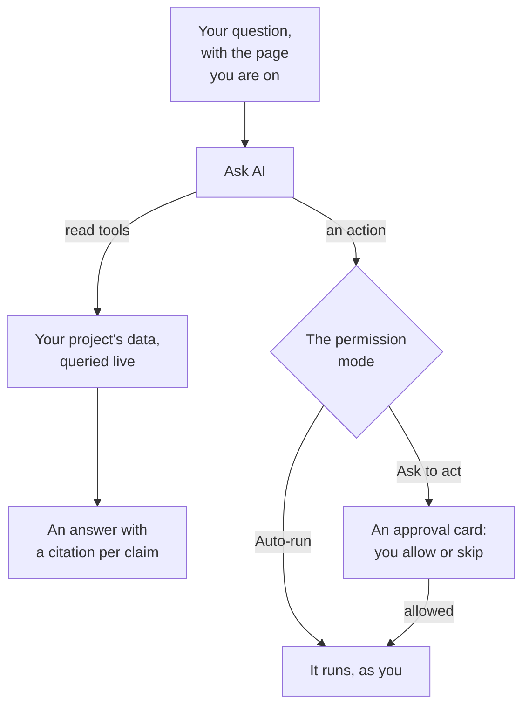

# Ask AI

Ask AI is OneUptime's chat over your project's data. Ask it about logs, traces, metrics, exceptions, incidents, alerts, monitors, on-call, status pages, SLOs, runbooks or workflows: it queries your project live, answers with a citation on every claim, and, when you allow it, acts for you.

:::cards
- [Open Ask AI](#open-ask-ai): From the header, the keyboard, a chart or its own page.
- [What it can see](#what-it-can-see): The data it reads to answer you.
- [Actions and permission modes](#actions-and-permission-modes): Choose whether it may act, and when it asks first.
- [Actions are made as you](#actions-are-made-as-you): Your permissions, your name on every change.
:::

## How Ask AI answers

Ask AI answers only from what its tools return: it runs queries against your project rather than answering from memory. Each fact in an answer carries a citation chip that shows the query behind it and opens the data it read. When you ask it to change something, the conversation's permission mode decides whether it asks you first. Before your question, it reads the project's [AI context](/docs/ai/ai-context): what your team wrote down for OneUptime AI about your own systems.

In **Read-only** mode the actions are never offered to the model, so the conversation only reads.

## Open Ask AI

| Where | How |
| --- | --- |
| Any page | Click **Ask AI** in the header, or press `Ctrl` + `I` (`Cmd` + `I` on a Mac). While you type in a text box or an editor, the keys stay the editor's italics shortcut. |
| The command palette | Press `Ctrl` + `K` (`Cmd` + `K` on a Mac) and choose **Ask AI**. |
| A log error pattern, or a chart's findings | Click **Explain with AI**: Ask AI opens with the evidence as a question you can edit before you send it. |
| Its own page | Open **Products → AI → Chat** for a full-page workspace. Each conversation there has its own address, so you can bookmark a thread or paste it into an incident channel. |

On an incident or an alert, the **AI Investigation** card has a conversation of its own, **Ask OneUptime AI**, shared with everyone who can see that incident or alert: see [Talk to OneUptime AI about the incident](/docs/ai/ai-sre#talk-to-oneuptime-ai-about-the-incident).

## What it can see

Ask AI reads your project with your own permissions, so it sees what you may see and nothing more.

| Area | What Ask AI reads |
| --- | --- |
| Telemetry | Log search and histograms, trace aggregations and span trees, metrics, exceptions, security events, real user monitoring and Web Vitals, recent changes, and anomaly checks against learned baselines. |
| Infrastructure | Hosts, Docker, Podman, Kubernetes, Docker Swarm, Proxmox, VMware vCenter, Ceph, storage arrays, serverless functions, cloud environments, IoT fleets and network devices: what is in the inventory, their reported connection state, metric trends, log severity counts and trace operation summaries. A query covers telemetry that names a service and an infrastructure resource alike. |
| Incident response | Incidents and alerts, with state filters ("what is active right now?"), their activity timelines (state changes, internal and public notes, the feed) and owners, and a search over past incidents to reuse how they were resolved. |
| On-call | Who is on call now, policies and escalation chains, and whether recent pages were delivered and acknowledged. |
| The AI's own work | The results of AI SRE investigations and AI Insights, so "what did the AI find?" is answered from the posted analysis instead of being worked out again. |
| Platform | Monitors (with status filters), scheduled maintenance, status pages and their announcements, SLOs, runbooks, workflow runs, probe health, teams, and the code of connected repositories. |

## Page context

Ask AI knows which page you opened it from. On an incident page, "why did this happen?" means that incident, and the composer shows a chip with the page's subject; remove it to ask about the whole project instead. If you move to another page while the panel is open, the context follows you. The conversation also remembers its first subject on the server, so a follow-up days later still resolves "this incident".

Infrastructure lists and resource pages offer questions for the kind of resource you are looking at. Open a Kubernetes cluster and ask "Which metrics changed over the last 24 hours?", or open a Docker host and ask "Summarize log severity and trace errors over the last six hours." Evidence links go back to the resource's page. Reads respect your project, resource and telemetry permissions, ownership and label restrictions included.

On a child page, the context also records the pod, container, VM, process or other child you selected. The infrastructure tools read the parent resource's telemetry; they cannot measure one child from its name alone. Ask AI says so, and does not guess a Kubernetes namespace the page does not give. A connection state is not the health of a workload, and missing telemetry does not mean a resource is healthy.

## Commands on your infrastructure

Opened on the page of a resource whose AI agent is connected (a host, a Docker or Podman host, a Docker Swarm cluster, a Proxmox cluster, a VMware vCenter, a Ceph cluster, a database server or a Kubernetes cluster), Ask AI runs commands on it through that agent when you ask: "run `uptime` on this host", or "show the last 100 lines of `journalctl -u nginx`". It answers with what came back, cited like any other evidence. Opened on an incident or an alert, it reaches the resources linked to it.

- It runs only the read-only commands an AI investigation may run on that kind of resource (see [Infrastructure AI Agents](/docs/ai/infrastructure-ai-agents)), at most 30 for one answer through each kind of agent, checked by OneUptime and again by the agent, in every permission mode. A change through the agent, such as restarting a service, never runs from Ask AI: it gives you the exact command instead, and the agent makes changes only when OneUptime AI remediates an incident or alert, under the resource's own fix settings. Ask AI's own actions, such as running a runbook, follow the conversation's permission mode, as below.
- It reaches only the resources you may view, and only while AI investigation is on for the resource.
- When it cannot run a command there (no agent is connected, the agent is offline, or AI investigation is off for the resource), it says so, with what to change, and answers from your project's data instead.

## Actions and permission modes

Every conversation has a permission mode, which you pick in the composer, beside the box you type in:

| Mode | What happens |
| --- | --- |
| **Ask to act** | The default. Ask AI proposes each action on an approval card, and nothing runs until you choose **Allow** or **Skip** for it, or **Deny all**. |
| **Auto-run** | Actions run as soon as the model asks for them, still limited to what your role may do. Use it with care. |
| **Read-only** | The actions are not offered to the model at all: Ask AI can only read. |

What Ask AI can do when a mode allows it:

- Create an incident or an alert, acknowledge or resolve incidents and alerts, and change an incident's severity.
- Link an incident or an alert to the infrastructure and services it is about. An incident or an alert it creates on a resource's page, such as a host's, is linked to that resource, and the approval card names what each action links. OneUptime AI investigates and fixes what an incident or alert is linked to.
- Post an internal note on an incident or an alert. Internal notes never show on a status page.
- Post a public status update on an incident. It is a separate action, because it notifies the status page's subscribers.
- Page an on-call policy, run a runbook, or start an AI investigation of an incident or alert.
- Propose a code change: commit to a new branch of a connected repository and open a pull request. It never writes to the default branch or a protected one, so a person still merges the change.

Ask for an incident when users are affected, and for an alert when something needs your team's attention first, such as a host's memory running high. Either one is created once and watches nothing: to be alerted every time a host's memory goes over 75%, create a [Host monitor](/docs/monitor/host-monitor#pre-built-alert-templates) from its memory template, with 75% as its threshold. Ask AI cannot create monitors. Asked for one, it says so, checks the value now, and offers to raise an alert if it is already over.

## Actions are made as you

Every action Ask AI takes is made as you: it makes the change the dashboard makes for the same action, with your own permissions in the project, and the change is credited to you. Acknowledging an incident from chat creates the same state change as the incident's state panel, so the incident's timeline and feed show that you changed its state. A page sent from chat shows you as who triggered it.

- **What each action needs.** The permission the dashboard asks for the same change. Creating an incident or an alert needs permission to create one: a role that may, or **Create Incident** or **Create Alert** in a custom role. Acknowledging or resolving an incident needs permission to change its state: **Project Owner**, **Project Admin**, **Project Member**, **Incident Admin** and **Incident Member**, or **Create Incident State Timeline** in a custom role; an alert needs the same permission for alerts (**Create Alert State Timeline**). Paging an on-call policy needs permission to execute it (**Create On-Call Duty Policy Execution Log**), and running a runbook needs permission to start runbook executions: a role that runs runbooks, for the runbooks its labels reach, or **Create Runbook Execution** in a custom role, which reaches every runbook of the project. Changing an incident's severity, starting an AI investigation of an incident or alert, and writing code to a connected repository need permission to change that incident, alert or repository. An action you may not take is refused, and the AI tells you which permission it needs. When you hold the permission but a team you belong to blocks it, the AI tells you that instead: a block on some labels refuses that action in Ask AI for every record, not only for records that carry those labels.
- **Which records.** Those you may change, as in OneUptime: with a role limited to some labels, or to the records you own, an action on any other record changes nothing. A runbook runs only when your permission to start runbook executions reaches it. On OneUptime Cloud, an action the project's plan doesn't include is refused with the plan it needs.
- **When an action is refused.** Nothing changes, and the AI tells you plainly that the action was not taken, and why, rather than trying it again.
- **Slack, Microsoft Teams and AI investigations.** The AI's answers in Slack and Microsoft Teams, and autonomous AI investigations, only read: they take none of these actions. To act from Slack or Microsoft Teams, use the buttons on OneUptime's messages, which act as you too (see [Slack](/docs/workspace-connections/slack#acting-on-incidents-alerts-and-events-from-slack) and [Microsoft Teams](/docs/workspace-connections/microsoft-teams#acting-on-incidents-alerts-and-events-from-microsoft-teams)).

## Steering a conversation

- **Stop it.** While Ask AI is working, the send button turns into a stop button. Stop a run at any time and ask something else straight away.
- **Pick the model.** The composer's provider picker lists your project's LLM providers and the global ones, with the default marked. A new conversation uses the default.
- **Rate an answer.** **Good answer** and **Poor answer** are stored with the message, so the quality of the answers can be measured over time.
- **See the cost.** The newest answer's footer shows its cost, its tokens and how many queries it ran, and every query is a citation chip that opens the data behind it.
- **Keep a copy.** **Download conversation** saves the thread with **Download as Markdown**, to read or paste into a ticket, or **Download as PDF**, to hand to someone.

## Requirements

- **An LLM provider.** Ask AI uses the project's default LLM provider (see [LLM Providers](/docs/ai/llm-provider)). On OneUptime Cloud it works out of the box with the global provider, paid from the project's AI credits; a self-hosted installation configures a provider, or the global provider environment variables. Answers are only as good as the model: a small self-hosted model without reliable tool calling answers poorly.
- **The Growth plan, on OneUptime Cloud.** A project on a lower plan sees that AI is not included in its plan, with a link to **Project Settings → Billing and Invoices → Billing**.
- **AI turned on for the project.** **Enable AI**, on **Project Settings → AI → AI Features**, turns every AI feature of the project off, Ask AI included. It is on unless someone turned it off.

Ask AI counts toward the project's own daily AI limits when the project sets them (Project Settings → AI → AI Features → More settings): once one is reached, Ask AI shows a sentence saying which limit was reached, that OneUptime AI starts again at midnight UTC, and who can raise or remove the limit. The project's owners are emailed the first time a limit is reached each day. The incident and alert daily limits never stop Ask AI. See [the project's own daily limits](/docs/ai/ai-sre#the-projects-own-daily-limits).

## Troubleshooting

:::details Ask AI says AI is not available
The panel says why before you type: the project's plan does not include AI, **Enable AI** is off, or the project has no LLM provider. Each notice links to the page that changes it.
:::

:::details An action was refused
Ask AI says which permission the action needs, or which team blocks it. Ask someone who may make the change, or ask a project owner to give your role the permission. Nothing was changed.
:::

:::details Answers are vague or never use any data
Check the model behind the provider. Ask AI needs a model that calls tools reliably; small local models often answer without running a single query. See [LLM Providers](/docs/ai/llm-provider).
:::

## Next steps

:::cards
- [AI SRE](/docs/ai/ai-sre): Let OneUptime AI investigate every new incident and alert.
- [LLM Providers](/docs/ai/llm-provider): Choose the model Ask AI and the other AI features use.
- [MCP Server](/docs/ai/mcp-server): Ask about OneUptime from Claude, Cursor or VS Code instead.
:::
