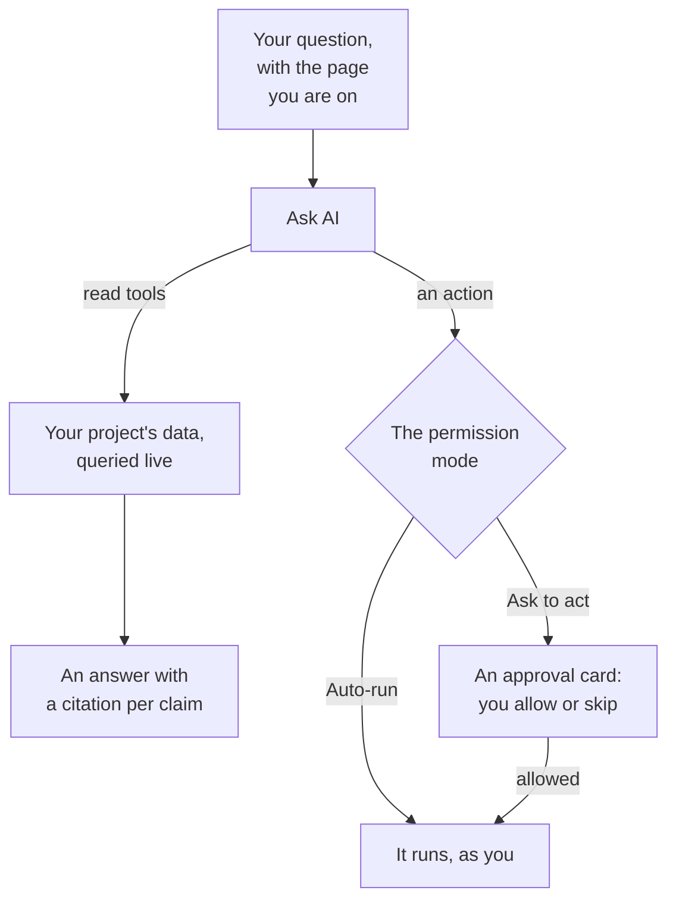

# Ask AI

Ask AI is OneUptime's chat over your project's data. Ask it about logs, traces, metrics, exceptions, incidents, alerts, monitors, on-call, status pages, SLOs, runbooks or workflows: it queries your project live, answers with a citation on every claim, and, when you allow it, acts for you.

:::cards
- [Open Ask AI](#open-ask-ai): From the header, the keyboard, a chart or the products menu.
- [What it can see](#what-it-can-see): The data it reads to answer you.
- [Actions and permission modes](#actions-and-permission-modes): Choose whether it may act, and when it asks first.
- [Actions are made as you](#actions-are-made-as-you): Your permissions, your name on every change.
:::

## How Ask AI answers

Ask AI answers only from what its tools return: it runs queries against your project rather than answering from memory. Each fact in an answer carries a citation chip that shows the query behind it and opens the data it read. When you ask it to change something, the conversation's permission mode decides whether it asks you first. Before your question, it reads the project's [AI context](/docs/ai/ai-context): what your team wrote down for OneUptime AI about your own systems.

In **Read-only** mode the actions are never offered to the model, so the conversation only reads.

## Questions about OneUptime

Ask AI also answers questions about OneUptime itself: "How do I get a text when my site is down?", "What is an episode?", "Where do I add a second phone number?". It answers them from these docs, the copy your OneUptime serves, so it works without internet access and sends nothing anywhere new. It reads a page in your language where the page is translated, cites the page and section for every step, and says the docs do not cover something rather than guess.

An answer to a "how do I" ends with a button that opens the page of your project where you do it, such as **Create Monitor** or **Notification Methods**. It only opens pages OneUptime has: the ones Search (`Ctrl` + `K`) finds.

## Open Ask AI

| Where | How |
| --- | --- |
| Any page | Click **Ask AI** in the header, or press `Ctrl` + `I` (`Cmd` + `I` on a Mac). While you type in a text box or an editor, the keys stay the editor's italics shortcut. |
| The command palette | Press `Ctrl` + `K` (`Cmd` + `K` on a Mac) and choose **Ask AI**. |
| A log error pattern, or a chart's findings | Click **Explain with AI**: Ask AI opens with the evidence as a question you can edit before you send it. |
| The products menu | Open **Products → AI → Chat**. Ask AI opens beside the page you were on. Each conversation has its own address, so you can bookmark it and come back to it. |

Ask AI opens at the side of the window, and the page makes room for it: nothing is hidden behind it, so you can keep working on the page, move to other pages and ask again. Drag its edge to make it wider or narrower. Press `Esc` in it, or click **Ask AI** again, to give the page the whole window back. With it open, `Ctrl` + `I` (`Cmd` + `I` on a Mac) goes from the page to the box you type in, and from there closes it. The conversation stays where you left it: open Ask AI again to carry on. If you close it while it is still answering, a reminder in the corner says when the answer is ready, and opens it. On a tablet or a phone, where there is no room for both, it opens over the page, and on a phone it fills the screen.

On an incident or an alert, the **OneUptime AI** card has a conversation of its own, **Ask OneUptime AI**, shared with everyone who can see that incident or alert: see [Talk to OneUptime AI about the incident](/docs/ai/ai-sre#talk-to-oneuptime-ai-about-the-incident).

## What it can see

Ask AI reads your project with your own permissions, so it sees what you may see and nothing more.

| Area | What Ask AI reads |
| --- | --- |
| Telemetry | Log search and histograms, trace aggregations and span trees, metrics, exceptions, security events, real user monitoring and Web Vitals, recent changes, and anomaly checks against learned baselines. |
| Infrastructure | Hosts, Docker, Podman, Kubernetes, Docker Swarm, Proxmox, VMware vCenter, Ceph, storage arrays, serverless functions, cloud environments, IoT fleets and network devices: what is in the inventory, their reported connection state, metric trends, log severity counts and trace operation summaries. A query covers telemetry that names a service and an infrastructure resource alike. |
| Incident response | Incidents and alerts, with state filters ("what is active right now?"), their activity timelines (state changes, internal and public notes, the feed) and owners, and a search over past incidents to reuse how they were resolved. |
| On-call | Who is on call now, policies and escalation chains, and whether recent pages were delivered and acknowledged. |
| The AI's own work | The results of AI SRE investigations and AI Insights, so "what did the AI find?" is answered from the posted analysis instead of being worked out again. |
| Platform | Monitors (with status filters), scheduled maintenance, status pages and their announcements, SLOs, runbooks, workflow runs, probe health, teams, and the code of connected repositories on GitHub, GitLab, Forgejo, Gitea and Azure DevOps (see [What AI reads in a Git repository](/docs/ai/ai-agent#what-ai-reads-in-a-git-repository)). |

## Page context

Ask AI knows which page you opened it from. On an incident page, "why did this happen?" means that incident: the composer shows a chip with the page's subject, and the questions it suggests are that page's own. Remove the chip to ask about the whole project instead, and add it back the same way. Open Ask AI on another page and the context follows you. The conversation also remembers its first subject on the server, so a follow-up days later still resolves "this incident".

On an incident, an alert, a monitor or a maintenance event, the questions also follow where that record stands, read each time Ask AI opens on it. A resolved incident asks how the response went and what would stop it happening again, a resolved alert whether it was a real problem and how often alerts like it fire, and a monitor that is not operational asks why. A maintenance event that has not started asks whether its monitors are healthy before it does, and one that has ended whether they are back to normal.

Infrastructure lists and resource pages offer questions for the kind of resource you are looking at. Open a Kubernetes cluster and ask "Which metrics changed over the last 24 hours?", or open a Docker host and ask "Summarize log severity and trace errors over the last six hours." Evidence links go back to the resource's page. Reads respect your project, resource and telemetry permissions, ownership and label restrictions included.

On a child page, the context also records the pod, container, VM, process or other child you selected. The infrastructure tools read the parent resource's telemetry; they cannot measure one child from its name alone. Ask AI says so, and does not guess a Kubernetes namespace the page does not give. A connection state is not the health of a workload, and missing telemetry does not mean a resource is healthy.

## Commands on your infrastructure

Opened on the page of a resource whose AI agent is connected (a host, a Docker or Podman host, a Docker Swarm cluster, a Proxmox cluster, a VMware vCenter, a Ceph cluster, a database server or a Kubernetes cluster), Ask AI runs commands on it through that agent when you ask: "run `uptime` on this host", or "show the last 100 lines of `journalctl -u nginx`". It answers with what came back, cited like any other evidence. Opened on an incident or an alert, it reaches the resources linked to it.

- It runs only the read-only commands an AI investigation may run on that kind of resource (see [Infrastructure AI Agents](/docs/ai/infrastructure-ai-agents)), as many as the answer needs, checked by OneUptime and again by the agent, in every permission mode. A change through the agent, such as restarting a service, never runs from Ask AI: it gives you the exact command instead, and the agent makes changes only when OneUptime AI remediates an incident or alert, under the resource's own fix settings. Ask AI's own actions, such as running a runbook, follow the conversation's permission mode, as below.
- It reaches only the resources you may view, and only while AI investigation is on for the resource.
- When it cannot run a command there (no agent is connected, the agent is offline, or AI investigation is off for the resource), it says so, with what to change, and answers from your project's data instead.

## Actions and permission modes

Every conversation has a permission mode, which you pick in the composer, beside the box you type in:

| Mode | What happens |
| --- | --- |
| **Ask to act** | The default. Ask AI proposes each action on an approval card, and nothing runs until you choose **Allow** or **Skip** for it, or **Deny all**. |
| **Auto-run** | Actions run as soon as the model asks for them, still limited to what your role may do. Use it with care. |
| **Read-only** | The actions are not offered to the model at all: Ask AI can only read. |

What Ask AI can do when a mode allows it:

- Create an incident or an alert, acknowledge or resolve incidents and alerts, and change an incident's severity.
- Link an incident or an alert to the infrastructure and services it is about. An incident or an alert it creates on a resource's page, such as a host's, is linked to that resource, and the approval card names what each action links. OneUptime AI investigates and fixes what an incident or alert is linked to.
- Write up a problem that someone is already handling, or that is already over: an incident or an alert it creates can start acknowledged or resolved, and then pages nobody. The approval card says which. See [Declared already acknowledged or resolved](/docs/incidents/declaring-incidents#declared-already-acknowledged-or-resolved).
- Post an internal note on an incident or an alert. Internal notes never show on a status page.
- Post a public status update on an incident. It is a separate action, because it notifies the status page's subscribers.
- Page an on-call policy, run a runbook, or start an AI investigation of an incident or alert.
- Set things up from a sentence: a website or API monitor, who is paged, a status page and the monitors it shows, all on one approval card. See [Set things up](#set-things-up).
- Propose a code change: commit to a new branch of a repository on GitHub, GitLab, Forgejo or Gitea and open a pull request (a merge request on GitLab). It never writes to the default branch or a protected one, so a person still merges the change. Ask AI writes each file whole, from the file as it last read it, and reads a repository's main branch unless it is asked for another. If a file changed on the branch after Ask AI read it, the card names it before you approve the commit or the pull request, for example "This file changed on fix/login after Ask AI read it, and Ask AI's version undoes that change: src/billing/charge.ts." It also names a file Ask AI read only on another branch, where it is different, a file Ask AI never read but replaces, and a file OneUptime could not check. Ask AI reads a long file a part at a time, so the card also names a file Ask AI read only part of, for example "Ask AI read only part of this file, and its version replaces all of it: src/billing/charge.ts." Once Ask AI has read all of the file, in one read or in several, the card says nothing of it. A later answer has the words of the earlier ones, not the files they read, so the card also names a file Ask AI read only in an earlier answer, for example "Ask AI read this file in an earlier answer and no longer has its text, and its version replaces all of it: src/billing/charge.ts." A very long answer also leaves out its oldest results, to stay within what the model can take in at once, so the card also names a file Ask AI read earlier in the same answer if that result was left out, for example "Ask AI read this file earlier in this answer and no longer has its text, and its version replaces all of it: src/billing/charge.ts." If Ask AI read the file in several parts and no longer has some of them, the card says so, for example "Ask AI read this file and no longer has part of its text, and its version replaces all of it: src/billing/charge.ts." Once Ask AI reads the file again in the answer that changes it, the card says nothing of it. A new file never counts. To keep what someone else changed, skip the action and ask Ask AI to read the files again. In Auto-run, where nobody approves actions, Ask AI does not make such a change: it reads the files again and makes its change on them as they are now. If a file changes while the card waits for you, approving it changes nothing, and Ask AI proposes the change again. A pull request you approve anyway lists those files in its description, for whoever reviews it. Ask AI is never shown values that look like secrets or personal data, such as IP addresses, email addresses and keys: it reads a placeholder such as `[redacted-ip]` in their place. So the card also names a file into which Ask AI's version writes such placeholders, for example "Values that look like secrets or personal data were hidden from Ask AI, and its version of this file writes placeholders in their place: config/servers.ts." A placeholder the file on the branch already has does not count. Ask AI cannot write those values back, so in Auto-run it does not make that change, and tells you what to change instead.

Ask for an incident when users are affected, and for an alert when something needs your team's attention first, such as a host's memory running high. Either one is created once and watches nothing: to be alerted every time a host's memory goes over 75%, create a [Host monitor](/docs/monitor/host-monitor#pre-built-alert-templates) from its memory template, with 75% as its threshold. Ask AI sets up only website and API monitors (see [Set things up](#set-things-up)). Asked for another kind, it says so, checks the value now, and offers to raise an alert if it is already over.

## Actions are made as you

Every action Ask AI takes is made as you: it makes the change the dashboard makes for the same action, with your own permissions in the project, and the change is credited to you. Acknowledging an incident from chat creates the same state change as the incident's state panel, so the incident's timeline and feed show that you changed its state. A page sent from chat shows you as who triggered it.

- **What each action needs.** The permission the dashboard asks for the same change. Creating an incident or an alert needs permission to create one: a role that may, or **Create Incident** or **Create Alert** in a custom role. Acknowledging or resolving an incident needs permission to change its state: **Project Owner**, **Project Admin**, **Project Member**, **Incident Admin** and **Incident Member**, or **Create Incident State Timeline** in a custom role; an alert needs the same permission for alerts (**Create Alert State Timeline**). Creating an incident or an alert that starts acknowledged or resolved needs both: permission to create it, and permission to change its state. Paging an on-call policy needs permission to execute it (**Execute On-Call Policies**), and running a runbook needs permission to start runbook executions: a role that runs runbooks, for the runbooks its labels reach, or **Create Runbook Execution** in a custom role, which reaches every runbook of the project. Changing an incident's severity, starting an AI investigation of an incident or alert, and writing code to a connected repository need permission to change that incident, alert or repository. An action you may not take is refused, and the AI tells you which permission it needs. When you hold the permission but a team you belong to blocks it, the AI tells you that instead: a block on some labels refuses that action in Ask AI for every record, not only for records that carry those labels.
- **Which records.** Those you may change, as in OneUptime: with a role limited to some labels, or to the records you own, an action on any other record changes nothing. A runbook runs only when your permission to start runbook executions reaches it. On OneUptime Cloud, an action the project's plan doesn't include is refused with the plan it needs.
- **When an action is refused.** Nothing changes, and the AI tells you plainly that the action was not taken, and why, rather than trying it again. Among the answer's steps, the action's own says it was not done, and why: your role does not allow it, a team you belong to blocks it, or the project's plan does not include it.
- **Slack, Microsoft Teams and AI investigations.** The AI's answers in Slack and Microsoft Teams, and autonomous AI investigations, only read: they take none of these actions. Asked for a change there, the AI says how to make it from the chat: `/oneuptime incident` declares an incident, `/oneuptime incident 42` shows incident 42 with its buttons, `/oneuptime page` pages someone (in Microsoft Teams, the same words typed to the OneUptime bot), and the buttons on OneUptime's messages act as you too (see [Slack](/docs/workspace-connections/slack#acting-on-incidents-alerts-and-events-from-slack) and [Microsoft Teams](/docs/workspace-connections/microsoft-teams#acting-on-incidents-alerts-and-events-from-microsoft-teams)). For any other change, it links to Ask AI, which proposes the change for you to approve. Asked in an incident's or an alert's own channel, it takes that incident or alert as the one you mean.

## Set things up

Ask AI sets up what the guided setups set up, from a sentence: "Monitor example.com every minute and text me if it is down."

- **One plan, one approval.** Ask AI proposes every part on one approval card, each in plain words: a website or API monitor, the project's first on-call policy, a status page and the monitors it shows. The card ends with "Nothing else changes." Choose **Skip** on any part you don't want, and run the rest. Nothing is created before you do.
- **Always asked.** Setting things up waits for your approval in every mode, **Auto-run** included, because it makes things that page people and that your customers see. **Read-only** doesn't offer it.
- **The guided setups' records.** The monitor is the one **Know when my website or API is down** makes for the same address: Create Monitor's defaults, opening an incident when the address does not answer or answers with an error, checked every 5 minutes unless you ask for another of Create Monitor's intervals. You own it, so you are emailed when its status changes. The status page is the one **Publish a status page** makes: public as soon as it is created, showing each monitor's status, uptime and history.
- **Who is paged.** In a project that pages nobody yet, Ask AI proposes the project's first on-call policy, "Default on-call policy", paging you, and the members and teams you name, for every new incident and alert. A project that already pages people keeps its own on-call policies and rules, and Ask AI says so instead of making another.
- **What is missing.** Ask AI never adds a phone number or the mobile app: you add and verify them in **User Settings → Notification Methods**. If you ask to be texted and have no verified number, the card says so and the answer links the page. A part Ask AI can't make isn't proposed, for example when your role doesn't allow it, the address isn't one or the monitors don't exist: the answer says what is needed.
- **What each part needs.** A monitor needs permission to create monitors. Paging needs permission to create on-call policies, their escalation rules, and incident and alert on-call rules. A status page needs permission to create status pages and to add monitors to them. The project's plan limits apply, as in the guided setups.
- **Then test it.** Once the plan runs, each card opens what was created, and **Test this policy** (or **Send me a test page**, for a monitor alone) under the answer sends a test page you acknowledge from the message. If a part fails, the answer says what was created and what was not.
- **Who is told.** Ask "who is told when example.com goes down?" and Ask AI answers from the same chain the monitor's page shows, naming every break.

## Steering a conversation

- **Stop it.** While Ask AI is working, the send button turns into a stop button. Stop a run at any time and ask something else straight away.
- **Follow its work.** While it answers, one line says what it is doing now, such as searching logs. Click the number of steps beside it to see each step.
- **Pick the model.** When your project can use more than one LLM provider, the composer's provider picker lists your project's LLM providers and the global ones, with the default marked. A new conversation uses the default.
- **Rate an answer.** **Good answer** and **Poor answer** are stored with the message, so the quality of the answers can be measured over time.
- **See the cost.** Under each answer, its sources open into the queries it ran, and the newest answer's also say how many queries it ran, its tokens and its cost. Each citation chip in an answer opens the data behind it.
- **Keep a copy.** **Download conversation** saves the thread with **Download as Markdown**, to read or paste into a ticket, or **Download as PDF**, to hand to someone.
- **Pick up where you left off.** **All conversations**, in Ask AI's header, lists your conversations, newest first, to open again or delete. A new conversation's start shows the last three.

## Requirements

- **An LLM provider.** Ask AI uses the project's default LLM provider (see [LLM Providers](/docs/ai/llm-provider)). On OneUptime Cloud it works out of the box with the global provider, paid from the project's AI credits; a self-hosted installation configures a provider, or the global provider environment variables. Answers are only as good as the model: a small self-hosted model without reliable tool calling answers poorly.
- **The Growth plan, on OneUptime Cloud.** A project on a lower plan sees that AI is not included in its plan, with a link to **Project Settings → Billing and Invoices → Billing**.
- **AI turned on for the project.** **Enable AI**, on **Project Settings → AI → AI Features**, turns every AI feature of the project off, Ask AI included. It is on unless someone turned it off.

Ask AI counts toward the project's own daily AI limits when the project sets them (Project Settings → AI → AI Features → More settings): once one is reached, Ask AI shows a sentence saying which limit was reached, that OneUptime AI starts again at midnight UTC, and who can raise or remove the limit. The project's owners are emailed the first time a limit is reached each day. The incident and alert daily limits never stop Ask AI. See [the project's own daily limits](/docs/ai/ai-sre#the-projects-own-daily-limits).

## Troubleshooting

:::details Ask AI says AI is not available
Ask AI says why before you type: the project's plan does not include AI, **Enable AI** is off, or the project has no LLM provider. Each notice links to the page that changes it.
:::

:::details An action was refused
Ask AI says which permission the action needs, or which team blocks it. Ask someone who may make the change, or ask a project owner to give your role the permission. Nothing was changed.
:::

:::details Answers are vague or never use any data
Check the model behind the provider. Ask AI needs a model that calls tools reliably; small local models often answer without running a single query. See [LLM Providers](/docs/ai/llm-provider).
:::

## Next steps

:::cards
- [AI SRE](/docs/ai/ai-sre): Let OneUptime AI investigate every new incident and alert.
- [LLM Providers](/docs/ai/llm-provider): Choose the model Ask AI and the other AI features use.
- [MCP Server](/docs/ai/mcp-server): Ask about OneUptime from Claude, Cursor or VS Code instead.
:::
