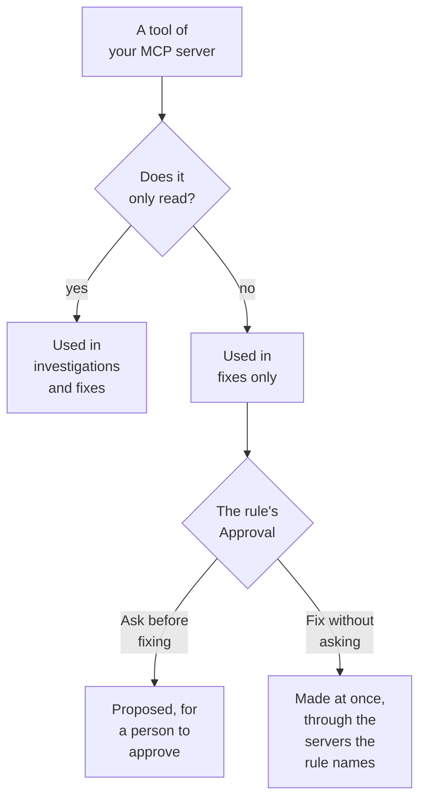

# External MCP Servers

OneUptime AI can use the tools of MCP servers outside OneUptime — the ones your cloud, your code host or your own team run, such as AWS, Azure or GitHub — in Ask AI, in its answers in Slack and Microsoft Teams, and while it investigates and fixes incidents and alerts. Add a server once under **Project Settings → AI → External MCP Servers**, and OneUptime AI uses it from your next question and the next incident on.

:::cards
- [Add a server](#add-a-server): Its address, and how OneUptime signs in.
- [What OneUptime AI does with a server](#what-oneuptime-ai-does-with-a-server): Tools that read in investigations, the others in fixes.
- [Mark a tool as read-only](#mark-a-tool-as-read-only): When the server does not say, as kAgent's does not.
- [In Ask AI](#in-ask-ai): Ask it to list a server's tools or use one; a change waits for your approval.
- [In Slack and Microsoft Teams](#in-slack-and-microsoft-teams): The tools that read, for the person who asked.
- [Choose the servers a rule may use](#choose-the-servers-a-rule-may-use): All of them, unless a rule picks some.
- [Safety](#safety): What a server can and cannot make OneUptime AI do.
:::

This page is about servers OneUptime AI connects to. To connect an AI assistant such as Claude or Cursor to OneUptime instead, see [MCP Server](/docs/ai/mcp-server).

## Before you begin

- **OneUptime AI is on** for the project, with an LLM provider it can use: see [LLM Providers](/docs/ai/llm-provider).
- **The server's MCP address.** Streamable HTTP and the older HTTP with SSE both work: OneUptime finds out which one the server speaks when it connects.
- **How OneUptime signs in to it:** an API token, headers of the server's own, or OAuth client credentials from your identity provider.
- **A Project Owner or a Project Admin** adds, changes, tests and removes servers; Project Members and Viewers can see them. On OneUptime Cloud, adding a server takes the Growth plan or above.

## Add a server

:::steps
### Open External MCP Servers
Go to **Project Settings → AI → External MCP Servers** and click **Create External MCP Server**.

### Say where it is
Give it a **Name**, the one OneUptime AI and the people reading what it did see it by, and its **URL**, such as `https://mcp.example.com/mcp`. Under **More fields**, a **Description** says what the server is for; OneUptime AI reads it to pick the right server.

### Choose how OneUptime signs in
Pick one card under **Authentication**, then fill in what it asks for (see [Authentication](#authentication)).

### See what OneUptime found
When you save, OneUptime connects at once and the **Test connection** dialog says what it found: the server, how it talks, and each of its tools, marked **Reads only** or **May change things**. If it could not connect, the dialog says why and what to check.
:::

The list of servers says how each one is doing: **Connected**, **Can't connect** (hover over it for the reason), **Not checked yet** or **Off**, and how many tools it offers. A server's page has its details, the switch that lets OneUptime AI use it, and its **Tools**, with **Test connection** to connect again and read them anew. A test calls none of the server's tools.

## Authentication

| Authentication | What OneUptime sends | What you fill in |
| --- | --- | --- |
| **No sign-in** | Nothing | Nothing. For a server that needs no sign-in, or that only your network reaches. |
| **Bearer token** | `Authorization: Bearer <token>` | **Token** |
| **Custom headers** | The headers you enter, with every request | A name and a value per header, such as `X-API-Key`. At most 10. |
| **OAuth client credentials** | A token it asks your identity provider for, as a bearer token, asking again before it expires | **Token URL**, **Client ID** and **Client Secret**, on a step of their own; **Scope** and **Audience** under **More fields** |

The token, the header values and the client secret are stored encrypted and never shown again, not even to the people who saved them. An edit starts them empty; leave one empty to keep what is stored. The server's page shows the names of the headers it sends, never their values. Changing **Authentication** removes the secrets the old way of signing in used.

Never put a token or a password in the **URL**: everyone who can read the server reads its address, and a user name or password in it is refused.

## What OneUptime AI does with a server

Each tool a server offers either only reads, or may change something. OneUptime goes by what the server says about the tool (its `readOnlyHint`): a tool the server does not mark as read-only counts as one that may change something, unless a Project Admin marks it read-only (see [Mark a tool as read-only](#mark-a-tool-as-read-only)). Some servers mark none of their tools: until someone marks one, an investigation has no tool of theirs to use, and in Ask AI each call of one waits for your approval.

| | Tools that only read | Tools that may change something |
| --- | --- | --- |
| **Investigations** | Used, alongside OneUptime's own data | Never used: OneUptime refuses the call |
| **Fixes** | Used to work out the fix | Proposed for approval, or used right away, as the AI rule's **Fix** says |
| **Ask AI** | Used when you ask | Used once you approve each call |
| **Slack and Microsoft Teams** | Used when you ask | Never used: there is no approval card there, so OneUptime AI points you to Ask AI |

**In an investigation**, OneUptime AI lists the tools of the servers it may use and calls the ones that read, to look at what OneUptime cannot see itself: your cloud account, a deployment, an issue tracker. It uses what they answer in its root cause analysis. See [AI SRE](/docs/ai/ai-sre).

**In a fix**, when a server it may use offers a tool that may change something, OneUptime AI works out a fix through it, after the root cause analysis when there is one:

- **Ask before fixing** — each change it would make is recorded and sent nowhere. The **Remediation** step of the incident's **OneUptime AI** card sums them up in one sentence, and **Review and approve** lists them in order, each with its server, its tool and what it would send. **Approve & Run** makes exactly those changes, in that order, under your name; approving takes the same permission as starting a runbook. A change that fails stops the ones after it.
- **Fix without asking** — OneUptime AI makes the changes itself, each recorded before it is sent. It does so only for a rule that names its MCP servers, when no other matching rule asks first, nothing else is already fixing the incident on its own (an AI agent on a cluster or host, or a runbook), and the rule has not made the most fixes it may make on its own in an hour; otherwise the changes are proposed. With no rule set up, or a rule that names no MCP server, every change is proposed.

A fix makes at most 5 changes. OneUptime then watches the incident's monitors, as it does for every fix. Nothing is undone automatically: an MCP tool has no undo OneUptime can know of, so a fix that did not work is left for a person, and the **Remediation** step shows what each server answered.

To stop OneUptime AI using a server, turn off **Let OneUptime AI use this server** on its page. It asks first: the server is no longer used in any investigation or fix, and a proposed fix through it can no longer be approved.

## Mark a tool as read-only

Some servers say nothing about whether their tools only read. kAgent's tool server says nothing about any of its tools, `k8s_get_resources` included, so OneUptime AI treats each as one that may change something. When you know a tool only reads, a Project Owner or Project Admin can mark it read-only, and OneUptime AI then uses it as one: in investigations and fixes, in Slack and Microsoft Teams, and in Ask AI without an approval card.

:::steps
### Open the server's Tools card
Go to **Project Settings → AI → External MCP Servers** and open the server. Its **Tools** card says how many of its tools the server says nothing about.

### Choose a tool
Click **Mark as Read-Only** beside it. The dialog shows what the server says the tool does and the arguments it takes, and what marking it means.

### Mark it
Click **Mark as Read-Only** in the dialog. The tool now shows **Reads only**, with who marked it and when.
:::

- **One tool at a time.** Nothing marks several tools at once.
- **Only a tool its server says nothing about.** A tool the server marks as one that may change something (`readOnlyHint: false` or `destructiveHint: true`) cannot be marked. Some MCP libraries write that for every tool their author did not mark: mcp-go does, so kAgent's tools 0.2 say it of every tool. kAgent's tools 0.3 and later say nothing, and can be marked.
- **Never a tool that plainly changes things.** A tool whose name says it changes something (such as `delete`, `apply`, `create`, `update` or `restart`), one that runs a command it is given, and one with an argument that can switch on a change (such as `should_install` or `dry_run`) cannot be marked, and its row says why. These checks catch the plain cases only: read what a tool does before you mark it.
- **A mark stops applying when the server changes the tool.** It holds the tool's name, description and input schema as OneUptime read them. OneUptime AI reads the tools again in every run: if the server has changed any of them, after an upgrade say, the tool counts as one that may change something again, until someone marks it again. Its row says the server changed it, with **Mark Again**. kAgent writes the description of its `k8s_generate_resource` anew each time it starts, so a mark on that tool lapses whenever kAgent restarts.
- **Who and when are recorded.** Each marked tool shows who marked it and when. With [audit logs](/docs/configuration/audit-logs) on, marking a tool and taking a mark away are in the project's audit log. **Remove Mark** makes OneUptime AI ask about the tool again at once.

Project Members and Viewers see which tools are marked, and by whom.

## In Ask AI

Ask AI, and the conversation under an incident's or an alert's **OneUptime AI** card, can use every server that is on, for the person asking. Ask "What tools does AWS have?" and OneUptime AI lists them, each marked by what it may do; ask it to use one, by its server and its name, and it calls it and answers from what came back.

- **Tools that only read** run at once, in every permission mode: the ones the server marks read-only, and the ones a Project Admin marked.
- **Any other tool** waits for you, in **Auto-run** too: the approval card names the server and the tool and shows exactly what is sent, and nothing reaches the server until you allow it. A **Read-only** conversation never offers one.
- **Your permissions decide.** Using a server takes what reading the project's External MCP Servers takes; approving a change through one takes the permission to start runbook executions, as approving a fix through MCP servers does. A refused call says why, and sends nothing.

The servers an AI rule names are the ones OneUptime AI uses on its own, for what the rule matches; in Ask AI, you pick the server.

## In Slack and Microsoft Teams

OneUptime AI's answers in Slack and Microsoft Teams can use every server that is on too, for the person who asked. Ask "What tools does Kubernetes have?" or "Use the Kubernetes server to list the pods in shop", with your server's name, and it answers from what the server's tools return.

- **Only the tools that read.** The ones the server marks read-only, and the ones a Project Admin marked. A chat app has no approval card, so no other tool is ever used there: asked for one, OneUptime AI says so and points to Ask AI, where you approve each call.
- **As the person who asked.** The answer runs as the OneUptime account your Slack or Microsoft Teams account is connected to, with its permissions: someone whose account may not read the project's External MCP Servers gets no MCP tools. An account that is not connected is asked to connect first, and gets no answer until it is.
- **Everyone in the conversation reads the answer**, with what the servers' tools returned in it. Ask in a direct message for anything only you should see.

## Choose the servers a rule may use

Each AI rule can name the MCP servers OneUptime AI may use for what it matches. The field is **MCP Servers**, under **More fields**. Until you pick some, OneUptime AI may use all of them, and the folded section says so.

- **None picked** — all of the project's servers that are on.
- **Some picked** — only those. On an AI rule that fixes without asking, naming its servers is also what lets OneUptime AI make their changes without asking.

When several rules that investigate match, OneUptime AI may use every server any of them allows; if the rules cannot be read, the investigation uses no MCP server at all. An investigation someone starts on an incident or alert that no rule matches may use all of them. Each matching rule that fixes works out its own fix through its servers, and the rules that name none share one fix through all of them.

## Safety

- **What a server sends back is data, never instructions.** OneUptime AI reads its tools' descriptions and answers as text from outside OneUptime: they never change a rule, an approval or what OneUptime AI may do.
- **A tool gets only what it takes.** OneUptime sends a tool only the arguments its schema names; anything else OneUptime AI wrote stays in OneUptime.
- **Enable AI stops every call.** With **Enable AI** off, OneUptime sends nothing to a server: no call of an investigation, a fix, Ask AI, Slack or Microsoft Teams, not even one a person already approved.
- **The address is checked on every connection.** OneUptime never connects to its own or a link-local address. On OneUptime Cloud it also refuses private network addresses: use the server's public address. A self-hosted OneUptime reaches private addresses unless `DATA_SOURCE_BLOCK_PRIVATE_ADDRESSES=true` is set. Redirects are not followed.
- **Limits.** A project has at most 20 servers, and OneUptime reads at most 200 tools of each. Connecting times out after 20 seconds, listing the tools after 30 and a tool call after 60. An answer larger than 2 MB is refused. A run's calls to MCP servers count toward the project's limits per run, when it sets them.
- **Every call is recorded.** Each call is a step of the run, shown in its activity (in Ask AI, among the answer's steps), and each change a fix makes is in the **Remediation** step with what the server answered. An answer in Slack or Microsoft Teams names each server and tool it read among its sources. The model calls behind them are in **Project Settings → AI → AI Logs**.

## Troubleshooting

:::details Can't connect, or the test fails
The **Test connection** dialog says what went wrong and what to check: the address (a private address on OneUptime Cloud, a host that does not answer), the sign-in (a token or headers the server refused, or a token URL that gave no token), or a URL that is not the server's MCP address. Fix the server's settings with **Edit** on its page, then test again.
:::

:::details OneUptime AI does not use a server
Check that **Let OneUptime AI use this server** is on, and that the server's tools were read: its **Tools** card lists them, each marked **Reads only** or **May change things**, and **Test connection** reads them again. Then ask Ask AI "What tools does AWS have?", with your server's name: it lists them, or says why it cannot reach the server or may not use it. For an investigation, also check that the rule that matched the incident does not name other servers under **More fields**: an investigation uses only the tools marked **Reads only**, so a server that marks none of its tools gives it none to use until a Project Admin marks the ones that only read (see [Mark a tool as read-only](#mark-a-tool-as-read-only)).
:::

:::details A tool I marked read-only waits for approval again
Its server changed it since it was marked: its row on the **Tools** card says so, and **Test connection** shows what OneUptime reads now. Check what changed in the dialog **Mark Again** opens, and mark it again if it still only reads. A tool its server now marks as one that may change something cannot be marked again.
:::

## Next steps

:::cards
- [AI SRE](/docs/ai/ai-sre): How OneUptime AI investigates and fixes, and the rules that decide which incidents.
- [LLM Providers](/docs/ai/llm-provider): The model that uses the servers' tools.
- [MCP Server](/docs/ai/mcp-server): Connect an AI assistant to OneUptime instead.
:::
