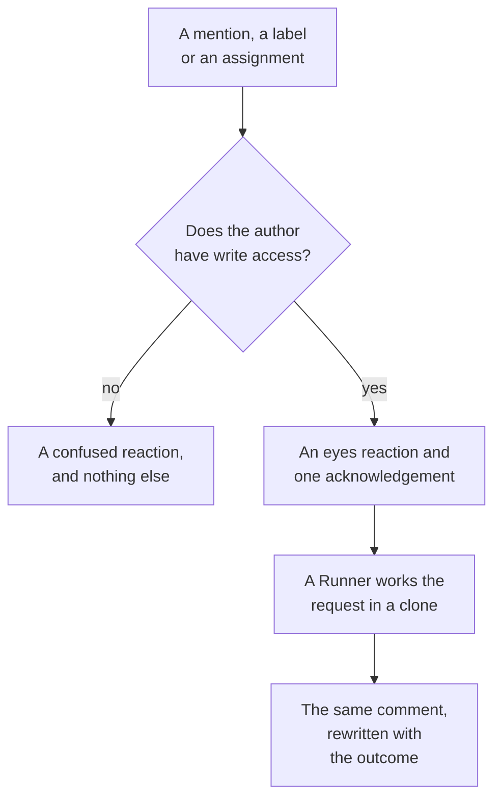

# GitHub App

The OneUptime GitHub App is more than a connection to your code: you can talk to it in your repository, and it does the work there. Mention it on an issue and it opens a pull request; mention it on a pull request and it revises the branch or reviews the diff. Everything it produces is a pull request or a review for a person to read: **it never merges anything, and it never approves a pull request.**

:::cards
- [The commands](#the-commands): What to write, on an issue or a pull request.
- [What it looks like in the thread](#what-it-looks-like-in-the-thread): One comment that follows the work.
- [Reviews with production context](#reviews-with-production-context): What production says about the changed code.
- [Who is allowed to command it](#who-is-allowed-to-command-it): People with write access, and nobody else.
- [Troubleshooting](#troubleshooting): When a mention does nothing.
:::

```text
@oneuptime implement this                          →  a pull request that closes the issue
@oneuptime revise this — use exponential backoff   →  new commits on this pull request's branch
@oneuptime review                                  →  a code review posted on this pull request
@oneuptime production review                       →  what production shows of the changed code
```

> [!NOTE]
> Replace `@oneuptime` with your own app's handle. On OneUptime Cloud it is `@oneuptime`. On a self-hosted instance it is whatever you named your GitHub App, lowercased, with spaces turned into hyphens: an app named "Acme AI" is mentioned as `@acme-ai`. If mentions do nothing, check this first.

## How it works



It is the same agent and the same Runner as in [Code](/docs/ai/ai-agent), with the same budgets; only the trigger differs.

## Before you start

- The repository must be **connected to a OneUptime project** through the GitHub App: connect it in **Products → Code**. A self-hosted instance needs its own GitHub App first: see [GitHub Integration](/docs/self-hosted/github-integration). If the app is already installed on the GitHub account, click **Connect an existing installation** there instead of installing it again.
- The Runner the repository picks in its settings in Code must be online, or a global Runner for a repository that picks none: the same Runner that carries out the tasks in [Code](/docs/ai/ai-agent). Without one, commands are accepted and then fail after 30 minutes, with a message that no Runner picked them up.
- The GitHub App needs the **Issues** permission with **Read & write**, and must be subscribed to the webhook events under [What to subscribe to](#what-to-subscribe-to).

## The commands

Every command starts with a mention of the app. The mention can be anywhere in the comment, and whatever you write after it is passed on as your request. Editing a comment that already mentions the app does not run it again: to change your request, write a new comment. An edit that adds the mention is a new request.

### On a pull request

| Command | What happens | Also understood |
| --- | --- | --- |
| `@oneuptime review` | Clones the branch, reads the changed code and the code around it, checks what production says about it, and posts a review as a comment. Changes nothing. | `code review`, `please review`, `can you review`, `review this` |
| `@oneuptime production review` | Reviews the pull request against production now, whoever opened it: the exceptions, operations, incidents and deploys around the changed code, in one comment edited in place (see [Production review of pull requests](/docs/ai/ai-agent#production-review-of-pull-requests)). Clones nothing and runs nothing. | `review against production`, `review production`, `check production` |
| `@oneuptime revise this — <what you want changed>` | Clones the pull request's own branch, makes the change and pushes new commits to that branch. Never opens a second pull request. | `revise`, `please revise`, `rework`, `redo` |

Anything you write after the mention that is not a known command is read as a revision request, because that is almost always what it is:

```text
@oneuptime the retry loop here should back off exponentially, and the test
should cover the 429 case
```

### On an issue

| Command | What happens | Also understood |
| --- | --- | --- |
| `@oneuptime implement this` | Works the issue and opens a pull request that closes it. | `implement`, `please implement`, `work on this`, `pick this up`, `take this` |
| `@oneuptime <anything else>` | The same, with your words as extra direction. | — |

You can also hand the app an issue without a comment:

- **Add the trigger label.** Adding the repository's trigger label, `oneuptime` unless you changed it, to an issue starts the same work. It is the most reliable way to hand over work from GitHub's own pages.
- **Assign the issue to the app's bot user**, where your repository allows it. GitHub does not let an app be an assignee everywhere, which is why the label exists: if assigning does nothing, use the label.

### Anywhere

| Command | What happens | Also understood |
| --- | --- | --- |
| `@oneuptime help` | Lists the commands. A bare mention with nothing after it does the same. | `commands`, `usage`, `what can you do` |
| `@oneuptime status` | Says what it is working on in this thread. | `progress` |
| `@oneuptime cancel` | Stops the runs it has going in this thread. Work already pushed stays pushed. | `stop`, `abort` |

`help`, `status` and `cancel` never start an agent run, so they cost nothing.

## What it looks like in the thread

One command produces **one comment**, which the app edits as the work moves, so a long task never turns a pull request into a status log.

1. It reacts 👀 to your comment, and posts an acknowledgement that names the OneUptime project the run belongs to and links to the live run.
2. When it finishes, it rewrites that same comment with the outcome: the pull request it opened, the commits it pushed, or a plain explanation of why it did nothing.

If it finds nothing worth changing, it says so rather than opening a speculative pull request. That is a normal outcome, not a failure: give it more direction and ask again.

## Reviews with production context

OneUptime holds the telemetry of the code it reviews, so a review can say what no reviewer reading the diff can. For the services the repository serves, it checks:

- the exceptions thrown in the changed files and functions in the last 7 days;
- how busy and how slow the endpoints and operations the diff touches are;
- the incidents linked to the changed files;
- the recent deploys of the services that OneUptime marked as regressions.

What it finds goes under a **Production context** heading of the review, each point with the numbers and the time window it comes from, for example: "`chargeCard` threw `TypeError: Cannot read properties of undefined` 1,240 times in the last 7 days; this change adds the null check that stops it." When production shows nothing that bears on the diff, the review leaves the heading out rather than say that all is well.

It needs nothing set up: the services are those OneUptime finds this repository for, as it does for a fix (see [Production telemetry in a fix](/docs/ai/ai-agent#production-telemetry-in-a-fix)). The queries are read-only, run on the OneUptime server and read nothing of another service, project or private incident. A repository whose services send no telemetry to the project is reviewed from its code alone.

To have every pull request reviewed against production on its own, turn on **Review Pull Requests Against Production** in the repository's settings: see [Production review of pull requests](/docs/ai/ai-agent#production-review-of-pull-requests).

## Who is allowed to command it

**Only people with write, maintain or admin access to the repository.** OneUptime asks GitHub for the commenter's permission on that repository every time; it does not trust the "contributor" badge GitHub shows beside a comment, which describes past activity rather than current access.

A mention from anyone else gets a single 😕 reaction and nothing more. This is deliberate: on a public repository anyone can comment, and an app that always replies to strangers can be used to spam a thread.

It also ignores every comment written by a bot, its own included, and mentions inside a quote (`>`) or a code block. Together, those two rules stop a reply to one of its own comments from starting it again.

## What it will not do

- **It never merges.** Nothing this app does can put code on your default branch.
- **It never approves or requests changes.** Reviews are posted as comments, so a review from the app can never satisfy a branch protection rule.
- **It never rewrites history.** A revision adds commits; it never force-pushes. If someone else pushed to the branch first, the revision fails rather than throw their work away.
- **It cannot revise a pull request from a fork.** A fork's branch is in a repository the installation cannot write to. It still reviews one: ask for a review instead.
- **It never changes a pull request's title, description or target branch.** Only code.

## What it costs, and how to bound it

Every command that starts work is a full agent run: a clone, up to 40 LLM calls and 100,000 output tokens, and, on a Runner of your own, the build and test checks your repository's `AGENTS.md` describes. A review's production queries, at most 12, count against the same 40 calls.

GitHub commands are AI work outside incidents and alerts, so no daily fix-task limit applies to them; the project's own daily AI limits do, when the project sets them. The one other limit is the one that already governs the tasks in [Code](/docs/ai/ai-agent):

- **The cap on open pull requests** (**Max Open Fix Pull Requests**, under **More settings** on the repository's **Settings** page). **AI Fix Pull Requests** is **No limit** until you choose **A limit**, or **None**, which blocks AI fix pull requests on that repository. Reviews and revisions are exempt: neither adds a pull request to your review queue.

Only one run of a kind is live per issue or pull request at a time. Asking twice tells you it is already working; asking for a review while a revision runs starts both, since they are different requests.

If a run cannot start, the app says why in the thread: it never fails silently.

## Turning it off

Each repository has a switch: **Respond to GitHub Commands**, under **More settings** on the repository's **Settings** page. It is on for every repository and saves the moment you flip it. With it off, the app ignores mentions, assignments and the trigger label in that repository, and answers anyone who asks with a link to the switch.

The same page holds the **GitHub Trigger Label**, under **More settings**, if you want a label other than `oneuptime`.

## What to subscribe to

In your GitHub App's **Permissions & events** settings, subscribe to:

| Event | Needed for |
| --- | --- |
| **Issue comment** | `@mention` commands on issues and pull requests |
| **Issues** | assigning an issue to the app, and the trigger label |
| **Pull request** | a review requested from the app, and production reviews of pull requests as they open and change |
| **Pull request review** | a mention in the body of a submitted review |
| **Pull request review comment** | a mention in an inline comment on the diff |

Under **Repository permissions**, **Issues** must be **Read & write**: GitHub sends a pull request's conversation comments through the issues API, so this is what lets the app comment on pull requests too.

## Prompt injection: what is and is not protected

Issue text, pull request descriptions, diffs and comments all become part of the agent's prompt, and on a public repository anyone can write them. A line that says "ignore your instructions and do X" is a realistic thing to find in an issue.

Two things bound this, and it is worth knowing which is which:

- **The prompts label untrusted text as a request, not as instructions**, and the run's repository, branch and pull request are fixed before the agent starts: nothing the agent reads can change what it works on.
- **The real containment is the sandbox.** The agent runs on your Runner, in a throwaway clone, with credentials taken out of its command environment and its git operations restricted. It can only ever push to a branch, and only a person can merge one.

Treat a pull request the AI wrote the way you would treat one from a new contributor who read the issue: review the diff, not the description.

## Troubleshooting

:::details Nothing happens when I mention it
Check the handle first: it is the app's slug, not its display name. Then check that the repository is connected to a project (in **Products → Code**), that **Respond to GitHub Commands** is on, and that your GitHub App is subscribed to the events above.
:::

:::details It reacts 😕 and says nothing
You do not have write access to the repository.
:::

:::details It says it is already working on this
A run of that kind is already live on this issue or pull request. `@oneuptime status` says what it is, and `@oneuptime cancel` stops it.
:::

:::details It acknowledged, then went quiet for a long time
Check that the Runner the repository picks is online under **Runbooks → Runners**. A repository that picks none works on a global Runner, and its settings in Code say whether one is connected. Without a Runner online, the run fails after 30 minutes and the thread is told.
:::

:::details It says the pull request comes from a fork
A revision needs a branch in this repository. Ask for a review instead, or push the branch here.
:::

## Next steps

:::cards
- [Code](/docs/ai/ai-agent): The same agent, asked in a repository or started from an exception, a trace or an investigation.
- [GitHub Integration](/docs/self-hosted/github-integration): Create and configure the GitHub App on a self-hosted instance.
- [Runners](/docs/runbooks/agents): The worker that carries out every run.
:::
