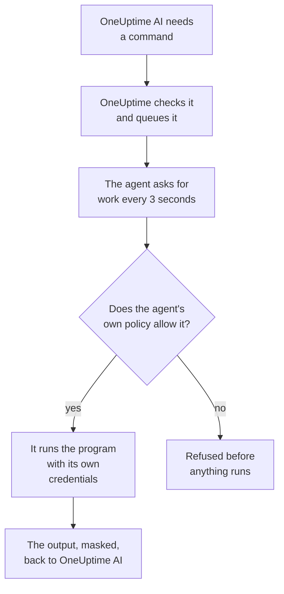

# Infrastructure AI Agents

OneUptime AI can look at more than your telemetry while it investigates an incident or alert. A small agent installed next to one of your resources — a Docker or Podman host, a Docker Swarm cluster, a Proxmox cluster, a VMware vCenter, a Ceph cluster, a database server or a Linux host — runs the read-only commands OneUptime AI asks for, such as `docker logs --tail 200 web`, `pvesh get /cluster/status`, `ceph health detail`, `db long-queries --min-seconds 30` or `journalctl -u nginx -n 200 --no-pager`, and sends the output back, so the root cause analysis cites what the resource itself says. If you allow it, the same agent also applies fixes — restarting a container, starting a VM, marking an OSD back in — each one tiered by a command policy and, unless you choose otherwise, approved by a person first. Ask AI, opened on the resource's page, runs the same read-only commands when you ask it to (see [Ask AI](/docs/ai/ask-ai)).

An AWS account, an Azure subscription or a Google Cloud project needs no agent to be investigated: OneUptime reads it live, through the read-only connection it was connected with. Only its fixes need one, the Cloud AI agent, which runs in the account itself and is set up with one command from the account's page (see [In a cloud account](#in-a-cloud-account)).

These agents are the **resource AI agents**. Each resource's dashboard page has an **AI** section with three pages:

- **Insights** — what OneUptime AI found out about the resource in the last 30 days: the problems that keep coming back and why, with what AI found and the step it suggests, the parts of the resource behind most of them, fixes that did not help or wait for approval, what AI fixed on its own, and the risks spotted before anything paged — with what AI itself did there as a footnote. It works like a cluster's — see [What AI learned on a cluster](/docs/ai/ai-sre#what-ai-learned-on-a-cluster).
- **Logs** — everything OneUptime AI did on the resource, newest first: each investigation with its incident or alert and its summary, each fix it proposed or ran, and every command it sent through the agent. (This page used to be called Insights.)
- **AI agent** — whether the agent is connected, what AI may do on the resource (investigate, and how fixes run), anything that needs attention with the step that fixes it, and, in the **⋯** menu next to the agent's status, **Test connection** and **Reset agent**.

The resource's **Overview** ends with an **AI agent** card that sums the AI agent page up: whether the agent is connected, whether investigation is on, how fixes run (**Off**, **Ask for approval**, **Automatic** or **Bypass approval**) and what needs attention, with a link to the AI agent page, where they are changed.

:::cards
- [Supported resources](#supported-resources): Eleven kinds of resource, one image.
- [Installing an AI agent](#installing-an-ai-agent): Beside a collector you already run, on a Linux host, or in a cloud account with one command.
- [How fixes work](#how-fixes-work): What may run on its own, what waits for a person, and what never runs.
- [Security model](#security-model): Three checks on every command, and no credential from OneUptime.
:::

## How it works

The agent never waits for a connection from OneUptime: it calls out to OneUptime, asks for work, and runs only what its own copy of the command policy allows, with the credentials it already has.



## How it relates to the Kubernetes AI agent

Kubernetes clusters have their own agent, the Kubernetes AI agent, installed by the Kubernetes agent Helm chart — see [Cluster access — let OneUptime AI run kubectl](/docs/ai/ai-sre#cluster-access-let-oneuptime-ai-run-kubectl). Nothing on this page changes it. The resource AI agents follow the same design:

- **The same tiers and modes.** Every command is **Read**, **SafeWrite**, **RiskyWrite** or **Denied**, and fixes are **Off**, **Ask for approval**, **Automatic** or **Bypass approval**, with the same meaning as on a cluster.
- **The same three checks.** The same command policy is enforced by OneUptime's AI tools, again when OneUptime queues the command, and again by the agent before it runs anything.
- **The same rule about credentials.** The agent uses only what its own environment and mounts give it. OneUptime never sends it a credential.
- **The same defaults.** AI investigations are on by default: a resource starts with investigation on and fixes off, like a cluster, so OneUptime AI investigates with its agent as soon as it connects, and changes nothing until someone allows fixes (see [Connecting to OneUptime](#connecting-to-oneuptime)).

What differs:

- **One image for every resource.** `oneuptime/resource-ai-agent` serves all eleven kinds of resource, and `ONEUPTIME_AI_AGENT_RESOURCE_TYPE` says which one an agent serves. It runs next to the resource's collector as one more container, or in the cloud account it serves, not from a Helm chart.
- **Write access is an environment variable.** `ONEUPTIME_AI_ALLOW_WRITES=true` on the agent lets it apply fixes at all, and `ONEUPTIME_AI_WRITE_TARGETS` limits which containers, services, VMs, OSDs, sessions or units they may touch. On a cluster the chart's RBAC and `aiAgent.remediation.namespaces` do this.

Like the Kubernetes AI agent, a resource AI agent is not a Runner. It never appears under Runbooks → Runners, and it is never used as a Bash or SSH host for runbooks.

## Supported resources

| Resource             | `ONEUPTIME_AI_AGENT_RESOURCE_TYPE` | Agent                 | Registers as (the collector's variable)                                                         | Runs                                                                                                                                               | Reaches the resource through                                               |
| -------------------- | ---------------------------------- | --------------------- | ----------------------------------------------------------------------------------------------- | -------------------------------------------------------------------------------------------------------------------------------------------------- | -------------------------------------------------------------------------- |
| Docker host          | `docker`                           | Docker AI agent       | `DOCKER_HOST_NAME`                                                                              | `docker`                                                                                                                                           | the Docker socket, `/var/run/docker.sock`                                  |
| Podman host          | `podman`                           | Podman AI agent       | `PODMAN_HOST_NAME`                                                                              | `docker`, through Podman's Docker-compatible API                                                                                                   | the Podman socket, `/run/podman/podman.sock`                               |
| Docker Swarm cluster | `docker-swarm` (or `swarm`)        | Docker Swarm AI agent | `DOCKER_SWARM_CLUSTER_NAME`                                                                     | `docker`                                                                                                                                           | a manager node's Docker socket                                             |
| Proxmox cluster      | `proxmox`                          | Proxmox AI agent      | `PROXMOX_CLUSTER_NAME`                                                                          | `pvesh` commands, sent to the Proxmox VE API (there is no `pvesh` binary in the agent)                                                             | `https://PVE_HOST:8006/api2/json`, with a Proxmox API token                |
| VMware vCenter       | `vmware` (or `vcenter`)            | VMware AI agent       | `VMWARE_VCENTER_NAME`                                                                           | `govc`                                                                                                                                             | vCenter's API, with a vSphere user                                         |
| Ceph cluster         | `ceph`                             | Ceph AI agent         | `CEPH_CLUSTER_NAME`                                                                             | `ceph`                                                                                                                                             | the monitors, with a `ceph.conf` and the keyring of the agent's own client |
| Database server      | `database` (or `db`)               | Database AI agent     | `DATABASE_SERVER_ID`, or `DATABASE_SYSTEM` + `DATABASE_SERVER_ADDRESS` + `DATABASE_SERVER_PORT` | `db` — one operation from a fixed diagnostic catalog, never SQL                                                                                    | the database's own driver, with a database login                           |
| Host                 | `host`                             | Host AI agent         | `HOST_NAME` (empty: the host's own hostname)                                                    | `systemctl`, `journalctl`, `df`, `free`, `uptime`, `ps`, `ss`, `ip`, `dmesg`, `lsblk`, `cat`, `top`, `uname`, `hostnamectl`, `timedatectl`, `kill` | `nsenter` into the host's namespaces, from a privileged container          |
| AWS account          | `aws`                              | Cloud AI agent        | `AWS_ACCOUNT_ID` (empty: the account it runs in)                                                | `cloud` — one operation from a fixed catalog, never an `aws` command                                                                               | the AWS APIs, with IAM roles of its own                                    |
| Azure subscription   | `azure`                            | Cloud AI agent        | `AZURE_SUBSCRIPTION_ID` (its setup command sets it)                                             | `cloud` — one operation from a fixed catalog, never an `az` command                                                                                | Azure Resource Manager, as its Container App's managed identity            |
| Google Cloud project | `gcp` (or `google-cloud`)          | Cloud AI agent        | `GOOGLE_CLOUD_PROJECT` (empty: the project it runs in)                                          | `cloud` — one operation from a fixed catalog, never a `gcloud` command                                                                             | the Google Cloud APIs, as a service account of its own                     |

Database servers: the Database AI agent has diagnostics for PostgreSQL, MySQL (and MariaDB and Percona Server), Redis (and Valkey, KeyDB and Dragonfly) and MongoDB. For any other engine it runs nothing and says so on the database's AI agent page.

**Test connection**, in the **⋯** menu next to the agent's status on the AI agent page, runs these read-only commands through the agent and shows their output in the agent's card:

| Resource             | Test connection runs                                 |
| -------------------- | ---------------------------------------------------- |
| Docker host          | `docker version`, `docker info`                      |
| Podman host          | `docker version`, `docker info`                      |
| Docker Swarm cluster | `docker version`, `docker node ls`                   |
| Proxmox cluster      | `pvesh get /version`, `pvesh get /cluster/status`    |
| VMware vCenter       | `govc about`                                         |
| Ceph cluster         | `ceph health`, `ceph versions`                       |
| Database server      | `db ping`, `db version`                              |
| Host                 | `uptime`, `systemctl list-units --failed --no-pager` |
| AWS account          | `cloud whoami`                                       |
| Azure subscription   | `cloud whoami`                                       |
| Google Cloud project | `cloud whoami`                                       |

On a Docker Swarm worker `docker node ls` fails: the Docker Swarm AI agent must run on a manager node. One started on a worker does not register for the cluster until its node is a manager, and the Docker Swarm installer leaves it out on a node that is not a manager.

On a cloud account, `cloud whoami` shows the account the Cloud AI agent acts in and who it is signed in as, whether it may change anything, the changes it may make and the tag it requires, if any.

## Installing an AI agent

Every resource AI agent is the same image, `oneuptime/resource-ai-agent:release`. Beside a collector or on a host, it needs nothing in the dashboard: once it runs, it registers with OneUptime and shows up on the resource's AI agent page within a minute. A cloud account's runs in the account, from one command the account's page writes for it (see [In a cloud account](#in-a-cloud-account)).

### Next to a collector

For Docker, Podman, Docker Swarm, Proxmox, VMware, Ceph and database servers, the agent runs beside the collector you already use for that resource, and shares its `.env`: it already has `ONEUPTIME_URL`, the ingestion key and the resource's name. Each collector's `docker-compose.yml` ships the agent as one more service, and its `install.sh` starts it.

| Resource             | Collector                                                   | AI agent service (and container)  | Where it is set up                                                                    |
| -------------------- | ----------------------------------------------------------- | --------------------------------- | ------------------------------------------------------------------------------------- |
| Docker host          | [Docker Agent](/docs/telemetry/docker-host#ai-agent)        | `oneuptime-docker-ai-agent`       | `agents/DockerAgent/docker-compose.yml`; `install.sh` starts it as a second container |
| Podman host          | [Podman Agent](/docs/telemetry/podman-host#ai-agent)        | `oneuptime-podman-ai-agent`       | `agents/PodmanAgent/docker-compose.yml`; `install.sh` starts it as a second container |
| Docker Swarm cluster | [Docker Swarm Agent](/docs/telemetry/docker-swarm#ai-agent) | `oneuptime-docker-swarm-ai-agent` | `agents/DockerSwarmAgent/docker-compose.yml`, on a manager node                       |
| Proxmox cluster      | [Proxmox Agent](/docs/telemetry/proxmox#ai-agent)           | `oneuptime-proxmox-ai-agent`      | `agents/ProxmoxAgent/docker-compose.yml`                                              |
| VMware vCenter       | [VMware Agent](/docs/telemetry/vmware#ai-agent)             | `oneuptime-vmware-ai-agent`       | `agents/VMwareAgent/docker-compose.yml`                                               |
| Ceph cluster         | [Ceph Agent](/docs/telemetry/ceph#ai-agent)                 | `oneuptime-ceph-ai-agent`         | `agents/CephAgent/docker-compose.yml`, with the agent's own Ceph client in `./ceph`   |
| Database server      | [Database Agent](/docs/telemetry/databases#ai-agent)        | `oneuptime-database-ai-agent`     | `agents/DatabaseAgent/docker-compose.yml`                                             |

A collector installed before the AI agent existed does not run it yet. Re-run its `install.sh`: it now starts the AI agent too (the Proxmox, VMware, Ceph, database and Docker Swarm installers download the current `docker-compose.yml`, which has the AI agent service). If you manage the files yourself, add the service from the collector's `docker-compose.yml` to yours and run `docker compose up -d`. The resource's AI agent page shows the exact service for that resource, with its name already filled in.

Without the installers, the Docker AI agent is one `docker run`:

```bash
docker run -d \
  --name oneuptime-docker-ai-agent \
  --user 0:0 \
  --restart unless-stopped \
  --read-only --tmpfs /tmp \
  -v /var/run/docker.sock:/var/run/docker.sock:ro \
  -e ONEUPTIME_URL="https://oneuptime.com" \
  -e ONEUPTIME_SERVICE_TOKEN="YOUR_TELEMETRY_INGESTION_TOKEN" \
  -e ONEUPTIME_AI_AGENT_RESOURCE_TYPE=docker \
  -e DOCKER_HOST_NAME="my-docker-host" \
  oneuptime/resource-ai-agent:release
```

`DOCKER_HOST_NAME` must be the name the Docker Agent reports. The Docker and Podman installers take `--no-ai-agent` (or `ONEUPTIME_INSTALL_AI_AGENT=false`) to leave the AI agent out, and so does the Docker Swarm installer. To run a collector without it later, delete its AI agent service from `docker-compose.yml`, or `docker rm -f` its container.

### Host AI agent

A Linux host that reports through the [Host OpenTelemetry Collector](/docs/telemetry/host-otel-collector) has no OneUptime container to sit beside, so the Host AI agent comes with its own installer (`agents/HostAIAgent`):

```bash
curl -fsSL https://raw.githubusercontent.com/OneUptime/oneuptime/master/agents/HostAIAgent/install.sh -o install.sh
sudo bash install.sh
```

It asks for your OneUptime URL, the project's telemetry ingestion key and the host's name, writes `/opt/oneuptime-host-ai-agent/.env` and `docker-compose.yml`, and starts the container `oneuptime-host-ai-agent`. Add `--systemd` to run it under the `oneuptime-host-ai-agent` systemd unit instead. It needs Docker (the system engine, not rootless Docker) with the Compose plugin; rootful Podman can run the same container.

The Host AI agent runs the **host's own** programs: every command runs as `nsenter --target 1 --mount --uts --ipc --net --pid -- PROGRAM ARGS`, which enters the namespaces of the host's init. That needs `pid: host`, `privileged: true` and root — see [The Docker socket and the Host AI agent are root on the host](#the-docker-socket-and-the-host-ai-agent-are-root-on-the-host). Leave `HOST_NAME` empty to use the host's hostname, which is what the collector reports as `host.name` unless you changed it; otherwise set it to the name shown under **Hosts**.

### In a cloud account

An AWS account, an Azure subscription or a Google Cloud project has no collector for an agent to sit beside, and OneUptime reads it without one (see [Cloud accounts](#cloud-accounts)). Its Cloud AI agent, which makes the fixes, runs in the account itself and is set up from the account's page with one command, with no compose file and no `.env`:

1. Under Cloud → Accounts, open the account and select **Let AI fix problems** in the **AI agent** card of its **Overview**.
2. Answer the one question, **How far may AI go?**: **Ask me first**, the default, sets **Fixes** to **Ask for approval**, and **Fix safe problems on its own** to **Automatic**. **Advanced** holds the rest: which changes AI may make, the resources it must never change, changing only resources tagged `oneuptime-ai=allow`, **Bypass approval**, reading the account's logs, and the agent's variables for running it somewhere else.
3. Run the command it shows in the cloud's own shell, signed in to that account. It writes the agent's role from the changes turned on and starts the agent, which connects on its own within a few minutes: there is nothing to paste back. If it does not connect, its log says why (see [Logs and status](#logs-and-status)).

| Cloud                | Run it in          | What the command creates                                                                                                                                                                                           |
| -------------------- | ------------------ | ------------------------------------------------------------------------------------------------------------------------------------------------------------------------------------------------------------------ |
| AWS account          | AWS CloudShell     | A CloudFormation stack, `oneuptime-ai-agent`, that runs one ECS Fargate task. Its task role may only assume the write role `OneUptimeAiAgentWrite`, which holds the permissions of the changes turned on.          |
| Azure subscription   | Azure Cloud Shell  | A Container App, `oneuptime-ai-agent`, in the resource group `oneuptime-ai-agent`. Its managed identity holds a custom role on the subscription with the permissions of the changes turned on.                     |
| Google Cloud project | Google Cloud Shell | A Cloud Run service, `oneuptime-ai-agent`, with CPU always allocated, running as the service account `oneuptime-ai-agent`, which holds a custom role on the project with the permissions of the changes turned on. |

The command works only in the account it was written for: on AWS it creates nothing in a shell signed in to another account, and the Azure and Google Cloud commands name their subscription or project on every call. It sets `ONEUPTIME_AI_INVESTIGATION=true`, `ONEUPTIME_AI_FIXES` from your answer, `ONEUPTIME_AI_ALLOW_WRITES=true`, and `ONEUPTIME_AI_CLOUD_ACCOUNT_ID` to the account it was written for. The agent registers as the account its cloud says it is in and never adds one to OneUptime: started in another account than its command's, it is refused, and the account it was written for says why on its page; started in an account no connection of the project reads, it is refused too, and its log says so.

To change anything, run the command again: open **Let AI fix problems** once more, or select **Change** on the account's **AI agent** page, and run the command it writes. The role always holds only the changes turned on. A cloud account's **AI** section has two pages, **AI agent** and **Logs**, and what the agent costs is on [Connect a Cloud Account](/docs/telemetry/cloud-accounts#let-ai-fix-problems).

### Connecting to OneUptime

The agent registers with the **same identity the collector reports** — `DOCKER_HOST_NAME`, `PROXMOX_CLUSTER_NAME`, `CEPH_CLUSTER_NAME`, … (`ONEUPTIME_AI_AGENT_RESOURCE_NAME` overrides it) — so it serves exactly the resource the collector's telemetry created. When OneUptime has no resource of that name yet, registration creates it, so a name that differs from the collector's gives you a second, empty resource instead of an error. A database registers by `DATABASE_SERVER_ID` when it is set, else by its engine, address and port; a `DATABASE_SERVER_ID` that is not a database of this project is refused.

If the collector still uses its default name (`docker-host`, `podman-host`, `docker-swarm`, `proxmox-cluster`, `vmware-vcenter`, `ceph`), every resource installed with that default reports into the same resource in OneUptime, and commands for it could reach any of them. The agent warns about this in its log; give each resource a unique name, on the collector and the agent alike.

It authenticates with the project's telemetry ingestion key — the first one set of `ONEUPTIME_API_KEY`, `ONEUPTIME_TELEMETRY_INGESTION_KEY` and `ONEUPTIME_SERVICE_TOKEN`, which the collectors already set — and receives a key of its own. All of its calls are HTTPS `POST`s to `<ONEUPTIME_URL>/resource-ai-agent-ingest/…`: it registers once at start, heartbeats every 30 seconds (it counts as online for 5 minutes after the last one), asks for work every 3 seconds, and signs off when it stops. A second agent with the same identity is refused while the first one is online: a container that stops cleanly signs off, so its replacement is admitted at once, and after a crash or a kill the replacement takes over once the old one has sent nothing for 40 seconds after the first refusal. If it is still refused after 10 minutes, another live agent uses the same identity: the agent logs an error saying so and asks only every 5 minutes until you give each resource its own name or stop the other agent. A project holds at most 250 resource AI agents, and at most 30 new ones register per hour. Once the 250 are reached, agents not heard from in 7 days are removed to make room for a new one (the resource keeps its AI settings, and such an agent that comes back simply registers again).

**Investigation** is on for every resource from the start, so OneUptime AI investigates with the agent as soon as it connects. Beyond that, what AI may do on the resource is the agent's own setting (see [What AI may do, set by the agent](#what-ai-may-do-set-by-the-agent)). An agent that names neither setting uses its defaults: it turns **investigation** on for its resource and, if it allows writes (`ONEUPTIME_AI_ALLOW_WRITES=true`), sets **Fixes** to **Ask for approval**, else **Off**. Its defaults apply only to a resource whose AI settings nobody has chosen on the AI agent page: settings someone saved there stay as they are until the agent's configuration names them, so a resource whose **Investigate** switch someone turned off stays off. An agent older than these settings reports neither, and the AI agent page sets them, as before.

**Reset agent**, in the same **⋯** menu on the AI agent page, makes OneUptime forget the agent's key once you confirm it; whatever held it is locked out, and the real agent registers again within a few minutes. The agent needs a OneUptime server of the same version as its image, or newer.

### What AI may do, set by the agent

Investigation and fixes are set where the agent runs — in the `.env` it shares with the collector, or its container's environment — and OneUptime follows them:

| Variable                     | Default | What it does                                                                                                                                                                                                                                          |
| ---------------------------- | ------- | ----------------------------------------------------------------------------------------------------------------------------------------------------------------------------------------------------------------------------------------------------- |
| `ONEUPTIME_AI_INVESTIGATION` | empty   | `true` lets AI run the read-only commands below while it investigates; `false` keeps it to the data OneUptime already has. Empty: on.                                                                                                                 |
| `ONEUPTIME_AI_FIXES`         | empty   | How AI may apply a fix: `off`, `ask-for-approval`, `automatic` or `bypass-approval` (see [Fix modes](#fix-modes)). Any mode but `off` also needs `ONEUPTIME_AI_ALLOW_WRITES=true`, and `off` keeps the agent read-only even with it. Empty: `ask-for-approval` when the agent allows writes, else `off`. |

For example, to let AI apply fixes with a person approving each one:

```bash
ONEUPTIME_AI_INVESTIGATION=true
ONEUPTIME_AI_FIXES=ask-for-approval
ONEUPTIME_AI_ALLOW_WRITES=true
```

Then restart the agent (`docker compose up -d`, or run the collector's `install.sh` again with them set for a Docker or Podman host). The agent reports both when it registers and with every heartbeat, and OneUptime applies them to the resource at once. The resource's AI agent page then shows them read-only: **Change** shows these lines for the option you pick instead of saving anything, and OneUptime refuses a change made anywhere else — the API, Terraform, a master admin — while the agent sets them. The command allowlist stays on the page. A value the agent cannot read keeps that setting off, and the agent logs which one.

## What an investigation may run

An investigation only ever runs **Read** commands: they look at the resource and change nothing. OneUptime AI sees the resources linked to the incident or alert (through their monitors and telemetry, at most 10 per signal) whose AI agent is connected (a cloud account needs none) and whose **Investigate** switch is on, and runs as many commands as the investigation needs (up to 200 per investigation, a guard against a runaway loop), each cited like any other evidence. Every command is one program with its arguments — never through a shell, so pipes, redirects, `;`, `&&`, `$(…)` and `sudo` are refused with a message that says so. A command gets 30 seconds by default and 2 minutes at most, and its output is capped at 1024 KB on the agent. Nothing of that output is cut off before OneUptime AI: a long output is shown a page at a time — the first 40,000 characters, then the rest on request. If an agent does not pick a command up, OneUptime AI stops sending that resource commands for the rest of the investigation.

What each kind of resource may read is below. It is the same list the AI itself is given; everything not on it is refused.

### Docker and Podman hosts

- Containers: `docker ps -a` (also `-q`, `-n`, `-l`, `-s`, `--no-trunc`, `--filter`, `--format json`), `docker container inspect web`, `docker inspect --type container web`, `docker top web`, `docker port web`, `docker diff web`. Environment values in inspect output come back masked.
- Logs and activity: `docker logs --tail 200 web` or `docker logs --since 30m web` — a `--tail` of at most 2000 or a `--since` is required (without `--tail`, `--since` must be a duration of at most 24h), and `-f` is never allowed; `docker stats --no-stream`; `docker events --since 30m --until 0s` (both bounds required, `--until` as a duration, so the window always closes in the past).
- The engine: `docker info`, `docker version`, `docker system df` (`-v` as a table only: `-v --format json` prints every build step's command line), `docker images`, `docker image inspect nginx:1.27`, `docker network ls`, `docker network inspect bridge`, `docker volume ls`, `docker volume inspect data`.
- `--format json` (or `table` for lists) only, never a Go template, and none of docker's global flags (`-H`, `--context`, `--config`, …): they would point the CLI at another engine.

A Podman host runs the same `docker` CLI and the same policy, through Podman's Docker-compatible API.

### Docker Swarm clusters

- Nodes: `docker node ls`, `docker node ps node-1`, `docker node inspect node-1 --pretty`.
- Services: `docker service ls`, `docker service ps web --no-trunc`, `docker service inspect web --pretty` (environment values come back masked), `docker service logs --tail 200 web` (a `--tail` of at most 2000 or a `--since` is required — alone, a duration of at most 24h — never `-f`).
- Stacks: `docker stack ls`, `docker stack ps shop`, `docker stack services shop`.
- The manager's own engine: `docker ps -a`, `docker container inspect web`, `docker logs --tail 200 web`, `docker stats --no-stream`, `docker info`, `docker version`, `docker network ls`, and the rest of the Docker host reads.

### Proxmox clusters

There is no `pvesh` in the agent. A command is written in `pvesh` grammar — `get` (or `ls`) and an API path, options as `--name value` — and the agent turns it into exactly one `GET` to the Proxmox VE API with its own token. `--output-format json|json-pretty|text` picks the output; query strings are not accepted, and a write must name its node (never `localhost`).

- The cluster: `pvesh get /version`, `pvesh get /cluster/status`, `pvesh get /cluster/resources --type vm`, `pvesh get /cluster/ha/status/current`, `pvesh get /cluster/log --max 50`, `pvesh get /cluster/tasks`, `pvesh get /nodes`, and the replication, backup, pool and storage lists.
- A node: `pvesh get /nodes/pve1/status`, `pvesh get /nodes/pve1/services`, `pvesh get /nodes/pve1/storage`, `pvesh get /nodes/pve1/disks/list`, `pvesh get /nodes/pve1/rrddata --timeframe hour`, plus its network, replication, APT updates and Ceph status.
- Tasks and logs: `pvesh get /nodes/pve1/tasks --errors 1 --limit 20`, a task's status and log, `pvesh get /nodes/pve1/syslog --limit 200`, `pvesh get /nodes/pve1/journal --lastentries 200`.
- Guests (`qemu` for VMs, `lxc` for containers): `pvesh get /nodes/pve1/qemu`, `pvesh get /nodes/pve1/lxc`, `pvesh get /nodes/pve1/qemu/101/status/current`, `pvesh get /nodes/pve1/qemu/101/config` (secrets such as cloud-init passwords come back masked), pending changes, snapshots, `pvesh get /nodes/pve1/qemu/101/rrddata --timeframe hour`, and QEMU guest-agent information such as `pvesh get /nodes/pve1/qemu/101/agent/get-fsinfo`.
- Never: anything under `/access` (users, API tokens, ACLs), consoles (`vncproxy`, `termproxy`, `spiceproxy`), the QEMU monitor, guest-agent exec and file calls.

### VMware vCenter

The command comes first, then its flags, then names or inventory paths (govc ignores flags written after an argument); `-dc DATACENTER` picks a datacenter.

- `govc about`, `govc datacenter.info`, `govc ls /DC/vm`, `govc find . -type m -runtime.powerState poweredOff` — the vCenter's version and inventory (`find` filters on names, types, health and runtime properties only; `ls -json` is refused, because it loads every property of each object it lists).
- `govc vm.info web-01`, `govc host.info esx-01`, `govc datastore.info datastore1`, `govc pool.info /DC/host/cluster1/Resources` — power state, host, guest OS, IP address, VMware Tools, capacity. `vm.info` is text only: `-json` and `-e` are refused because they print the VM's `extraConfig`, where cloud-init data and passwords live.
- `govc events -n 50 /DC/vm/web-01`, `govc tasks -n 50` — recent events and tasks (at most 500, never `-f`).
- `govc metric.sample -n 12 /DC/vm/web-01 cpu.usage.average`, `govc metric.ls /DC/vm/web-01`, `govc object.collect -s /DC/vm/web-01 runtime.powerState` (runtime and health properties only), `govc host.service.ls -host esx-01`, `govc host.date.info -host esx-01`, `govc tags.ls`.
- Never: the connection, credential, TLS and debug flags (`-u`, `-k`, `-cert`, `-debug`, `-dump`, …), guest operations (`guest.*`), datastore file access, `esxcli`, `env` and every command not listed.

### Ceph clusters

- The cluster: `ceph status` (or `ceph -s`), `ceph health detail`, `ceph df detail`, `ceph versions`, `ceph progress`, `ceph quorum_status`, `ceph log last 100`.
- OSDs: `ceph osd tree`, `ceph osd df`, `ceph osd perf`, `ceph osd stat`, `ceph osd dump`, `ceph osd blocked-by`, `ceph osd find 3`, `ceph osd metadata 3`, `ceph osd ok-to-stop 3`, `ceph osd safe-to-destroy 3`.
- Pools and placement groups: `ceph osd pool ls detail`, `ceph osd pool stats`, `ceph osd pool get rbd size`, `ceph pg stat`, `ceph pg dump_stuck`, `ceph pg 1.2f query`, `ceph pg ls-by-osd 3`.
- Daemons, crashes and cephadm: `ceph mon stat`, `ceph mgr services`, `ceph mgr module ls`, `ceph fs status`, `ceph mds stat`, `ceph balancer status`, `ceph crash ls`, `ceph crash stat`, `ceph orch ps`, `ceph orch ls`, `ceph orch host ls`, `ceph orch device ls`.
- Add `--format json` (or `-f json`, `json-pretty`, `plain`) for structured output. No other option is accepted — never `-c`, `--keyring`, `--id`, `--admin-daemon`, `-i`, `-o` or `-w` — and `auth`, `config-key`, `config`, `tell` and `daemon` never run.

### Database servers

`db` is not a program: it names one operation from a fixed diagnostic catalog, which the agent runs through the database's own driver in a read-only session, with a time limit on every statement. OneUptime AI never writes SQL, a Redis command or MongoDB shell code. Flags are long only (`--limit 20` or `--limit=20`).

- `db ping`, `db version` — whether the server answers, its version and uptime.
- `db sessions --limit 20` (also `--state active`, `--user`, `--database`; `db current-ops` is the same) — the sessions and what each one runs.
- `db long-queries --min-seconds 30`, `db blocking`, `db locks` — slow statements, and who waits for a lock and who holds it.
- `db replication`, `db connections`, `db database-sizes`, `db table-sizes --limit 20`, `db top-statements --limit 10` — replication lag, connections against the limit, where the space and the time go.
- `db settings work_mem` (or every setting) — never a credential setting such as `requirepass`.
- Engine reports: `db slowlog`, `db info memory`, `db innodb-status`, `db memory`, `db keyspace`.

Query text in the output is normalized — every string and number literal becomes `?` — so your customers' data in a statement never reaches OneUptime.

### Hosts

- Services: `systemctl status nginx --no-pager -n 50`, `systemctl is-active nginx`, `systemctl list-units --failed --no-pager`, `systemctl list-timers --all`, `systemctl show nginx -p ActiveState,SubState,Result,NRestarts` (`-p` is required, and only unit-state properties are allowed — never `Environment`, and never a unit file).
- Logs: `journalctl -u nginx -n 200 --no-pager` — every read needs `-n` (at most 2000) or `--since`, never `-f`; also `-p err`, `-k`, `-b`, `--until`, `-g`, `-t`, `-o short-iso|json`; `journalctl --list-boots`, `journalctl --disk-usage`.
- Resources: `uptime`, `free -m`, `df -h`, `df -i`, `lsblk -f`, `uname -a`, `hostnamectl`, `timedatectl`, `dmesg -T --level=err,warn`.
- Processes: `ps aux --sort=-%cpu`, `top -b -n 1 -o %MEM`. Passwords on command lines come back masked.
- Network: `ss -tulpn`, `ss -s`, `ip -br addr`, `ip route`, `ip route get 1.1.1.1`.
- Kernel counters: `cat /proc/loadavg`, `cat /proc/meminfo`, `cat /proc/pressure/memory`, `cat /etc/os-release` — `cat` reads only a short list of `/proc` files and `/etc/os-release`, nothing else.
- One program per command, named without a path: never a shell, `sudo` or any other program.

### Cloud accounts

OneUptime reads an AWS account, an Azure subscription or a Google Cloud project itself, live, through the account's read-only connection (see [Connect a Cloud Account](/docs/telemetry/cloud-accounts)): these reads run on OneUptime and need no agent, so an investigation reads a linked account whether or not a Cloud AI agent runs in it. A command is `cloud`, one operation from a fixed catalog and one resource's id, exactly as the account's inventory lists it: an ARN such as `arn:aws:ecs:us-east-1:123456789012:service/prod/web`, an Azure resource ID such as `/subscriptions/00000000-0000-0000-0000-000000000000/resourceGroups/prod/providers/Microsoft.Web/sites/web`, or a Google Cloud full resource name such as `//run.googleapis.com/projects/my-project/locations/us-central1/services/web`. There is never an `aws`, `az` or `gcloud` command, and flags are long only, each one given once.

- `cloud describe RESOURCE` — the resource's live settings and status. On AWS, a resource that is not an ECS service, EC2 instance, RDS instance, Aurora cluster, Auto Scaling group, Lambda function, Lambda alias, SQS queue, target group or load balancer is read from OneUptime's copy of the account's last read, marked NOT LIVE.
- `cloud recent-events RESOURCE [--hours N] [--limit N]` — what the platform did to the resource lately: deployments and service events, RDS events, scaling activities, resource health and activity log entries (`--hours` 6 by default, up to 72).
- `cloud target-health RESOURCE` — AWS only: which backends a target group or load balancer counts as healthy, and why the others are not.
- `cloud quota-usage RESOURCE [--limit N]` — the account's usage against its limits for the resource's service, in the resource's region.
- `cloud read-logs RESOURCE [--filter TEXT] [--minutes N] [--limit N]` — the resource's log lines, newest first, only those containing `--filter` when it is given (`--minutes` 60 by default, up to 1440). Log lines can hold customer data, so this read is off until someone turns on **Let AI read this account's logs during investigations**, under **Advanced** in **Let AI fix problems**, which is saved at once, with no command to run.
- `cloud whoami` — the one read that runs on the Cloud AI agent: the account it acts in, whether it may change anything and which changes. **Test connection**, in the **⋯** menu next to the agent's status, runs it.

`--limit` is 50 rows by default, 200 at most. A read's answer is cut at 64 KB, at a line, and an account takes at most 30 live reads a minute.

## How fixes work

Fixes are off until you turn them on, and that takes two settings on the agent: `ONEUPTIME_AI_FIXES` set to a mode other than `off` (see [What AI may do, set by the agent](#what-ai-may-do-set-by-the-agent)), and `ONEUPTIME_AI_ALLOW_WRITES=true` (see [Write access on the agent](#write-access-on-the-agent)). Either one alone changes nothing. An agent older than `ONEUPTIME_AI_FIXES` takes **Fixes** from the resource's AI agent page instead. Fixes also need AI to be enabled for the project (**Enable AI** under Project Settings → AI → AI Features), which it is unless someone turned it off.

### Fix modes

Fixes have the same four modes as on a Kubernetes cluster — `ONEUPTIME_AI_FIXES` writes them `off`, `ask-for-approval`, `automatic` and `bypass-approval`:

- **Off** — AI only investigates.
- **Ask for approval** — after the root cause analysis, OneUptime AI diagnoses with read commands and composes the smallest plan that addresses the cause, for example `docker restart web`. The plan appears on the incident or alert with its rationale, expected effect and rollback; a person approves it with one click, and OneUptime runs exactly those commands.
- **Automatic** — safe changes (**SafeWrite**) run on their own; a riskier change (**RiskyWrite**) is proposed for approval, unless the resource's command allowlist names its exact shape.
- **Bypass approval** — every change the policy allows, riskier ones included, runs on its own. What always needs a person still waits for one.

After a fix runs, OneUptime watches the incident's or alert's monitors. If they do not recover, the plan's rollback runs and OneUptime AI composes one more plan, with the failed attempt in front of it — at most two rounds per incident or alert. In **Automatic** mode that second round asks for approval; in **Bypass approval** it runs on its own too. Unattended fixes are circuit-broken to three per resource per hour: past that, or while another unattended OneUptime AI round is still changing or verifying the same resource, a round proposes its plan for approval instead of running it.

One incident or alert gets one AI fix lane. When it is linked to a Kubernetes cluster whose fixes are on, the cluster's round runs and no resource round does. Otherwise the first linked resource with fixes on and a ready agent gets the round, in this order: Docker host, Podman host, Docker Swarm cluster, Proxmox cluster, VMware vCenter, Ceph cluster, Database server, Host, AWS account, Azure subscription, Google Cloud project. The round only changes that resource.

### Safe, riskier and never

| Tier           | What it means                                                                                                                         | Runs                                                                                                         |
| -------------- | ------------------------------------------------------------------------------------------------------------------------------------- | ------------------------------------------------------------------------------------------------------------ |
| **Read**       | Looks at the resource and changes nothing                                                                                             | In investigations and fix rounds, always                                                                     |
| **SafeWrite**  | A reversible change to exactly one named object: restart one container, start one VM, mark one OSD in, restart one unit               | On its own in **Automatic** and **Bypass approval**; after approval in **Ask for approval**                  |
| **RiskyWrite** | A change that can take something down or change what runs: stop, kill, shut down, scale to zero, a new image, several objects at once | On its own in **Bypass approval**, or in **Automatic** when the allowlist names it; otherwise after approval |
| **Denied**     | Everything else — above all anything that runs code, deletes data, reads credentials or that the policy does not know                 | Never, even when a person approves it                                                                        |

Some riskier changes **always need a person** in every mode, Bypass approval included, and no allowlist entry changes that — they are marked as such in the tables below.

### Fixes on Docker and Podman hosts

|                     | Commands                                                                                                                                                                                                                                                                                              |
| ------------------- | ----------------------------------------------------------------------------------------------------------------------------------------------------------------------------------------------------------------------------------------------------------------------------------------------------- |
| **Safe**            | `docker restart web` (`-t 30` is fine), `docker start web`, `docker unpause web` — one container                                                                                                                                                                                                      |
| **Riskier**         | `docker stop web`, `docker kill -s TERM web` (TERM, INT, HUP, QUIT, USR1, USR2 or KILL), `docker pause web`, `docker update --memory 1g web` (also `--memory-swap`, `--memory-reservation`, `--cpus`, `--cpu-shares`, `--restart`, `--pids-limit`), and `docker restart web api` (several containers) |
| **Always a person** | —                                                                                                                                                                                                                                                                                                     |
| **Never**           | `docker exec web sh`, `docker run nginx`, `docker rm web`, `docker system prune`, `docker cp web:/etc/passwd .`, `docker compose up -d`, create, build, pull, push, login, commit, save, load, network and volume changes, swarm commands and any other `update` flag                                 |

### Fixes on Docker Swarm clusters

|                     | Commands                                                                                                                                                                                                                                                                                                                                |
| ------------------- | --------------------------------------------------------------------------------------------------------------------------------------------------------------------------------------------------------------------------------------------------------------------------------------------------------------------------------------- |
| **Safe**            | `docker service update --force web` (a rolling restart), `docker service rollback web`, `docker service scale web=3` (to 1 or more) — one service                                                                                                                                                                                       |
| **Riskier**         | `docker service scale web=0`, `docker service update --image nginx:1.27 web`, `docker service update --replicas 5 web`, `docker service update --limit-memory 1g web` (also CPU limits, reservations and the update policy), `docker node update --availability active node-1`                                                          |
| **Always a person** | `docker node update --availability drain node-1`, `docker node update --availability pause node-1`                                                                                                                                                                                                                                      |
| **Never**           | `docker service rm web`, `docker stack deploy -c stack.yml shop`, `docker secret ls`, `docker node rm node-1`, `docker service update --env-add A=b web` (environment, mounts, secrets, networks, ports, user), configs, node promotion and labels, and `docker restart web` — changing one container on the manager is not a Swarm fix |

Right before a change runs, the Docker, Podman and Docker Swarm AI agents look its target up on the engine, and refuse a change whose target makes it more than its tier says: stopping or killing a container started with `--rm` (docker would delete it and its anonymous volumes), starting a stopped one-off container made by `docker compose run` (its job would run again), and any update, scale or rollback of a Swarm job service (`replicated-job` or `global-job`: each one runs the job again). Such a change is left to a person, whoever approved it.

### Fixes on Proxmox clusters

A fix is `create` and an API path — one `POST` to the Proxmox VE API. `{type}` is `qemu` for a VM and `lxc` for a container. The agent follows the task a fix starts until it stops, so a guest that fails to start is reported as a failed fix, with the task's log.

|                     | Commands                                                                                                                                                                                                                                                                                                                                                                                                                                                                                                                   |
| ------------------- | -------------------------------------------------------------------------------------------------------------------------------------------------------------------------------------------------------------------------------------------------------------------------------------------------------------------------------------------------------------------------------------------------------------------------------------------------------------------------------------------------------------------------- |
| **Safe**            | `pvesh create /nodes/pve1/qemu/101/status/start`, `pvesh create /nodes/pve1/lxc/102/status/start`, `pvesh create /nodes/pve1/qemu/101/status/resume`, `pvesh create /nodes/pve1/qemu/101/status/reboot` — one guest                                                                                                                                                                                                                                                                                                        |
| **Riskier**         | `pvesh create /nodes/pve1/qemu/101/status/shutdown`, `pvesh create /nodes/pve1/qemu/101/status/stop`, `pvesh create /nodes/pve1/qemu/101/status/suspend`, `pvesh create /nodes/pve1/qemu/101/status/reset`, and `pvesh create /nodes/pve1/services/pveproxy/restart` (start, restart or reload of pveproxy, pvedaemon, pvestatd, pve-ha-lrm, pve-ha-crm, spiceproxy, pvescheduler, pve-firewall, chrony, cron or postfix)                                                                                                  |
| **Always a person** | `pvesh create /nodes/pve1/qemu/101/migrate --target pve2`, `pvesh create /nodes/pve1/services/corosync/restart` (and starting, restarting or reloading `pve-cluster`)                                                                                                                                                                                                                                                                                                                                                      |
| **Never**           | `pvesh set /nodes/pve1/qemu/101/config --memory 4096` (any configuration change), `pvesh delete /nodes/pve1/qemu/101`, `pvesh create /nodes/pve1/services/pveproxy/stop` (stopping a node service), `pvesh create /nodes/pve1/status --command reboot` (node reboot or shutdown), `pvesh create /nodes/pve1/stopall`, `pvesh create /nodes/pve1/qemu/101/snapshot --snapname before`, `pvesh get /access/users`, `pvesh create /nodes/pve1/qemu/101/vncproxy`, `pvesh create /nodes/pve1/qemu/101/agent/exec --command ls` |

### Fixes on VMware vCenter

Every VM is named exactly — best by its full inventory path, since govc applies a bare name to every VM that has it, in any folder — and every ESXi host by its name alone, since a path can name a whole cluster. No wildcards and no managed object references (`vm-42`), with the flags before the names.

|                     | Commands                                                                                                                                                                                                                                                                                                                                                       |
| ------------------- | -------------------------------------------------------------------------------------------------------------------------------------------------------------------------------------------------------------------------------------------------------------------------------------------------------------------------------------------------------------- |
| **Safe**            | `govc vm.power -on /DC/vm/web-01`, `govc vm.power -r /DC/vm/web-01` (a graceful guest reboot through VMware Tools) — one VM, named by its inventory path                                                                                                                                                                                                      |
| **Riskier**         | `govc vm.power -s web-01` (guest shutdown), `govc vm.power -off web-01`, `govc vm.power -reset web-01`, `govc vm.power -suspend web-01` (`-force` only with `-off` or `-reset`), `govc vm.power -on web-01 web-02` (several VMs), `govc vm.power -on web-01` (a bare name: every VM called web-01), `govc host.maintenance.exit esx-01`                        |
| **Always a person** | `govc vm.migrate -host esx-02 web-01`, `govc host.maintenance.enter esx-01`                                                                                                                                                                                                                                                                                    |
| **Never**           | `govc vm.destroy web-01` (and create, clone, change, register), `govc snapshot.create -vm web-01 before`, `govc guest.run -vm web-01 ls`, `govc vm.info -e web-01`, `govc env`, `govc host.esxcli -host esx-01 system version get`, devices and disks, datastore file access, host add, remove, reboot and shutdown, permissions, roles, sessions and licenses |

### Fixes on Ceph clusters

Every fix names one OSD (`3` or `osd.3`), PG (`1.2f`), daemon (as `ceph orch ps` lists it), service or crash report.

|                     | Commands                                                                                                                                                                                                                                                                                                                                     |
| ------------------- | -------------------------------------------------------------------------------------------------------------------------------------------------------------------------------------------------------------------------------------------------------------------------------------------------------------------------------------------- |
| **Safe**            | `ceph osd in 3`, `ceph osd unset noout` (also norebalance, nobackfill, norecover, noscrub, nodeep-scrub, pause), `ceph orch daemon restart osd.3`, `ceph pg scrub 1.2f`, `ceph pg deep-scrub 1.2f`, and archiving one crash report                                                                                                           |
| **Riskier**         | `ceph osd out 3`, `ceph osd down 3`, `ceph osd set noout`, `ceph osd reweight 3 0.8`, `ceph pg repair 1.2f`, `ceph mgr fail`, `ceph orch daemon stop osd.3`, `ceph orch restart rgw.default`, `ceph crash archive-all`, `ceph balancer on`                                                                                                   |
| **Always a person** | `ceph osd set pause` (it stops all client I/O), `ceph osd pool set rbd size 3` (and `min_size`)                                                                                                                                                                                                                                              |
| **Never**           | `ceph osd purge 3` (and destroy, rm, lost, crush changes), `ceph osd pool delete rbd` (and creating, renaming or any other pool setting), `ceph auth ls`, `ceph config-key ls`, `ceph tell osd.3 injectargs --debug-osd 20`, `ceph --id admin status`, `config`, `daemon`, fs and mon changes, `mgr module enable`, `orch apply`, `crash rm` |

### Fixes on database servers

`12345` below is a session id as `db sessions` prints it: the PostgreSQL pid, the MySQL processlist id, the Redis client id or the MongoDB opid. The agent looks the session up first, and never touches its own connection, a server or replication thread, or a session that is not there.

|                     | Commands                                                                                                                                                                                              |
| ------------------- | ----------------------------------------------------------------------------------------------------------------------------------------------------------------------------------------------------- |
| **Safe**            | `db cancel-query 12345` — cancels the statement one session runs; the session stays connected (PostgreSQL, MySQL/MariaDB, MongoDB)                                                                    |
| **Riskier**         | `db terminate-session 12345` — disconnects one session and rolls back its open transaction (PostgreSQL, MySQL/MariaDB, Redis)                                                                         |
| **Always a person** | —                                                                                                                                                                                                     |
| **Never**           | `db query "SELECT 1"`, `db sql DROP TABLE users` — no SQL, no setting changes (`ALTER SYSTEM`, `SET GLOBAL`, `CONFIG SET`), no `FLUSHALL`, no `SHUTDOWN`, no schema, data, user or replication change |

### Fixes on hosts

Units are named by their full name: `systemctl restart nginx` restarts `nginx.service`.

|                     | Commands                                                                                                                                                                                                                                                                                                                                                             |
| ------------------- | -------------------------------------------------------------------------------------------------------------------------------------------------------------------------------------------------------------------------------------------------------------------------------------------------------------------------------------------------------------------- |
| **Safe**            | `systemctl restart nginx`, `systemctl start nginx`, `systemctl reload nginx`, `systemctl reset-failed nginx` (also `try-restart` and `reload-or-restart`) — one service, socket, timer or path unit                                                                                                                                                                  |
| **Riskier**         | `systemctl stop nginx`, `systemctl restart nginx php-fpm` (several units), `journalctl --vacuum-size=500M` (also `--vacuum-time`, `--vacuum-files`), and `systemctl reset-failed` without a unit                                                                                                                                                                     |
| **Always a person** | `systemctl restart sshd` and any other change to a protected unit (ssh, `systemd-*`, udev, dbus, polkit, NetworkManager, networking, getty and autovt, docker, containerd, podman, kubelet, the firewall, `user@`, and the package-upgrade units such as `apt-daily-upgrade` and `unattended-upgrades`), `systemctl restart docker`, `systemctl restart local-fs.target` (any `.target`, `.mount`, `.automount` or `.swap` unit), `kill -TERM 4242` (signalling a process) |
| **Never**           | `systemctl enable nginx` (and disable, mask, edit), `systemctl daemon-reload`, `systemctl reboot` (and poweroff, halt, suspend, rescue, and their units such as `reboot.target` and `runlevel6.target`), `systemctl start debug-shell` (a root shell with no password), `systemctl cat nginx`, `systemctl show nginx -p Environment`, `journalctl -f -u nginx`, `ip link set eth0 down`, `kill -9 1`, `cat /etc/shadow`, `bash -c uptime`, `sudo systemctl restart nginx`, `dmesg --clear`, `ss -K` |

### Fixes on cloud accounts

A change names one resource by its id, as a read does, and runs only on a resource the account's inventory lists, so OneUptime AI never changes what OneUptime does not know is there. Before it makes a change, the agent reads the value the change replaces, such as the count before a scale or the version before a roll back, and OneUptime writes the change's undo from that value, so a fix that did not help is put back exactly. A resource whose tags say code declares it (a CloudFormation stack, Terraform, Pulumi and the like) only ever gets its fix proposed for approval, in every mode, because the next apply would put the old value back; the plan names the code that owns it. A change's tier depends on the kind of resource it changes:

| Change               | AWS                                           | Azure                                                                       | Google Cloud                                       |
| -------------------- | --------------------------------------------- | --------------------------------------------------------------------------- | -------------------------------------------------- |
| `restart-service`    | Safe: ECS service                             | Riskier: App Service or Function App, Container App                         | —                                                  |
| `start-instance`     | Safe: EC2 instance, RDS instance              | Safe: virtual machine                                                       | Safe: Compute Engine VM                            |
| `scale-out`          | Safe: ECS service, Auto Scaling group         | Safe: App Service plan, VM scale set                                        | Safe: Cloud Run service, managed instance group    |
| `scale-in`           | Riskier: ECS service, Auto Scaling group      | Riskier: App Service plan, VM scale set                                     | Riskier: Cloud Run service, managed instance group |
| `reboot-instance`    | Riskier: EC2 instance, RDS instance           | Riskier: virtual machine, PostgreSQL flexible server, MySQL flexible server | Riskier: Compute Engine VM, Cloud SQL instance     |
| `roll-back-service`  | Riskier: ECS service, Lambda alias            | Riskier: App Service or Function App, Container App                         | Riskier: Cloud Run service                         |
| `set-concurrency`    | Riskier: Lambda function                      | —                                                                           | Riskier: Cloud Run service                         |
| `fail-over-database` | Always a person: Aurora cluster, RDS instance | Always a person: SQL failover group                                         | Always a person: Cloud SQL instance                |
| `stop-instance`      | Always a person: EC2 instance                 | Always a person: virtual machine                                            | Always a person: Compute Engine VM                 |
| `redrive-queue`      | Always a person: SQS queue                    | —                                                                           | —                                                  |

`scale-out` stays within the group's maximum, and at most doubles the count where the platform sets none; `scale-in` never goes below the minimum or to zero. `roll-back-service` moves to the version that ran before, or to the one `--to` names; on an App Service it swaps a deployment slot (`--slot`) back. Written out, a change reads `cloud scale-out arn:aws:ecs:us-east-1:123456789012:service/prod/web --count 4`.

**Never**, even when a person approves it: deleting or terminating anything, IAM, security groups and firewall rules, secrets and keys, storage and database contents, instance types, snapshots and restores, purging a queue, a group's minimum or maximum, and anything not in the table.

### The command allowlist

In **Automatic** mode, the resource's **Command allowlist** on the AI agent page lets riskier commands you name run without approval. It is matched word by word against the command, not as text:

- `*` stands for exactly **one whole word** — a name, an id, a value — never part of a word and never extra words or flags. `docker update --memory * web` allows any memory limit for `web`; `docker stop web-*` matches nothing, because `*` never stands for part of a word.
- Every word the command has must be in the entry, flags included, and the entry must have at least two words after the program. `*` may not stand for the verb: `docker *` and `docker * web` are refused when you save them.
- An entry that can never pre-approve a change is refused: a read-only command (reads never need approval), a command the policy denies, or one for another kind of resource. A list holds at most 50 entries of at most 500 characters.
- An entry with a `*` where the target goes — `docker stop *` pre-approves stopping **every** container — asks you to confirm before it is saved.
- A Proxmox path is one word, so it cannot hold a `*`: write one entry per guest, such as `pvesh create /nodes/pve1/qemu/100/status/shutdown`.
- Nothing on the allowlist overrides a change that always needs a person, or a command the policy denies.

One valid entry per resource: `docker stop web` (Docker and Podman), `docker service update --image nginx:1.27 web` (Docker Swarm), `pvesh create /nodes/pve1/qemu/100/status/shutdown` (Proxmox), `govc vm.power -off web-01` (VMware), `ceph osd out 3` (Ceph), `db terminate-session 12345` (databases), `systemctl stop nginx` (hosts), `cloud scale-in arn:aws:ecs:us-east-1:123456789012:service/prod/web --count 2` (AWS), `cloud restart-service /subscriptions/00000000-0000-0000-0000-000000000000/resourceGroups/prod/providers/Microsoft.Web/sites/web` (Azure), `cloud reboot-instance //compute.googleapis.com/projects/my-project/zones/us-central1-a/instances/web-1` (Google Cloud).

### Who may change it

While the agent sets investigation and fixes, they change where it runs, whoever you are, and what follows applies to the command allowlist alone. For an agent older than these settings, which leaves them to the AI agent page: turning fixes on — any move from **Off**, **Ask for approval** included — and loosening them — switching to **Automatic** or **Bypass approval**, or adding an allowlist entry — takes a Project Owner, a Project Admin or the **Edit AI Rule** permission, the same people who may create an AI rule that fixes without asking. **Reset agent** takes the same people. Tightening — **Off**, a less autonomous mode, removing allowlist entries — and the **Investigate** switch are open to anyone who may edit the resource, and so are **Test connection** and approving a fix OneUptime AI proposes for it. All of these take permission to edit that very resource: a permission limited to some labels, or to the resources you or your teams own, reaches only those resources, and a block with labels takes away the resources that carry them.

## Write access on the agent

Whatever the AI agent page says, the agent itself refuses every change unless it was started with write access. Its environment decides:

| Variable                         | Default | What it does                                                                                                                                                                                                                                       |
| -------------------------------- | ------- | -------------------------------------------------------------------------------------------------------------------------------------------------------------------------------------------------------------------------------------------------- |
| `ONEUPTIME_AI_ALLOW_WRITES`      | `false` | `true` lets the agent run changes at all. Anything else — unset, `false`, a typo, `yes` — keeps it read-only, and the agent logs a warning for a value that is neither `true` nor `false`.                                                         |
| `ONEUPTIME_AI_WRITE_TARGETS`     | empty   | Comma-separated globs of the targets a change may touch; `*` matches any run of characters, and the match is case-sensitive. Empty means any target except the protected ones. When it is set, a change that does not name its targets is refused. |
| `ONEUPTIME_AI_PROTECTED_TARGETS` | empty   | Comma-separated globs of targets OneUptime AI must never change, on top of the ones the agent protects on its own. Compared case-insensitively.                                                                                                    |
| `ONEUPTIME_AI_CLOUD_OPERATIONS`  | empty   | A Cloud AI agent only: the comma-separated changes it may make, such as `restart-service,scale-out`. Empty: every change of the catalog, each with its tier. A name the agent does not know is left out, with a warning in its log.                |
| `ONEUPTIME_AI_CLOUD_REQUIRED_TAG` | empty   | A Cloud AI agent only: a tag as `key=value`, such as `oneuptime-ai=allow`. The agent then changes only resources that carry it (as a label on Google Cloud), and on AWS its write role allows the changes on those resources alone. A value that is not `key=value` refuses every change. |

Set them in the `.env` the agent shares with the collector (or in its container's environment) and restart it with `docker compose up -d`. A list longer than 64 entries, or with an entry longer than 256 characters, keeps the agent read-only until it is fixed. A Cloud AI agent's come from its setup command, as **Which changes AI may make (their tiers still apply)**, **Resources AI must never change** and the tag under **Advanced** in **Let AI fix problems** set them: run the command again to change them.

The agent reports these settings to OneUptime with every heartbeat, so OneUptime already refuses a fix outside them when OneUptime AI proposes it and again when someone approves it — it never reaches the agent as a failed fix. The agent refuses it too, before it runs anything.

### Write targets per resource

| Resource                | A change's targets, as `ONEUPTIME_AI_WRITE_TARGETS` sees them                                                                                                                                        | Example                 |
| ----------------------- | ---------------------------------------------------------------------------------------------------------------------------------------------------------------------------------------------------- | ----------------------- |
| Docker and Podman hosts | container names or ids, as the command writes them                                                                                                                                                   | `web-*,api-*`           |
| Docker Swarm clusters   | service names (`web`, not `web=3`) and node names                                                                                                                                                    | `web_*,api_*`           |
| Proxmox clusters        | a guest's VMID (`101`); a node service as `<node>/<service>` (`pve1/pveproxy`)                                                                                                                       | `100,101,pve1/pveproxy` |
| VMware vCenter          | VM and host names or inventory paths, exactly as the command writes them — list both forms if you use paths                                                                                          | `web-*,/DC/vm/web/*`    |
| Ceph clusters           | `osd.3` (whether the command wrote `3` or `osd.3`), a pool name, a PG id, a daemon name, a service name, `mgr.NAME`, `crash/ID`, and `cluster` for cluster-wide changes such as `ceph osd set noout` | `osd.*,cluster`         |
| Database servers        | `session:<id>`                                                                                                                                                                                       | `session:*`             |
| Hosts                   | full unit names (`nginx.service`), `pid:<pid>` for a process, `journal` for a journal vacuum                                                                                                         | `nginx.service,app-*`   |
| Cloud accounts          | the resource's id: an ARN, an Azure resource ID in lowercase, or a Google Cloud full resource name                                                                                                   | `arn:aws:ecs:*:123456789012:service/prod/*` |

### What the agent protects on its own

OneUptime AI never changes the agent itself or what it runs in, whatever `ONEUPTIME_AI_WRITE_TARGETS` says:

- **Docker, Podman and Docker Swarm:** the agent's own container (by name and id) and its Swarm service, and the containers of OneUptime's Docker, Podman and Docker Swarm agents — the collectors, the Swarm inventory poller and their AI agents. Until the agent has found its own container, it refuses every change.
- **VMware vCenter:** the VM named after the host in `VCENTER_ENDPOINT` (and its short name) — normally the vCenter appliance itself — by whatever inventory path a command names it. The agent knows the appliance by that name only: when `VCENTER_ENDPOINT` is an IP address (the agent then warns at start-up), or the appliance's VM has another name, put that VM in `ONEUPTIME_AI_PROTECTED_TARGETS`.
- **Database servers:** the agent's own session.
- **Hosts:** every OneUptime unit (`oneuptime-*`, the Host AI agent's own included), the OpenTelemetry collector (`otelcol-contrib.service`, `otelcol.service`), the Docker engine it runs in (`docker.service`, `docker.socket`, `containerd.service`), and the agent's own process and the processes above it.
- **Proxmox:** the agent cannot tell which guest it runs in. If it runs in a VM or container of the same cluster, put that VMID in `ONEUPTIME_AI_PROTECTED_TARGETS`; do the same with the agent's VM on VMware.
- **Cloud accounts:** everything its setup command created: on AWS the `oneuptime-ai-agent` stack, its ECS cluster and service, and the roles `OneUptimeAiAgentTask` and `OneUptimeAiAgentWrite`; on Azure the `oneuptime-ai-agent` resource group; on Google Cloud the `oneuptime-ai-agent` Cloud Run service and service account.

## Credentials and least privilege

The agent uses only the credentials in its own environment and mounts — mostly the collector's, from the same `.env`. A job that carries a credential is refused: OneUptime never sends one. Whatever the command policy allows, the resource itself only lets the agent do what that credential may, so the credential is the hard limit. Give investigations a read-only identity, and fixes a separate one with exactly the rights they need.

| Resource                     | What the agent uses                                                                                                                                                                                                                     | For investigations                                                    | For fixes                                                                                                                                                                                                                    |
| ---------------------------- | --------------------------------------------------------------------------------------------------------------------------------------------------------------------------------------------------------------------------------------- | --------------------------------------------------------------------- | ---------------------------------------------------------------------------------------------------------------------------------------------------------------------------------------------------------------------------- |
| Docker, Podman, Docker Swarm | The engine socket, mounted into the container (`DOCKER_HOST` overrides where it is)                                                                                                                                                     | There is no read-only socket: leave `ONEUPTIME_AI_ALLOW_WRITES` unset | `ONEUPTIME_AI_WRITE_TARGETS` to the containers or services AI may change                                                                                                                                                     |
| Proxmox cluster              | `PVE_API_TOKEN_ID` / `PVE_API_TOKEN_SECRET` (the collector's token), or `ONEUPTIME_AI_PVE_API_TOKEN_ID` / `ONEUPTIME_AI_PVE_API_TOKEN_SECRET` when set; `PVE_HOST`, `PVE_PORT`, `PVE_VERIFY_SSL`, `PVE_CA_FILE`                         | The collector's `PVEAuditor` token                                    | A token of the agent's own with `VM.PowerMgmt` (for example the `PVEVMUser` role) on `/vms`, or better on a pool or single VMIDs; `Sys.Modify` on a node only if AI may restart node services                                |
| VMware vCenter               | `VCENTER_USERNAME` / `VCENTER_PASSWORD` (the collector's user), or `ONEUPTIME_AI_VCENTER_USERNAME` / `ONEUPTIME_AI_VCENTER_PASSWORD` when set; `VCENTER_ENDPOINT`, `VCENTER_INSECURE_SKIP_VERIFY`, `VCENTER_CA_FILE`, `GOVC_DATACENTER` | The collector's **Read-Only** user                                    | A user of the agent's own with `VirtualMachine.Interact.PowerOn`, `PowerOff`, `Reset` and `Suspend`, granted only on the folders AI may fix; `Host.Config.Maintenance` and migration privileges only if you want those fixes |
| Ceph cluster                 | The keyring of its own client, `client.oneuptime-ai`, and a minimal `ceph.conf`, mounted at `/etc/ceph` (`CEPH_CLIENT_ID`, `CEPH_CONF`, `CEPH_KEYRING`)                                                                                 | `mon 'allow r' mgr 'allow r' osd 'allow r'` — never the admin keyring | The read caps plus `allow command` entries for exactly the fixes (the Ceph agent's README lists them)                                                                                                                        |
| Database server              | `DATABASE_USERNAME` / `DATABASE_PASSWORD` (the collector's login), or `ONEUPTIME_AI_DATABASE_USERNAME` / `ONEUPTIME_AI_DATABASE_PASSWORD` when set; `DATABASE_ENDPOINT` and the TLS settings                                            | The collector's monitoring login (`pg_monitor` on PostgreSQL)         | A login of the agent's own that may signal other sessions: `pg_signal_backend` (PostgreSQL), `CONNECTION_ADMIN` (MySQL 8), `+client\|kill` (Redis ACL), the `killop` action (MongoDB)                                        |
| Host                         | Nothing: it runs privileged as root in the host's namespaces                                                                                                                                                                            | Leave `ONEUPTIME_AI_ALLOW_WRITES` unset                               | `ONEUPTIME_AI_WRITE_TARGETS` to the units AI may change                                                                                                                                                                      |
| Cloud accounts               | The identity of where it runs: on AWS its ECS task's role, which may only assume the write role in `ONEUPTIME_AI_AWS_WRITE_ROLE_ARN`; on Azure its Container App's managed identity; on Google Cloud its Cloud Run service's service account | Nothing: OneUptime reads the account through its read-only connection | The role its setup command writes: the permissions of the changes turned on and the reads they need, nothing else. On AWS each change assumes `OneUptimeAiAgentWrite` with a session policy for that one change on its one resource |

The collectors' READMEs have the exact commands: the `pveum` commands for a Proxmox fixes token ([ProxmoxAgent](https://github.com/OneUptime/oneuptime/tree/master/agents/ProxmoxAgent)), the vSphere fixes role ([VMwareAgent](https://github.com/OneUptime/oneuptime/tree/master/agents/VMwareAgent)), the Ceph read and fixes caps ([CephAgent](https://github.com/OneUptime/oneuptime/tree/master/agents/CephAgent)) and the database grants per engine ([DatabaseAgent](https://github.com/OneUptime/oneuptime/tree/master/agents/DatabaseAgent)). A Cloud AI agent's role is written by its setup command: turn a change off and run the command again, and its permissions leave the role.

## Security model

### Three enforcement points

Every command is an argument list, never a shell line, and the same command policy — one copy in OneUptime, a byte-identical copy in the agent — decides its tier at three points:

1. **OneUptime AI's tools.** The investigation tool refuses anything but a Read; the fix tools refuse Denied commands, apply the mode, the allowlist and the agent's reported write access, and send a change that needs a person for approval.
2. **When OneUptime queues it.** Every command is checked again: a Denied command is refused, an investigation may only queue Reads, the resource must be this project's and its agent online, the investigation or fix switch must be on, the job may carry no credential, and a change must fit the agent's reported write access. A project may queue at most 240 investigation commands and 30 fix commands an hour.
3. **On the agent, before anything runs.** The agent refuses a job that is not an AI command for its own resource (the identity it registered with, and its OneUptime id), a program its resource does not run, a command its own policy denies or ranks higher than the tier OneUptime sent, anything but a Read in an investigation, and a change while `ONEUPTIME_AI_ALLOW_WRITES` is not `true` or outside its write targets.

### How a command runs

- One program, as an argument list, never through a shell: pipes, redirects, `;`, `&&` and `$(…)` are refused before anything runs, and so is `sudo`.
- An environment built for that one command: nothing of the agent's own — not its ingestion key, not its proxy settings — reaches the program, and `docker`, `govc` and `ceph` get a private, empty home directory under `/tmp` for that one command. The `docker` CLI gets an empty private `DOCKER_CONFIG`, so no context or credential helper can change where it points; `govc` gets its credentials in its environment, never on its command line; `ceph` gets the agent's own `--conf`, `--keyring` and `--id`, and a command may not choose others.
- A time limit (at most 2 minutes), after which the program is killed; output capped at 50 KB.
- Secrets in the output — environment values in `docker inspect`, Proxmox cloud-init passwords, keys, tokens and passwords in logs and command lines — are masked on the agent before the output leaves it, and again by OneUptime before it is stored or shown to the model.
- The containers run with a read-only root filesystem. The Proxmox, VMware, Ceph and Database AI agents run as UID 1000 with no capabilities.
- A Cloud AI agent starts no program at all: `cloud` names one operation of its catalog, which the agent carries out as the one API call it maps to, with the credentials of where it runs. The reads run on OneUptime, through the account's read-only connection.

### The Docker socket and the Host AI agent are root on the host

Be clear about what two of these agents hold:

- **The Docker and Podman socket is root on the host.** Whoever can talk to it can start a privileged container that mounts the host's filesystem. Mounting it read-only (`:ro`) does not change that: a process can still connect to a socket on a read-only mount, and every API call goes through. On a Docker Swarm manager, the socket controls the whole swarm. The Docker, Podman and Docker Swarm AI agents run as root because the socket is root-owned.
- **The Host AI agent is root on the host.** It runs privileged, as root, in the host's pid namespace, and enters the host's namespaces for every command.

There is no finer-grained credential for either, so for these four agents the command policy, `ONEUPTIME_AI_ALLOW_WRITES` and `ONEUPTIME_AI_WRITE_TARGETS` are the limit — not the account. The policy never runs `exec`, `run`, `rm`, `prune`, a shell or a program outside its list, and the agent never changes itself or its collector. If that is more trust than you want to place in it, leave `ONEUPTIME_AI_ALLOW_WRITES` unset (investigations still work), or do not run the agent on that host.

### What OneUptime never sends

OneUptime sends an agent a command — the program, its arguments and its tier — and nothing else. It never sends a password, token, key or connection setting; a job that carries one is refused when it is queued, when the agent claims it, and by the agent. The agent's own key is minted at registration and only its hash is stored. OneUptime's API only shows an agent to people who may read its resource.

## Troubleshooting

### Logs and status

Start with the agent's log, then its status. Each agent answers on port `3877` (the Kubernetes AI agent uses 3876, so both can run on one machine), on `127.0.0.1` of its own network only (`ONEUPTIME_AI_AGENT_HEALTH_HOST=0.0.0.0` serves it on every interface, to publish the port), with `/status/live`, `/status/ready` (neither waits for OneUptime) and `/status` — whether it registered, the resource it serves, its last heartbeat and error, whether it can reach the resource and why not, and whether your OneUptime is too old for it:

```bash
docker logs --tail 100 oneuptime-docker-ai-agent
docker exec oneuptime-docker-ai-agent wget -qO- http://127.0.0.1:3877/status
```

Use your resource's container name: `oneuptime-docker-ai-agent`, `oneuptime-podman-ai-agent` (with `podman` instead of `docker`), `oneuptime-docker-swarm-ai-agent`, `oneuptime-proxmox-ai-agent`, `oneuptime-vmware-ai-agent`, `oneuptime-ceph-ai-agent`, `oneuptime-host-ai-agent`. The database agent's service has no fixed container name, so use `docker compose logs --tail=100 oneuptime-database-ai-agent` and `docker compose exec oneuptime-database-ai-agent wget -qO- http://127.0.0.1:3877/status` in `/opt/oneuptime-database-agent`. The Host AI agent uses the host's network, so `curl -s http://127.0.0.1:3877/status` works on the host itself.

A Cloud AI agent runs in its cloud, with no container to `exec` into: read its log in the cloud's shell with `aws logs tail /oneuptime/oneuptime-ai-agent --since 30m`, `az containerapp logs show --name oneuptime-ai-agent --resource-group oneuptime-ai-agent --tail 100` or `gcloud run services logs read oneuptime-ai-agent --region "$(gcloud run services list --filter "metadata.name=oneuptime-ai-agent" --format "value(region)" | head -1)" --limit 100`, and its status on the account's **AI agent** page, which shows the same command.

A missing setting does not crash the agent: it stays up and healthy, says what is missing in its log and `/status`, and does nothing else, so the container never restarts in a loop.

### Common errors

| What you see                                                                          | What to do                                                                                                                                                                  |
| ------------------------------------------------------------------------------------- | --------------------------------------------------------------------------------------------------------------------------------------------------------------------------- |
| `ONEUPTIME_AI_AGENT_RESOURCE_TYPE is not set` (or another required setting)           | Set it in the `.env` the agent shares with the collector, then `docker compose up -d`.                                                                                      |
| `This OneUptime server does not have the resource AI agent API`                       | Upgrade OneUptime, or run the agent image version that matches your server. The agent checks again every 5 minutes.                                                         |
| `OneUptime refused the agent's API key`                                               | Use an unpinned telemetry ingestion key of the project.                                                                                                                     |
| `OneUptime refused the registration: …`                                               | Read the rest of the line: an unknown resource type, an identity that is empty or too long, a `DATABASE_SERVER_ID` of another project, or the project's agent limit. A Cloud AI agent is also refused in an account no connection of the project reads, or in another account than its command's. |
| `Waiting for this …'s previous AI agent to go offline`                                | The old container did not sign off (a crash or a kill); the new one gets in once the old one has sent nothing for 40 seconds. Any longer: another agent uses this identity. |
| A warning that the name is the collector's default                                    | Give the resource a unique name on the collector and the agent.                                                                                                             |
| `The agent cannot reach this … right now`                                             | Check the socket mount, the address, the credentials or the keyring the message names. The AI agent page shows the same reason.                                             |
| `Refused by the …: … this agent is read-only`                                         | Set `ONEUPTIME_AI_ALLOW_WRITES=true` and `ONEUPTIME_AI_FIXES` to a mode other than `off`, and restart the agent.                                                            |
| `ONEUPTIME_AI_FIXES="…" is not one of …, so AI fixes stay off`                        | Use `off`, `ask-for-approval`, `automatic` or `bypass-approval` (and `true` or `false` for `ONEUPTIME_AI_INVESTIGATION`); until then that setting stays off.             |
| `ONEUPTIME_AI_FIXES=…, but … is not "true": the agent stays read-only`                | Set `ONEUPTIME_AI_ALLOW_WRITES=true` as well, or `ONEUPTIME_AI_FIXES=off`.                                                                                                  |
| A save refused because what OneUptime AI may do is set by the agent                   | The agent sets investigation and fixes: change them where it runs. **Change** on the AI agent page shows the lines for each option.                                        |
| A fix refused as `outside the targets` or because the agent `protects` a target       | Adjust `ONEUPTIME_AI_WRITE_TARGETS` or `ONEUPTIME_AI_PROTECTED_TARGETS`, or leave that change to a person.                                                                  |
| `OneUptime sent … as …, but this agent's policy reads it as …`                        | The agent and OneUptime run different versions: run the agent image version that matches your server.                                                                       |
| `pipes and redirects are not supported; run one command`                              | Expected: commands never run through a shell. The refusal tells OneUptime AI to run one command at a time.                                                                  |
| `Killed (timeout …)`                                                                  | The resource did not answer in time; with no output at all, the agent cannot reach it — check the network between them.                                                     |
| A Proxmox, vCenter, Ceph or database error saying a privilege, role or cap is missing | The credential is the hard limit: grant what the message names (see [Credentials and least privilege](#credentials-and-least-privilege)), or leave that change to a person. |
| `The Cloud AI agent could not check its cloud: …`                                     | Its role, managed identity or service account is gone or lacks a permission, or it cannot reach its cloud's APIs: run the setup command again from the account's page.      |
| `cloud … is not one of the changes this agent may make`                               | Turn the change on under **Advanced** in **Let AI fix problems** and run the command again: it also gives the agent's role that change's permissions.                       |
| `the agent only changes resources that carry the …`                                   | Tag the resource `oneuptime-ai=allow` (a label on Google Cloud), or set the agent up again without the tag.                                                                 |

The READMEs of the [Proxmox](https://github.com/OneUptime/oneuptime/tree/master/agents/ProxmoxAgent), [VMware](https://github.com/OneUptime/oneuptime/tree/master/agents/VMwareAgent), [Ceph](https://github.com/OneUptime/oneuptime/tree/master/agents/CephAgent) and [Database](https://github.com/OneUptime/oneuptime/tree/master/agents/DatabaseAgent) agents, and of the [Host AI agent](https://github.com/OneUptime/oneuptime/tree/master/agents/HostAIAgent), have a troubleshooting table for their own connection errors.

## What is not covered

Kubernetes clusters use the Kubernetes AI agent. One Cloud AI agent serves one AWS account, Azure subscription or Google Cloud project, and there is no agent for a whole AWS Organization: a connection that reads an organization or a tenant needs an agent in each account, subscription or project AI should fix. A fix to a resource declared as code stays a proposal: OneUptime AI opens no pull request against that code. IoT fleets and network devices have no AI agent: acting on them needs device credentials, which OneUptime AI only uses through a Runner you run.

## Next steps

:::cards
- [AI SRE](/docs/ai/ai-sre): What OneUptime AI does with an incident, and how fixes are decided.
- [Docker Agent](/docs/telemetry/docker-host): Install the collector the Docker AI agent runs beside.
- [Host OpenTelemetry Collector](/docs/telemetry/host-otel-collector): Report a Linux host, then add the Host AI agent.
- [Connect a Cloud Account](/docs/telemetry/cloud-accounts): Connect the account a Cloud AI agent serves, then let AI fix problems in it.
:::
