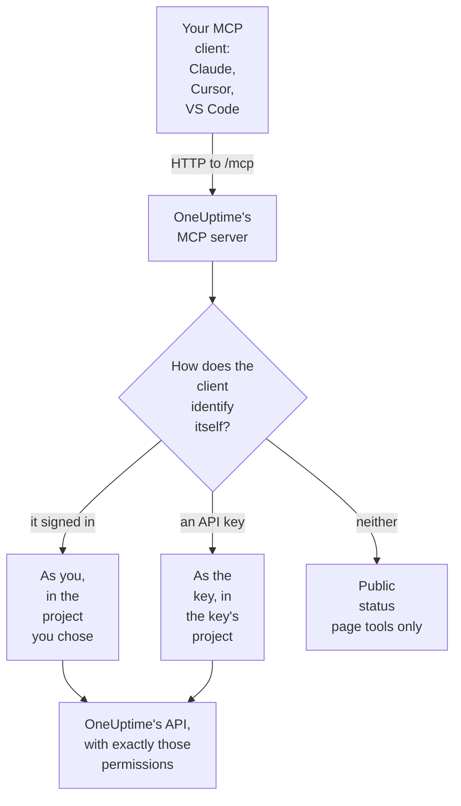

# MCP Server

The OneUptime MCP server lets an AI assistant work with your OneUptime project directly. Connect Claude, Cursor, VS Code with GitHub Copilot or any other client of the Model Context Protocol (MCP), and ask it to look into an incident, query logs and traces, acknowledge an alert or set up a monitor: it calls OneUptime's tools with your permissions, or an API key's.

:::cards
- [Connect a client](#connect-a-client): Give your client the server's address and sign in.
- [Signing In with OneUptime](#signing-in-with-oneuptime): What a connected client may do, and how to disconnect it.
- [Getting Your API Key](#getting-your-api-key): For an agent that runs unattended.
- [Troubleshooting](#troubleshooting): Sign-in, permission and connection problems.
:::

This page is about AI assistants that connect to OneUptime. To let OneUptime AI use the tools of other MCP servers instead, such as AWS's or GitHub's, see [External MCP Servers](/docs/ai/external-mcp-servers).

## How it works

The MCP server is part of every OneUptime instance, at `/mcp` on the same address as the dashboard, and speaks the streamable HTTP transport. There is nothing to install.

- **OneUptime Cloud**: `https://oneuptime.com/mcp`
- **Self-hosted**: `https://your-oneuptime-domain.com/mcp`



The server is stateless: it issues no session ids, and every request stands on its own, so it works behind load balancers and with several replicas.

## What the tools cover

- **Monitors**: create and configure monitors, check their status and review their history.
- **Incident response**: create, acknowledge and resolve incidents, add internal or public notes, and follow them to resolution.
- **Alerts**: acknowledge and resolve alerts, add notes, and manage alert states and severities.
- **Teams and on-call**: manage teams and on-call policies.
- **Status pages**: manage status pages and post announcements.
- **Scheduled maintenance**: create and manage maintenance events.
- **Telemetry**: query logs, metrics, traces, exceptions, monitor logs, security events and more, read-only.

There are create, get, list, update, delete and count tools for 32 kinds of record, list and count tools for 9 kinds of telemetry, and tools made for incident response. Read-only tools carry `readOnlyHint`, every tool that changes something carries `destructiveHint`, and only the public status page tools carry `openWorldHint`, so a client can run read-only calls on its own and ask you before any change. A failed tool call comes back as a tool result (`isError: true`) with a `statusCode`, the details and a suggestion, not as an MCP protocol error, so the agent can read the failure and correct itself.

## Before you begin

- A OneUptime instance: OneUptime Cloud or self-hosted.
- An MCP client, such as Claude Code, Claude, VS Code with GitHub Copilot or Cursor.
- A OneUptime account to sign in with, or a OneUptime API key for an agent that runs unattended. The public status page tools need neither.
- On OneUptime Cloud, the Growth plan or higher: connecting an MCP client is available on the same plans as API keys.

## Connect a client

Give the client the server's address and nothing else. The first time it needs your data, it opens OneUptime in your browser for you to sign in (see [Signing In with OneUptime](#signing-in-with-oneuptime)). On a self-hosted instance, use `https://your-oneuptime-domain.com/mcp` in place of `https://oneuptime.com/mcp`.

:::tabs
@tab Claude Code
```bash
claude mcp add --transport http oneuptime https://oneuptime.com/mcp
```
Then run `/mcp` inside Claude Code and choose **oneuptime** to sign in.
@tab Claude
In Claude, open **Customize → Connectors**, choose **Add custom connector**, and enter `https://oneuptime.com/mcp`. Claude asks you to sign in to OneUptime the first time it needs your data.
@tab VS Code
Add this to your MCP configuration (see [VS Code with GitHub Copilot](#vs-code-with-github-copilot) for where it lives). VS Code opens OneUptime for you to sign in when you start the server:
```json
{
  "servers": {
    "oneuptime": {
      "type": "http",
      "url": "https://oneuptime.com/mcp"
    }
  }
}
```
@tab Cursor
```json
{
  "mcpServers": {
    "oneuptime": {
      "url": "https://oneuptime.com/mcp"
    }
  }
}
```
:::

Any other client that supports MCP authorization works the same way: give it the address and it discovers everything else. See [Signing In (OAuth 2.1)](#signing-in-oauth-21) for the protocol.

The dashboard has these steps too, with your instance's address filled in: **Project Settings → AI → MCP Server**. And from any resource (a monitor, an incident, a status page, and so on), expand **Developer** in its side menu and choose **AI Assistants**: that page also suggests prompts that name the resource and its ID, so the assistant finds it straight away. For a resource the MCP server has no tools for yet, such as a workflow, the page shows how an assistant that can run commands can work with it through the REST API instead.

## Signing In with OneUptime

The simplest way to connect is to give your MCP client the server's address and nothing else. The first time the client needs your data, it opens a OneUptime page in your browser:

:::steps
1. Sign in to OneUptime, if you are not signed in already.
2. Choose the project the client should work in.
3. Choose **Read and write**, or **Read only**.
4. Click **Authorize**.
:::

The client then acts as you in that project. There is no API key to create, copy or rotate, and nothing secret is stored in a configuration file.

What a connected client can do:

- **It has your permissions, and never more.** Whatever your teams allow you to do in the project is what the client can do. If your role changes or you leave the project, that applies to the client's very next request. Leaving the project also disconnects the client: its authorization is deleted, and you connect it again if you rejoin.
- **Read only means read only.** A client authorized as read only can use the `get_`, `list_` and `count_` tools. Tools that create, update, delete, acknowledge or resolve are refused, by the MCP server and by the OneUptime API behind it. You can never give a client more access than it asked for.
- **It is for one project.** To use a second project, connect the client again and choose that project.
- **It works only through the MCP server.** The client's access token is accepted by the MCP endpoint and nowhere else. It cannot be used to call the OneUptime REST API directly.
- **Instance administrators get no special treatment.** A client connected by a master admin has what that person's teams grant in the project, not instance-wide access.

### Managing Connected Clients

Every client connected by signing in is listed on **Project Settings → AI → MCP Server**, under **Connected MCP Clients**, with who connected it, what it may do and when it was last used. You see the clients you connected; project owners and admins see everyone's.

Click **Disconnect** to sign a client out. It stops working at once.

A client stays connected for as long as it is used. One that has not been used for 30 days has to sign in again.

### Controlling Who Can Connect Clients

Every project member can connect an MCP client by default. To stop the members of a team from doing so, open the team's **Permissions** page, open **More settings** at the bottom, and add the **Authorize MCP Client** permission under **Block Permissions**. Clients those members already connected stop working at once.

If the project requires single sign-on, sign in to the project with SSO in your browser before you authorize a client. The client's connection lasts as long as that SSO sign-in does; when it lapses, or the SSO provider you signed in with is turned off or deleted, connect the client again.

On OneUptime Cloud, connecting an MCP client is available on the same plans as API keys (Growth and above).

On the Enterprise Edition, every change a connected client makes is recorded in the audit log under the person who connected it, with the name of the client. Changes made with an API key show the name of the key.

## Getting Your API Key

Use an API key for an agent that runs unattended, such as a scheduled job or a CI pipeline, where nobody is there to sign in.

:::steps
### Create the key

Go to **Project Settings → Advanced → API Keys** and click **Create API Key**. Give it a name, such as "MCP Server".

### Choose what it may do

Under **Access**, pick **Viewer** for an agent that only reads, or **Project Admin** for one that also creates, updates and deletes (see [API Key Permissions](#api-key-permissions)).

### Copy the key

Click **Create API Key**: the key's page opens. Copy the key from there.
:::

API keys belong to one project: the MCP server takes the project from the key, so create tools never need a `projectId` argument.

> [!WARNING]
> Never give an AI agent a master key. A OneUptime master API key is also accepted on this header and grants admin access to the whole instance. Always use a project API key with the least the agent needs: a read-only key is enough for every `get_`, `list_` and `count_` tool.

## Connecting with an API key

Send the key in the `x-api-key` header. A request that carries an API key is never asked to sign in. On a self-hosted instance, use your own domain in place of `oneuptime.com`.

:::tabs
@tab Claude Code
```bash
claude mcp add --transport http oneuptime https://oneuptime.com/mcp --header "x-api-key: your-api-key-here"
```
@tab Claude Desktop
Add this to `claude_desktop_config.json`, in `~/Library/Application Support/Claude/` on macOS, `%APPDATA%\Claude\` on Windows or `~/.config/Claude/` on Linux:
```json
{
  "mcpServers": {
    "oneuptime": {
      "transport": "streamable-http",
      "url": "https://oneuptime.com/mcp",
      "headers": {
        "x-api-key": "your-api-key-here"
      }
    }
  }
}
```
@tab VS Code
The input variable with `"password": true` asks for the key when the server starts, rather than keeping it in plain text:
```json
{
  "servers": {
    "oneuptime": {
      "type": "http",
      "url": "https://oneuptime.com/mcp",
      "headers": {
        "x-api-key": "${input:oneuptime-api-key}"
      }
    }
  },
  "inputs": [
    {
      "type": "promptString",
      "id": "oneuptime-api-key",
      "description": "OneUptime API Key",
      "password": true
    }
  ]
}
```
@tab Cursor
```json
{
  "mcpServers": {
    "oneuptime": {
      "url": "https://oneuptime.com/mcp",
      "headers": {
        "x-api-key": "your-api-key-here"
      }
    }
  }
}
```
:::

## VS Code with GitHub Copilot

VS Code 1.99 and later supports MCP servers natively in GitHub Copilot Chat.

:::steps
### Check what you need

VS Code 1.99 or later, with the GitHub Copilot extension installed and signed in, and GitHub Copilot Chat turned on.

### Open the MCP configuration

Press `Ctrl+Shift+P` (`Cmd+Shift+P` on macOS), type "MCP: Open User Configuration" and press Enter. It opens, or creates, the `mcp.json` file. For one workspace only, create `.vscode/mcp.json` in it instead.

### Add OneUptime

Paste the VS Code configuration above: the one with no key to sign in, or the one with an API key.

### Start the server

Press `Ctrl+Shift+P` (`Cmd+Shift+P` on macOS), type "MCP: List Servers", and choose **oneuptime** to start it. VS Code asks you to trust the server the first time, then to sign in or to enter your API key.

### Ask Copilot

Open GitHub Copilot Chat in agent mode and ask, for example, "What monitors do I have in OneUptime?", "Show me recent incidents" or "Create a new monitor for https://example.com".
:::

## Authentication

The MCP server works in three ways.

### Public Tools (No Authentication Required)

Without an API key or a sign-in, a client can use the public tools:

- **`oneuptime_help`**: help and guidance about OneUptime's MCP tools
- **`oneuptime_list_resources`**: the resources and what you can do with each
- **`get_public_status_page_overview`**: the overview of a public status page
- **`get_public_status_page_incidents`**: the incidents of a public status page
- **`get_public_status_page_scheduled_maintenance`**: its scheduled maintenance events
- **`get_public_status_page_announcements`**: its announcements

The public status page tools take a status page's ID (a UUID) or its domain name. To use only these, connect with the address and no credentials:

```json
{
  "mcpServers": {
    "oneuptime": {
      "transport": "streamable-http",
      "url": "https://oneuptime.com/mcp"
    }
  }
}
```

A status page's owners can turn MCP access off for that page: on the status page, open **MCP** in the **AI** section of its side menu and switch off **Enable MCP Server**. The switch saves as soon as it is flipped. MCP access is on by default. While it is off, the four `get_public_status_page_*` tools return an error for that status page; the status page website, its RSS feed and its public JSON API are unaffected, and the status page tools that need sign-in (`get_status_page`, `list_status_pages` and so on) keep working for the page's own project.

### Signing In (OAuth 2.1)

Every other tool needs to know who is calling. A client that sends no credentials and calls one of them gets `401 Unauthorized` with a `WWW-Authenticate` header that points at the server's protected resource metadata. That is the signal an MCP client acts on to sign you in; `initialize`, `tools/list` and the public tools never ask for it.

The server implements the [MCP authorization specification](https://modelcontextprotocol.io/specification/latest/basic/authorization):

- **Flow**: OAuth 2.1 authorization code with PKCE (`S256` only). Access tokens are sent as `Authorization: Bearer`.
- **Discovery**: protected resource metadata (RFC 9728) and authorization server metadata (RFC 8414). The issuer and the resource are both `https://<host>/mcp`.
- **Client identity**: a Client ID Metadata Document (the client ID is an `https` URL the server fetches), or Dynamic Client Registration (RFC 7591). No client has to be registered by an administrator.
- **Scopes**: `mcp:read` for the `get_`, `list_` and `count_` tools; `mcp:write` adds every tool that changes something, and includes `mcp:read`. A read-only token that calls a write tool gets `403` with `error="insufficient_scope"`.
- **Token lifetimes**: an access token lasts one hour. A refresh token lasts 30 days and is replaced every time it is used; using a refresh token that was already replaced ends the connection.
- **Resource indicators** (RFC 8707): a token is issued for `https://<host>/mcp` and is not accepted anywhere else.
- **Revocation** (RFC 7009): revoking either token ends the connection.

### API Key

An agent that runs unattended sends a OneUptime API key in one of these headers:

- `x-api-key`: your OneUptime API key
- `Authorization`: a bearer token with your API key (e.g. `Bearer your-api-key-here`)

The `Bearer` scheme is case-insensitive. A request that carries an API key is never asked to sign in.

On OneUptime Cloud, API keys work only while the project is on **Growth** or above. Below it, every tool that needs the key answers `402` with a message that names the plan, and the agent is told not to retry. Nothing is deleted: the key works again as it is once the project is back on Growth, with nothing to reconnect. A client connected by signing in acts as a person and keeps working ([API keys and SCIM below their plan](/docs/api-reference/api-reference#api-keys-and-scim-below-their-plan)).

## Available Endpoints

| Endpoint | Method | Description |
| --- | --- | --- |
| `/mcp` | POST | JSON-RPC requests for tool calls and other operations |
| `/mcp` | GET | Without an SSE `Accept` header: a short JSON description of the server. With one: `405`, because the stateless server offers no standalone SSE stream (clients that follow the specification carry on without it) |
| `/mcp` | DELETE | Does nothing: the server is stateless, so there is no session to end |
| `/mcp/health` | GET | Health check |
| `/mcp/tools` | GET | The list of tools, as plain REST |

MCP clients that sign in also use the OAuth endpoints below. A client finds them by itself; they are listed for people who write a client or set up a proxy.

| Endpoint | Method | Description |
| --- | --- | --- |
| `/mcp/.well-known/oauth-protected-resource` | GET | Protected resource metadata (RFC 9728). Also at `/.well-known/oauth-protected-resource/mcp` |
| `/.well-known/oauth-authorization-server/mcp` | GET | Authorization server metadata (RFC 8414). Also at `/mcp/.well-known/oauth-authorization-server` |
| `/mcp/oauth/authorize` | GET | Authorization endpoint: where the client sends your browser to sign in |
| `/mcp/oauth/token` | POST | Token endpoint: exchanges an authorization code or a refresh token |
| `/mcp/oauth/register` | POST | Dynamic Client Registration (RFC 7591) |
| `/mcp/oauth/revoke` | POST | Token revocation (RFC 7009) |

To check that the server runs, and to list its tools:

```bash
curl https://oneuptime.com/mcp/health
curl https://oneuptime.com/mcp/tools
```

## Tools for incident response

Beside the tools for each kind of record, the server has tools made for responding to incidents and alerts:

- **`acknowledge_incident`** / **`resolve_incident`**: move an incident to the project's Acknowledged or Resolved state, as the dashboard's button does
- **`acknowledge_alert`** / **`resolve_alert`**: the same for alerts
- **`add_incident_note`**: add a note to an incident with `visibility: "internal"` (the team only, the default) or `visibility: "public"` (posted to the status page). Markdown is supported
- **`add_alert_note`**: add an internal note to an alert

A typical loop: `list_incidents` → `acknowledge_incident` → investigate with `list_logs` → `add_incident_note` (public) → `resolve_incident`.

The **`oneuptime_whoami`** tool returns the project your credentials belong to (its ID and name). For a client that signed in, it also says who it is signed in as and whether it may make changes. It is a good first call for an agent to find its bearings, and since create tools take `projectId` from the credentials, the agent never has to pass a project ID.

## Querying Telemetry

Logs, metrics, traces (spans), exceptions, monitor logs and the other kinds of telemetry come as read-only `list_` and `count_` tools (`list_logs`, `list_metrics`, `list_spans`, `list_exception_instances`, `list_monitor_logs` and their `count_` twins). Telemetry arrives through OpenTelemetry, so there are no create tools.

Always query telemetry with a time range. A query field takes a value, or an operator object:

```json
{
  "query": {
    "time": { "_type": "GreaterThan", "value": "2026-07-04T00:00:00.000Z" }
  },
  "sort": { "time": "DESC" },
  "limit": 50
}
```

The operators are `EqualTo`, `NotEqual`, `IsNull`, `NotNull`, `EqualToOrNull`, `GreaterThan`, `LessThan`, `GreaterThanOrEqual`, `LessThanOrEqual`, `InBetween`, `Search` and `Includes`. Sort values are `"ASC"` or `"DESC"`.

## Field Selection and Pagination

`get_` and `list_` tools take an optional `select` array of field names. By default every readable field comes back except the heavy ones (JSON, very long text and HTML columns), which must be asked for in `select`.

List tools page with `limit` (10 by default, 100 at most) and `skip`, and every list answer says exactly what it returned:

```json
{
  "returnedCount": 10,
  "totalCount": 42,
  "skip": 0,
  "limit": 10,
  "hasMore": true,
  "data": ["..."]
}
```

## Usage Examples

### Everyday questions

```text
"What's the current status of all my monitors?"
"Show me incidents from the last 24 hours"
"List the teams in this project"
"Show me our on-call policies"
```

### Monitors and incidents

```text
"Create a new website monitor for https://example.com that checks every 5 minutes"
"Set up an API monitor for https://api.example.com/health with a 30-second timeout"
"Disable the monitor for staging.example.com while we're doing maintenance"
"Create a high-priority incident for the database outage affecting user authentication"
"Add a note to incident #123 saying 'Database connection restored, monitoring for stability'"
"Mark incident #456 as resolved"
```

### Status pages

```text
"Update our status page to show 'Investigating Payment Issues' for the payment service"
"Create a status page announcement about scheduled maintenance this weekend"
```

### Public Status Page Queries (No API Key Required)

These work without credentials, with the public status page tools alone:

```text
"What's the current status of status.example.com?"
"Show me recent incidents from the OneUptime status page"
"Are there any scheduled maintenance events on status.acme.com?"
"Get the latest announcements from my public status page with ID abc123-..."
```

### Several steps at once

```text
"Create a scheduled maintenance window for Saturday 2-4 AM, disable all monitors for api.example.com during that time, and update the status page"
"Show me all monitors that have been down in the last hour, create incidents for any that don't already have one"
```

## API Key Permissions

| What the agent does | Pick under **Access** |
| --- | --- |
| Only reads | **Viewer**, or add read permissions on the key's page |
| Also creates, updates and deletes | **Project Admin**, or add the Project Admin role on the key's page |

Give each key the least it needs, rotate keys regularly, keep a separate key for each environment, and watch what each key does in OneUptime.

## Self-Hosted Configuration

Signing in works out of the box on a self-hosted instance. Two settings change it:

| Environment variable | Helm value | What it does |
| --- | --- | --- |
| `DISABLE_MCP_OAUTH` | `mcpOAuth.disabled` | Set to `true` to switch sign-in off. The OAuth endpoints stop being served and the MCP server accepts API keys only. Nothing is deleted; connected clients work again when it is switched back. |
| `DISABLE_MCP_OAUTH_CLIENT_ID_METADATA_DOCUMENTS` | `mcpOAuth.disableClientIdMetadataDocuments` | Set to `true` on an instance that cannot reach the internet. A client may identify itself with a URL that OneUptime fetches; with this set, clients register with your instance directly instead, which needs no outbound request. |

If you run your own reverse proxy in front of OneUptime, forward `/.well-known/oauth-protected-resource` and `/.well-known/oauth-authorization-server` (and everything under them) to OneUptime along with `/mcp`. The bundled ingress already does.

The server builds every OAuth URL from the `HOST` and `HTTP_PROTOCOL` settings, so they have to match the address people use to reach your instance.

## Troubleshooting

### Sign-In Issues

- **The client never asks me to sign in**: the client may not support MCP authorization, or it may be configured with an API key header, which takes precedence. Remove the header to sign in instead.
- **My project is greyed out on the authorization page**: the page says why next to the project name - the project's plan does not include connecting MCP clients, the project requires SSO and this browser has not signed in to it with SSO, or your team is blocked from connecting clients.
- **A tool is refused as "read-only"**: the client was authorized as read only. Connect it again and choose **Read and write**.
- **The client stopped working**: it was disconnected, was not used for 30 days, you were removed from the project, or the project's SSO sign-in lapsed or its provider was turned off. Connect it again.
- **Self-hosted - the client says it cannot find the authorization server**: check that `HOST` and `HTTP_PROTOCOL` match your public address, and that your proxy forwards the `/.well-known/oauth-*` paths.

### Permission Errors

The API key, or for a client that signed in your own account, needs the right permissions: read access to list records, write access to create and update them, and delete access to remove them.

### Connection Issues

Check that the OneUptime address is right and reachable, that the API key is valid, and that the health endpoint answers (see [Available Endpoints](#available-endpoints)).

### Invalid API Key

- Check the API key in your OneUptime settings, without extra spaces or characters
- Check that the key has not expired
- On OneUptime Cloud, a `402` that says API keys need the Growth plan means the project is below it: upgrade the project in **Project Settings → Billing and Invoices → Billing**, and the same key works again

### Session Errors

The MCP server is stateless: it neither issues nor tracks session ids, so every request works against any replica. A client that sends an `mcp-session-id` header from an older server version can leave it out; it is ignored. Update an older client configuration that expects the server to return a session id.

## Available Resources

| Area | Records with create, get, list, update, delete and count tools |
| --- | --- |
| Monitoring | Monitor, Monitor Status, Monitor Status Event |
| Incidents | Incident, Incident State, Incident Severity, Incident State Timeline, Incident Public Note, Incident Internal Note, Incident Alert, Postmortem Status |
| Alerts | Alert, Alert State, Alert Severity, Alert State Timeline, Alert Internal Note |
| Status pages | Status Page, Status Page Announcement |
| Scheduled maintenance | Scheduled Maintenance Event, Scheduled Maintenance State, Scheduled Maintenance State Timeline |
| Teams and on-call | Team, On-Call Policy |
| Labels | Label |
| Security | Security Case, Security Case Evidence, Security Case Note, Security Case Priority, Security Case Status, Security Case Task, Security Detection, Security Playbook |

| Area | Telemetry with list and count tools only |
| --- | --- |
| Observability | Log, Metric, Span, Exception Instance, Monitor Log |
| Security | Security Event, Threat Intel Indicator |
| Changes and cost | Change Event, Kubernetes Cost Allocation |

The tools are named in snake case: `create_incident`, `get_incident`, `list_incidents`, `update_incident`, `delete_incident` and `count_incidents`, or `list_logs` and `count_spans` for telemetry.

## Next steps

:::cards
- [Ask AI](/docs/ai/ask-ai): Ask about your project inside OneUptime instead.
- [OneUptime API Reference](/docs/api-reference/api-reference): The REST API behind every tool.
- [Permissions](/docs/permissions/index): What a role, a team or an API key may do.
:::
