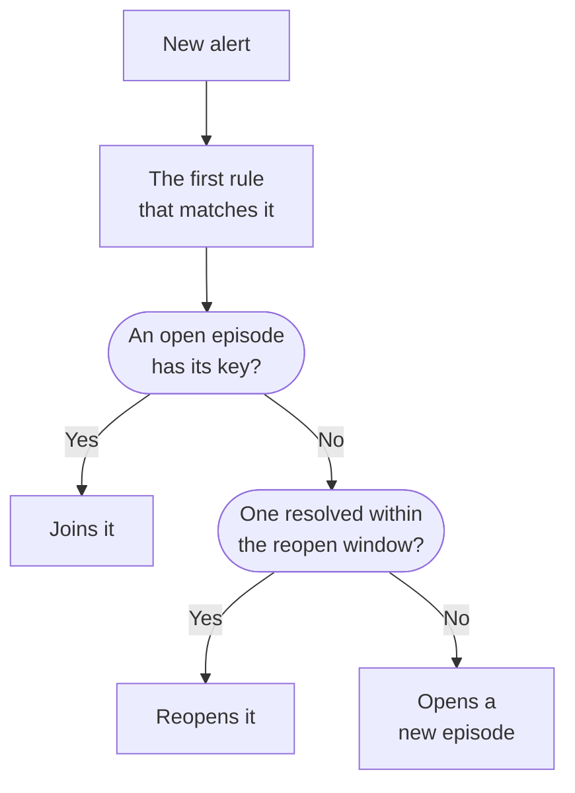

# Alert Episodes & Grouping Rules

When a database goes down, twenty monitors can raise twenty alerts within minutes. An episode puts them into one record your team acknowledges and resolves together, and a grouping rule decides which alerts belong in it. This page shows how grouping works, how to set up a rule, and how an episode behaves once it is open.

:::cards
- [How grouping works](#how-grouping-works): Rules, grouping keys and time windows.
- [Create a grouping rule](#create-a-grouping-rule): From a template in one click, or your own.
- [How an episode behaves](#how-an-episode-behaves): Its severity, its states and when it resolves.
- [Who an episode pages](#who-an-episode-pages): The rule's on-call policies and the alerts' own.
:::

## How grouping works

Grouping runs once for each new alert, right after its on-call policies run. The alert is checked against your enabled grouping rules, from the top of the list down, and the first rule that matches it decides its episode. An alert that no rule matches stays on its own.



- **The rule's conditions** decide which alerts it applies to. A rule with none applies to every new alert.
- **The grouping key** decides which alerts share an episode: those with the same monitor, the same severity, the same title, or whatever mix the rule groups by. A rule that groups by nothing puts every alert it matches into one episode.
- **The time window** decides how long an episode keeps taking alerts. With it on, an alert joins only if it arrives within the window of the episode's last alert. With it off, matching alerts keep joining until the episode is resolved.

Grouping happens when an alert is created. A rule you add today groups the alerts created after it; it does not regroup the ones already there.

> [!NOTE]
> An alert created already acknowledged can join an open episode but never opens one, and an alert created resolved is not grouped at all. See [Created already acknowledged or resolved](/docs/alerts/index#created-already-acknowledged-or-resolved).

## Create a grouping rule

Go to **Alerts → Rules → Grouping Rules**. The **Rules** section of the side menu starts folded, so expand it first.

### Start from a template

A project with no grouping rules sees four ready-made rules instead of an empty list; once you have rules, **Create from Template** on the card opens them. **Add Rule** saves one in a single click, enabled, at the end of the list, and applying to every new alert. Edit it afterwards like any other rule.

| Template                               | Groups                                                    | Time window |
| -------------------------------------- | --------------------------------------------------------- | ----------- |
| **Group alerts from the same monitor** | One episode per monitor                                   | 30 minutes  |
| **Group alerts that happen together**  | One shared episode, whatever the monitor                  | 10 minutes  |
| **Group alerts by severity**           | One episode per severity                                  | 30 minutes  |
| **Group repeats of the same alert**    | One episode per alert title, numbers and case ignored     | 1 hour      |

### Create your own

:::steps
#### Answer how to group

Click **Create Custom Rule** under the templates, or **Create Alert Grouping Rule** on the card once you have rules. On the **Grouping** step, **Group alerts by** asks one question: **Monitor**, **Everything Together**, **Severity**, **Title** or **Custom**. The **Name** follows your answer until you type your own.

#### Set the time window

**Only group alerts that arrive close together** is on, with a window of 30 minutes. Change the minutes, or turn it off to keep one episode open until it is resolved.

#### Combine fields, for Custom

**Custom** adds a **Group By** step with five switches: **Group By Monitor**, **Group By Alert Severity**, **Group By Alert Title**, **Group By Alert Labels** and **Group By Monitor Labels**. Labels group by their exact set.

#### Narrow it down

On **Which Alerts**, **All alerts**, where a new rule starts, groups every new alert. To narrow it down, pick **Only alerts that match conditions** and add conditions on monitors, severities, labels, titles and descriptions. Then click **Create Alert Grouping Rule**.
:::

Everything else a rule can do is folded under **More fields** at the end of the **Grouping** step, in three groups. Folded, its header names what it holds and says what each setting the rule uses is set to, so editing a rule never hides what it does.

| Group                     | Settings                                                                                                   |
| ------------------------- | ---------------------------------------------------------------------------------------------------------- |
| **On-Call & Ownership**   | **On-Call Duty Policies** to run when the rule opens an episode, and **Episode Owners**.                   |
| **Episode Lifecycle**     | **Reopen recently resolved episodes**, **Wait before resolving an episode** and **Resolve quiet episodes**, each a switch with its minutes. |
| **Details**               | The rule's **Description**, the **Episode Title Template**, the **Episode Description Template** and **Episode Labels**. |

Rules are checked from the top of the list down, and the first match wins: drag a rule to change its place. Put specific rules above broad ones. The list's **Grouping** column says what each rule does in a sentence, such as "One episode per monitor".

## Episode titles

Without a template, an episode is named after the monitor of its first alert, or after the first 50 characters of the alert's title when it has no monitor. With an **Episode Title Template** or an **Episode Description Template**, these variables are filled in. Type `{{` in either field to pick one.

| Variable               | Filled with                                                            |
| ---------------------- | ---------------------------------------------------------------------- |
| `{{alertTitle}}`       | The first alert's title.                                               |
| `{{alertDescription}}` | The first alert's description.                                         |
| `{{alertSeverity}}`    | The first alert's severity.                                            |
| `{{monitorName}}`      | The name of the first alert's monitor.                                 |
| `{{alertCount}}`       | How many alerts the episode holds, written again as alerts join or leave. |

A variable the first alert has no value for, or one that is not on this list, is left out. When the first alert is private, `{{alertTitle}}` and `{{alertDescription}}` read "Private alert", because the episode is not private.

## How an episode behaves

An episode moves through your alert states, the same list alerts use, and has its own owners, notes, root cause and remediation notes.

- **Its severity rises with its alerts.** It starts with its first alert's severity, and takes the severity of any more severe alert that joins it, "more severe" meaning higher in **Alerts → Settings → Alert Severity**.
- **Its state moves its alerts.** Acknowledge or resolve an episode, or move it to a state of your own, and every alert in it moves too, except an alert already in that state or past it.
- **It resolves itself** once every alert in it is resolved. **Wait before resolving an episode** holds it open for that many minutes first, in case an alert comes back.
- **It can reopen.** With **Reopen recently resolved episodes** on, a matching alert that arrives within the minutes after the episode resolved reopens it, instead of opening another. It is the one move back up the list of states, and it does not reopen the episode's alerts.

> [!WARNING]
> **Resolve quiet episodes** resolves an episode when no new alert has joined it for the minutes you set, and resolves every alert still open in it too. Use it for noise you are sure needs no answer.

## Who an episode pages

An alert's own on-call policies run when it is created, before grouping, whether or not it joins an episode. An episode adds its own:

```mermaid title="An alert that opens an episode pages twice; one that joins pages once"
flowchart TB
    alert["New alert"] --> own["The alert's own<br/>policies run"]
    own --> grouped{"Grouping"}
    grouped -->|"Opens an episode"| ep["The episode's<br/>policies run too"]
    grouped -->|"Joins an episode"| none["Nothing more runs"]
```

- **A new episode** runs the rule's **On-Call Duty Policies**, plus those of any matching rule on the **Episode Rules** tab of **Alerts → Rules → On-Call Rules**.
- **An alert joining an open episode** runs only its own policies. The episode's do not run again.
- **Answering an episode's page** acknowledges the episode, and with it every alert in it.

> [!TIP]
> To page once per problem rather than once per alert, put on-call policies on your grouping rules and leave them off the alerts: off the monitor's criteria, the create form and your alert on-call rules.

Episode owners hear about it too: **Alert episode created**, **Alert episode state changed** and **Alert added to alert episode** are on by email by default, under **User Settings → Notification Settings**, on the **Alerts** tab. The rule's **Episode Owners** become owners of every episode it opens, and are notified like any other owner.

## Create an episode by hand

:::steps
### Open the form

Go to **Alerts → All Episodes** and click **Create Episode**. The **Create New Alert Episode** form opens.

### Describe the episode

On **Episode Details**, fill in the **Title** and, if you like, an **Alert Severity** and a **Description**. **Initial State** and **Labels** wait under **More fields**.

### Pick who is paged and who owns it

On **On-Call & Owners**, pick an **On-Call Policy** to run when the episode is created, and its **Owners**. Then click **Create Episode**.

### Add the alerts

Open the episode's **Member Alerts** page, click **Add Alerts** and tick the alerts that belong to it, as many as you need at once. To start from the alerts instead, select them on the **Alerts** list and choose **Add to New Episode** under **Bulk Actions** (see [Episodes](/docs/incidents/episodes)).
:::

An episode you create has no grouping rule, so the list shows its **Grouping Rule** as **Manual**, and no lifecycle setting applies to it. It still resolves itself once every alert in it is resolved.

## What each page of an episode shows

| Side menu section | Pages                                                              |
| ----------------- | ------------------------------------------------------------------ |
| **Overview** | **Overview**, **State Timeline** |
| **Investigation** | **Description**, **Root Cause**, **Remediation Notes** |
| **Team** | **Owners** |
| **Alerts** | **Member Alerts** |
| **Notes** | **Private Notes** |
| **Developer** | **Terraform**, **API**, **AI Assistants** |
| **Advanced** | **Audit Logs**, **Delete Episode** |

**Developer** and **Advanced** start folded. On the **Overview**, the header names the episode's **Owners**, teams first, and the first tile says when the episode was **Created** — **Automatically**, when a grouping rule opened it. **What happened** leads the page — the episode's description and **Root cause** — then **Alerts in this episode** and the **Episode Feed**, beside the **Episode Details** card: its number, state, severity, alert count, grouping rule and on-call policies. Its header has **Acknowledge** and **Resolve**, and **Move episode to** in the **⋯** menu.

**Alerts → Active Episodes** lists the episodes that are not resolved yet, and the badge beside it counts them.

## Troubleshooting

:::details A new alert did not join the episode I expected
Check, in order: the rule is enabled; no rule above it matched the alert first; the alert matches the rule's conditions; it has the same grouping key as the episode's alerts, such as the same monitor; and, with the time window on, it arrived within the window of the episode's last alert. An alert created already acknowledged never opens an episode, and one created resolved is never grouped.
:::

:::details We were paged twice for one problem
The alert's own on-call policy ran, and the new episode's policy ran too. Keep the policies on the grouping rule, and take them off the alert's criteria, form or on-call rules.
:::

:::details An episode resolved on its own
Every alert in it was resolved, so the episode resolved once its wait was over. When **Resolve quiet episodes** is on, it also resolves an episode that took no new alert for that long.
:::

## Next steps

:::cards
- [Alert Rules & Settings](/docs/alerts/settings): The other rules that act on new alerts and episodes.
- [Alert States & Severities](/docs/alerts/states-and-severities): The states an episode moves through.
- [Escalation Rules](/docs/on-call/escalation-rules): How the policies an episode runs page people.
- [Incident Settings & Automation](/docs/incidents/settings): Grouping rules for incidents.
:::
