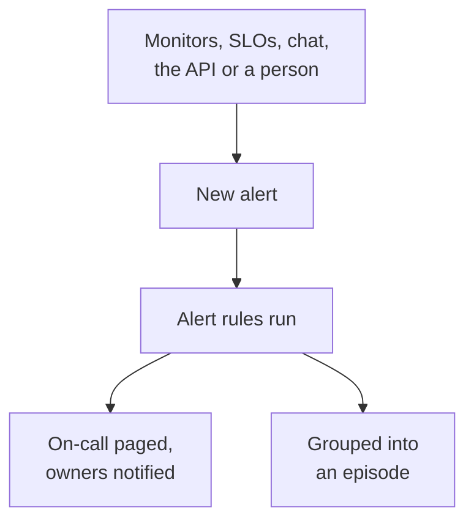

# Alerts Overview

An alert tells your team about a problem to look into before your users notice it: a disk filling up, a certificate about to expire, an error rate creeping up. It can page whoever is on call and notify its owners, but it never shows on a status page and never tells your subscribers. This page explains where alerts come from, where they live in the dashboard and how your team works them.

:::cards
- [Alerts and incidents](#alerts-and-incidents): Which one a problem should be, and how the two connect.
- [Where alerts come from](#where-alerts-come-from): Monitors, SLOs, chat, the API, or by hand.
- [Create an alert by hand](#create-an-alert-by-hand): Two steps in the dashboard.
- [Respond to an alert](#respond-to-an-alert): Acknowledge it, resolve it, or declare an incident.
:::

## How it works

Most alerts are raised by a monitor whose criteria match. Some come from an SLO burning its error budget, a security rule, a page sent from Slack or Microsoft Teams, or a person. Whichever way it arrives, an alert is the same record, and the same rules run on it.

- **Rules shape it.** Privacy, owner, label and on-call rules run the moment an alert is created, and runbook rules start the procedures that match. See [Alert Rules & Settings](/docs/alerts/settings).
- **On-call policies page people.** The policies the alert names, plus the ones its on-call rules add, page their people until someone acknowledges the alert.
- **Episodes group the noise.** A grouping rule puts related alerts into one episode, so twenty alerts from one outage are one thing to work. See [Alert Episodes & Grouping Rules](/docs/alerts/episodes).

## Alerts and incidents

Both record a problem, and both can page whoever is on call. What differs is who the problem affects.

|                              | Alert                                                  | Incident                                          |
| ---------------------------- | ------------------------------------------------------ | ------------------------------------------------- |
| **What it is**               | A problem for your team to look into before users are affected | A problem that affects your users, such as an outage |
| **On status pages**          | Never                                                  | Can show, and tells subscribers                   |
| **Notes**                    | Private notes, for your team only                     | Public notes for customers, and private notes     |
| **Starting states**          | **Identified**, **Acknowledged**, **Resolved**         | **Identified**, **Acknowledged**, **Resolved**    |
| **Starting severities**      | **High**, **Low**                                      | Critical Incident, Major Incident, Minor Incident |
| **Numbers in a new project** | `ALT-42`, and `AE-42` for episodes                     | `INC-42`, and `IE-42` for episodes                |

Raise an alert when your team should look before anyone outside notices, and declare an incident when users are affected. When an alert turns out to be part of an outage, declare an incident from it, or link it to the incident that explains it: see [Linked Alerts](/docs/incidents/linked-alerts).

## Where alerts come from

- **A monitor's criteria.** Under a criteria's **Actions**, turn on **When filters match, create an alert.** and fill in the alert it creates: **Alert Title** and **Severity**, then, each folded, **Description**, **Ownership & Labels**, **On-Call** and **More fields**, which holds **Auto Resolve Alert**, **Private Alert** and **Remediation Notes**. A criteria keeps one open alert at a time, one per series on a monitor that groups by a field, and **Auto Resolve Alert** resolves it once the criteria stops matching. See [Creating a Monitor](/docs/monitor/create-monitor) and [Incident & Alert Templating](/docs/monitor/incident-alert-templating).
- **By hand.** Click **Create Alert** on the alerts list, or on the **Alerts** tab of a monitor, a host, a network device or another resource, which picks that resource for you. See [Create an alert by hand](#create-an-alert-by-hand).
- **An SLO's burn rate.** A burn rate rule can create an alert when an SLO spends its error budget too fast. See [Burn Rate Alerts and Incidents](/docs/slo/burn-rate-alerts).
- **Network sites and security events.** A network site set to alert when it is unhealthy opens an alert when its rollup stops being operational, and your security detection rules open alerts too. See [Network Sites (Health Rollup & Uptime)](/docs/monitor/network-sites) and [Security Events](/docs/telemetry/security-events).
- **A page.** `/oneuptime page` in Slack or Microsoft Teams opens an alert whose title is your message, and pages the people you name. A workflow's paging blocks do the same with the title and message you give them. See [Paging someone from Slack](/docs/workspace-connections/slack#paging-someone-from-slack) and [Paging](/docs/workflows/components#paging).
- **The API, Terraform and workflows.** Alerts are an ordinary resource: `/api/alert`, the `oneuptime_alert` Terraform resource, and a workflow's **Create One Alert** step.

## Where alerts live in the dashboard

Open **Alerts** from the **Products** menu in the top bar. The alerts list is at `/dashboard/{projectId}/alerts`, and its side menu holds everything about alerts:

| Section       | What you do there                                                                                                         |
| ------------- | ------------------------------------------------------------------------------------------------------------------------- |
| **Alerts**    | **All Alerts** and **Active Alerts**, whose red badge counts the alerts that are not resolved yet.                          |
| **Episodes** | **All Episodes** and **Active Episodes**: related alerts grouped into one problem to work on. |
| **AI**        | **Insights**, **Logs** and **Settings**: what OneUptime AI learned from your alerts, everything it did, and what it may do. |
| **Workspace** | **Slack** and **Microsoft Teams**, whichever the project has connected, or **Connect Slack or Teams** when it has neither. |
| **Rules**     | **Grouping Rules**, **On-Call Rules**, **Owner Rules**, **Runbook Rules**, **Privacy Rules**, **Label Rules**, **Reminder Rules**. |
| **Settings**  | **Alert State**, **Alert Severity**, **Note Templates**, **Custom Fields**, **Measurements**, **Episode Membership**, **Numbering**.                |

**Alerts** and **Episodes** are open; **AI**, **Workspace**, **Rules**, **Settings** and **Developer** start folded, and a section opens by itself when you are on one of its pages. Alert configuration lives here, not in **Project Settings**.

The list shows **Alert Number**, **Title**, **State**, **Severity**, **Affected Resources** (the alert's monitor first), **Created**, **Duration**, **Labels** and **Owners**. Select alerts to act on several at once: **Acknowledge**, **Resolve**, **Change State**, **Change Severity**, **Assign to Me**, **Add Owner**, **Remove Owner**, **Add Labels**, **Remove Labels**, **Link to Incident**, **Declare Incident** or delete them.

Each alert's **⋯** menu, at the end of its row, does the same for that alert alone: **Acknowledge** and **Resolve** while the alert can make that move, **Change State**, **Change Severity**, **Assign to Me** until you own it, and **Add Owner** to hand it to someone else.

## Create an alert by hand

:::steps
### Open the form

Go to **Alerts → All Alerts** and click **Create Alert**. The **Create New Alert** form opens on its first step, **Alert Details**.

### Describe the alert

Fill in the **Title** and pick an **Alert Severity**; both are required. Add a **Description** if it helps. Under **More fields**, folded, you can pick an **Initial State**, add **Labels**, or make it a **Private Alert**. **Owners** waits there too: you become an owner of the alert you create anyway, and each team you are a member of is one click away under the picker. A master admin, who runs the whole installation, is the one exception: they are not made an owner of what they create.

### Pick what it affects and who is paged

Click **Next** to reach **Resources & On-Call**. Pick the **Monitor** it is about and any **Other Affected Resources**, such as hosts, network devices, Kubernetes clusters or services. In **On-Call Policy**, pick the policies to run when the alert is created.

### Create it

Click **Next** to check the summary, then **Create Alert**. The alert's own page opens, and the rules start running. On the summary, the **Owners** row lists each owner rule that will add someone, and whom: see [Who will own it](/docs/incidents/declaring-incidents#who-will-own-it).
:::

Leave **Initial State** empty and the alert starts where every new alert does: your created state, **Identified** in a new project. Picking a later state records an alert that someone is already handling, or that is already over; see [Created already acknowledged or resolved](#created-already-acknowledged-or-resolved).

## What happens when an alert is created

The moment an alert is created, OneUptime works through these steps, in this order:

1. **It gets a number and a state.** The alert number comes from a per-project counter, shown with your prefix (`ALT-42`). The alert starts in your created state unless the form, the API or a workflow picked another.
2. **Privacy rules run first**, so everything after them sees whether the alert is private.
3. **The feed and your chat tools hear of it.** An **Alert Created** entry is written to the **Alert Feed**, and the channels your Slack and Microsoft Teams rules name are told; a rule can create a channel for the alert.
4. **Owners and labels are added**: the ones the monitor's criteria or the request names, then those of matching owner and label rules.
5. **On-call rules add their policies**, then runbook rules start the runbooks that match.
6. **On-call policies run.** Every policy on the alert pages its people in parallel; one failing does not stop the others.
7. **Grouping rules put it into an episode**, when one matches. See [Alert Episodes & Grouping Rules](/docs/alerts/episodes).
8. **Reminders are scheduled**, when a reminder rule matches, and **OneUptime AI** investigates the alert when **Investigate new alerts** is on at **Alerts → AI → Settings**, and fixes it when **Fix new alerts automatically** is on. See [AI SRE](/docs/ai/ai-sre).

A background job tells the alert's owners within a minute, and the **On Create Alert** workflow trigger starts any workflow built on it.

### Created already acknowledged or resolved

An alert that starts in a later state is a record of a problem someone is already on, so it is not treated as a new emergency:

- **At or past your acknowledged state**, no on-call policy runs. The alert keeps its policies, and its feed says in one line why nobody was paged. It can join an open episode, but never opens one, which would page through the episode's policies.
- **At or past your resolved state**, the alert is over: it is not grouped into an episode, no runbook or auto-remediation acts on it, OneUptime AI does not investigate it, and no Slack or Microsoft Teams channel is created for it.

Its rules, its owners, its feed and its first state still happen either way. Incidents follow the same rule: see [Declared already acknowledged or resolved](/docs/incidents/declaring-incidents#declared-already-acknowledged-or-resolved).

## Respond to an alert

Open the alert. Its header shows its state, its severity, how long it has lasted, its owners and the monitor and episode it belongs to, with the buttons your next step needs:

- **Acknowledge** says someone is on it. It stops the alert's on-call policies from paging the next level.
- **Resolve** closes it. The alert leaves **Active Alerts**, and its reminders stop.
- **Change state to**, in the **⋯** menu beside them, moves it to a state of your own, such as "Investigating".
- **Declare Incident** opens a new incident prefilled from the alert, when the problem turns out to affect users. See [Linked Alerts](/docs/incidents/linked-alerts).

A move to another state asks you to confirm, with an optional private note folded under **Add a private note**. What each state does is on [Alert States & Severities](/docs/alerts/states-and-severities).

While you work it, write down what you learn as **Private Notes**, fill in its **Root Cause** and **Remediation** pages, and add **Owners**. The **Actions** menu of the **Alert Feed** also runs a runbook with **Execute Runbook**, or pages more people with **Execute On-Call Policy**.

## What each page of an alert shows

| Side menu section | Pages                                                                                                          |
| ----------------- | -------------------------------------------------------------------------------------------------------------- |
| **Overview** | **Overview** and **State Timeline** |
| **Investigation** | **Description**, **Root Cause**, **Remediation**, **Runbooks**, **Linked Incidents** |
| **Team** | **On-Call Executions** and **Owners**: who was paged for the alert, and who owns it |
| **Notifications**          | **Notification Logs** and **AI Logs**: every message sent about the alert, and everything AI did for it          |
| **Notes**   | **Private Notes**                                                                                               |
| **Developer**     | **Terraform**, **API** and **AI Assistants**: the alert managed from code                                       |
| **Advanced** | **Custom Fields**, **Settings**, **Audit Logs**, **Delete Alert** |

**Overview**, **Investigation**, **Team** and **Notes** are open; the other sections start folded until you click them.

- **Overview** — the header names the alert's **Owners**, teams first, beside its monitor and episode. Three tiles show when it was **Created** and by what, and how long it took to be acknowledged and resolved; how long it has lasted is the header's first fact. **What happened** leads the page — the alert's description and **Root cause** — then the **AI Investigation** card, with **Ask OneUptime AI** at its foot, and the **Alert Feed** records everything that happened to the alert. Beside them sit the **Affected Resources** card, the **Alert Details** card and the alert's measurements.
- **State Timeline** — every state the alert has been in, when, and for how long. See [The state timeline](/docs/alerts/states-and-severities#the-state-timeline).
- **Linked Incidents** — the incidents this alert is part of, with **Link Incident** and **Declare Incident**.
- **Settings** — **Who can see this alert**, with the **Private Alert** switch, and **Reminders**, with **Send reminders**. Each switch saves the moment you flip it.

## Private alerts

A private alert is seen only by its owners, the owner users and the members of its owner teams, and by your project's admins and owners. Nobody else in the project can open it.

Make an alert private with **Private Alert** under **More fields** on the create form or in a monitor's criteria, with **Alerts → Rules → Privacy Rules**, or later on its **Settings** page, which asks **Make this alert private?** before it hides the alert. If you are none of those people, you lose access to it too.

An episode that a private alert opens is not private, so it never shows the alert's title or description: where its title or description would carry them, it reads "Private alert".

## Who hears about an alert

- **On call.** The alert's on-call policies page their people, each the way they set it up under **User Settings → On-Call Rules**, on the **Alerts** tab. Answering the page acknowledges the alert, and paging stops.
- **Its owners.** By email, unless they chose other channels under **User Settings → Notification Settings**, on the **Alerts** tab: **Alert created**, **Alert state changed** and **Alert reminder** are on by default, and **Alert note posted** and **Added as alert owner** are off until someone turns them on. An alert with no owners notifies the project's owners instead.
- **Your chat tools.** **Alerts → Workspace** holds the Slack and Microsoft Teams rules that post alerts and episodes to channels. See [Slack](/docs/workspace-connections/slack) and [Microsoft Teams](/docs/workspace-connections/microsoft-teams).

## Troubleshooting

:::details Nobody was paged for a new alert
Open the alert's **On-Call Executions** page. When it is empty, the alert had no on-call policy: none was picked on the form or in the monitor's criteria, and no on-call rule matched it. When the alert was created already acknowledged or resolved, its feed says no one was paged, and why.
:::

:::details The monitor keeps failing, but no new alert appears
A criteria keeps one open alert at a time. Until that alert is resolved, the monitor adds nothing new for the same criteria. Resolve it, or turn on **Auto Resolve Alert** so the monitor resolves it when the criteria stops matching.
:::

:::details A teammate can open an alert that I cannot find
The alert is probably private. Ask a project admin to add you as an owner, or to turn **Private Alert** off on the alert's **Settings** page.
:::

## Next steps

:::cards
- [Alert States & Severities](/docs/alerts/states-and-severities): What acknowledging and resolving do, and how to add your own states.
- [Alert Episodes & Grouping Rules](/docs/alerts/episodes): Turn a flood of alerts into one thing to work.
- [Alert Rules & Settings](/docs/alerts/settings): Page, own, label and remind automatically.
- [Linked Alerts](/docs/incidents/linked-alerts): Tie alerts to the incident that explains them.
:::
