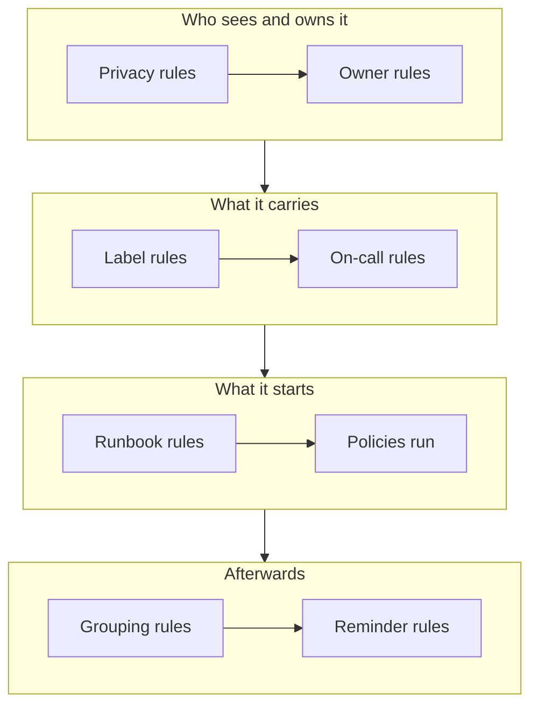

# Alert Rules & Settings

Alert configuration lives inside **Alerts**, not in **Project Settings**: the rules that act on every new alert, and the settings that shape every alert in the project. This page is the reference for each of them, and for what runs on its own when an alert is created.

:::cards
- [The rules a new alert passes through](#the-rules-a-new-alert-passes-through): In order, and what each one does.
- [On-call rules](#on-call-rules): Page the right people without picking a policy each time.
- [Reminder rules](#reminder-rules): Remind owners while an alert stays open.
- [Settings](#settings): Note templates, custom fields, measurements, episode membership and numbering.
:::

## Where alert settings live

Open **Alerts** from the **Products** menu in the top bar. The **Rules** and **Settings** sections of its side menu start folded, so expand them first. Every page here is project-wide, at addresses beginning `/dashboard/{projectId}/alerts/settings/`.

| Rules page          | What it does                                                                                   |
| ------------------- | ---------------------------------------------------------------------------------------------- |
| **Grouping Rules**  | Puts related alerts into episodes. See [Alert Episodes & Grouping Rules](/docs/alerts/episodes). |
| **On-Call Rules**   | Runs on-call policies for matching alerts and episodes.                                        |
| **Owner Rules**     | Adds owners to matching alerts and episodes.                                                   |
| **Runbook Rules**   | Starts runbooks for matching alerts.                                                           |
| **Privacy Rules**   | Makes matching alerts and episodes private.                                                    |
| **Label Rules**     | Adds labels to matching alerts and episodes.                                                   |
| **Reminder Rules**  | Reminds owners at an interval while an alert is open.                                          |

The **Settings** section holds **Alert State** and **Alert Severity**, covered on [Alert States & Severities](/docs/alerts/states-and-severities), then **Note Templates**, **Custom Fields**, **Measurements**, **Episode Membership** and **Numbering**, covered below.

Two more sections act on alerts. **Alerts → AI → Settings** decides what OneUptime AI does on its own: **Investigate new alerts**, on for new projects, and **Fix new alerts automatically**, off until you turn it on. See [AI SRE](/docs/ai/ai-sre). **Alerts → Workspace** holds the Slack and Microsoft Teams rules that post alerts and episodes to channels, and its **Summary** tab. See [Slack](/docs/workspace-connections/slack).

## The rules a new alert passes through

The rules differ in how several matches resolve:

- **Grouping Rules** and **Reminder Rules** are checked from the top of their list down, and the first match wins. Drag a rule to change its place; a new rule goes to the end.
- **On-Call Rules**, **Owner Rules**, **Label Rules**, **Privacy Rules** and **Runbook Rules** all act when they match. On-call policies, owners and labels that several rules add are added once.

**On-Call Rules**, **Owner Rules**, **Label Rules** and **Privacy Rules** have two tabs: **Alert Rules**, for alerts, and **Episode Rules**, which act the same way on each new alert episode. A new rule starts enabled; switch **Enabled** off on its edit form to pause it, and the list shows a green **Enabled** or red **Disabled** for each rule.

Most rules act on alerts and episodes created after you save them. To apply an owner, label or privacy rule to the ones you already have, use **Run Now**: see [Run Rules on Existing Resources](/docs/configuration/run-rules-now). Reminder rules are the exception: saving one matches every open alert again.

### Conditions

A rule's conditions decide which alerts it acts on, and read like sentences: "If **Alert Title** contains `database`", "And **Monitor Labels** has any of *Production*". A rule with no conditions matches every alert.

| Condition                                                     | Compares with                                                                                                  |
| ------------------------------------------------------------- | -------------------------------------------------------------------------------------------------------------- |
| **Monitors**, **Alert Severities**, **Alert Labels**, **Monitor Labels** | **Has any of**, **Has all of** or **Has none of** the values you pick.                              |
| **Alert Title**, **Alert Description**, **Monitor Name**, **Monitor Description** | **Contains**, **Does not contain**, **Equals**, **Does not equal**, **Starts with**, **Ends with**, ignoring case, or **Matches pattern** and **Does not match pattern**, for a regular expression or a `*` wildcard. |

With two or more conditions, choose **Match all**, where every one must hold, or **Match any**, where one is enough. Episode rules match an episode's severity, labels, title and description instead.

## On-call rules

**Alerts → Rules → On-Call Rules** makes paging automatic. Every matching rule adds its policies to the new alert, and the alert runs them with any policies it already had, each one once.

:::steps
### Name the rule

Click **Create Alert On-Call Rule**. On **Basic Info**, give it a **Name**, such as "Page database team for any DB alert", and a **Description** if you like.

### Choose the alerts

On **Match Criteria**, add the conditions an alert must meet. Leave them empty to match every new alert.

### Pick the policies

On **On-Call Policies**, pick the **On-Call Duty Policies** the rule runs, then create the rule.
:::

A severity pages nobody on its own: an on-call rule that matches **Alert Severities** is how "page the database team for every High alert" is set up. To see what ran for one alert, open its **On Call Executions** page. Each person is then reached the way they set up under **User Settings → On-Call Rules**, on the **Alerts** tab; see [Escalation Rules](/docs/on-call/escalation-rules).

## Owner and label rules

**Owner Rules** add owner users and teams to new alerts that match, and **Label Rules** add labels. Creating one takes two steps: **Match**, the conditions, then **Owners** or **Labels**, what the rule adds. The rule's **Name** follows what you pick until you type your own.

- **A rule can inherit.** Folded under **Inherit Owners** or **Inherit Labels**, six switches hand on the owners or labels of the alert's monitor, hosts, Kubernetes clusters, Docker hosts, Podman hosts and services. Episode rules have no such switches.
- **A new rule has to add something**: pick at least one owner or label, or turn on a switch.
- **Notify Owners**, under **More fields** on an owner rule, decides whether the people added are told.

[Label and Owner Rules](/docs/configuration/label-and-owner-rules) covers the form step by step, for every kind of resource.

## Privacy and runbook rules

**Privacy Rules** make new alerts that match private, before anything else runs: only their owners and the project's admins and owners can see them. A rule has a **Basic Info** step and a **Match Criteria** step, and makes private every alert it matches. See [Private alerts](/docs/alerts/index#private-alerts).

**Runbook Rules** start a runbook when a new alert matches, unless the alert was created resolved. See [Runbook Rules](/docs/runbooks/rules).

## Reminder rules

**Alerts → Rules → Reminder Rules** reminds an alert's owners while it stays open. Each new alert gets the first rule that matches it, from the top of the list down.

:::steps
### Name the reminder rule

Click **Create Alert Reminder Rule**. On **Rule Info**, give it a **Name**, such as "Critical Alert Reminders".

### Choose which alerts to remind about

On **Match Criteria**, pick the **Alert Severities** and **Labels** it applies to. Leave them empty to remind about every alert.

### Set the interval

On **Reminder Settings**, set **Reminder Interval (minutes)**, how often owners are reminded, and **Stop Reminders When**: **Resolved**, the default, or **Acknowledged**. Then create the rule.
:::

Owners get each reminder as **Alert reminder**, which is on by email by default. An alert's rule is matched again when its severity or labels change. To stop the reminders for one alert, turn **Send reminders** off on its **Settings** page; it saves the moment you flip it.

## Settings

### Note templates

**Alerts → Settings → Note Templates** holds ready-made text for private notes. The **Private Note Templates for Alerts** card lists them; **Create Alert Note Template** asks for a **Template Name**, a **Template Description** and the **Note**. A template is offered when someone writes a private note on an alert or an episode, and when they acknowledge or resolve one, and its text can be edited before it is posted. Alert note templates are plain text: unlike incident note templates, they fill in no variables.

### Custom fields

**Alerts → Settings → Custom Fields** adds your own fields to every alert, such as a customer tier or a ticket reference. Fill them in on an alert's **Custom Fields** page, or through the API as `customFields`. A field can copy its value from a monitor custom field instead of being typed in: see [Fields copied from a monitor](/docs/incidents/settings#fields-copied-from-a-monitor), which works the same way for alerts.

### Measurements

**Alerts → Settings → Measurements** times how long things take on every alert. Pick **Time to acknowledge** or **Time to resolve**, or two moments of your own, such as when **The alert is created** and when it enters a state you pick. Each measurement is shown on the alert's page and charted as `oneuptime.alert.measurement.<key>`. See [Measurements](/docs/incidents/settings#measurements), which works the same way for alerts.

### Episode membership

**Alerts → Settings → Episode Membership** decides whether an alert can be in more than one episode. Turn on **An alert can be in only one episode**, and an alert that is in an episode is not added to another one, from the dashboard, the API, a workflow or a grouping rule, until it is removed from that episode. It is off until you turn it on, and only Project Owners and Project Admins can change it. Turning it on takes no alert out of an episode. See [One episode per incident](/docs/incidents/episodes#one-episode-per-incident), which works the same way for alerts.

### Numbering

**Alerts → Settings → Numbering** sets the text in front of alert and episode numbers: `ALT-` and `AE-` in a new project, or `#` with none. **Update** opens **Alert Number Prefix** and **Alert Episode Number Prefix**, with a preview as you type. Only alerts and episodes created afterwards get the new prefix. The rules for a prefix are on [Number prefixes](/docs/incidents/settings#number-prefixes).

The **Next Number** card under it sets the number the next alert and the next episode get, to carry on from another tool's numbers: **Update** opens **Next Alert Number** and **Next Alert Episode Number**, each higher than the highest used so far. See [Next numbers](/docs/incidents/settings#next-numbers).

> [!NOTE]
> On OneUptime Cloud, note templates and custom fields take the **Growth** plan or above.

## Workflows

Every alert model has workflow triggers and actions, named after it: **On Create Alert**, **On Update Alert**, **On Create or Update Alert** and **On Delete Alert**, the same for **Alert Episode**, **Alert State Timeline** and the others, and actions such as **Create One Alert** and **Update One Alert**. Alert custom field definitions are the one exception: they have no workflow triggers. See [Workflows Overview](/docs/workflows/index).

## Who can change these

Rules, custom fields and measurements need a Project Owner or Project Admin, or a custom role with that rule's own permission. **Alert Member** works with alerts and episodes, their notes, owners and state timelines, and note templates, and **Alert Admin** also manages alert states and severities. See [Users, Teams & Permissions](/docs/permissions/index).

## Next steps

:::cards
- [Alert Episodes & Grouping Rules](/docs/alerts/episodes): The grouping rules, in depth.
- [Escalation Rules](/docs/on-call/escalation-rules): What happens once an on-call rule runs a policy.
- [Label and Owner Rules](/docs/configuration/label-and-owner-rules): The rule form, step by step.
- [AI SRE](/docs/ai/ai-sre): Investigate and fix new alerts on their own.
:::
