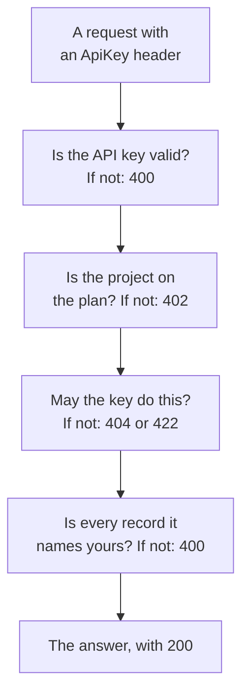

# OneUptime API Reference

Everything you can do on the OneUptime dashboard, you can also do through its REST API: automate repetitive work, connect OneUptime to your other tools, or build your own integrations. This page shows how to make your first request, and the rules every request follows. Every endpoint and field is listed in the [full API reference](/reference).

:::cards
- [Make your first request](#make-your-first-request): An API key, one header and a curl command.
- [Requests and answers](#requests-and-answers): The six requests every resource has, and what each status code means.
- [Plans and the API](#plans-and-the-api): What a plan sells, and what still works below it.
- [Naming and writing records](#naming-and-writing-records): IDs, references, switches and the fields OneUptime sets.
- [States and episodes](#states-and-episodes): The state a record starts in and moves through.
- [What a request can reach](#what-a-request-can-reach): Reads, changes and deletes, one project at a time.
:::

## How a request is answered

The API is organized around REST: standard HTTP methods and status codes, JSON in and JSON out. Each request carries an API key and passes a few checks. The first check it fails answers with a status code and `{ "message": "..." }`, so the message says what stopped it.



## Make your first request

All API requests are authenticated with an API key. A key belongs to one project, and does what its permissions allow.

:::steps
### Create an API key

Open **Project Settings → Advanced → API Keys** and click **Create API Key**. Give it a **Name**, and under **Access** pick what it may do: **Project Admin**, **Project Member**, **Viewer**, or **Choose permissions later** to add single permissions on the key's page. The key expires a year from today unless you pick another date under **Advanced**.

### Copy the key

The key's page opens. Copy the **API Key** from the **API Key Details** card, and keep it out of your code:

```bash
export ONEUPTIME_API_KEY="your-api-key"
```

### Send a request

List the first ten monitors. The key reads its own project, so the request names no project:

```bash
curl -X POST 'https://oneuptime.com/api/monitor/get-list?skip=0&limit=10' \
  -H "ApiKey: $ONEUPTIME_API_KEY" \
  -H 'Content-Type: application/json' \
  -d '{ "select": { "name": true } }'
```

The answer is `{ "data": [...], "count": ... }`: the monitors, and how many there are in all. On a self-hosted install, use your own OneUptime address in place of `https://oneuptime.com`.
:::

### Examples for each resource

Every resource in the OneUptime dashboard has a **Developer** section in its side menu, collapsed until you open it. Its **API** page has ready-to-run `curl` commands for that resource, pointed at your OneUptime and filled in from your own project: read, change and delete it from the resource's own page, or list, count and create from a list page (for example **Monitors**). The commands read your API key from the `ONEUPTIME_API_KEY` environment variable.

The examples are written for the resource. On the **Incidents** list, for example, the list request shows its answer with your first incident, the filters find incidents that are not resolved, of one severity, about one monitor or from the last seven days, using your own states, severities and monitors, and the create request declares an incident with one of your severities, with a line on what each field is for. An incident's own page reads it with its real answer, moves it to another of your severities, and has its common tasks: acknowledge and resolve it (with your project's own states), and add internal or public notes. Every API page ends with the resource's endpoints.

## Requests and answers

Every resource has the same requests, under `https://oneuptime.com/api` and the resource's path, such as `/monitor` or `/incident`:

| Request | Method and path | What the body holds |
| --- | --- | --- |
| List | `POST /api/<resource>/get-list` | `query`, `select` and `sort` |
| Count | `POST /api/<resource>/count` | `query` |
| Read one | `POST /api/<resource>/<id>/get-item` | `select` |
| Create | `POST /api/<resource>` | `{ "data": { ... } }` |
| Change one | `PUT /api/<resource>/<id>` | `{ "data": { ... } }`, the fields to change |
| Delete one | `DELETE /api/<resource>/<id>` | Nothing |

`POST /api/<resource>/<id>/update-item` and `POST /api/<resource>/<id>/delete-item` change and delete one record too, for clients that send only `POST`.

### Filter, sort and page

A list or a count takes a `query`. A field with a value matches that value; an object with a `_type` compares:

| `_type` | Matches |
| --- | --- |
| `Search` | Text that contains `value` |
| `NotEqual` | Anything but `value` |
| `GreaterThan`, `LessThan` | Later dates or larger numbers, or earlier and smaller ones |
| `InBetween` | Dates or numbers between `startValue` and `endValue` |
| `Includes` | Any of the values in `value` |
| `IsNull`, `NotNull` | No value, or any value |

A field of a record the resource names is filtered under its relation: `"user": { "name": { "_type": "Search", "value": "ada" } }` finds the team members whose user's name contains "ada". Filtering by a field needs permission to read it, through a relation as on the resource itself: a filter on a field you may not read is refused with a `422` that names it.

A resource with owners - a monitor, an incident, an on-call policy and every other one with user and team owners - is also filtered by who owns it, under `owners`: `"owners": { "_type": "OwnedBy", "userIds": ["..."], "teamIds": ["..."] }` finds the records owned by one or more of those people and teams. `match` is `AnyOf` unless you set it: `NoneOf` finds the records none of them own, records without owners included, and `AnyOwner` and `NoOwner` find the records with any owner or with none, naming no one. A team's members are not owners of what the team owns. One filter names at most 1,000 people and teams together, a resource without owners refuses it with a `400`, and filtering by owners without permission to read them is refused with a `422`.

`select` names the fields to return, and `_id` always comes back. `sort` orders them, `ASC` or `DESC`; without one, the newest come first. A list returns 10 records unless you set `limit`, up to 10,000, and `skip` passes over that many first: keep raising `skip` by `limit` until you have `count` of them. Add `?output-type=csv` to a list request for CSV instead of JSON.

For example, the monitors whose name contains "checkout", created since the start of 2026, newest first:

```bash
curl -X POST 'https://oneuptime.com/api/monitor/get-list' \
  -H "ApiKey: $ONEUPTIME_API_KEY" \
  -H 'Content-Type: application/json' \
  -d '{
    "query": {
      "name": { "_type": "Search", "value": "checkout" },
      "createdAt": { "_type": "GreaterThan", "value": "2026-01-01T00:00:00.000Z" }
    },
    "select": { "name": true, "createdAt": true },
    "sort": { "createdAt": "DESC" },
    "limit": 100
  }'
```

Dates and IDs other than `_id` come back wrapped, as `{ "_type": "DateTime", "value": "..." }` and `{ "_type": "ObjectID", "value": "..." }`: read them from `value`.

Every ID a request filters by or writes - `_id`, a field such as `monitorId`, and each record a relation lists, such as `"labels": [{ "_id": "..." }]` - is a UUID, sent as text or wrapped the way it comes back. Anything else, such as text that is not a UUID or an object in place of an ID, is refused with a `400` that names the field and says whether it was in the `query` or the `data`, and nothing is read or written:

```text
Invalid ID for "currentIncidentStateId" in the query: "resolved". An ID is a UUID, such as "550e8400-e29b-41d4-a716-446655440000".
```

### Status codes

| Code | What it means | Read more |
| --- | --- | --- |
| `200` | It went through. A list or a count answers with the records you may read, none when there are none. | [Reading one record by its ID](#reading-one-record-by-its-id) |
| `400` | The request is wrong: the API key is invalid, a value is not allowed, a field cannot be written, a record it names is not yours, or it changes several projects at once. The message says what is wrong. | [Records a request names](#records-a-request-names) |
| `402` | The project's plan does not include what the request uses. The message names the plan. | [Features your plan does not include](#features-your-plan-does-not-include) |
| `404` | The record does not exist, is in another project, or is one you may not read: the same answer for each. | [Changing or deleting a record you may not read](#changing-or-deleting-a-record-you-may-not-read) |
| `422` | You may not do this: the API key has no permission for this kind of record, you may read the record but not change it, or a permission's labels leave it out. The message says why. | [Changing or deleting a record you may not read](#changing-or-deleting-a-record-you-may-not-read) |
| `500` | Something failed on the server. When the owner of a new record cannot be written, the record is removed again, so the create can be tried again. | [Records a request names](#records-a-request-names) |

## Plans and the API

### Features your plan does not include

On OneUptime Cloud, some resources are sold on a plan: single sign-on providers and SCIM connections on **Scale**; API keys, on-call schedules, and Slack and Microsoft Teams notification rules and summaries on **Growth**, among others. Creating one, changing one or switching one on needs that plan. Below it, the request is refused with `402 Payment Required`, and the message names the plan.

Some settings of a resource are sold on a plan in the same way. For example: a status page that is private, that hides one of its lists, or that has custom HTML, CSS or JavaScript, email reports, SMS, Slack, Microsoft Teams or webhook subscribers, or an IP allowlist; a dashboard that is shared publicly, or its IP allowlist; a form's IP allowlist; a project's audit logs. Each one's guide, and the dashboard beside the setting, names the plan it needs. Such a setting needs its plan whenever it is written - when the resource is created with it as when it is changed later - so a create that switches one on below the plan is refused with `402` too. A setting left at its default, or put back to it, works on every plan: a create that leaves these settings alone goes through, and so does a Terraform configuration that does not set them.

What a project already has stays manageable whatever its plan, for example after a trial ends or the plan goes down:

- you can delete those records;
- you can switch one off, on a resource with an `isEnabled` field, by sending `"isEnabled": false` and nothing else;
- you can list and read the ones a project has to find after the plan goes down - to switch them off, or to see what stopped: single sign-on providers, SCIM connections, API keys and their permissions, on-call schedules, and Slack and Microsoft Teams notification rules and summaries.

The usual permissions still decide who can do each, exactly as on the plan. Reading the other resources a plan sells, such as templates, custom fields, monitor groups, on-call logs and form submissions, still needs the plan: reading them is using the feature. An API key's permissions are not deleted one by one below **Growth**, because deleting a block permission would give the key more access; delete the key instead.

### API keys and SCIM below their plan

On OneUptime Cloud, a project's API keys work only while the project is on **Growth** or above, and its SCIM connections - the project's own and its status pages' - work fully only while it is on **Scale** or above. When the project moves below that plan:

- Every request made with one of the project's API keys is refused with `402 Payment Required`, whatever it asks for: the REST API, and everything that calls it with an API key - Terraform, the `oneuptime` CLI, MCP clients connected with an API key, workflows that send one in a request header, and your own scripts. The message names the plan: `API keys need the Growth plan. This project's plan does not include them, so its API keys stopped working. The keys are kept: upgrade the project to Growth in Project Settings > Billing and Invoices > Billing and they work again.`
- Its SCIM connections only remove people. Deactivating and deleting people, and removing them from groups, still work, so anyone who leaves still loses their access; every SCIM request that would add or change people or groups is refused with `402`, in the SCIM error format, so your identity provider shows why ([SCIM below the Scale plan](/docs/identity/scim#below-the-scale-plan)).

Nothing is deleted or switched off. The keys and connections are kept, and they work fully again, as they are, as soon as the project is back on the plan: no new keys to make, nothing to set up again in your identity provider. A plan change takes effect within a minute.

Below **Growth**, **Project Settings** > **Advanced** > **API Keys** lists the keys the project still has and says they stopped, so any of them can be deleted (revoked) on every plan. Creating or changing keys needs **Growth**. **Project Settings** > **Billing and Invoices** > **Billing** names how many API keys a lower plan stops and how many SCIM connections it limits, on each plan you can pick, and what the project's plan has stopped; the project's owners get an email when a plan change stops them. The owners of projects that were already below these plans when this started get one email saying what stopped and how to turn it back on.

Only a project's API keys and SCIM connections are affected. People are not affected: signing in to the dashboard, and MCP clients connected by signing in, work as before. Telemetry ingestion keys, probe keys and agent keys are not API keys, and keep working. Self-hosted installs have no plans, so nothing changes for them.

## Naming and writing records

### Finding a resource's ID

Requests that read, change or delete one resource name it by its ID, a UUID. On the resource's own page, its details card ends with a small **ID** line that shows the start of the ID: click the ID, or the copy button beside it, to copy the whole ID. Lists that offer it have **Show ID** in a row's **⋯** menu, and the ID is also the last part of the page's address. Your project's ID is the first thing on the **Project Details** card of **Project Settings → Project**.

### Records a request names

Many resources name other records: a monitor its labels and probes, a status page subscriber its status page, a network device its site, an incident's member the incident and the role. Each rule below holds for the API, Terraform and workflows alike:

| When a request | It must | Otherwise |
| --- | --- | --- |
| names a record by its ID | name a record of your project | `400` |
| creates a record that is read through another one, such as a note | create it under one you may read | `400`, or `422` with no permission to read that kind of record |
| moves a record under another one | move it under one you may read | `400` |
| lists records, or names one in a field of its own | name records your permission to read reaches | `400` |
| names a setting that holds credentials | come from someone who may read that kind of setting | `400` |
| creates or relabels a record under a permission restricted to labels | give the record one of those labels | `422` |
| names one record two ways | name the same record both times | `400` |

#### Every ID must be your project's

Every ID you send for a record a resource names must be a record of your project — the dashboard's pickers offer nothing else — and requests from Terraform and workflows are held to the same. An ID of another project's record and an ID that does not exist are refused alike, with a `400` that names the field and the ID:

```text
This network device references records that are not in this project: Network Site "…". Please pick values from this project and try again.
```

People are checked by membership: someone who is not a member of the project is refused the same way. A global probe, which every project can use, counts as your project's. Changing a resource checks only the IDs the change adds, so a resource that names something that has since gone can still be saved.

#### Records read through another one

A record read through another one - an incident's or an alert's notes and state timeline, a status page's announcements, domains and groups - must also name one you may read, by the rule a read of it follows: an incident outside the labels or owners your permission to read incidents reaches, carrying a label a block on reading incidents takes away, or marked private without you among its owners, directly or through a team (project owners and admins see every private incident, alert and episode), is refused with the same `400`, and nothing is written. Each status page an announcement names must be one you may read, and a key whose permission to read status pages reaches only some of them must name at least one. A permission to create such a record needs one to read the record it is created under; without one, the create is refused with a `422` that names the permissions that would let it in:

```text
You do not have permissions to create Incident Internal Note. It is read through its Incident, and you need one of these permissions to read Incidents: …
```

A change that moves such a record follows the same rule: each record it adds as a parent - another status page for an announcement, another service for a record read through its service - must be one you may read, or the change is refused with the same `400` and nothing is written. The parents a record has already are not checked again, and a change that leaves it under none needs a permission to read that kind of record that reaches every one of them, as a create that names none does.

#### Owners

The owners of a resource - the user and team owner records of a monitor, an on-call policy, a dashboard and every other resource with owners - are read through the resource they own the same way: listing, reading, adding and removing them needs a permission to read that resource, under its labels and owners, and an owner record of a resource you may not read is answered as if it did not exist. Adding and removing them keeps to the scope of the permission that does it, too: one scoped to `Owned` reaches only the owners of resources you or one of your teams own, and adding an owner to any other resource is refused with a `422` that says so.

#### Records a write lists or names

The records a create or a change lists - an incident's monitors and on-call policies, an alert's services, a scheduled maintenance event's status pages, a rule's runbooks - keep to your permission to read that kind of record when you have one, and to a block with labels on reading it either way: one outside them is refused with the same `400`. A change checks only the records it adds to a list, so the ones the list holds already stay.

The one record a create or a change names in a field of its own - an alert's monitor, the monitor a status page resource shows, a cost budget's service, the incident a runbook run is linked to - keeps to the same rule, under either of its names: one outside your permission to read that kind of record, or carrying a label a block on reading it takes away, is refused with the same `400`. A change checks it only when it names another record than the one the field holds already. OneUptime's global probes and AI agents, which every project can use, stay open to every project. The records a template fills in for you are checked the same way once they are filled in, before anything is saved: the monitors, status pages and on-call policies an incident template adds to an incident declared from it must be ones you may read, as if you had picked them.

#### Settings that hold credentials

A setting that holds credentials - an SMTP server, a call and SMS provider, SNMP credentials, a video call connection, an API key, an external MCP server - is named only by a caller who may read that kind of setting: a status page's `smtpConfig` and `callSmsConfig`, an incoming call policy's `projectCallSMSConfig`, a network device's or site's `snmpCredentialProfile`, an incident's or alert's video call `videoCallConnection`, an API key permission's `apiKey`, and an AI rule's `externalMcpServers`. Naming one without a permission to read that kind of setting - or with one a block with no labels takes away - is refused with the same `400`, under either of its names; a change that keeps the setting a record names already is not asked about. The number search and the owned-number list of an incoming call policy take the same read of the Call/SMS config they name.

#### Labels and owners on a create

A permission to create restricted to labels creates only records carrying one of its labels - for a record with no labels of its own, records under one that carries one - unless another permission to create that kind of record reaches the whole project, and a block with labels on a permission to create refuses a record carrying one of its labels. A create outside them is refused with a `422` that names the labels:

```text
Your access lets you create Status Pages only with one of these labels: Production. Add one of them and try again.
```

A permission to create scoped to **Owned** creates a monitor, a status page or another record with owners of its own only for a person, who becomes one of its owners, and a note or another record that takes its owners from the record it belongs to only under one you or one of your teams own.

The creator is made an owner right after the record is saved, before anything else happens to it. If the owner row cannot be written, the record is removed again and the create is refused with a `500`, so no record is left behind that its creator could not reach.

#### A change of labels

A change of the labels a record carries - its own labels, or for a record with no labels of its own the records it names - keeps to your permission to change that kind of record the same way: with one restricted to labels, the record keeps at least one of them, unless another permission to change it reaches the whole project, and a block with labels on a permission to change refuses giving it one of its labels. Such a change is refused with a `422` that names the labels:

```text
Your access lets you change Monitors only with one of these labels: Production. Keep one of them and try again.
```

#### Naming a record two ways

A record can be named in two ways: by its ID field (`monitorId`), or by the relation (`"monitor": { "_id": "…" }`), which is what the dashboard's forms send. Send one of them. If a request sends both, they must name the same record: a request whose two disagree — two different IDs, or an ID and an empty value — is refused with a `400` that names both fields:

```text
Conflicting Monitor references were provided. monitorId and monitor are names for the same field and must hold the same value: send only one of them, or the same id in each.
```

Either name is checked the same way. The rules about the record you name hold whichever name you send it under: a status page group's parent group must be on the same status page, a status page takes at most three header links, and a group's name must be unique on its status page.

### Switches

A field that is on or off - `isEnabled`, `isVisibleOnStatusPage`, `isArchived` and every other `true` or `false` field - takes `true` or `false`. Text and numbers that the database reads as one of them are taken as that value, the same way for the API, Terraform and workflows: `"true"`, `"yes"`, `"on"`, `"1"` and `1` are `true`, and `"false"`, `"no"`, `"off"`, `"0"` and `0` are `false`, in any case. Everything OneUptime does with the record treats it as that value too: a scheduled maintenance event sent with `"isVisibleOnStatusPage": "true"` shows its images on the status page, and `"isEnabled": "false"` switches a resource off below its plan like `false` does. Any other value, such as `"maybe"`, `""` or `2`, is refused with a `400` that names the field:

```text
isVisibleOnStatusPage must be true or false.
```

An update that writes a record's values as they already are changes nothing: it does not start the record's **On Update** workflows, send live updates or add an audit log entry. `false` written over `false` counts as the same value, and so do `"false"` written over `false`, a number written as its text, a time written as the same instant in another format, and labels written as the same labels in any order. When an update changes some values and writes others back as they are, its audit log entry lists only the values that changed, and a workflow's **Fields to watch** hears only those.

### Where a project was bought

A project's reseller, reseller plan and reseller license (`resellerId`, `resellerPlanId`, `resellerLicenseId`, and the relations `reseller` and `resellerPlan`) are set by OneUptime alone: when a project is created with a reseller's promo code, and when the reseller changes the plan. A create or a change of a project that sends one of them is refused with a `400` that names the field, whoever sends it:

```text
User is not allowed to create on resellerId column of Project. No permission allows it: the column is set by the server, not by a request.
```

### Who created a record

OneUptime records who created a record — and who archived it, resolved it, acknowledged it or triggered it — from the request itself: the person signed in, or nobody when the request comes with an API key or from a workflow. These fields (`createdByUserId` and the other fields ending in `ByUserId`, with their relations such as `createdByUser`) are read-only, and so is when a record was archived or resolved (`archivedAt`, `markedAsResolvedAt`, `markedAsArchivedAt`): turning `isArchived` or `isResolved` on records who did it and when, and turning it off clears both. Sending a switch as it already stands keeps who turned it, and when.

The API reference marks these fields read-only. A value a request sends for one beside other changes is ignored, so the rest of the change goes through; an update that sends nothing else is refused with a message naming the fields. Records that OneUptime itself creates on someone's behalf — a note posted from Slack or Microsoft Teams, an account made by an invitation — name that person.

## States and episodes

### The state a new record starts in

An incident, an alert, an incident episode and an alert episode can be created in any of your project's states, as the **Initial State** field of their create forms does: send `currentIncidentStateId` (incidents and incident episodes) or `currentAlertStateId` (alerts and alert episodes), or the relation. The record starts in that state and its state timeline begins with it. Leave it out and it starts in your project's created state, the one flagged `isCreatedState` — or, for an incident declared from a template that has an initial state, in the template's. A state of another project is refused like any other record. Terraform's `current_incident_state_id` and `current_alert_state_id` work the same way. A record created at or past your acknowledged state pages no one, and one created resolved is also not grouped, remediated or investigated by AI and gets no Slack or Microsoft Teams channel — see [Declared already acknowledged or resolved](/docs/incidents/declaring-incidents#declared-already-acknowledged-or-resolved).

### Changing a record's state

A record's state changes by a row of its state timeline - `POST /api/incident-state-timeline`, `/api/alert-state-timeline`, `/api/incident-episode-state-timeline`, `/api/alert-episode-state-timeline` or `/api/scheduled-maintenance-state-timeline` - or by an update that writes its current state (`currentIncidentStateId`, `currentAlertStateId`, `currentScheduledMaintenanceStateId`, or the relation), which records the same row. Either way one rule holds the move, for an episode as for an incident, an alert or a scheduled maintenance event: a state earlier in your project's order than the record's current one is refused before anything is saved, as is the state it is in already:

```text
Episode cannot transition to Acknowledged state from Resolved state because Acknowledged is before Resolved in the order of incident states.
```

A state set by mistake is put right by deleting its row from the record's state timeline. See [Order is a real constraint](/docs/incidents/states-and-severities#order-is-a-real-constraint-not-a-display-preference).

### The episode an incident or alert is in

An incident's `incidentEpisodeId` and an alert's `alertEpisodeId` — and their relations `incidentEpisode` and `alertEpisode` — name the latest episode it was added to and is still a member of, or nothing. They are read-only: OneUptime sets them from the episode's members. To put an incident in an episode, create an Incident Episode Member (`POST /api/incident-episode-member` with `incidentEpisodeId` and `incidentId`); to take it out, delete that member, and the incident then names the latest episode it is still in, or none. Alerts work the same way through Alert Episode Members (`/api/alert-episode-member`, with `alertEpisodeId` and `alertId`). Grouping rules add incidents and alerts to episodes the same way. A create or update of an incident or alert that sends its episode is refused, whoever sends it — the API, Terraform, the MCP tools or a workflow. In Terraform, `incident_episode_id` and `alert_episode_id` can be read but not set; the `oneuptime_incident_episode_member` and `oneuptime_alert_episode_member` resources manage membership.

## What a request can reach

### Changing or deleting a record you may not read

A change or a delete reaches only the records the API key - or the person signed in - may read. A record outside its labels or owners, behind a block on reading, or read through another record it may not read (an incident's note, a status page's announcement) cannot be changed or deleted either. A permission to change or delete a kind of record works together with the permission to read it, and one to change an incident's notes with one to read incidents.

A request that changes or deletes one record by its ID - `PUT /api/<resource>/<id>` or `POST /api/<resource>/<id>/update-item`, `DELETE /api/<resource>/<id>` or `POST /api/<resource>/<id>/delete-item` - and reaches nothing answers:

- `404` when the record does not exist, is in another project, or is one you may not read - the same answer for each:

```text
Incident not found.
```

- `422` when you may read the record but not change or delete it, with the reason:

```text
You do not have permission to update this incident.
```

A delete that reached nothing used to answer `200`. Updates and deletes by query, such as a workflow's update and delete steps, answer with how many records they changed, `0` when they reached none. Terraform reads a `404` on `terraform destroy` as a resource that is already gone.

Telemetry follows the same rule. A delete of logs, traces, metrics, exceptions, profiles or session replays reaches the rows of the resources - services, hosts, clusters and the like - whose telemetry you may both read and delete, and is made in one project at a time: a request across all of your projects is refused. A delete of one row by its ID that reaches nothing answers `404` or `422` as above.

### Changes are made in one project at a time

An update or a delete of a project's records is made in the project the request names: the `tenantid` header, or, for an API key, the key's own project. A signed-in user's update or delete that names no project, or that asks across all of their projects with the `is-multi-tenant-query` header, is refused with `400`:

```text
Changes to incidents are made in one project at a time. Please pass the project ID in the 'tenantid' header.
```

Such a request used to fail with `500`. Reads may still ask across all of your projects.

### Reading one record by its ID

A read of one record by its ID - `POST /api/<resource>/<id>/get-item` - answers `404` when the record does not exist, is in another project, or is one you may not read, the same answer for each:

```text
Incident not found.
```

It used to answer `200` with an empty body. A list (`get-list`) and a count still answer `200` with the records you may read, none when there are none. The Terraform provider reads a `404` on refresh as a resource that is gone and removes it from the state, so the next plan creates it again: give the API key it uses the permissions, and the labels, to read every resource it manages. The MCP tools answer a `404` with an error that points to the matching list tool, and the CLI exits with code `3`.

## The full endpoint reference

Every resource, endpoint and field is listed in the [OneUptime API reference](/reference). It is available in several languages: your language is picked from your browser, and you can switch at any time with the selector at the top of the page.

## Troubleshooting

:::details Every request answers 400 Invalid API Key
The `ApiKey` header is empty, is not a key, or names a key that has expired or been reset. Copy the key again from its page under **Project Settings → Advanced → API Keys**, where its **Expires** date is too.
:::

:::details Every request answers 402 Payment Required
On OneUptime Cloud, API keys work only while the project is on the **Growth** plan or above. The keys are kept, and work again as they are once the project is back on the plan: see [API keys and SCIM below their plan](#api-keys-and-scim-below-their-plan).
:::

:::details Every request answers 422 You do not have permissions
The API key has no permission for that kind of record. A key made with **Choose permissions later** can do nothing until it gets one: open it under **Project Settings → Advanced → API Keys**, then click **Add Role** or **Add Permission**. The message names the permissions that would let the request in.
:::

:::details A record I can see in the dashboard answers 404
The API key reads only what its permissions, and their labels, reach, and a key may reach less than your own account. Give the key a permission that reaches the record: see [Reading one record by its ID](#reading-one-record-by-its-id).
:::

:::details An update answers 400 Invalid request body
An update sends the fields to change inside `data`, as `{ "data": { "name": "New name" } }`. A body without it is refused, rather than answering `200` and changing nothing:

```text
Invalid request body. The update payload should be an object of the form { "data": { ...fields to update... } }.
```
:::

:::details A write answers 400 and names a field and an ID
The ID names a record of another project, one that does not exist, or one your permissions do not reach. See [Records a request names](#records-a-request-names).
:::

## Next steps

:::cards
- [Users, Teams & Permissions](/docs/permissions/index): What an API key's permissions and labels reach.
- [Terraform Provider](/docs/terraform/index): Manage OneUptime resources as code, through the same API.
- [OneUptime CLI](/docs/cli/index): Call the API from your terminal and your scripts.
- [MCP Server](/docs/ai/mcp-server): Let AI assistants work with your project.
:::
