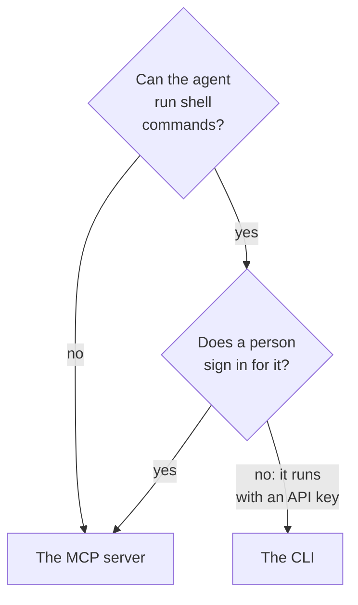

# CLI for AI Agents

An AI agent that can run shell commands, such as a coding agent in your editor or a job in your pipeline, can work with OneUptime through the CLI instead of the [MCP server](/docs/ai/mcp-server). This page says when each one fits, and how an agent installs the CLI, finds its way and reads its answers.

:::cards
- [The CLI or the MCP server](#the-cli-or-the-mcp-server): Which one an agent should use.
- [Set it up for an agent](#set-it-up-for-an-agent): Install it, and give it a key in the environment.
- [How an agent finds its way](#how-an-agent-finds-its-way): The resources, their fields and the help.
- [Read the answers](#read-the-answers): JSON from every command, errors included.
:::

## The CLI or the MCP server

Both reach the OneUptime API, and do what their credentials allow. They differ in what the agent needs to reach them:



| | The CLI | The MCP server |
| --- | --- | --- |
| The agent needs | A shell, and Node.js 22 or later | An MCP client, such as Claude or Cursor |
| It signs in with | A project API key, in `ONEUPTIME_API_KEY` | Your OneUptime account, or an API key |
| It reaches | Every resource of the API, 450 and more | The records and telemetry it has tools for, and tools for incident response |
| It suits | Scripts the agent writes for people to keep, checks in a pipeline, and work with many records | A conversation: looking into an incident, setting up a monitor |

Use the CLI when the agent already runs commands, as a coding agent does, or when what it builds should keep running without it: a script in a repository, a step of a pipeline. Use the MCP server when a person talks to the agent in a chat client, so the agent works with their permissions and the client asks before a change.

## Set it up for an agent

Every OneUptime serves the CLI's install script for its own release: the commands below download it from `https://oneuptime.com`, so on a self-hosted OneUptime replace it with your URL. The script is saved as `install.sh` first, so you can read it before you run it:

```bash
curl -fsSL https://oneuptime.com/install/cli -o install.sh
ONEUPTIME_URL=https://oneuptime.com bash install.sh
```

Give the agent a project API key with only the access its work needs, in the environment rather than on the command line, and have it check the key first:

```bash
export ONEUPTIME_API_KEY="your-api-key"
export ONEUPTIME_URL=https://oneuptime.com
oneuptime whoami --check -o json
```

Create the key in **Project Settings → Advanced → API Keys**: see [Create an API key](/docs/api-reference/api-reference#create-an-api-key). A key that may only read lets the agent look, and nothing else.

## How an agent finds its way

The CLI says what it can do, without an API key and without a request:

| Command | What it answers |
| --- | --- |
| `oneuptime resources -o json` | Every resource: its command, its names, its API path, its operations and its actions |
| `oneuptime incident fields -o json` | A resource's fields: what each is for, its type, whether a create needs it, and its flag |
| `oneuptime incident create --help` | A command's arguments and flags |

A field that holds an ID says which resource's ID it takes, so the agent lists that resource first: `incidentSeverityId` takes an ID from `oneuptime incident-severity list`. A field that names a person takes their email address too, such as `--user-email`.

## Read the answers

Have the agent add `-o json`, or `--json`, to every command. Every command then answers with JSON, the ones whose answer is a sentence included, and an error is one JSON object on the standard error:

```bash
oneuptime incident acknowledge 6f1c2a40-3b1e-4c55-9a0b-3e2f8d7c1a11 -o json
```

```json
{
  "_id": "6f1c2a40-3b1e-4c55-9a0b-3e2f8d7c1a11",
  "action": "acknowledge",
  "changed": true,
  "state": {
    "_id": "0b7d5e2c-8f4a-4d1b-9c3e-5a6f7b8c9d0e",
    "name": "Acknowledged"
  }
}
```

The exit code says what happened: `0` when it worked, `2` when the API key is missing or refused, and `3` when the record is not there. An error's JSON has the same code in `exitCode`, and in `hint` what to do next. See [Output Formats](/docs/cli/output-formats#json) and [Exit codes](/docs/cli/scripting#exit-codes).

## Next steps

:::cards
- [Resource Operations](/docs/cli/resource-operations): Every operation, with its flags and filters.
- [Command Reference](/docs/cli/command-reference): Every command, option and default.
- [MCP Server](/docs/ai/mcp-server): Connect a chat client to OneUptime instead.
:::
