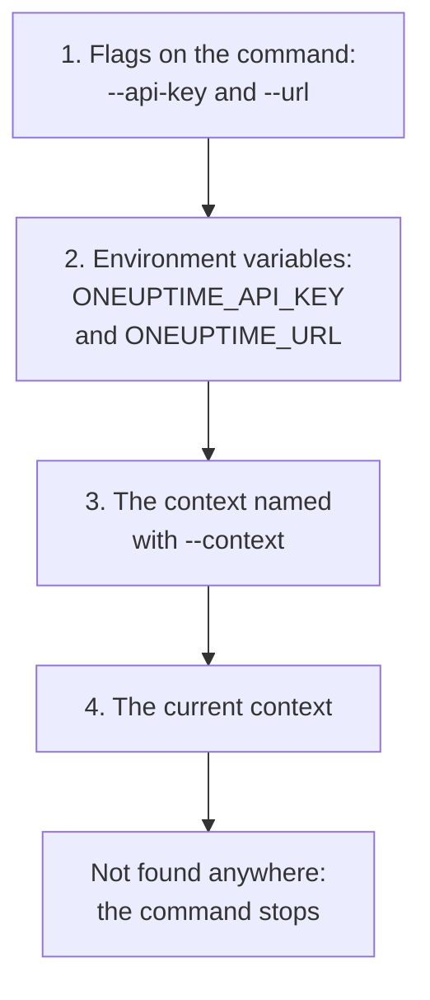

# Authentication

Every request the CLI sends carries an API key of your project. Save keys once with `oneuptime login`, one context for each environment, or hand them to a command in flags or environment variables, as scripts do. This page shows each way, and which one a command uses when there are several.

:::cards
- [Log in](#log-in): Save an API key and your OneUptime's address.
- [Contexts](#contexts): A saved login for each project or environment, and switching between them.
- [Which credentials a command uses](#which-credentials-a-command-uses): Flags first, then environment variables, then contexts.
- [Troubleshooting](#troubleshooting): No credentials found, invalid keys and refusals.
:::

## Before you begin

You need an API key of your project. Create one in **Project Settings → Advanced → API Keys** with **Create API Key**, and give it the access your commands need: see [Create an API key](/docs/api-reference/api-reference#create-an-api-key). A key does what its permissions allow, so a key that may only read records can list and read them, but not change them.

On OneUptime Cloud, API keys work only while the project is on the **Growth** plan or above. Below it, every command answers `API error (402)` with a message that names the plan, until the project is upgraded; then the same key works again. See [API keys and SCIM below their plan](/docs/api-reference/api-reference#api-keys-and-scim-below-their-plan).

## Log in

`oneuptime login` saves an API key and your OneUptime's address as a context, and makes it the current context:

```bash
oneuptime login <api-key> <instance-url> [--context-name <name>]
```

| Argument or option | What it is |
| --- | --- |
| `<api-key>` | An API key of your project |
| `<instance-url>` | Your OneUptime's address: `https://oneuptime.com`, or your own server's, such as `https://oneuptime.example.com` |
| `--context-name <name>` | The name to save the context under. Default: `default` |

For example, a context named `production`:

```bash
oneuptime login <api-key> https://oneuptime.com --context-name production
```

It answers `Logged in successfully. Context "production" is now active.` A slash at the end of the address is removed, and logging in again under the same name replaces that context.

> [!NOTE]
> `login` saves the key without asking OneUptime about it. Run a command, such as `oneuptime incident count`, to see that the key works.

## Contexts

A context is a saved login: a name, an address and an API key. Save one for each project or environment, then choose one for all the commands that follow, or for a single command.

:::steps
### Save a context for each environment

```bash
oneuptime login <production-api-key> https://oneuptime.com --context-name production
oneuptime login <staging-api-key> https://oneuptime.example.com --context-name staging
```

Each login makes its context the current one, so `staging` is current now.

### List them

```bash
oneuptime context list
```

```text
┌───┬────────────┬───────────────────────────────┐
│   │ Name       │ URL                           │
├───┼────────────┼───────────────────────────────┤
│   │ production │ https://oneuptime.com         │
├───┼────────────┼───────────────────────────────┤
│ * │ staging    │ https://oneuptime.example.com │
└───┴────────────┴───────────────────────────────┘
```

The `*` marks the current context. API keys are never listed.

### Switch to another context

```bash
oneuptime context use production
```

It answers `Switched to context "production".` and the commands that follow use it.

### Use a context for one command

```bash
oneuptime incident list --context staging
```

The current context stays as it was.
:::

| Command | What it does |
| --- | --- |
| `oneuptime context list` | Lists the saved contexts; `*` marks the current one. With `-o json`, each context's `name`, `apiUrl` and `isCurrent`, never its key |
| `oneuptime context use <name>` | Makes a saved context the current one |
| `oneuptime context current` | Shows the current context's name, URL and API key, with all but the first four and last four characters of the key hidden |
| `oneuptime context delete <name>` | Deletes a saved context. If it was the current one, the first context left becomes current |

## Which credentials a command uses

A command needs an API key and a URL. It takes each of the two from the first of these places that has it:



So you can mix them: an API key from an environment variable with the URL of the current context, for example. Environment variables suit scripts and CI jobs, which have no saved contexts:

:::tabs
@tab Linux
```bash
export ONEUPTIME_API_KEY=<api-key>
export ONEUPTIME_URL=https://oneuptime.com
oneuptime incident list
```
@tab macOS
```bash
export ONEUPTIME_API_KEY=<api-key>
export ONEUPTIME_URL=https://oneuptime.com
oneuptime incident list
```
@tab Windows
```powershell
$env:ONEUPTIME_API_KEY = "<api-key>"
$env:ONEUPTIME_URL = "https://oneuptime.com"
oneuptime incident list
```
:::

Flags come before everything else, for one command:

```bash
oneuptime --api-key <api-key> --url https://oneuptime.com incident list
```

> [!WARNING]
> A key given as a flag lands in your shell history, and other users of the machine can see it in the process list. On a shared machine, use a context or an environment variable instead.

## Check what the CLI will use

`oneuptime whoami` shows the URL and the API key the next command will use, and the context they come from:

```bash
oneuptime whoami
```

```text
URL:     https://oneuptime.com
API Key: 4f1c****0a13
Context: production
```

Only the first four and the last four characters of the key are shown. The `Context` line appears only when the URL and the key are that context's own, not values a flag or an environment variable replaced. `whoami` reads your settings without calling OneUptime: it shows what a command will send, not whether OneUptime accepts it. With nothing saved or set, it answers:

```text
Not authenticated. Run `oneuptime login` to authenticate.
```

## The configuration file

`oneuptime login` saves contexts in `~/.oneuptime/config.json`, in your home folder (`%USERPROFILE%\.oneuptime\config.json` on Windows). The CLI creates it so that only your user can read and write it (mode `0600`):

```json title="~/.oneuptime/config.json"
{
  "currentContext": "production",
  "contexts": {
    "production": {
      "name": "production",
      "apiUrl": "https://oneuptime.com",
      "apiKey": "<api-key>"
    },
    "staging": {
      "name": "staging",
      "apiUrl": "https://oneuptime.example.com",
      "apiKey": "<api-key>"
    }
  }
}
```

The file holds the API keys as they are: keep it out of shared folders, backups and repositories. To log out of one context, delete it with `oneuptime context delete <name>`; to log out of all of them, delete the file. A key that may have leaked stays valid until you delete it in OneUptime, in **Project Settings → Advanced → API Keys**.

Output formats and list sizes are not saved here: give `-o` and `--limit` to each command.

## Troubleshooting

:::details No credentials found
`Authentication error: No credentials found.` means no flag, environment variable or saved context gave the command its API key and URL. Run `oneuptime login`, or set both `ONEUPTIME_API_KEY` and `ONEUPTIME_URL`. The command exits with code `2`.
:::

:::details API error (400): Invalid API Key
The key is not an API key of OneUptime, has expired, or was reset. Copy it again from its page in **Project Settings → Advanced → API Keys**, where its **Expires** date is too, and log in again under the same context name. The command exits with code `2`.
:::

:::details API error (402): API keys need the Growth plan
On OneUptime Cloud, the project is below the **Growth** plan, so its API keys stopped working. Upgrade the project, and the same key works again: nothing to change in the CLI.
:::

:::details API error (422): You do not have permissions
The key's permissions do not reach what the command asks for. Give the key a role or a permission on its page in **Project Settings → Advanced → API Keys**: the message names the permissions that would let the request in.
:::

:::details Context "staging" does not exist
No context of that name is saved. `oneuptime context list` shows the names there are.
:::

:::details whoami shows another URL or key than the context has
An environment variable or a flag replaces the context's value. `env | grep ONEUPTIME` shows the variables that are set, and `unset ONEUPTIME_API_KEY ONEUPTIME_URL` goes back to your contexts.
:::

:::details Request failed to the address
`Error: Request failed to https://...` means the CLI could not reach OneUptime at that address. Check the URL with `oneuptime whoami`: it is the address you open OneUptime at, with `https://`, such as `https://oneuptime.com`.
:::

## Next steps

:::cards
- [Resource Operations](/docs/cli/resource-operations): List, read, create, change, delete and count records.
- [Scripting & CI/CD](/docs/cli/scripting): Give a pipeline its key in environment variables.
- [OneUptime API Reference](/docs/api-reference/api-reference): What an API key may do, and what each answer means.
:::
