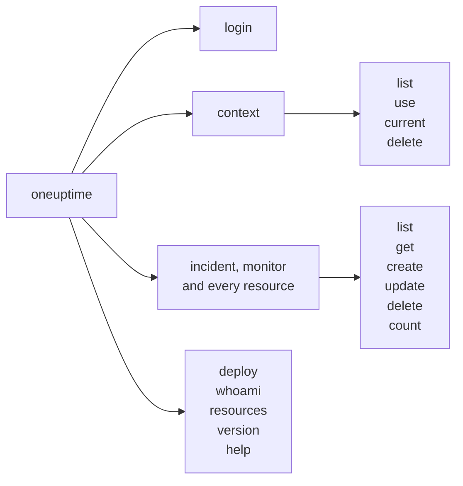

# Command Reference

Every command of the `oneuptime` CLI, with its arguments, options and defaults. Add `--help` to any command to see the same in your terminal.

:::cards
- [Global options](#global-options): The options every command takes.
- [Login and contexts](#login-and-contexts): login and the context commands.
- [Resource commands](#resource-commands): list, get, create, update, delete and count.
- [Other commands](#other-commands): deploy, whoami, resources, version and help.
:::

## The commands



## Global options

| Option | What it does | Default |
| --- | --- | --- |
| `--api-key <key>` | The API key for this command | `ONEUPTIME_API_KEY`, then the context's key |
| `--url <url>` | Your OneUptime's address for this command | `ONEUPTIME_URL`, then the context's URL |
| `--context <name>` | The saved context to use for this command | The current context |
| `-o, --output <format>` | `json`, `table` or `wide` | `table` in a terminal, `json` in a pipe |
| `--no-color` | Prints without colors | Colors, unless `NO_COLOR` is set |
| `-V, --version` | Prints the CLI's version | |
| `-h, --help` | Shows the help of a command | |

The options go before or after the command: `oneuptime --context staging incident list` and `oneuptime incident list --context staging` do the same.

## Login and contexts

### `oneuptime login`

Saves an API key and an address as a context, and makes it the current one. See [Log in](/docs/cli/authentication#log-in).

```bash
oneuptime login <api-key> <instance-url> [--context-name <name>]
```

| Argument or option | Required | What it is | Default |
| --- | --- | --- | --- |
| `<api-key>` | Yes | An API key of your project | |
| `<instance-url>` | Yes | Your OneUptime's address, such as `https://oneuptime.com` | |
| `--context-name <name>` | No | The name to save the context under | `default` |

### `oneuptime context list`

Lists the saved contexts; `*` marks the current one. API keys are never listed.

```bash
oneuptime context list [-o <format>]
```

| Option | Required | What it is |
| --- | --- | --- |
| `-o, --output <format>` | No | `json`, `table` or `wide`. JSON gives each context's `name`, `apiUrl` and `isCurrent` |

### `oneuptime context use`

Makes a saved context the current one.

```bash
oneuptime context use <name>
```

| Argument | Required | What it is |
| --- | --- | --- |
| `<name>` | Yes | The name of a saved context |

### `oneuptime context current`

Shows the current context's name and URL, and its API key with all but the first four and last four characters hidden.

```bash
oneuptime context current
```

### `oneuptime context delete`

Deletes a saved context. If it was the current one, the first context left becomes current.

```bash
oneuptime context delete <name>
```

| Argument | Required | What it is |
| --- | --- | --- |
| `<name>` | Yes | The name of a saved context |

## Resource commands

`<resource>` is the command of a kind of record, from the [Resources](#resources) tables, such as `incident` or `monitor`. See [Resource Operations](/docs/cli/resource-operations) for examples.

### `oneuptime <resource> list`

Lists records, newest first. Labels are listed by name instead, numbered labels first (`2. Team` before `10. Owner`).

```bash
oneuptime <resource> list [--query <json>] [--limit <n>] [--skip <n>] [--sort <json>] [-o <format>]
```

| Option | What it does | Default |
| --- | --- | --- |
| `--query <json>` | A filter, as JSON | Every record the key may read |
| `--limit <n>` | The most records to return, up to 10,000 | `10` |
| `--skip <n>` | How many records to pass over first | `0` |
| `--sort <json>` | The order, as JSON: `{"<field>":"ASC"}` or `{"<field>":"DESC"}` | Newest first |
| `-o, --output <format>` | `json`, `table` or `wide` | `table` in a terminal, `json` in a pipe |

### `oneuptime <resource> get`

Reads one record. Records only: telemetry has no `get`.

```bash
oneuptime <resource> get <id> [-o <format>]
```

| Argument or option | Required | What it is |
| --- | --- | --- |
| `<id>` | Yes | The record's ID, a UUID |
| `-o, --output <format>` | No | `json`, `table` or `wide` |

### `oneuptime <resource> create`

Creates a record and prints it.

```bash
oneuptime <resource> create (--data <json> | --file <path>) [-o <format>]
```

| Option | Required | What it is |
| --- | --- | --- |
| `--data <json>` | One of the two | The record, as JSON |
| `--file <path>` | One of the two | A JSON file holding the record. Given with `--data`, the file is used |
| `-o, --output <format>` | No | `json`, `table` or `wide` |

### `oneuptime <resource> update`

Changes the fields you give. Records only: telemetry has no `update`.

```bash
oneuptime <resource> update <id> --data <json> [-o <format>]
```

| Argument or option | Required | What it is |
| --- | --- | --- |
| `<id>` | Yes | The record's ID |
| `--data <json>` | Yes | The fields to change, as JSON |
| `-o, --output <format>` | No | `json`, `table` or `wide` |

### `oneuptime <resource> delete`

Deletes a record at once, without asking. Records only: telemetry has no `delete`.

```bash
oneuptime <resource> delete <id> [--force]
```

| Argument or option | Required | What it is |
| --- | --- | --- |
| `<id>` | Yes | The record's ID |
| `--force` | No | Accepted and changes nothing: `delete` never asks to confirm |

### `oneuptime <resource> count`

Counts records, and prints the number.

```bash
oneuptime <resource> count [--query <json>] [-o <format>]
```

| Option | Required | What it is |
| --- | --- | --- |
| `--query <json>` | No | A filter, as JSON. Without one, every record the key may read |
| `-o, --output <format>` | No | `json`, `table` or `wide` |

### Resources

Records take `list`, `get`, `create`, `update`, `delete` and `count`:

| Area | Commands |
| --- | --- |
| Monitoring | `monitor`, `monitor-status`, `monitor-status-event` |
| Incidents | `incident`, `incident-state`, `incident-severity`, `incident-state-timeline`, `incident-public-note`, `incident-internal-note`, `incident-alert`, `postmortem-status` |
| Alerts | `alert`, `alert-state`, `alert-severity`, `alert-state-timeline`, `alert-internal-note` |
| Status pages | `status-page`, `status-page-announcement` |
| Scheduled maintenance | `scheduled-maintenance-event`, `scheduled-maintenance-state`, `scheduled-maintenance-state-timeline` |
| Teams and on-call | `team`, `on-call-policy` |
| Security | `security-case`, `security-case-evidence`, `security-case-note`, `security-case-priority`, `security-case-status`, `security-case-task`, `security-detection`, `security-playbook` |
| Data security | `data-store`, `data-store-finding`, `data-store-access-entry`, `data-flow`, `data-security-issue`, `data-security-scan`, `custom-data-type`, `check-setting`, `residency-rule`, `data-security-setting` |
| Labels | `label` |

Telemetry takes `list`, `create` and `count`:

| Area | Commands |
| --- | --- |
| Observability | `log`, `metric`, `span`, `exception-instance`, `monitor-log` |
| Security | `security-event`, `threat-intel-indicator` |
| Changes and cost | `change-event`, `kubernetes-cost-allocation` |

The CLI is released with OneUptime, so `oneuptime resources` lists the commands of the version you installed.

### API requests

Each operation is one request to the API, with the key in the `APIKey` header. `<path>` is the resource's API path, from `oneuptime resources`: `/incident` for `incident`, `/on-call-duty-policy` for `on-call-policy`.

| Operation | Request | Body |
| --- | --- | --- |
| `list` | `POST /api/<path>/get-list` | `query`, `select`, `skip`, `limit` and `sort` |
| `get` | `POST /api/<path>/<id>/get-item` | `select` |
| `create` | `POST /api/<path>` | `{"data": ...}` |
| `update` | `PUT /api/<path>/<id>/` | `{"data": ...}` |
| `delete` | `DELETE /api/<path>/<id>/` | None |
| `count` | `POST /api/<path>/count` | `query` |

## Other commands

### `oneuptime deploy`

Records a deploy, or another change, from a pipeline: it is drawn on the service's charts and read by OneUptime AI when it investigates an incident. It writes with a telemetry ingestion key, not an API key. See [Deploys and changes](/docs/telemetry/change-events).

```bash
oneuptime deploy [--service <name>] [--service-version <version>] [--previous-version <version>] [--commit <sha>] [--repository <url>] [--branch <name>] [--pull-request <number>] [--environment <name>] [--title <title>] [--description <text>] [--type <type>] [--time <time>] [--attribute <key=value...>] [--ingestion-key <key>]
```

| Option | Required | What it is | Default |
| --- | --- | --- | --- |
| `--service <name>` | No | The service that was deployed | A project-wide change |
| `--service-version <version>` | No | The version deployed | |
| `--previous-version <version>` | No | The version it replaced | |
| `--commit <sha>` | No | The commit deployed | |
| `--repository <url>` | No | The repository the commit is in | |
| `--branch <name>` | No | The branch deployed | |
| `--pull-request <number>` | No | The pull request deployed | |
| `--environment <name>` | No | The environment deployed to | |
| `--title <title>` | No | The change's title; another kind than a deploy needs one | `Deploy <version>` |
| `--description <text>` | No | Details of the change | |
| `--type <type>` | No | The kind of change, such as `config-change` or `rollback` | `deployment` |
| `--time <time>` | No | When it happened, such as `2026-10-19T10:00:00Z` | Now |
| `--attribute <key=value...>` | No | More attributes, as `key=value`, one or more | |
| `--ingestion-key <key>` | No | A telemetry ingestion key of the project | `ONEUPTIME_TELEMETRY_INGESTION_KEY` |

### `oneuptime whoami`

Shows the URL and the API key the next command will use, with the key masked, and the context they come from. It does not call OneUptime. See [Check what the CLI will use](/docs/cli/authentication#check-what-the-cli-will-use).

```bash
oneuptime whoami
```

### `oneuptime resources`

Lists every kind of record the CLI has a command for: its command, singular and plural names, type and API path, and the total.

```bash
oneuptime resources [--type <type>] [-o <format>]
```

| Option | Required | What it is | Default |
| --- | --- | --- | --- |
| `--type <type>` | No | `database` for records, `analytics` for telemetry | Both |
| `-o, --output <format>` | No | `json`, `table` or `wide`. JSON gives each one's `name`, `singularName`, `pluralName`, `modelType` and `apiPath` | `table` in a terminal, `json` in a pipe |

### `oneuptime version`

Prints the CLI's version, as `oneuptime --version` does.

```bash
oneuptime version
```

### `oneuptime help`

Shows the help of the CLI, or of a command.

```bash
oneuptime help [command]
```

## Environment variables

| Variable | What it does |
| --- | --- |
| `ONEUPTIME_API_KEY` | The API key, when no `--api-key` flag gives one |
| `ONEUPTIME_URL` | Your OneUptime's address, when no `--url` flag gives one |
| `ONEUPTIME_TELEMETRY_INGESTION_KEY` | The telemetry ingestion key `oneuptime deploy` writes with, when no `--ingestion-key` flag gives one |
| `NO_COLOR` | Set to any value, turns colors off |

## Files

| File | What it holds |
| --- | --- |
| `~/.oneuptime/config.json` | The saved contexts, their API keys, and the current context |

## Exit codes

| Code | Meaning |
| --- | --- |
| `0` | It worked |
| `1` | It failed: OneUptime refused the request, or the command was wrong |
| `2` | No usable API key: none found, invalid, or below its plan |
| `3` | Not found: OneUptime answered `404` |

See [Exit codes](/docs/cli/scripting#exit-codes) for examples.

## Next steps

:::cards
- [CLI Overview](/docs/cli/index): Install the CLI and run your first commands.
- [Resource Operations](/docs/cli/resource-operations): Examples of every operation.
- [Scripting & CI/CD](/docs/cli/scripting): The CLI in scripts and pipelines.
:::
