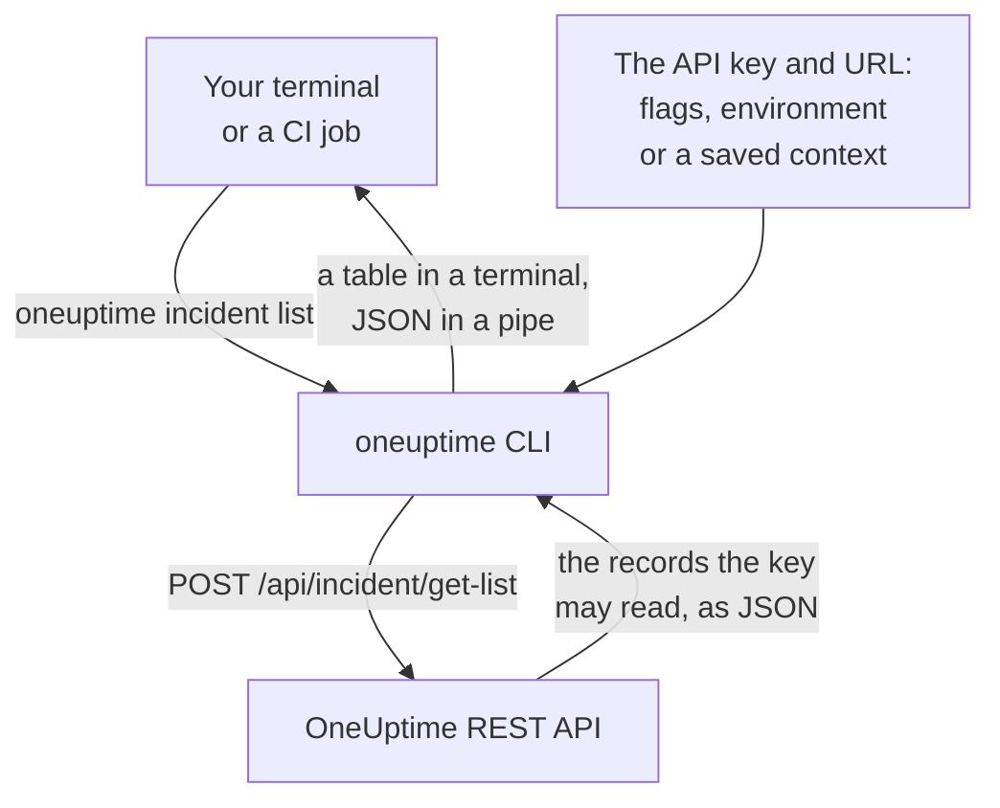

# CLI Overview

The OneUptime CLI, `oneuptime`, manages your OneUptime project from a terminal or a script. List, read, create, change, delete and count monitors, incidents, alerts, status pages and the other records the OneUptime API offers, with an API key of your project.

:::cards
- [How the CLI works](#how-the-cli-works): One command, one API request, one answer.
- [Install the CLI](#install-the-cli): One npm command, and the version to pick.
- [Run your first commands](#run-your-first-commands): Save your API key, then list your incidents.
- [Commands at a glance](#commands-at-a-glance): Every command, and the page that explains it.
:::

## How the CLI works

Each command sends one request to the OneUptime REST API and prints the answer. The CLI takes the API key and your OneUptime's address from flags, environment variables or a context that `oneuptime login` saved. The key decides what a command may read and change, exactly as it does for the API.



The commands for records come with the CLI: each kind of record the OneUptime API opens to tools has one, the same records the [MCP server](/docs/ai/mcp-server) has tools for. Run `oneuptime resources` to list them.

## Before you begin

- **Node.js and npm**, a current LTS release, to install the CLI.
- **An API key of your project.** Create one in **Project Settings → Advanced → API Keys** with **Create API Key**: see [Create an API key](/docs/api-reference/api-reference#create-an-api-key).
- **On OneUptime Cloud, the Growth plan or above.** A project's API keys work only on it: see [API keys and SCIM below their plan](/docs/api-reference/api-reference#api-keys-and-scim-below-their-plan).

## Install the CLI

Install the `@oneuptime/cli` package from npm. It adds the `oneuptime` command, and `--version` prints the version you installed:

```bash
npm install -g @oneuptime/cli
oneuptime --version
```

The CLI is released with OneUptime and has the same version number. On a self-hosted OneUptime, install the CLI of your OneUptime's version, so its commands match the records your server has:

```bash
npm install -g @oneuptime/cli@<your-oneuptime-version>
```

> [!WARNING]
> CLI versions before 14.0.64 stop as soon as they start, with an error such as `Cannot find module 'Common/Models/DatabaseModels/Index'`. Install 14.0.64 or later with `npm install -g @oneuptime/cli@latest`. On a self-hosted OneUptime older than 14.0.64, [upgrade OneUptime](/docs/installation/upgrading#how-to-upgrade) first, then install the CLI of the version you upgraded to.

## Run your first commands

:::steps
### Save your API key

Log in with the key and your OneUptime's address. The CLI saves them as a context named `default` and uses it from now on:

```bash
oneuptime login <your-api-key> https://oneuptime.com
```

It answers `Logged in successfully. Context "default" is now active.` On a self-hosted OneUptime, use its address in place of `https://oneuptime.com`.

### List your incidents

```bash
oneuptime incident list
```

The ten newest incidents appear as a table. `login` saves the key without checking it, so this is the first command that shows the key works: if it is refused, see [Troubleshooting](/docs/cli/authentication#troubleshooting).

### See what else you can manage

```bash
oneuptime resources
```

The list shows every kind of record you can work with, and its command, such as `monitor`, `status-page` or `on-call-policy`.
:::

## Commands at a glance

| Command | What it does | Read more |
| --- | --- | --- |
| `oneuptime login <api-key> <instance-url>` | Saves an API key and an address as a context | [Authentication](/docs/cli/authentication#log-in) |
| `oneuptime context list`, `use`, `current`, `delete` | Lists, switches, shows and deletes saved contexts | [Authentication](/docs/cli/authentication#contexts) |
| `oneuptime whoami` | Shows the URL and API key the next command will use | [Authentication](/docs/cli/authentication#check-what-the-cli-will-use) |
| `oneuptime deploy` | Records a deploy, or another change, for charts and OneUptime AI | [Deploys and Changes](/docs/telemetry/change-events) |
| `oneuptime <resource> list`, `get`, `create`, `update`, `delete`, `count` | Works with one kind of record | [Resource Operations](/docs/cli/resource-operations) |
| `oneuptime resources` | Lists the kinds of record, with their commands | [Command Reference](/docs/cli/command-reference#oneuptime-resources) |
| `oneuptime version` | Prints the CLI's version | [Command Reference](/docs/cli/command-reference#oneuptime-version) |
| `oneuptime help [command]` | Shows the help of a command | [Get help](#get-help) |

## Global options

These options work with every command, before or after it:

| Option | What it does |
| --- | --- |
| `--api-key <key>` | The API key for this command, in place of the saved one |
| `--url <url>` | Your OneUptime's address for this command |
| `--context <name>` | A saved context for this command, in place of the current one |
| `-o, --output <format>` | `table`, `json` or `wide`: see [Output Formats](/docs/cli/output-formats) |
| `--no-color` | Prints without colors |
| `-V, --version` | Prints the CLI's version |
| `-h, --help` | Shows the help of the command |

## Get help

Every command has its own help, with its arguments, options and defaults:

```bash
oneuptime --help
oneuptime help incident
oneuptime incident list --help
```

## Next steps

:::cards
- [Authentication](/docs/cli/authentication): Contexts for each environment, and which key a command uses.
- [Resource Operations](/docs/cli/resource-operations): List, read, create, change, delete and count records.
- [Output Formats](/docs/cli/output-formats): Tables for people, JSON for scripts.
- [Scripting & CI/CD](/docs/cli/scripting): Exit codes, jq and pipelines.
- [Command Reference](/docs/cli/command-reference): Every command, option and default.
:::
