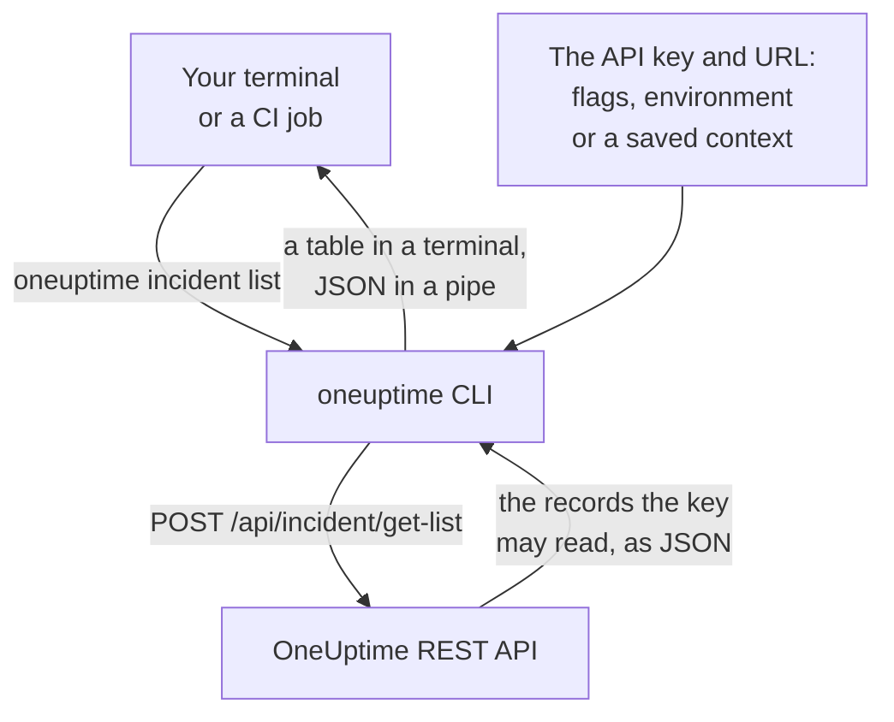

# CLI Overview

The OneUptime CLI, `oneuptime`, manages your OneUptime project from a terminal or a script. List, read, create, change, delete and count monitors, incidents, alerts, status pages and the other records the OneUptime API offers, with an API key of your project.

:::cards
- [How the CLI works](#how-the-cli-works): A command, the API requests it sends, and its answer.
- [Install the CLI](#install-the-cli): The installer your OneUptime serves, or npm.
- [Run your first commands](#run-your-first-commands): Save your API key, check it, then list your incidents.
- [Commands at a glance](#commands-at-a-glance): Every command, and the page that explains it.
:::

## How the CLI works

Most commands send one request to the OneUptime REST API and print the answer; an action, such as `acknowledge`, sends the few the dashboard's button does. The CLI takes the API key and your OneUptime's address from flags, environment variables or a context that `oneuptime login` saved. The key decides what a command may read and change, exactly as it does for the API.



Every resource of the OneUptime API is a command, 450 and more of them, from `incident` and `monitor` to `status-page-subscriber` and `telemetry-ingestion-key`, each with the operations the API takes for it. The CLI is released with OneUptime, so the CLI of your OneUptime's version has a command for each resource your server has. Run `oneuptime resources` to list them.

## Before you begin

- **Node.js and npm**, a current LTS release, to install the CLI.
- **An API key of your project.** Create one in **Project Settings → Advanced → API Keys** with **Create API Key**: see [Create an API key](/docs/api-reference/api-reference#create-an-api-key).
- **On OneUptime Cloud, the Growth plan or above.** A project's API keys work only on it: see [API keys and SCIM below their plan](/docs/api-reference/api-reference#api-keys-and-scim-below-their-plan).

## Install the CLI

Every OneUptime serves the CLI's install script for its own release: the commands below download it from `https://oneuptime.com`, so on a self-hosted OneUptime replace it with your URL. The script is saved as `install.sh` first, so you can read it before you run it. It asks your OneUptime for its version, and installs the CLI of the same version with npm:

```bash
curl -fsSL https://oneuptime.com/install/cli -o install.sh
ONEUPTIME_URL=https://oneuptime.com bash install.sh
```

Or install the `@oneuptime/cli` package from npm yourself. It adds the `oneuptime` command, and `--version` prints the version you installed:

```bash
npm install -g @oneuptime/cli
oneuptime --version
```

The CLI is released with OneUptime and has the same version number. On a self-hosted OneUptime, install the CLI of your OneUptime's version, so its commands match the records your server has:

```bash
npm install -g @oneuptime/cli@<your-oneuptime-version>
```

> [!WARNING]
> CLI versions before 14.0.64 stop as soon as they start, with an error such as `Cannot find module 'Common/Models/DatabaseModels/Index'`. Install 14.0.64 or later with `npm install -g @oneuptime/cli@latest`. On a self-hosted OneUptime older than 14.0.64, [upgrade OneUptime](/docs/installation/upgrading#how-to-upgrade) first, then install the CLI of the version you upgraded to.

## Run your first commands

:::steps
### Save your API key

Log in with the key and your OneUptime's address. The CLI saves them as a context named `default` and uses it from now on:

```bash
oneuptime login <your-api-key> https://oneuptime.com
```

It answers `Logged in successfully. Context "default" is now active.` On a self-hosted OneUptime, use its address in place of `https://oneuptime.com`.

### Check the key

```bash
oneuptime whoami --check
```

`login` saves the key without asking OneUptime about it. `--check` asks: it shows the key's project, your OneUptime's version and the CLI's, and what to install when the two differ. If OneUptime refuses the key, see [Troubleshooting](/docs/cli/authentication#troubleshooting).

### List your incidents

```bash
oneuptime incident list
```

The ten newest incidents appear as a table.

### See what else you can manage

```bash
oneuptime resources
```

The list shows every kind of record you can work with, and its command, such as `monitor`, `status-page` or `on-call-policy`. `oneuptime monitor fields` lists a monitor's fields, and the flags that set them.
:::

## Commands at a glance

| Command | What it does | Read more |
| --- | --- | --- |
| `oneuptime login <api-key> <instance-url>` | Saves an API key and an address as a context | [Authentication](/docs/cli/authentication#log-in) |
| `oneuptime context list`, `use`, `current`, `delete` | Lists, switches, shows and deletes saved contexts | [Authentication](/docs/cli/authentication#contexts) |
| `oneuptime whoami` | Shows the URL and API key the next command will use, and with `--check` whether OneUptime takes the key | [Authentication](/docs/cli/authentication#check-what-the-cli-will-use) |
| `oneuptime deploy` | Records a deploy, or another change, for charts and OneUptime AI | [Deploys and Changes](/docs/telemetry/change-events) |
| `oneuptime dbt upload` | Sends a dbt project's artifacts after a build to Data Observability | [Command Reference](/docs/cli/command-reference#oneuptime-dbt-upload) |
| `oneuptime <resource> list`, `get`, `create`, `update`, `delete`, `count` | Works with one kind of record | [Resource Operations](/docs/cli/resource-operations) |
| `oneuptime <resource> fields` | Lists a resource's fields, and the flags that set them | [Resource Operations](/docs/cli/resource-operations#see-a-resources-fields) |
| `oneuptime <resource> acknowledge`, `resolve`, `start`, `end`, `add-note` | Does what the dashboard's buttons do on incidents, alerts and scheduled maintenance | [Resource Operations](/docs/cli/resource-operations#acknowledge-resolve-and-add-notes) |
| `oneuptime resources` | Lists the kinds of record, with their commands | [Command Reference](/docs/cli/command-reference#oneuptime-resources) |
| `oneuptime version` | Prints the CLI's version | [Command Reference](/docs/cli/command-reference#oneuptime-version) |
| `oneuptime help [command]` | Shows the help of a command | [Get help](#get-help) |

## Global options

These options work with every command, before or after it:

| Option | What it does |
| --- | --- |
| `--api-key <key>` | The API key for this command, in place of the saved one |
| `--url <url>` | Your OneUptime's address for this command |
| `--context <name>` | A saved context for this command, in place of the current one |
| `-o, --output <format>` | `table`, `json` or `wide`: see [Output Formats](/docs/cli/output-formats) |
| `--json` | The same as `-o json` |
| `--no-color` | Prints without colors |
| `-V, --version` | Prints the CLI's version |
| `-h, --help` | Shows the help of the command |

## Get help

Every command has its own help, with its arguments, options and defaults:

```bash
oneuptime --help
oneuptime help incident
oneuptime incident list --help
```

## Next steps

:::cards
- [Authentication](/docs/cli/authentication): Contexts for each environment, and which key a command uses.
- [Resource Operations](/docs/cli/resource-operations): List, read, create, change, delete and count records.
- [Output Formats](/docs/cli/output-formats): Tables for people, JSON for scripts.
- [Scripting & CI/CD](/docs/cli/scripting): Exit codes, jq and pipelines.
- [CLI for AI Agents](/docs/cli/ai-agents): When an agent runs the CLI, and when it uses the MCP server.
- [Command Reference](/docs/cli/command-reference): Every command, option and default.
:::
