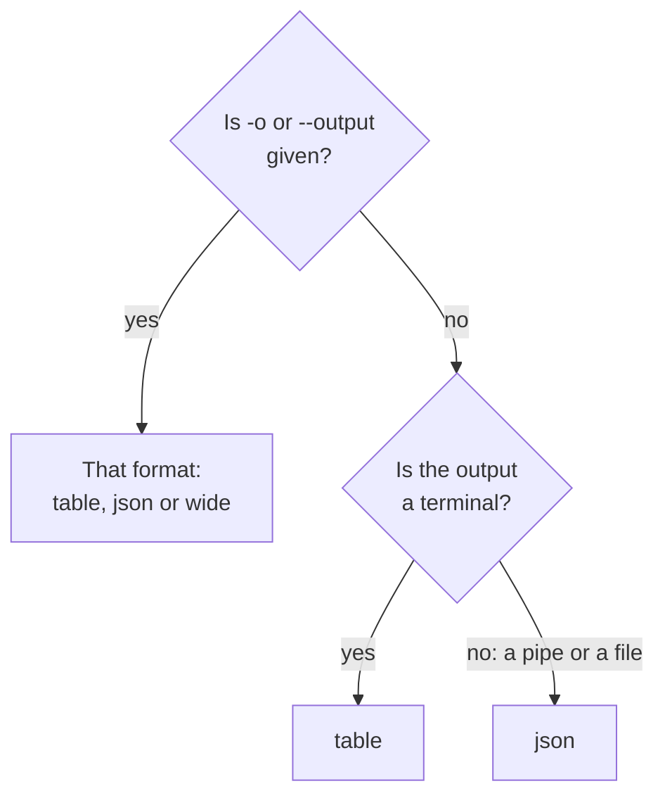

# Output Formats

The CLI prints a table when you read its answer in a terminal, and JSON when a script or another program reads it. Choose the format of any command with `-o` or `--output`.

:::cards
- [How the format is chosen](#how-the-format-is-chosen): A terminal gets a table, a pipe gets JSON.
- [Table](#table): Six columns, each value cut at 60 characters.
- [JSON](#json): Every field, whole, for scripts and jq.
- [Wide](#wide): A table with every column.
:::

## How the format is chosen



| Format | What it prints | Best for |
| --- | --- | --- |
| `table` | A table of up to six columns; one record as a row for each field | Reading in a terminal |
| `json` | The answer as OneUptime sent it, indented by two spaces | Scripts, `jq` and files |
| `wide` | A table with a column for every field | Comparing many fields at a glance |

`-o` works on every command that prints records: `list`, `get`, `create`, `update` and `count` of a resource, `oneuptime resources` and `oneuptime context list`. It can go anywhere on the command line. Any other value is refused before a request is sent:

```text
error: option '-o, --output <format>' argument 'yaml' is invalid. Allowed choices are json, table, wide.
```

## Table

A table is the default in a terminal. `oneuptime resources --type analytics`, for example, prints this one:

```text
┌────────────────────────────┬────────────────────────────┬─────────────────────────────┬───────────┬─────────────────────────────┐
│ Command                    │ Singular                   │ Plural                      │ Type      │ API Path                    │
├────────────────────────────┼────────────────────────────┼─────────────────────────────┼───────────┼─────────────────────────────┤
│ log                        │ Log                        │ Logs                        │ analytics │ /logs                       │
├────────────────────────────┼────────────────────────────┼─────────────────────────────┼───────────┼─────────────────────────────┤
│ span                       │ Span                       │ Spans                       │ analytics │ /span                       │
├────────────────────────────┼────────────────────────────┼─────────────────────────────┼───────────┼─────────────────────────────┤
│ metric                     │ Metric                     │ Metrics                     │ analytics │ /metrics                    │
├────────────────────────────┼────────────────────────────┼─────────────────────────────┼───────────┼─────────────────────────────┤
│ exception-instance         │ Exception Instance         │ Exception Instances         │ analytics │ /exceptions                 │
├────────────────────────────┼────────────────────────────┼─────────────────────────────┼───────────┼─────────────────────────────┤
│ monitor-log                │ Monitor Log                │ Monitor Logs                │ analytics │ /monitor-log                │
├────────────────────────────┼────────────────────────────┼─────────────────────────────┼───────────┼─────────────────────────────┤
│ kubernetes-cost-allocation │ Kubernetes Cost Allocation │ Kubernetes Cost Allocations │ analytics │ /kubernetes-cost-allocation │
├────────────────────────────┼────────────────────────────┼─────────────────────────────┼───────────┼─────────────────────────────┤
│ security-event             │ Security Event             │ Security Events             │ analytics │ /security-events            │
├────────────────────────────┼────────────────────────────┼─────────────────────────────┼───────────┼─────────────────────────────┤
│ change-event               │ Change Event               │ Change Events               │ analytics │ /change-events              │
├────────────────────────────┼────────────────────────────┼─────────────────────────────┼───────────┼─────────────────────────────┤
│ threat-intel-indicator     │ Threat Intel Indicator     │ Threat Intel Indicators     │ analytics │ /threat-intel-indicators    │
└────────────────────────────┴────────────────────────────┴─────────────────────────────┴───────────┴─────────────────────────────┘

Total: 9 resources
```

For a list of records, a table shows up to six columns: `_id`, `name`, `title`, `status`, `createdAt` and `updatedAt` first, those of them the records have, then the records' next fields in order. The columns are taken from the first record. A value longer than 60 characters is cut to its first 57, followed by `...`.

One record, as `get` and `create` print it, is a table of two columns: the field's name and its value, one row for each field.

OneUptime sends dates and the IDs of other records as objects, such as `{"_type":"DateTime","value":"2026-10-14T09:12:44.000Z"}`, and a table shows them as that text. Their value is in `value`: see [JSON](#json).

## JSON

JSON is the answer as OneUptime sent it, indented by two spaces: a list is an array of records, and one record is an object.

```bash
oneuptime incident list --limit 1 -o json
```

```json
[
  {
    "_id": "6f1c2a40-3b1e-4c55-9a0b-3e2f8d7c1a11",
    "createdAt": {
      "_type": "DateTime",
      "value": "2026-10-14T09:12:44.000Z"
    },
    "title": "Checkout API is down",
    "currentIncidentStateId": {
      "_type": "ObjectID",
      "value": "0b7d5e2c-8f4a-4d1b-9c3e-5a6f7b8c9d0e"
    }
  }
]
```

A record has every field the key may read; this one is cut to four. A record's own `_id` is text, and the other IDs and the dates are objects whose `value` holds them:

```bash
oneuptime incident list -o json | jq -r '.[] | "\(.createdAt.value)  \(.title)"'
```

When the output is not a terminal, as in `oneuptime incident list | jq '.[].title'`, the CLI prints JSON without `-o json`. Write `-o json` in scripts anyway, so they do not depend on it.

## Wide

`-o wide` is a table with a column for every field of the records. Each value is still cut at 60 characters, and records have many fields, so a wide table is very wide: page through it with `less -S`.

```bash
oneuptime incident list -o wide | less -S
```

## Colors

Table headers are cyan; messages are green when something worked, blue for information and red for errors. Turn colors off with `--no-color`, or by setting `NO_COLOR` to any value:

```bash
oneuptime incident list --no-color
NO_COLOR=1 oneuptime incident list
```

## What each command prints

Records and counts go to the standard output, and errors to the standard error, so a pipe reads only the answer.

| Command | In a table | In JSON |
| --- | --- | --- |
| A `list` that finds nothing | `No results found.` | `[]` |
| A `get` or a `create` | A row for each field | The record |
| A `count` | The number | The number |
| An `update` | An empty line | `{}` |
| A `delete` | `Monitor <id> deleted successfully.` | The same line |

## Next steps

:::cards
- [Scripting & CI/CD](/docs/cli/scripting): Read the JSON with jq in scripts and pipelines.
- [Resource Operations](/docs/cli/resource-operations): The operations whose answers these are.
- [Command Reference](/docs/cli/command-reference): Every command and option.
:::
