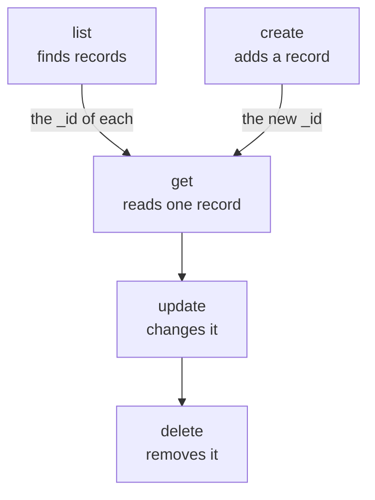

# Resource Operations

Each kind of record is a command of its own, such as `incident`, `monitor` or `status-page`, with the operations the API takes for it: for most, `list`, `get`, `create`, `update`, `delete` and `count`. This page shows every operation, with filters, paging and the flags a record is written with, and the commands that do what the dashboard's buttons do.

:::cards
- [Find the command for a record](#find-the-command-for-a-record): oneuptime resources lists them all.
- [List records](#list-records): Filter, sort and page.
- [Create a record](#create-a-record): A flag for each field, or the record as JSON.
- [Acknowledge, resolve and add notes](#acknowledge-resolve-and-add-notes): The dashboard's buttons, as commands.
- [Delete a record](#delete-a-record): At once, with no undo.
:::

## How the operations fit together

Reading, changing and deleting a record need its ID. Listing, counting and creating need none, and a list or a create gives you the IDs the others take:



An ID is a UUID, such as `6f1c2a40-3b1e-4c55-9a0b-3e2f8d7c1a11`. You can also copy one from the record's page in OneUptime: see [Finding a resource's ID](/docs/api-reference/api-reference#finding-a-resources-id).

## Find the command for a record

```bash
oneuptime resources
```

The list shows each kind of record with its command, its names, its type and its API path. There are two types:

| Type | What it holds |
| --- | --- |
| `database` | Records you manage: monitors, incidents, alerts, status pages, teams and more |
| `analytics` | Telemetry: logs, spans, metrics, exceptions and other events |

Show one type with `oneuptime resources --type database` or `--type analytics`. The [Command Reference](/docs/cli/command-reference#resources) lists every command.

A resource takes the operations the API takes for it. Most take all six; one that OneUptime writes itself, such as an email log, is read only. `oneuptime <resource> --help` lists the subcommands a resource has.

## See a resource's fields

`fields` lists a resource's fields from the CLI itself, with no API key and no request:

```bash
oneuptime incident fields
```

Each field has its type, what it is for, whether a create must give it, and the flag that sets it. A field that holds an ID names the resource the ID is of: `incidentSeverityId` takes one from `oneuptime incident-severity list`. With `-o json`, a script or an AI agent reads the same, with the same keys for every field: `name`, `title`, `type`, `description`, `required`, `create`, `update`, `read`, `flag`, `emailFlag` and `relatedResource`.

## List records

```bash
oneuptime <resource> list [--query <json>] [--limit <n>] [--skip <n>] [--sort <json>] [--fields <names>] [--all] [-o <format>]
```

| Option | What it does | Default |
| --- | --- | --- |
| `--query <json>` | Returns only the records that match: see [Filter a list](#filter-a-list) | Every record the key may read |
| `--limit <n>` | The most records to return, up to 10,000 | `10` |
| `--skip <n>` | How many matching records to pass over first | `0` |
| `--sort <json>` | The order, such as `{"createdAt":"ASC"}`, or `"DESC"` for newest first | Newest first |
| `--fields <names>` | The fields to return, separated by commas, such as `title,createdAt` | Every field the key may read |
| `--all` | Every record that matches, page after page, in place of `--limit` and `--skip`. Records only | |
| `-o, --output <format>` | `table`, `json` or `wide` | `table` in a terminal, `json` in a pipe |

```bash
# The ten newest incidents
oneuptime incident list

# The oldest monitors first, 50 at a time: the second page
oneuptime monitor list --sort '{"createdAt":"ASC"}' --limit 50 --skip 50

# Every field of each incident, as JSON
oneuptime incident list -o json

# The title, the state and the creation date of every incident
oneuptime incident list --all --fields title,currentIncidentState.name,createdAt -o json
```

A list asks OneUptime for every field of each record that the key may read. `--fields` asks for the ones it names instead, and, after a dot, for a field of a related record, as in `currentIncidentState.name`. A table shows six fields; JSON shows them all (see [Output Formats](/docs/cli/output-formats)). `--all` reads every page, 100 records at a time, up to 100,000; `count` says how many there are.

Labels are listed by name rather than newest first: labels whose names start with a number come first, in the order of that number (`2. Team` before `10. Owner`), then the others alphabetically. To list them in another order, give `--sort`.

### Filter a list

`--query` takes the same filter as the API: a field with a value matches that value, and an object with a `_type` compares.

| Filter | Matches |
| --- | --- |
| `{"title":"Checkout API is down"}` | Records with exactly that value |
| `{"title":{"_type":"Search","value":"checkout"}}` | Text that contains the value |
| `{"createdAt":{"_type":"GreaterThan","value":"2026-10-01T00:00:00.000Z"}}` | Later dates, or larger numbers |
| `{"currentIncidentState":{"isResolvedState":false}}` | A field of a record the resource names: here, incidents that are not resolved |

```bash
oneuptime incident list --query '{"title":{"_type":"Search","value":"checkout"}}'
```

[Filter, sort and page](/docs/api-reference/api-reference#filter-sort-and-page) in the API reference lists every `_type`.

## Read a record

```bash
oneuptime <resource> get <id> [--fields <names>] [-o <format>]
```

```bash
oneuptime incident get 6f1c2a40-3b1e-4c55-9a0b-3e2f8d7c1a11
```

A table shows one row for each field of the record, each value cut at 60 characters; `-o json` shows the values whole. An ID that names no record your key may read answers `Not found`, and the command exits with code `3`.

## Create a record

```bash
oneuptime <resource> create [--<field> <value>]... [--data <json>] [--file <path>] [-o <format>]
```

Each field a create takes has a flag: `--title <text>`, `--incident-severity-id <id>`, `--labels <ids>` for IDs separated by commas, `--is-visible-on-status-page [true|false]` for a yes-or-no field, true when given alone, and `--monitor-steps <json>` for a field that holds JSON. `oneuptime <resource> create --help` lists them, and [`fields`](#see-a-resources-fields) says what each is for. The project comes from the API key, so a record never names it.

```bash
# A manual monitor
oneuptime monitor create --name "Checkout API" --monitor-type Manual

# An incident with one of your severities
oneuptime incident create --title "Checkout API is down" --incident-severity-id <severity-id>

# The same incident, from a file
oneuptime incident create --file incident.json
```

`--data` takes the record as JSON, and `--file` reads it from a JSON file, with the API's fields: the [API reference](/reference) lists each resource's. Given both, the file is used, and flags go on top of either.

A field that names a person by user ID has a second flag that names them by email address: `--user-email` beside `--user-id`, `--owner-user-emails` beside `--owner-users`. The CLI finds them among the members of the API key's project and the people invited to it. A team member named by an address nobody in the project has is invited to it, as inviting them from the dashboard does:

```bash
oneuptime team-member create --team-id <team-id> --user-email alice@example.com
```

The CLI prints the new record, with its `_id`. An incident starts in your project's created state unless `currentIncidentStateId` names another one: see [The state a new record starts in](/docs/api-reference/api-reference#the-state-a-new-record-starts-in). To find your severities' IDs:

```bash
oneuptime incident-severity list -o json | jq -r '.[] | "\(._id)  \(.name)"'
```

> [!TIP]
> On Windows, give the fields with their flags, or put the JSON in a file and use `--file`: PowerShell and the Command Prompt quote JSON on the command line differently from Bash.

## Update a record

```bash
oneuptime <resource> update <id> [--<field> <value>]... [--data <json>] [--file <path>] [-o <format>]
```

Give only the fields to change, with their flags or as JSON:

```bash
# Rename a monitor
oneuptime monitor update <monitor-id> --name "Checkout API (EU)"

# Record an incident's root cause
oneuptime incident update <incident-id> --root-cause "A full disk on the primary database"
```

OneUptime answers an update with an empty object: the CLI prints an empty line, or `{}` with `-o json`. Run `get` to see the record as it is now. To move an incident to another state, give `--current-incident-state-id`: the change is recorded on its timeline, as the dashboard does, and a state before its current one is refused. [`acknowledge` and `resolve`](#acknowledge-resolve-and-add-notes) find the state for you. To find the ID of the resolved state, the first one in your project's order:

```bash
oneuptime incident-state list --query '{"isResolvedState":true}' --sort '{"order":"ASC"}' --limit 1 -o json | jq -r '.[0]._id'
```

## Acknowledge, resolve and add notes

Incidents, alerts, their episodes and scheduled maintenance events have commands for what the dashboard's buttons do on them:

| Command | What it does | Resources |
| --- | --- | --- |
| `acknowledge <id>` | Moves the record to your project's acknowledged state | `incident`, `alert`, `incident-episode`, `alert-episode` |
| `resolve <id>` | Moves it to your project's resolved state | The same four |
| `start <id>` | Moves the event to your project's ongoing state | `scheduled-maintenance-event` |
| `end <id>` | Moves it to your project's ended state | `scheduled-maintenance-event` |
| `add-note <id> --note <markdown>` | Adds a note only the people who can see the record can read, or with `--public` one on the record's status pages | All five |

```bash
oneuptime incident acknowledge 6f1c2a40-3b1e-4c55-9a0b-3e2f8d7c1a11
oneuptime incident add-note 6f1c2a40-3b1e-4c55-9a0b-3e2f8d7c1a11 --note "Rolled back the 14:05 deploy."
oneuptime incident resolve 6f1c2a40-3b1e-4c55-9a0b-3e2f8d7c1a11
```

`acknowledge` answers `Incident 6f1c2a40-3b1e-4c55-9a0b-3e2f8d7c1a11 acknowledged: it is in Acknowledged now.` A record in that state already, or past it, is left as it is: the command says so, and exits with `0`. With `-o json`, it answers with the record's `_id`, the `action`, whether anything `changed`, and the `state` the record is in. Alerts and alert episodes take internal notes only.

## Delete a record

```bash
oneuptime <resource> delete <id>
```

```bash
oneuptime monitor delete 6f1c2a40-3b1e-4c55-9a0b-3e2f8d7c1a11
```

It answers `Monitor 6f1c2a40-3b1e-4c55-9a0b-3e2f8d7c1a11 deleted successfully.` With `-o json`, it answers with the record's `_id` and `"deleted": true`.

> [!CAUTION]
> `delete` removes the record at once. The CLI does not ask you to confirm, and there is no undo. It accepts `--force`, for scripts written with it, and `--force` changes nothing.

## Count records

```bash
oneuptime <resource> count [--query <json>]
```

```bash
# Every incident
oneuptime incident count

# Incidents that are not resolved
oneuptime incident count --query '{"currentIncidentState":{"isResolvedState":false}}'
```

The CLI prints one number, the same in a table and in JSON, so a script can read it as it is.

## Troubleshooting

:::details Not found: API error (404)
The record does not exist, is in another project, or is one the key may not read: OneUptime answers the same for each. Check the ID with `list`, and the key's permissions. The command exits with code `3`.
:::

:::details Left out fields this API key may not read
A list or a get asks for every field of the record, and OneUptime refuses a field the key may not read: the CLI asks again without it, and names the fields it left out on the standard error. Give the key a permission that reads them, or name the fields you need with `--fields`: a field it names that the key may not read stops the command with `API error (422)`.
:::

:::details Error: Invalid JSON
The value of `--query`, `--sort` or `--data` is not JSON. In Bash and zsh, wrap it in single quotes; on Windows, give the fields with their flags, or put a record in a file and use `--file`.
:::

:::details API error (400) on a create or an update
OneUptime refused a field: the message names it, and `oneuptime <resource> fields` lists the fields with the flags that set them. A command that gives no field at all is refused before it is sent, with the flags to give.
:::

:::details No one in this project, or invited to it, has the email address
An email flag names someone who is neither a member of the API key's project nor invited to it. Invite them with `oneuptime team-member create --team-id <team-id> --user-email <email>`, or name them by user ID.
:::

## Next steps

:::cards
- [Output Formats](/docs/cli/output-formats): Read the answers as tables or as JSON.
- [Scripting & CI/CD](/docs/cli/scripting): Use these operations in scripts and pipelines.
- [Command Reference](/docs/cli/command-reference): Every command, option and default.
:::
