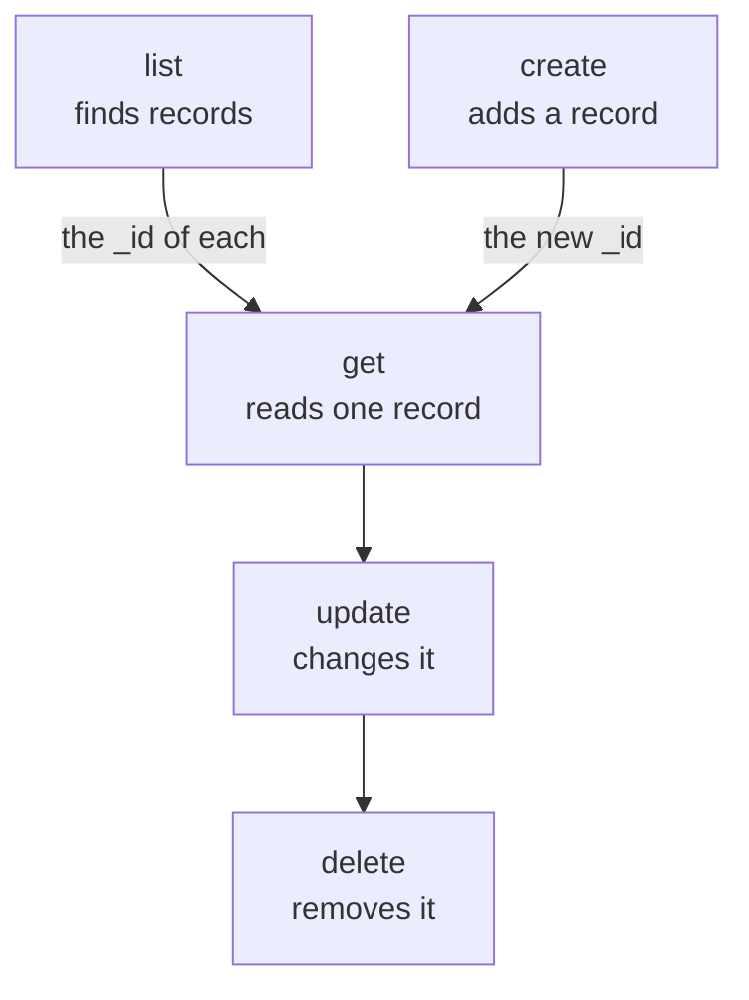

# Resource Operations

Each kind of record is a command of its own, such as `incident`, `monitor` or `status-page`, and each one takes the same operations: `list`, `get`, `create`, `update`, `delete` and `count`. This page shows every operation, with filters, paging and the JSON a record is written in.

:::cards
- [Find the command for a record](#find-the-command-for-a-record): oneuptime resources lists them all.
- [List records](#list-records): Filter, sort and page.
- [Create a record](#create-a-record): From JSON on the command line or in a file.
- [Delete a record](#delete-a-record): At once, with no undo.
:::

## How the operations fit together

Reading, changing and deleting a record need its ID. Listing, counting and creating need none, and a list or a create gives you the IDs the others take:



An ID is a UUID, such as `6f1c2a40-3b1e-4c55-9a0b-3e2f8d7c1a11`. You can also copy one from the record's page in OneUptime: see [Finding a resource's ID](/docs/api-reference/api-reference#finding-a-resources-id).

## Find the command for a record

```bash
oneuptime resources
```

The list shows each kind of record with its command, its names, its type and its API path. There are two types:

| Type | What it holds | Operations |
| --- | --- | --- |
| `database` | Records you manage: monitors, incidents, alerts, status pages, teams and more | `list`, `get`, `create`, `update`, `delete`, `count` |
| `analytics` | Telemetry: logs, spans, metrics, exceptions and other events | `list`, `create`, `count` |

Show one type with `oneuptime resources --type database` or `--type analytics`. The [Command Reference](/docs/cli/command-reference#resources) lists every command.

## List records

```bash
oneuptime <resource> list [--query <json>] [--limit <n>] [--skip <n>] [--sort <json>] [-o <format>]
```

| Option | What it does | Default |
| --- | --- | --- |
| `--query <json>` | Returns only the records that match: see [Filter a list](#filter-a-list) | Every record the key may read |
| `--limit <n>` | The most records to return, up to 10,000 | `10` |
| `--skip <n>` | How many matching records to pass over first | `0` |
| `--sort <json>` | The order, such as `{"createdAt":"ASC"}`, or `"DESC"` for newest first | Newest first |
| `-o, --output <format>` | `table`, `json` or `wide` | `table` in a terminal, `json` in a pipe |

```bash
# The ten newest incidents
oneuptime incident list

# The oldest monitors first, 50 at a time: the second page
oneuptime monitor list --sort '{"createdAt":"ASC"}' --limit 50 --skip 50

# Every field of each incident, as JSON
oneuptime incident list -o json
```

A list asks OneUptime for every field of each record that the key may read. A table shows six of them; JSON shows them all (see [Output Formats](/docs/cli/output-formats)). To page through every record, raise `--skip` by `--limit` until a page comes back empty; `count` says how many there are.

Labels are listed by name rather than newest first: labels whose names start with a number come first, in the order of that number (`2. Team` before `10. Owner`), then the others alphabetically. To list them in another order, give `--sort`.

### Filter a list

`--query` takes the same filter as the API: a field with a value matches that value, and an object with a `_type` compares.

| Filter | Matches |
| --- | --- |
| `{"title":"Checkout API is down"}` | Records with exactly that value |
| `{"title":{"_type":"Search","value":"checkout"}}` | Text that contains the value |
| `{"createdAt":{"_type":"GreaterThan","value":"2026-10-01T00:00:00.000Z"}}` | Later dates, or larger numbers |
| `{"currentIncidentState":{"isResolvedState":false}}` | A field of a record the resource names: here, incidents that are not resolved |

```bash
oneuptime incident list --query '{"title":{"_type":"Search","value":"checkout"}}'
```

[Filter, sort and page](/docs/api-reference/api-reference#filter-sort-and-page) in the API reference lists every `_type`.

## Read a record

```bash
oneuptime <resource> get <id> [-o <format>]
```

```bash
oneuptime incident get 6f1c2a40-3b1e-4c55-9a0b-3e2f8d7c1a11
```

A table shows one row for each field of the record, each value cut at 60 characters; `-o json` shows the values whole. An ID that names no record your key may read answers `Not found`, and the command exits with code `3`.

## Create a record

```bash
oneuptime <resource> create --data <json> [-o <format>]
oneuptime <resource> create --file <path> [-o <format>]
```

`--data` takes the record as JSON, and `--file` reads it from a JSON file. Give one of the two; given both, the file is used. The fields are the API's, and the [API reference](/reference) lists each resource's. The project comes from the API key, so a record never names it.

```bash
# A manual monitor
oneuptime monitor create --data '{"name":"Checkout API","monitorType":"Manual"}'

# An incident with one of your severities
oneuptime incident create --data '{"title":"Checkout API is down","incidentSeverityId":"<severity-id>"}'

# The same incident, from a file
oneuptime incident create --file incident.json
```

The CLI prints the new record, with its `_id`. An incident starts in your project's created state unless `currentIncidentStateId` names another one: see [The state a new record starts in](/docs/api-reference/api-reference#the-state-a-new-record-starts-in). To find your severities' IDs:

```bash
oneuptime incident-severity list -o json | jq -r '.[] | "\(._id)  \(.name)"'
```

> [!TIP]
> On Windows, put the JSON in a file and use `--file`: PowerShell and the Command Prompt quote JSON on the command line differently from Bash.

## Update a record

```bash
oneuptime <resource> update <id> --data <json> [-o <format>]
```

`--data` is required and holds only the fields to change:

```bash
# Rename a monitor
oneuptime monitor update <monitor-id> --data '{"name":"Checkout API (EU)"}'

# Move an incident to your resolved state
oneuptime incident update <incident-id> --data '{"currentIncidentStateId":"<resolved-state-id>"}'
```

OneUptime answers an update with an empty object: the CLI prints an empty line, or `{}` with `-o json`. Run `get` to see the record as it is now. Moving an incident to another state this way records the change on its timeline, as the dashboard does, and a state before its current one is refused. To find the ID of the resolved state, the first one in your project's order:

```bash
oneuptime incident-state list --query '{"isResolvedState":true}' --sort '{"order":"ASC"}' --limit 1 -o json | jq -r '.[0]._id'
```

## Delete a record

```bash
oneuptime <resource> delete <id>
```

```bash
oneuptime monitor delete 6f1c2a40-3b1e-4c55-9a0b-3e2f8d7c1a11
```

It answers `Monitor 6f1c2a40-3b1e-4c55-9a0b-3e2f8d7c1a11 deleted successfully.`

> [!CAUTION]
> `delete` removes the record at once. The CLI does not ask you to confirm, and there is no undo. It accepts `--force`, for scripts written with it, and `--force` changes nothing.

## Count records

```bash
oneuptime <resource> count [--query <json>]
```

```bash
# Every incident
oneuptime incident count

# Incidents that are not resolved
oneuptime incident count --query '{"currentIncidentState":{"isResolvedState":false}}'
```

The CLI prints one number, the same in a table and in JSON, so a script can read it as it is.

## What each type can do

| Operation | `database` | `analytics` |
| --- | --- | --- |
| `list` | Yes | Yes |
| `get` | Yes | No |
| `create` | Yes | Yes |
| `update` | Yes | No |
| `delete` | Yes | No |
| `count` | Yes | Yes |

## Troubleshooting

:::details Not found: API error (404)
The record does not exist, is in another project, or is one the key may not read: OneUptime answers the same for each. Check the ID with `list`, and the key's permissions. The command exits with code `3`.
:::

:::details API error (422): You do not have permissions to select on
A list or a get asks for every field of the record, and the key may not read one of them: the message names the field and the permissions that may read it. Give the key one of those permissions.
:::

:::details Error: Invalid JSON
The value of `--query`, `--sort` or `--data` is not JSON. In Bash and zsh, wrap it in single quotes; on Windows, put a record in a file and use `--file`.
:::

:::details API error (400) on a create or an update
OneUptime refused a field: the message names it. `No fields to update` means `--data` held no field to change.
:::

## Next steps

:::cards
- [Output Formats](/docs/cli/output-formats): Read the answers as tables or as JSON.
- [Scripting & CI/CD](/docs/cli/scripting): Use these operations in scripts and pipelines.
- [Command Reference](/docs/cli/command-reference): Every command, option and default.
:::
