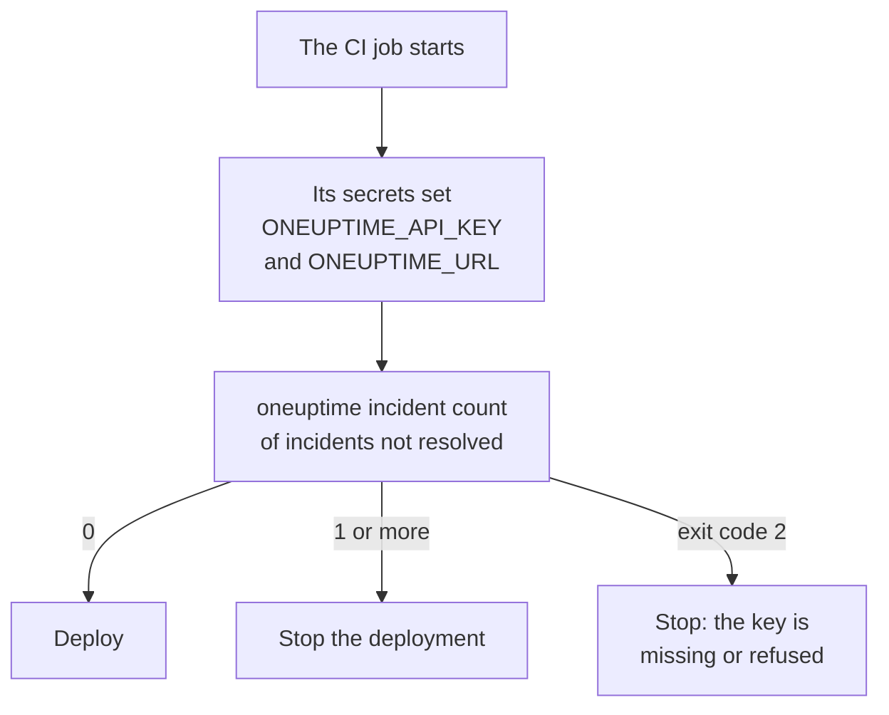

# Scripting & CI/CD

The CLI works the same in a script as in a terminal. Give it an API key in environment variables, read its answers as JSON, and let its exit code tell the script what happened. This page shows each of these, and complete pipelines for GitHub Actions, GitLab CI and Docker.

:::cards
- [Give a script its API key](#give-a-script-its-api-key): Two environment variables, no saved context.
- [Exit codes](#exit-codes): 0 when it worked, and why it did not.
- [Read answers with jq](#read-answers-with-jq): IDs, titles and dates out of the JSON.
- [Pipeline examples](#pipeline-examples): GitHub Actions, GitLab CI and Docker.
:::

## How a script uses the CLI

A deployment can ask OneUptime first whether an incident is open, and stop if one is:



## Give a script its API key

Set `ONEUPTIME_API_KEY` and `ONEUPTIME_URL` from your CI system's secrets. The CLI then needs no `login` and no configuration file. A flag still comes before them for one command, and they come before saved contexts.

```bash
export ONEUPTIME_API_KEY="$CI_ONEUPTIME_API_KEY"
export ONEUPTIME_URL="https://oneuptime.com"
oneuptime incident count
```

> [!TIP]
> Give each pipeline an API key of its own, with only the access it needs: a check that only reads needs a key that only reads. Delete the key in OneUptime when the pipeline is retired.

If one machine runs jobs for several projects, save a context for each and name it in every command, so that a job never uses another's current context:

```bash
oneuptime --context production incident count
oneuptime --context staging monitor count
```

## Exit codes

| Code | Meaning | For example |
| --- | --- | --- |
| `0` | It worked | A list, even one that finds nothing |
| `1` | It failed | OneUptime refused the request, such as `API error (422)`; invalid JSON; a missing or unknown option; a context that is not saved |
| `2` | No usable API key | No credentials found; an invalid API key; a key below its plan (`402`); `401` |
| `3` | Not found | OneUptime answered `404`: the record does not exist, is in another project, or the key may not read it |

`whoami` and `context current` exit with `0` even when nothing is saved: they report what is set, they do not check it. A script tells the cases apart by the code:

```bash
oneuptime incident get "$INCIDENT_ID" -o json > incident.json
case $? in
  0) echo "Saved the incident to incident.json" ;;
  2) echo "Check ONEUPTIME_API_KEY and ONEUPTIME_URL" >&2; exit 1 ;;
  3) echo "There is no incident $INCIDENT_ID" >&2; exit 1 ;;
  *) echo "OneUptime refused the request" >&2; exit 1 ;;
esac
```

Error messages go to the standard error, so `incident.json` holds only the answer.

## Read answers with jq

Write `-o json` in scripts. In a pipe the CLI prints JSON anyway, but the flag keeps the script working wherever it runs:

```bash
# The title of each incident
oneuptime incident list -o json | jq -r '.[].title'

# The ID of a new monitor
MONITOR_ID=$(oneuptime monitor create --data '{"name":"Checkout API","monitorType":"Manual"}' -o json | jq -r '._id')

# When each incident was created: dates come as objects
oneuptime incident list -o json | jq -r '.[] | "\(.createdAt.value)  \(.title)"'

# The newest 100 incidents as CSV
oneuptime incident list --limit 100 -o json | jq -r '.[] | [._id, .title, .createdAt.value] | @csv'
```

A count prints one number, ready to compare:

```bash
OPEN=$(oneuptime incident count --query '{"currentIncidentState":{"isResolvedState":false}}')
echo "$OPEN incidents are open"
```

## Create records from files

Keep records as JSON files next to your code, and create them from there:

```json title="monitors/checkout-api.json"
{
  "name": "Checkout API",
  "monitorType": "Manual"
}
```

```bash
oneuptime monitor create --file monitors/checkout-api.json
```

Many records from one JSON array, one create each:

```bash
jq -c '.[]' monitors.json | while IFS= read -r monitor; do
  oneuptime monitor create --data "$monitor" -o json | jq -r '._id'
done
```

> [!NOTE]
> Each run creates new records. To keep monitors and status pages in step with files, change only what changed and remove what is gone, use the [Terraform provider](/docs/terraform/index).

## Pipeline examples

:::tabs
@tab GitHub Actions
```yaml title=".github/workflows/deploy.yml"
name: Deploy
on:
  push:
    branches: [main]

jobs:
  deploy:
    runs-on: ubuntu-latest
    steps:
      - uses: actions/checkout@v4
      - uses: actions/setup-node@v4
        with:
          node-version: lts/*
      - name: Install the OneUptime CLI
        run: npm install -g @oneuptime/cli
      - name: Stop while an incident is open
        env:
          ONEUPTIME_API_KEY: ${{ secrets.ONEUPTIME_API_KEY }}
          ONEUPTIME_URL: https://oneuptime.com
        run: |
          OPEN=$(oneuptime incident count --query '{"currentIncidentState":{"isResolvedState":false}}')
          if [ "$OPEN" -gt 0 ]; then
            echo "$OPEN incidents are open: not deploying."
            exit 1
          fi
      - name: Deploy
        run: ./deploy.sh
```
@tab GitLab CI
```yaml title=".gitlab-ci.yml"
check-incidents:
  stage: test
  image: node:lts
  variables:
    ONEUPTIME_URL: https://oneuptime.com
  script:
    - npm install -g @oneuptime/cli
    - OPEN=$(oneuptime incident count --query '{"currentIncidentState":{"isResolvedState":false}}')
    - echo "$OPEN incidents are open"
    - test "$OPEN" -eq 0
```
@tab Docker
```dockerfile title="Dockerfile"
FROM node:lts-slim
RUN npm install -g @oneuptime/cli
ENTRYPOINT ["oneuptime"]
```
:::

In GitHub Actions, add `ONEUPTIME_API_KEY` under the repository's **Settings → Secrets and variables → Actions**; in GitLab, add it as a masked CI/CD variable. With the Docker image, pass the variables to each run:

```bash
docker build -t oneuptime-cli .
docker run --rm -e ONEUPTIME_API_KEY -e ONEUPTIME_URL oneuptime-cli incident count
```

## Next steps

:::cards
- [Authentication](/docs/cli/authentication): Which key a command uses when several are set.
- [Output Formats](/docs/cli/output-formats): The JSON your scripts read.
- [Resource Operations](/docs/cli/resource-operations): Filters, paging and the fields of a record.
- [Terraform Provider](/docs/terraform/index): Keep OneUptime's configuration in files.
:::
