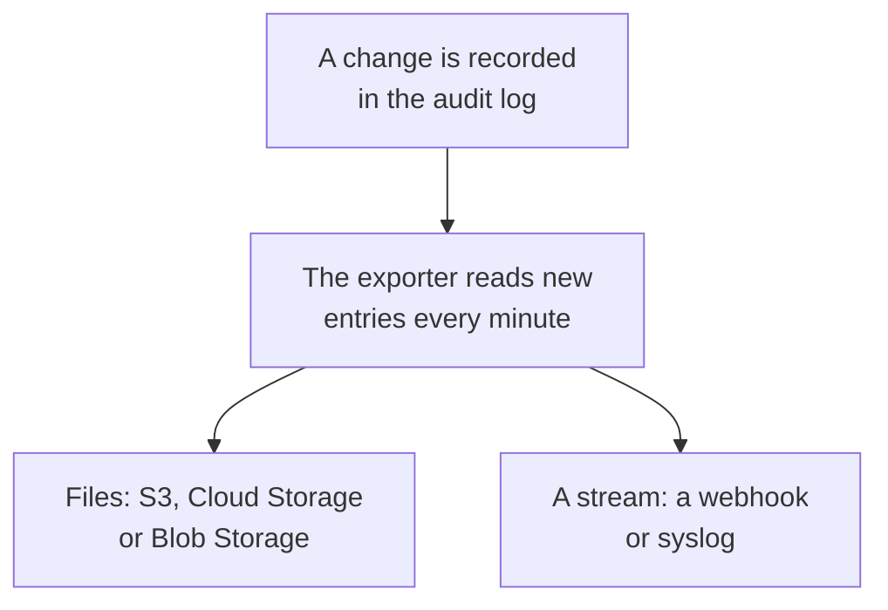

# Audit Log Export

Send the audit log, as it is recorded, to storage or a service you choose: Amazon S3 or S3-compatible storage, Google Cloud Storage, Azure Blob Storage, a webhook or syslog. Keep entries there as long as your compliance reviews need, and search them in your SIEM. A project's owners and admins export its audit log from Project Settings, and master admins export every project's from the Admin Dashboard. It is part of the Enterprise plan on OneUptime Cloud, and of the Enterprise Edition when you self-host.

:::cards
- [Set up an export](#set-up-an-export): Pick a destination, test it, save it.
- [What is sent](#what-is-sent): One JSON object per entry, in a stable schema.
- [When entries are sent](#when-entries-are-sent): Every minute, each entry once, in order.
- [When a destination fails](#when-a-destination-fails): Retries, the error, and nothing skipped.
:::

## How an entry reaches your destination



- **One export, one destination.** A project can have several exports, each sending every entry to its own destination.
- **A project's, or the instance's.** A project's export sends that project's entries. An export set up in the Admin Dashboard sends the entries of every project that records audit logs.
- **From when it is saved.** An export sends what is recorded after it is saved, unless you set **Export from** to an earlier date.

## Before you begin

- **On OneUptime Cloud, the Enterprise plan.** On other plans, the page shows what the feature does and how to get it.
- **When you self-host, the Enterprise Edition**, with a license that includes audit logs. See [Enterprise Edition](/docs/self-hosted/enterprise).
- **Audit logging turned on** in each project you export. See [Audit Logs](/docs/configuration/audit-logs).
- **A Project Owner or Project Admin** to export a project's audit log, or a master admin to export the instance's.

## Set up an export

:::steps
### Open the export page

For a project, go to **Project Settings → Audit Logs → Export**. For the whole instance, go to **Settings → Audit Log Export** in the Admin Dashboard.

### Pick a destination

Click **Add export** and pick one of the six destinations below. An export's destination cannot be changed later.

### Fill in how to reach it

Fill in what the destination asks for. Settings most people leave as they are wait under **More fields**, and **Setup guide** opens the destination's section on this page.

### Send a test

Click **Write a test file** or **Send a test entry**. Storage gets the file `oneuptime-audit-log-export-test.ndjson.gz` in its folder, and a webhook or syslog gets one entry whose action is `Test`. A failed test says what to fix.

### Start exporting

Click **Next**, name the export, and click **Start exporting**. The first entries arrive within a few minutes.
:::

The export's row shows how it is doing: **Exporting**, **Failing**, **Paused**, **Waiting for entries** or **Starting**. **Send a test** sends a test with the saved settings, and **Edit** changes them: a credential you leave empty keeps the one saved.

## Destinations

| Destination | What arrives | Signs in with |
| --- | --- | --- |
| [Amazon S3](#amazon-s3) | Compressed NDJSON files | An access key |
| [S3-compatible storage](#s3-compatible-storage) | Compressed NDJSON files | An access key |
| [Google Cloud Storage](#google-cloud-storage) | Compressed NDJSON files | A service account key |
| [Azure Blob Storage](#azure-blob-storage) | Compressed NDJSON files | A SAS token or an access key |
| [Webhook](#webhook) | HTTPS requests | An optional header and signing secret |
| [Syslog](#syslog) | RFC 5424 messages | None |

### Amazon S3

| Field | What to enter |
| --- | --- |
| **Bucket** | The bucket the files are written to. |
| **Region** | The bucket's region. It starts on `us-east-1`. |
| **Access key ID** | An access key that may write objects to the bucket. |
| **Secret access key** | The key's secret. |
| **Folder** | Under **More fields**. Left empty, the files go to `oneuptime/audit-logs/`. |

The key needs only `s3:PutObject` on the folder:

```json
{
  "Version": "2012-10-17",
  "Statement": [
    {
      "Effect": "Allow",
      "Action": "s3:PutObject",
      "Resource": "arn:aws:s3:::my-audit-logs/oneuptime/audit-logs/*"
    }
  ]
}
```

### S3-compatible storage

The same fields as Amazon S3, after an **Endpoint**: the storage's S3 address, such as `https://minio.example.com:9000` or `https://<account>.r2.cloudflarestorage.com`. Set **Region** to the one the storage expects: `us-east-1` for MinIO and Wasabi's default, `auto` for Cloudflare R2.

### Google Cloud Storage

Enter the **Bucket** and paste a **Service account key** (JSON) whose service account has the Storage Object Creator role on the bucket. **Folder** waits under **More fields**.

### Azure Blob Storage

Enter the **Storage account** and the **Container**, and choose how to **Sign in with**: a **SAS token** with Create and Write permission on the container, or an **Access key** of the storage account. A SAS token can be limited to this container, so it is the safer choice. **Cloud** and **Folder** wait under **More fields**.

### Webhook

OneUptime POSTs each batch to the **URL**, as a JSON array (`application/json`) or one entry per line (`application/x-ndjson`), as **Body format** says, with these headers:

| Header | Value |
| --- | --- |
| `X-OneUptime-Event` | `audit-log-export` |
| `X-OneUptime-Batch-Id` | The id of the batch's first entry: the same batch sent again carries the same id. |
| `X-OneUptime-Entry-Count` | How many entries the body holds. |
| `X-OneUptime-Signature` | `sha256=` and the HMAC-SHA256 of the body, with the **Signing secret**, when one is set. |

The **Credential**, such as `Bearer <token>`, is sent in the **Header name** you choose, `Authorization` unless you change it. **Body format**, **Header name** and **Signing secret** wait under **More fields**. Any 2xx answer is a delivery. A `413` splits the batch in two, and any other refusal sends the whole batch again later.

### Syslog

Each entry is one RFC 5424 message to the **Host** and **Port**, over TLS on port `6514` unless **Protocol** says TCP, with facility 13 (log audit) and severity 6 (informational):

```text
<110>1 2026-10-24T09:15:03.000Z oneuptime.example.com oneuptime - audit-log - {"schemaVersion":1,"id":"..."}
```

Messages are framed by octet counting (RFC 5425) unless **Framing** says one message per line. A receiver whose certificate a private CA signed needs that CA's certificate in **CA certificate**. Both wait under **More fields**.

## What is sent

Every entry is one JSON object, its keys always in this order:

| Key | What it holds |
| --- | --- |
| `schemaVersion` | `1`. A change to the schema comes with a new version. |
| `id` | The entry's id. The same entry sent twice has the same id. |
| `createdAt` | When the change was recorded, in UTC. |
| `projectId` | The project the change was made in. |
| `action` | `Create`, `Update`, `Delete` or `Download`. |
| `resourceType`, `resourceId`, `resourceName` | What was changed. |
| `rootResourceType`, `rootResourceId` | The resource it belongs to, such as an SLO for its rule. |
| `userId`, `userName`, `userEmail`, `userType` | Who made the change. |
| `apiKeyId`, `apiKeyName` | The API key it was made with, if any. |
| `mcpOAuthGrantId`, `mcpClientName` | The MCP client it was made through, if any. |
| `workflowId`, `workflowName` | The workflow that made it, if any. |
| `changes` | Each field changed: `field`, with `oldValue` and `newValue`. |

A file holds one entry per line, compressed with gzip, and is filed by the hour of its first entry: `oneuptime/audit-logs/2026/10/24/09/20261024T091503Z_<first entry id>.ndjson.gz`.

Keys, tokens and passwords never leave: they are recorded as `[REDACTED]`, and fields nobody may read are left out of every entry.

## When entries are sent

- **Every minute.** Entries recorded more than a minute ago are read oldest first and sent in batches: up to 5,000 entries or 16 MB per file, and 500 entries per webhook request or syslog connection.
- **Files are not written for every entry.** A file is written when a batch is full or its first entry is five minutes old.
- **Each entry once, in order.** After every delivery the export remembers the last entry sent, so a restart or another worker carries on from there.
- **A repeat can be recognised.** A batch sent again after a crash writes the same file name or carries the same `X-OneUptime-Batch-Id`, and every entry carries its `id`.

## When a destination fails

A batch is tried three times, a few seconds apart, then the export waits before trying again: one minute, then two, four and so on, up to an hour. Its row says **Failing**, and **View Error** shows what the destination answered and when it is tried next.

Nothing is skipped: the entries wait in the audit log, and the next delivery that works catches up from the oldest. An entry older than its project's audit log retention is deleted before it can be sent, so fix a failing export within that time.

To pause an export, turn off **Export** in **Edit**: it keeps its place, and turned back on, it sends what was recorded meanwhile. On OneUptime Cloud, a project that leaves the Enterprise plan stops exporting, and its exports wait under the upgrade card, where they can be turned off or deleted. When you self-host, exporting stops while the license does not include audit logs, and carries on from where it stopped once one does.

## Troubleshooting

:::details The test says access is denied
The key, token or service account may not write where the export writes. Give it permission to create objects in the folder, as each destination's section above shows, then send the test again.
:::

:::details The test cannot reach the address
A project's export on OneUptime Cloud cannot reach a private network address. When you self-host it can, unless `DATA_SOURCE_BLOCK_PRIVATE_ADDRESSES` is `true`, and an export set up in the Admin Dashboard always can. Loopback and link-local addresses are never reached.
:::

:::details Nothing arrives
Check that audit logging is on in the project, and that someone changed something after the export was saved. Storage receives a file only once a batch is full or five minutes old.
:::

## Next steps

:::cards
- [Audit Logs](/docs/configuration/audit-logs): What is recorded, and how long it is kept.
- [Users, Teams & Permissions](/docs/permissions/index): Decide who may set up an export.
- [Enterprise Edition](/docs/self-hosted/enterprise): Audit logs on a self-hosted installation.
:::
