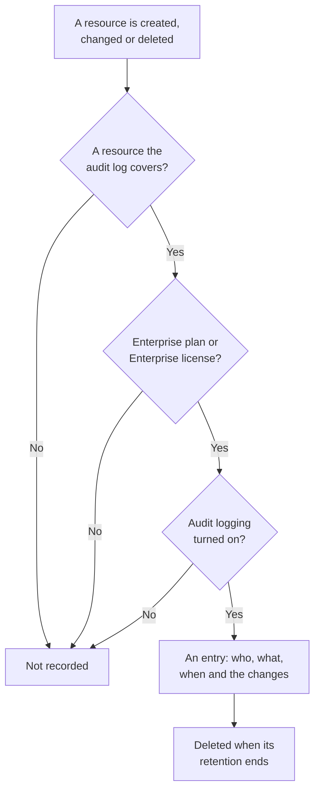

# Audit Logs

The audit log records who changed what in your project: each create, update and delete of the resources it covers, with the values before and after, and every time someone signs in or out. Use it to find out who turned a monitor off or changed an API key, who signed in and from where, and to keep a record for compliance reviews. It is part of the Enterprise plan on OneUptime Cloud, and of the Enterprise Edition when you self-host.

:::cards
- [Turn on audit logging](#turn-on-audit-logging): It starts off in every project.
- [Read the audit log](#read-the-audit-log): Who changed what, and when.
- [What is recorded](#what-is-recorded): The resources and actions it covers.
- [Sign-ins and sessions](#sign-ins-and-sessions): Who signed in, and how each session ended.
- [How long entries are kept](#how-long-entries-are-kept): From 7 to 180 days.
:::

## How a change becomes an entry

- **It starts off.** A project records nothing until someone turns audit logging on, and nothing from before that moment.
- **It records what people do.** A change made by a person, an API key, an MCP client or a workflow is recorded. A change OneUptime makes by itself, such as a background job's, is left out unless you turn on **Store System Events**.
- **Entries cannot be changed.** Nobody can edit or delete an entry, in the dashboard or through the API. An entry leaves only when its retention ends.

## Before you begin

- **On OneUptime Cloud, the Enterprise plan.** On other plans, the audit log pages show what the feature does and how to get it.
- **When you self-host, the Enterprise Edition**, with a license that includes audit logs. See [Enterprise Edition](/docs/self-hosted/enterprise).
- **A role that reads the audit log.** Project Owner, Project Admin, Settings Admin, or the **Read Audit Log** permission. Turning audit logging on, and changing its settings, takes a Project Owner, a Project Admin, or permission to edit the project.

## Turn on audit logging

:::steps
### Open the audit log settings

Go to **Project Settings → Audit Logs → Settings**. **Audit Logs** starts folded in the side menu: click it to open it.

### Edit the settings

Click **Edit Audit Log Settings**.

### Turn it on

Turn on **Enable Audit Logs**, set **Retention (days)**, and choose whether to **Store System Events**. Click **Save Changes**.
:::

| Setting | Starts at | What it does |
| --- | --- | --- |
| **Enable Audit Logs** | Off | Records changes to the project's resources from now on. |
| **Retention (days)** | 7 | How many days each entry is kept: from 7 to 180. |
| **Store System Events** | Off | Also records the changes OneUptime makes by itself, which no person or key started. |

A change to these settings applies within a minute.

## Read the audit log

**Project Settings → Audit Logs → Audit Logs** lists every entry in the project, newest first:

| Column | What it shows |
| --- | --- |
| **When** | How long ago, with the date and time. |
| **Action** | `Create`, `Update` or `Delete`, `Download` for a packet capture file someone downloaded, or `Sign In`, `Sign Out`, `Session Timeout` or `Session Revoked` for a session. |
| **Resource** | The resource's name, which opens it while it still exists, and its type. |
| **Actor** | Who made the change: a person, an API key, a workflow, or `System` for a change OneUptime made by itself. A person's change made through an MCP client says which one. |
| **Changes** | How many fields changed, or were captured for a create or a delete. For a session, how it signed in or why it ended. Click it to see each field. |

Filter by **Resource Type**, **Resource Name**, **Action**, **User Email** or **Time**. An update lists only the fields that changed, before and after, and a save that changes nothing adds no entry.

A resource with no name of its own is named by what names it in OneUptime: an exception by its type and the start of its message, with ids, addresses and anything that looks like a secret masked, a runbook run by its runbook, an incoming call policy's phone number by the number, and a template or a domain by its own name.

Monitors, incidents, alerts, status pages, SLOs and many other resources also have an **Audit Logs** page of their own, in a folded section of their side menu such as **Advanced**. It lists only that resource's entries, with those of what belongs to it: an SLO's page shows its rules and owners too.

## What is recorded

Everything people create, change or delete in a project is recorded: monitors, incidents, alerts, status pages, workflows and their steps, queues, dashboards, on-call policies, teams and who is on them, API keys and every setting. **Resource Type** says what an entry is about, such as `Monitor`, `Workflow` or `Queue`.

| Not recorded | Why |
| --- | --- |
| Logs of messages | Each is already the record of an email, SMS, call, push notification or chat message OneUptime sent or received. |
| Records of runs | Each is already the record of a workflow run, an on-call escalation, a scan, an import or an AI run. |
| What agents and telemetry report | Discovered resources, readings and usage change with every report, not because anybody changed them. |
| Activity feeds | A feed lists changes the audit log already records. |
| OneUptime's working state | Status page readers' sessions, queued jobs and other state OneUptime keeps while it works. |
| A person's own notification setup | Each person's addresses, numbers and How to Reach Me are theirs alone. |
| A person's own preferences | The products each person pins to their own top bar are theirs alone, and only they see them. |

An administrator adding or removing a notification method or a rule in How to Reach Me on someone else's account is recorded too, without the address or number itself.

Fields only OneUptime writes, such as when a host was last seen, are left out of every entry, and so are fields nobody may read. When OneUptime writes one because someone asked it to, such as merging an exception into another or resetting a webhook URL, the entry records it as their change. Keys, tokens and passwords are recorded as `[REDACTED]`: the entry shows they changed, never their value. A workflow's steps are recorded as what changed, naming a step's settings but never what was typed into them, and moving a step on the canvas is not recorded.

What OneUptime does because someone asked it to is recorded as their change too, whether or not the project stores system events:

- Starting, approving, completing, skipping and cancelling a runbook run. Its steps are recorded as what was done to each, such as `Approved "Restart the API" (step 3)`, never with what a step printed.
- What a rule changes when someone runs it: the labels and owners it adds, the records a privacy rule makes private, the devices a site assignment rule moves, the devices and monitors an auto import rule creates, and what a status page or SLO monitor rule changes on its page or SLO.
- Buying, attaching and releasing an incoming call policy's phone number.
- Resolving a data alert someone marks as expected or not an issue.
- Resetting a calendar feed's link.
- The teams someone joins when they sign in with SSO.

What a rule does by itself is OneUptime's own change, recorded with **Store System Events** on: the labels and owners a rule adds as a record is created, and a record it makes private then; the devices and monitors an auto import rule creates from new scan results; and what a status page or SLO monitor rule changes when a rule, a monitor or a label is saved.

Resetting the AI agent of a host, a cluster or a cloud account is recorded on that resource's own **Audit Logs** page, as the change of `aiAgentResetAt` by whoever reset it: who, and when. So is making a key for a cloud account's AI agent: the keys show as changed, never with a key or a hash. What an agent reports as it connects and checks in is left out, as before.

## Sign-ins and sessions

Each time a member of the project signs in to OneUptime, the audit log records it, and again when that session ends. A sign-in is to OneUptime, not to one project, so every project the person is a member of records it.

| Action | When it is recorded |
| --- | --- |
| `Sign In` | Someone signs in: with a password or a sign-in link, a passkey, Google, Microsoft, Vercel or single sign-on. |
| `Sign Out` | They sign out. |
| `Session Timeout` | OneUptime ends the session on time: the idle timeout or session length a server admin set, or 30 days without use. |
| `Session Revoked` | OneUptime ends the session because the password changed, the account was blocked, or a server admin reset or required two-factor authentication. |

An entry's **Resource** is the session, named by the device it signed in from, such as `Chrome 130 on macOS`. Its **Actor** is the person whose session it is, so filtering by **User Email** finds every sign-in and session of theirs. Its details say how they signed in and with which second factor, the IP address and the place, and for a session that ended, when it signed in, when it was last used and when it timed out. A project's own SSO provider is named only in that project's audit log.

Sign-ins and sessions are recorded whether or not the project stores system events. A session length or 30 days without use is recorded within minutes of running out. An idle timeout is recorded when the person's open tab or the mobile app next reaches OneUptime.

## How long entries are kept

Each entry is kept for the **Retention (days)** the project had when it was recorded, then deleted. A new retention applies to new entries: the entries recorded so far keep their dates. Through the API too, a retention is a whole number of days from 7 to 180: any other value is refused.

To keep entries longer than 180 days, send them to your own storage or SIEM as they are recorded: see [Audit Log Export](/docs/configuration/audit-log-export). You can also read them through the API with an API key that holds **Read Audit Log**, and store them where you need them. See [API Reference](/docs/api-reference/api-reference).

## When the plan or license no longer includes audit logs

- **On OneUptime Cloud**, a project that leaves the Enterprise plan stops recording, and its audit log pages show the upgrade card until it is back on the plan.
- **When you self-host**, audit logging stops recording when the Enterprise trial or grace period ends without a license, or when the license does not include audit logs. The audit log says so in red. Entries recorded so far are kept, and recording resumes with the same settings once a license is activated. See [When a license expires or is missing](/docs/self-hosted/enterprise#when-a-license-expires-or-is-missing).

## Troubleshooting

:::details The audit log is empty
Audit logging starts off, and records nothing from before it was turned on. If the list says audit logging is off, follow its link to the settings and turn it on. Otherwise, change a monitor or an incident and refresh the list.
:::

:::details A change is missing from the audit log
Check that the resource is in [What is recorded](#what-is-recorded), and that the change was made after audit logging was turned on. A change OneUptime made by itself is recorded only with **Store System Events** on.
:::

## Next steps

:::cards
- [Audit Log Export](/docs/configuration/audit-log-export): Send the audit log to your own storage or SIEM.
- [Users, Teams & Permissions](/docs/permissions/index): Decide who may read the audit log.
- [Project Settings](/docs/configuration/project-settings): The rest of the project's settings.
- [Billing & Usage](/docs/configuration/billing): Change the project's plan.
- [Enterprise Edition](/docs/self-hosted/enterprise): Audit logs on a self-hosted installation.
:::
