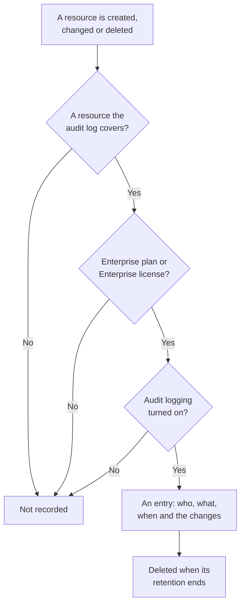

# Audit Logs

The audit log records who changed what in your project: each create, update and delete of the resources it covers, with the values before and after. Use it to find out who turned a monitor off or changed an API key, and to keep a record for compliance reviews. It is part of the Enterprise plan on OneUptime Cloud, and of the Enterprise Edition when you self-host.

:::cards
- [Turn on audit logging](#turn-on-audit-logging): It starts off in every project.
- [Read the audit log](#read-the-audit-log): Who changed what, and when.
- [What is recorded](#what-is-recorded): The resources and actions it covers.
- [How long entries are kept](#how-long-entries-are-kept): From 7 to 180 days.
:::

## How a change becomes an entry

- **It starts off.** A project records nothing until someone turns audit logging on, and nothing from before that moment.
- **It records what people do.** A change made by a person, an API key, an MCP client or a workflow is recorded. A change OneUptime makes by itself, such as a background job's, is left out unless you turn on **Store System Events**.
- **Entries cannot be changed.** Nobody can edit or delete an entry, in the dashboard or through the API. An entry leaves only when its retention ends.

## Before you begin

- **On OneUptime Cloud, the Enterprise plan.** On other plans, the audit log pages show what the feature does and how to get it.
- **When you self-host, the Enterprise Edition**, with a license that includes audit logs. See [Enterprise Edition](/docs/self-hosted/enterprise).
- **A role that reads the audit log.** Project Owner, Project Admin, Settings Admin, or the **Read Audit Log** permission. Turning audit logging on, and changing its settings, takes a Project Owner, a Project Admin, or permission to edit the project.

## Turn on audit logging

:::steps
### Open the audit log settings

Go to **Project Settings → Audit Logs → Settings**. **Audit Logs** starts folded in the side menu: click it to open it.

### Edit the settings

Click **Edit Audit Log Settings**.

### Turn it on

Turn on **Enable Audit Logs**, set **Retention (days)**, and choose whether to **Store System Events**. Click **Save Changes**.
:::

| Setting | Starts at | What it does |
| --- | --- | --- |
| **Enable Audit Logs** | Off | Records changes to the project's resources from now on. |
| **Retention (days)** | 7 | How many days each entry is kept: from 7 to 180. |
| **Store System Events** | Off | Also records the changes OneUptime makes by itself, which no person or key started. |

A change to these settings applies within a minute.

## Read the audit log

**Project Settings → Audit Logs → Audit Logs** lists every entry in the project, newest first:

| Column | What it shows |
| --- | --- |
| **When** | How long ago, with the date and time. |
| **Action** | `Create`, `Update` or `Delete`, or `Download` for a packet capture file someone downloaded. |
| **Resource** | The resource's name, which opens it while it still exists, and its type. |
| **Actor** | Who made the change: a person, an API key, a workflow, or `System` for a change OneUptime made by itself. A person's change made through an MCP client says which one. |
| **Changes** | How many fields changed, or were captured for a create or a delete. Click it to see each field. |

Filter by **Resource Type**, **Resource Name**, **Action**, **User Email** or **Time**. An update lists only the fields that changed, before and after, and a save that changes nothing adds no entry.

Monitors, incidents, alerts, status pages, SLOs and many other resources also have an **Audit Logs** page of their own, in a folded section of their side menu such as **Advanced**. It lists only that resource's entries, with those of what belongs to it: an SLO's page shows its rules and owners too.

## What is recorded

| Resource | **Resource Type** in the log |
| --- | --- |
| Monitors | `Monitor` |
| Incidents | `Incident` |
| Alerts | `Alert` |
| Status pages | `Status Page` |
| Scheduled maintenance events | `Scheduled Maintenance Event` |
| On-call policies | `On-Call Policy` |
| SLOs | `Service Level Objective` |
| An SLO's rules and owners | `SLO Burn Rate Rule`, `SLO Monitor Rule`, `Service Level Objective User Owner`, `Service Level Objective Team Owner` |
| Teams | `Team` |
| Custom roles, and the teams and API keys given one | `Custom Role`, `Team Custom Role`, `API Key Custom Role` |
| Labels | `Label` |
| Incident states and severities | `Incident State`, `Incident Severity` |
| Alert states and severities | `Alert State`, `Alert Severity` |
| Monitor statuses | `Monitor Status` |
| Scheduled maintenance states | `Scheduled Maintenance State` |
| Incident roles | `Incident Role` |
| Postmortem statuses | `Postmortem Status` |
| API keys | `API Key` |
| MCP clients people connect | `MCP Client Authorization` |
| Inventory items | `Inventory Item` |
| Collector Configs | `Collector Config` |
| vCenters | `vCenter` |
| Packet captures, and their downloads | `Packet Capture` |
| Security cases, playbooks and their runs, and protected entities | `Security Case`, `Security Playbook`, `Security Playbook Run`, `Protected Entity` |

An administrator adding or removing a notification method or a personal on-call rule on someone else's account is recorded too, without the address or number itself.

Other records are not in the audit log, such as who is on a team, or a permission added to a team on its own. Fields nobody may read, such as secret keys, are left out of every entry.

## How long entries are kept

Each entry is kept for the **Retention (days)** the project had when it was recorded, then deleted. A new retention applies to new entries: the entries recorded so far keep their dates.

To keep entries longer than 180 days, read them through the API with an API key that holds **Read Audit Log**, and store them where you need them. See [API Reference](/docs/api-reference/api-reference).

## When the plan or license no longer includes audit logs

- **On OneUptime Cloud**, a project that leaves the Enterprise plan stops recording, and its audit log pages show the upgrade card until it is back on the plan.
- **When you self-host**, audit logging stops recording when the Enterprise trial or grace period ends without a license, or when the license does not include audit logs. The audit log says so in red. Entries recorded so far are kept, and recording resumes with the same settings once a license is activated. See [When a license expires or is missing](/docs/self-hosted/enterprise#when-a-license-expires-or-is-missing).

## Troubleshooting

:::details The audit log is empty
Audit logging starts off, and records nothing from before it was turned on. If the list says audit logging is off, follow its link to the settings and turn it on. Otherwise, change a monitor or an incident and refresh the list.
:::

:::details A change is missing from the audit log
Check that the resource is in [What is recorded](#what-is-recorded), and that the change was made after audit logging was turned on. A change OneUptime made by itself is recorded only with **Store System Events** on.
:::

## Next steps

:::cards
- [Users, Teams & Permissions](/docs/permissions/index): Decide who may read the audit log.
- [Project Settings](/docs/configuration/project-settings): The rest of the project's settings.
- [Billing & Usage](/docs/configuration/billing): Change the project's plan.
- [Enterprise Edition](/docs/self-hosted/enterprise): Audit logs on a self-hosted installation.
:::
