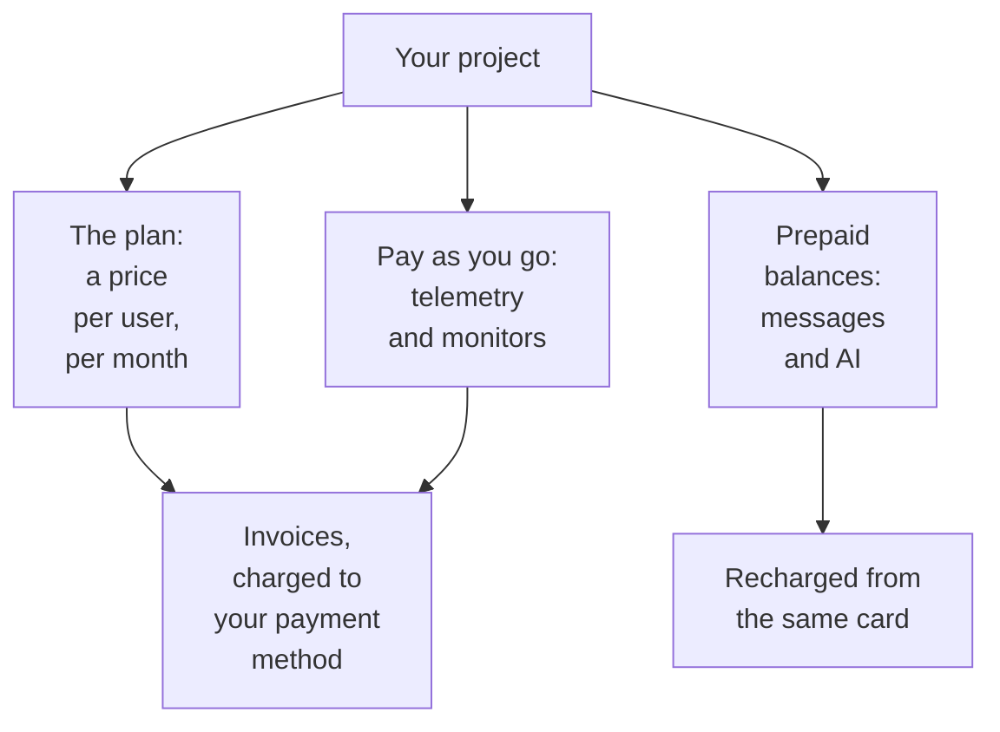

# Billing & Usage

On OneUptime Cloud, a project pays for its plan, per user, and for what it uses: telemetry, active monitors, and the messages and AI work it pays for from prepaid balances. This page shows where to see and change each of them, and who can. A self-hosted installation has no billing, and none of these pages.

:::cards
- [Your plan and seats](#your-plan-and-seats): What the plan costs, and who counts as a seat.
- [Payment methods](#payment-methods): The card your invoices are charged to.
- [Invoices](#invoices): Pay them, download them, and check what you used.
- [Prepaid balances](#prepaid-balances): Messages and AI, recharged by hand or automatically.
:::

## What a project pays for

| What | How it is priced |
| --- | --- |
| The plan | A price per user, per month, billed monthly or yearly. Every person in the project is a seat. |
| Telemetry | $0.10 per GB ingested, with 15 days of retention. Longer retention costs more, and retention under 7 days is billed as 7 days: see [What retention costs](/docs/telemetry/data-retention#what-retention-costs). |
| Session replays | $2 per GB, with 15 days of retention. |
| Active monitors | $1 per monitor per month. Every monitor but a Manual one is active, even while it is turned off. |
| SMS, calls, WhatsApp and Telegram | Paid from the project's balance as each message is sent. |
| OneUptime AI | Paid from the project's AI credits, unless it runs on your own LLM provider. |

The [pricing page](https://oneuptime.com/pricing) compares the plans.

## Before you begin

- **OneUptime Cloud.** The **Billing and Invoices** section of **Project Settings** is on OneUptime Cloud only, and starts folded: click its title to open it.
- **A role that reads billing.** Project Owners, people with **Manage Billing**, and the three billing roles read every billing page. See [Who can do what](#who-can-do-what).

## Your plan and seats

Go to **Project Settings → Billing and Invoices → Billing**. The **Current Plan** card shows the project's plan and its price per user, and **Seats**: one for each person in the project.

A person counts as a seat from the moment you invite them, before they accept, until you remove them. To change the number of seats, invite or remove people: see [Inviting People](/docs/permissions/inviting-people).

## Change the plan

:::steps
### Add a payment method first

A plan change needs a payment method. Without one, **Change Plan** opens **Add a Payment Method** instead: see [Payment methods](#payment-methods).

### Click Change Plan

On the **Current Plan** card, click **Change Plan**. **Yearly Plan** starts on: turn it off to see the monthly prices.

### Pick the plan

Each plan shows its price per user. The note under the plans says what happens to your trial: **Your free trial carries over** while the project is still on its trial, and **Changing plan does not start a free trial** once it is not.

### Save the change

Click **Save Changes**. A paid plan is billed from the moment you change to it, and every person you invite on it is billed when you invite them.
:::

API keys need the Growth plan or a higher one, and below the Scale plan SCIM connections only remove people. A plan that stops them says how many before you pick it, and the **Billing** page shows **Not included in this plan** while they are stopped. Nothing is deleted: they work again on a plan that includes them.

> [!NOTE]
> Bought OneUptime through a reseller or a cloud marketplace (AWS Marketplace, Microsoft Marketplace, Google Cloud Marketplace or Vercel Marketplace)? The **Billing** page says so. A reseller changes your plan for you, and a marketplace bills the project's plan and usage on your cloud bill.

## Payment methods

The **Payment Methods** card lists the cards on the project. Invoices are charged automatically to the default one.

:::steps
### Click Add Payment Method

On the **Payment Methods** card, click **Add Payment Method**.

### Enter the card

Enter the payment details and click **Save payment method**. The method you add becomes the default, and adding one turns on pay-as-you-go usage. It does not change your plan.
:::

- **Set as Default** makes another method on the list the one invoices are charged to.
- **Re-sync Autopay**, on the default method, fixes a renewal that still charges an older card.
- The project keeps at least one payment method: add another before you delete the last one.

## Billing address and invoice email

The **Business Details / Billing Address** card holds what your invoices say about you. Click **Update** and fill in two steps:

| Step | Fields |
| --- | --- |
| **Billing Address** | **Business Details / Billing Address**: your company's legal name, address and tax or VAT ID. **Country**: your billing country. |
| **Invoices** | **Finance / Accounting Email**: where invoices, receipts and billing notices go, several addresses separated by commas. **Send Invoices by Email**: email each invoice there as it is issued. |

## Invoices

**Project Settings → Billing and Invoices → Invoices** lists the project's invoices, with each one's **Invoice Number**, **Invoice Date**, **Amount** and **Invoice Status**.

- **Pay Invoice** pays an invoice that still owes money.
- **Download** opens the invoice as a PDF. On an invoice that still owes money, it is in the row's **⋯** menu.

When your bank is still processing a payment, OneUptime says so: some banks take up to 2 days to confirm a card payment, and the invoice updates by itself. Do not pay it again.

## Usage history

**Project Settings → Billing and Invoices → Usage History** shows the telemetry the project sent, one row per product, service and day:

| Column | What it shows |
| --- | --- |
| **Product** | Logs, traces, metrics and the other kinds of telemetry. |
| **Day** | The day it was sent. |
| **Service** | The service, or the host, cluster or other resource, that sent it. |
| **Data Ingested (in GB)** | How much arrived. |
| **Data Retention (in Days)** | How long it is kept. |
| **Total Cost** | What it cost, in US dollars. |

A day's usage shows up once the day is over. Filter by **Product**, **Day** or **Service** to find what grew.

## Prepaid balances

SMS, phone calls, WhatsApp and Telegram messages are paid from the project's balance, and OneUptime AI from its AI credits. You add to each one in advance:

| Balance | Where |
| --- | --- |
| SMS, calls, WhatsApp and Telegram | **Project Settings → Notifications → Notification Settings** |
| OneUptime AI | **Project Settings → AI → AI Credits** |

:::steps
### Recharge it now

On the page's **Current Balance** card, click **Recharge Balance**. Enter an amount from $20 to $1,000 and click **Recharge**. The amount is charged to the project's card.

### Or let it recharge itself

On the **Auto Recharge** card, click **Edit Auto Recharge** and turn on **Enable Auto Recharge**. It starts off. Once it is on, OneUptime adds $20 whenever the balance falls to $10, or the amounts you pick.
:::

When a balance cannot pay, the message is not sent, or OneUptime AI stops, and the project's owners are emailed. See [When a page is not sent](/docs/on-call/escalation-rules#when-a-page-is-not-sent) and [When AI credits run out](/docs/ai/ai-sre#when-ai-credits-run-out).

## Who can do what

| To | It takes |
| --- | --- |
| Read the billing pages: the plan, invoices, usage, balances and payment methods | Project Owner, **Manage Billing**, **Billing Admin**, **Billing Member** or **Billing Viewer** |
| Download an invoice | Project Owner, Project Admin, **Manage Billing**, **Read Invoices**, **Billing Admin** or **Billing Member** |
| Change the billing address and invoice email | Project Owner, **Manage Billing**, **Billing Admin** or **Billing Member** |
| Turn SMS, calls, WhatsApp or Telegram on or off | Project Owner, **Manage Billing** or **Billing Admin** |
| Add a payment method | Project Owner, **Manage Billing** or **Create Payment Method** |
| Pay an invoice | Project Owner, **Manage Billing** or **Edit Invoices** |
| Change the plan, recharge a balance or change Auto Recharge | Project Owner or **Manage Billing** |

A button you may not use is shown locked, and says who may. See [Users, Teams & Permissions](/docs/permissions/index#teams) for the billing roles.

## Settings that need a plan

On OneUptime Cloud, these administration settings need a plan. A page whose plan you are not on shows what the feature does and the plan it needs.

| Setting | The plan it needs |
| --- | --- |
| Labels | Growth |
| API keys | Growth |
| Your own SMTP servers and Twilio accounts | Growth |
| Your own LLM providers | Growth |
| Connecting MCP clients | Growth |
| Creating teams | Scale |
| SSO, OIDC and SCIM | Scale |
| Retention overrides | Scale |
| Audit logs | Enterprise |

## Cancel the plan

To stop paying for a project, delete it: billing stops when it is deleted. See [Delete the project](/docs/configuration/project-settings#delete-the-project). A project bought through a reseller is cancelled with the reseller, and one bought through a cloud marketplace on the marketplace.

## Troubleshooting

:::details "Add a payment method in Project Settings > Billing and Invoices > Billing before using paid monitoring or telemetry"
A project on the Free plan needs a payment method before it creates active monitors or sends telemetry, because they are paid as you go. Add one under [Payment methods](#payment-methods). Manual monitors stay free.
:::

:::details A red banner says some invoices are unpaid
A project with unpaid invoices becomes inactive, and is deleted if they stay unpaid. Open **Invoices** and click **Pay Invoice** on each one that still owes money.
:::

:::details Change Plan opens Add a Payment Method
The project has no payment method yet. Add one, then change the plan.
:::

:::details Usage History is empty
Usage is counted per day, and a day shows up once it is over. A project that sent no telemetry has no rows.
:::

## Next steps

:::cards
- [Project Settings](/docs/configuration/project-settings): Everything else that applies to the whole project.
- [Inviting People](/docs/permissions/inviting-people): Add the people your seats are for.
- [Data Retention](/docs/telemetry/data-retention): Keep telemetry as long as you need, and no longer.
- [Drop Filters & Scrub Rules](/docs/telemetry/drop-filters-and-scrub-rules): Stop paying for telemetry you do not use.
:::
