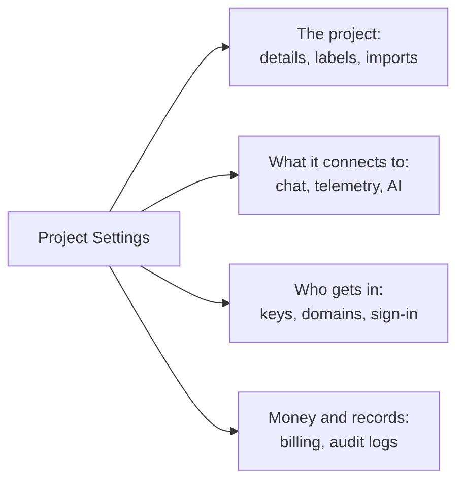

# Project Settings

Project Settings holds what applies to the whole project: its name, the tools it connects to, its keys, how people sign in, its billing and its audit trail. You set most of it up once and come back rarely. This page is a map of it, and covers the settings that have no page of their own: the project's details, labels, feature flags and deleting the project.

:::cards
- [Find a setting](#find-a-setting): What each section of the side menu holds.
- [The project's details](#the-projects-details): Its name, its ID and support access.
- [Labels](#labels): Tags for resources, permissions and rules.
- [Delete the project](#delete-the-project): What it takes, and what goes with it.
:::

## Open Project Settings

Go to **Products → Settings → Project Settings**. The side menu groups the pages into sections, and only **Basic** starts open: click a section's title to open it. A section opens by itself on any page inside it.

## Before you begin

- **A role that changes the project.** Project Owners and Project Admins change most of these settings. Billing, notification channels and deleting the project take more, as each section says.
- **On OneUptime Cloud, the plan that includes a setting.** Some settings need a plan: see [Settings that need a plan](/docs/configuration/billing#settings-that-need-a-plan).

## Find a setting

| Section | Pages | Where to read more |
| --- | --- | --- |
| **Basic** | **Project**, **Labels** | [The project's details](#the-projects-details), [Labels](#labels) |
| **Workspace** | **Slack**, **Microsoft Teams**, **Video Calls** | [Slack](/docs/workspace-connections/slack), [Microsoft Teams](/docs/workspace-connections/microsoft-teams), [Video Calls](/docs/workspace-connections/video-calls) |
| **Telemetry & APM** | **Ingestion Keys**, **Data Retention** | [Ingestion Keys](/docs/telemetry/ingestion-keys), [Data Retention](/docs/telemetry/data-retention) |
| **Notifications** | **Notification Settings**, **Notification Logs**, **Mobile Apps** | [Notifications](#notifications) |
| **AI** | **AI Features**, **LLM Providers**, **External MCP Servers**, **AI Credits**, **AI Logs**, **MCP Server** | [LLM Providers](/docs/ai/llm-provider), [External MCP Servers](/docs/ai/external-mcp-servers), [MCP Server](/docs/ai/mcp-server), [AI SRE](/docs/ai/ai-sre#cost-controls) |
| **Advanced** | **Domains**, **API Keys**, **Feature Flags**, **Import from another tool** | [Custom domains](/docs/status-pages/branding-and-domains#custom-domains), [API keys](/docs/permissions/index#api-keys), [Feature flags](#feature-flags), [Moving from Opsgenie](/docs/moving-to-oneuptime/opsgenie) and the other moving guides |
| **Security** | **SSO**, **SCIM** | [SSO](/docs/identity/sso), [SCIM](/docs/identity/scim) |
| **Billing and Invoices** | **Billing**, **Usage History**, **Invoices** | [Billing & Usage](/docs/configuration/billing) |
| **Audit Logs** | **Audit Logs**, **Settings**, **Export** | [Audit Logs](/docs/configuration/audit-logs), [Audit Log Export](/docs/configuration/audit-log-export) |
| **Danger Zone** | **Danger Zone** | [Delete the project](#delete-the-project) |

**Billing and Invoices** and **AI Credits** are on OneUptime Cloud only: a self-hosted installation has no billing.

## The project's details

**Project Settings → Basic → Project** holds two cards.

**Project Details** shows the project's name and its ID:

- **Project Name**: click **Edit Project** to rename the project. A name has at least 2 characters. Renaming takes a Project Owner, or permission to edit the project or to manage billing.
- **Project ID**: copy it for the API, the CLI and Terraform, or when you write to support.
- **Data Residency**: on OneUptime Cloud, where your project's data is meant to be kept, when OneUptime has recorded it. Only OneUptime sets it.

**Customer Support Access**, on OneUptime Cloud, decides whether OneUptime's support team may open the project. Turn on **Let OneUptime support access this project** when you want their help: OneUptime asks first, because support can then see and change everything in the project, and you click **Let support in**. Turn it off once they have finished: it saves at once. Project Owners and Project Admins change it.

## Labels

Labels are tags you put on monitors, incidents, status pages and other resources. They filter and group lists, and they narrow what a team's permissions and the project's rules reach.

:::steps
### Open Labels

Go to **Project Settings → Basic → Labels**.

### Create a label

Click **Create Label**. Give it a **Name** and, if you like, a **Description**. **Label Color** is already picked, a color no label on the page uses yet: pick another if you prefer. Click **Create Label** to save it.
:::

On OneUptime Cloud, creating and changing labels needs the Growth plan. See [Labels](/docs/permissions/index#labels) for how labels narrow permissions, and [Label and Owner Rules](/docs/configuration/label-and-owner-rules) to label resources as they are created.

In a list, a record's labels are shown one under another; when there are more than four, the first three are shown with a link to the rest. Wherever labels are listed (in lists, on a record's page and in every label picker), they are in natural order: labels whose names start with a number come first, in the order of that number (`2. Team` before `10. Owner`), then the others alphabetically, whatever their case. To choose the order your labels read in, start their names with a number, such as `1. Category` and `2. Subcategory`.

### Archive a label

To retire a label, archive it from its row's **⋯** menu instead of deleting it. Everything that has the label keeps it, and you can still filter by it, but nobody can add it to anything again: every label picker leaves it out, and the API, Terraform and MCP refuse it. The dialog lists the rules and permissions set up to use the label, which keep using it until you change them. Archived labels are listed apart, in the folded **Archived Labels** section, where **Unarchive** puts one back. **Delete** first lists everything the label would come off, and offers **Archive instead**.

## Notifications

**Project Settings → Notifications** holds how the project sends notifications:

- **Notification Settings**: the **Notification Channels** card turns SMS, phone calls, WhatsApp and Telegram on or off for the project. All four start off. A Project Owner, a **Billing Admin** or someone with **Manage Billing** switches them. The page also holds, folded under **More settings**, the project's own mail servers, under **Custom SMTP Configs** (see [SMTP](/docs/emails/smtp)), and its own Twilio account (see [Twilio Integration](/docs/self-hosted/twilio-integration)). On OneUptime Cloud, it holds the balance these messages are paid from: see [Prepaid balances](/docs/configuration/billing#prepaid-balances).
- **Notification Logs**: every notification the project sent, with one tab for each channel: **Email**, **SMS**, **WhatsApp**, **Telegram**, **Webhook**, **Call**, **Push** and **Workspace**.
- **Mobile Apps**: where to get the iOS and Android apps. See [Apps Overview](/docs/mobile-desktop-apps/index).

## Feature flags

**Project Settings → Advanced → Feature Flags** turns optional features on or off for the project. Each one is a switch that saves when you flip it. Today it holds **Monitor Groups**, off in a new project: turn it on to add Monitor Groups to the Monitors menu. Turning it off deletes no group. See [Monitor Groups](/docs/monitor/monitor-groups).

## Delete the project

Deleting a project deletes everything in it, for every member: its monitors, incidents, status pages, on-call setup and telemetry. Nothing brings it back.

:::steps
### Open the Danger Zone

Go to **Project Settings → Danger Zone**.

### Click Delete Project

Click **Delete Project**. A dialog asks you to confirm.

### Type the project's name

Type the name exactly as it is. **Delete Project** stays locked until you do. On OneUptime Cloud, the dialog also asks why you are leaving: the answer is optional.

### Confirm

Click **Delete Project**. OneUptime deletes the project and takes you out of it.
:::

> [!CAUTION]
> Deleting the project cannot be undone. It takes a Project Owner, or permission to delete the project.

On OneUptime Cloud, deleting the project is how you cancel its plan: billing stops when the project is deleted. A project billed through a cloud marketplace gets one last charge for its usage, and its purchase on the marketplace stays active until you cancel it there.

## Troubleshooting

:::details A section of the side menu seems to be missing
Every section but **Basic** starts folded. Click the section's title to open it. On a self-hosted installation there is no **Billing and Invoices** section and no **AI Credits** page.
:::

:::details Edit Project is locked
Renaming the project takes a Project Owner, or permission to edit the project or to manage billing. The locked button names the permission you need.
:::

:::details Delete Project stays locked in the dialog
Type the project's name exactly as the dialog shows it: letter case counts.
:::

## Next steps

:::cards
- [Inviting People](/docs/permissions/inviting-people): Bring your team into the project.
- [Billing & Usage](/docs/configuration/billing): Your plan, payment methods, invoices and usage.
- [Audit Logs](/docs/configuration/audit-logs): See who changed what in the project.
- [SSO](/docs/identity/sso): Let people sign in with your identity provider.
:::
