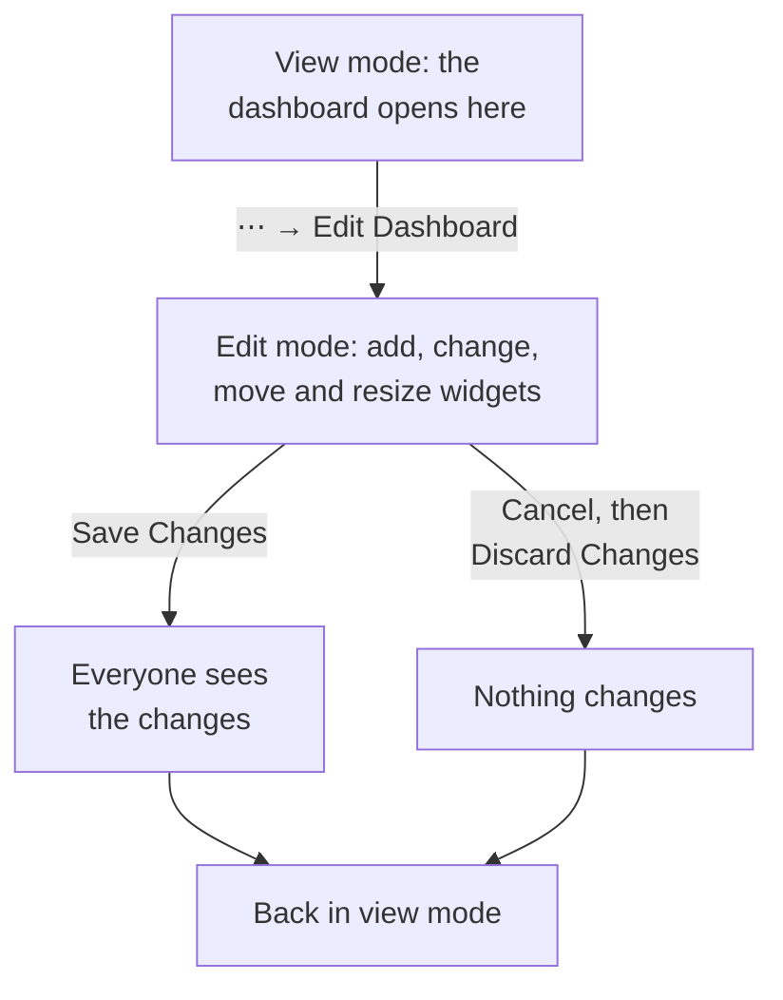

# Authoring a Dashboard

To create a dashboard, open **Products → Dashboards** and click **Create Dashboard**. The **Create a dashboard** dialog asks how you want to start, then for a name. **Start from scratch** gives you an empty dashboard; a template builds its widgets, and often its variables, for you, and fills in its name (numbered, as in "Kubernetes Dashboard 2", when the project already has one). Click **Create Dashboard** and the new dashboard opens. An empty one opens on its canvas, with an **Add Widget** button for its first widget.

:::cards
- [Create a dashboard](#create-a-dashboard): Start from scratch or from a template.
- [Edit and save](#edit-and-save): Nothing changes for anyone until you click Save Changes.
- [Add a widget](#add-a-widget): Pick it from the catalog, set it up, put it in place.
- [Zooming into a spike](#zooming-into-a-spike): Drag across a chart to read the whole dashboard at that moment.
:::

## Before you begin

Project owners and admins can create and edit every dashboard. Anyone else needs a team permission: `CreateDashboard` to create dashboards, and `EditDashboard` to change them. Project members and viewers can read dashboards without either. Someone who may not edit a dashboard still opens its **⋯** menu, where **Edit Dashboard** is locked and says which permission it needs.

## Create a dashboard

:::steps
### Choose how to start

Open **Products → Dashboards** and click **Create Dashboard**. The **Create a dashboard** dialog opens on **Start from scratch**, an empty dashboard for your own widgets. Below it, **Or start from a template** lists six **Recommended** templates.

### Pick a template

Click a template to see what it adds: its widgets, named as **Add Widget** names them, and the variables you narrow it with in its toolbar. For the others, choose a category beside the search box, or **All templates**, or type into **Search templates…**: every word you type has to match. Then click **Use this template**, or double-click the template. In the search box, the arrow keys pick a template and **Enter** uses it.

### Name the dashboard

A template's name is filled in, numbered past the names the project already has. **Start from scratch** leaves it empty: type one. The description is optional, folded under **More fields**, and you can add it later on the dashboard's **Overview** page. **Back** takes you to the templates as you left them.

### Create it

Click **Create Dashboard**. The new dashboard opens: a template's widgets at once, or an empty canvas with **Add Widget** on it.
:::

The templates, by the category the picker lists them under:

| Category | Templates |
| --- | --- |
| Monitoring & APM | Monitor Dashboard, Metrics Dashboard, Real User Monitoring Dashboard, SLO Dashboard |
| Incident Response | Incident Dashboard, Alert Dashboard |
| Infrastructure | Kubernetes Dashboard, Kubernetes Cost Dashboard, Hosts Dashboard, Proxmox Dashboard, VMware Dashboard, Ceph Dashboard, Storage Array Dashboard, Docker Swarm Dashboard, Network Dashboard |

**Recommended** holds Monitor Dashboard, Incident Dashboard, Alert Dashboard, Kubernetes Dashboard, Hosts Dashboard and Metrics Dashboard. A template is a starting point, not a link: once the dashboard is created, change it as you like. Nothing updates it from the template later.

## Edit and save

A dashboard opens in view mode, for reading. To change it, open the **⋯** menu in its toolbar and pick **Edit Dashboard**. The toolbar shows **Editing** next to the name, and swaps the time range and its other controls for **Add Widget**, **Variables**, **Cancel** and **Save Changes**, with a row below them for the dashboard's **Default time range** and **Default auto-refresh**.

Your changes are yours alone until you save them. Nothing is saved while you edit, so other people keep seeing the dashboard as it was.

- **Save Changes** saves the widgets, their places and sizes, the variables, and the default time range and auto-refresh, all at once, and goes back to view mode. If the save is refused, for example because you lost the permission meanwhile, you stay in edit mode with your changes and the reason above the grid.
- **Cancel** asks first, because it throws your changes away: **Discard Changes** goes back to the dashboard as it was saved, and **Keep Editing** returns to your work.

While you edit, auto-refresh pauses, and a zoomed time range goes back to the range you picked.

## Add a widget

:::steps
### Open the widget catalog

Click **Add Widget**: in the toolbar while you edit, or on the canvas of an empty dashboard. The catalog groups its widgets by what they show. Type in its search box to find one by name or purpose ("error budget", "pods"), and press Enter to add the first match.

### Pick a widget

Click it. The widget lands at the first free spot on the grid that fits it, and its settings open.

### Set what it shows

The settings dialog shows a **Live Preview** of the widget above its settings, and the preview follows every change you make. Choose what the widget reads (a metric query, a filter, a text) and how it looks, then click **Done**.

### Put it in place

Drag the widget to move it, and drag its edges or corners to resize it. See [Widgets on the grid](#widgets-on-the-grid).
:::

[Dashboard Widgets](/docs/dashboards/widgets) lists every widget and its settings.

## Widgets on the grid

The canvas is a grid twelve columns wide. Widgets snap to it, and the page grows downwards as you add rows. While you drag a widget, a dashed outline shows where it will land, with its column and row; while you resize one, the outline shows its size in grid units. Widgets in the way move aside, so no two widgets ever overlap.

Each kind of widget has a smallest size, so that what it draws stays readable: a chart is at least six columns wide and three rows high, while a single number fits in one cell.

The grid is as wide as the screen. On a narrower screen its columns get narrower and its rows keep their height. On a phone the widgets are shown one under another, each as wide as the screen, in the order they sit on the grid: row by row from the top, left to right within a row. A chart is drawn taller there, so its plot has room. Editing on a phone shows the grid, which scrolls sideways.

To change a widget later, click it while you edit. Its settings open again, with two more buttons at the bottom:

- **Duplicate Widget** adds a copy, with the same settings, at the first free spot.
- **Delete Widget** removes it, once you confirm.

## Time range and auto-refresh

In view mode, the toolbar's time range picker sets the window that every chart, number, log and trace widget reads. Pick a preset from the past 5 minutes to the past 3 months, or a custom start and end. The dashboard opens on its default time range: the past hour, unless an editor sets another.

Lists of incidents, alerts, monitors and resources show their current state, whatever the time range.

Next to the time range, the auto-refresh menu reads every widget again every 5 seconds, 10 seconds, 30 seconds, 1 minute, 5 minutes or 15 minutes, with a countdown until the next refresh. Leave it off while you investigate, so the view keeps still. The dashboard opens with its default auto-refresh: off, unless an editor sets another.

The time range picker, the variables and auto-refresh appear once the dashboard has a widget.

### The dashboard's defaults

While you edit the dashboard, the row under the toolbar's buttons sets what everyone opens it on: **Default time range**, a preset from the past 5 minutes to the past 3 months, and **Default auto-refresh**. **Save Changes** saves them with the rest of the dashboard, for your team and for the visitors of its public link alike. A custom start and end can't be a default: the dashboard would stay on that moment for good. The row appears once the dashboard has a widget.

Dashboards saved before these settings open on the past hour, with the auto-refresh they had. Through the API and Terraform, both are in the dashboard's `dashboardViewConfig`: `timeRange`, a preset as the API reference spells it, such as `Past 1 Day`, and `refreshInterval`, such as `1m`. Any other value is refused.

### Your own picks

The time range and auto-refresh you pick in view mode are yours alone, and your browser remembers them for each dashboard: a refresh, a browser restart or a wall screen's reboot opens the dashboard as you left it. Only a preset is remembered. A custom range or a zoom lasts until you leave the page, so the dashboard never sticks on a moment in the past.

The first choice of each picker names the dashboard's default, as in Default (Past 1 Day). Pick it to go back to the default: your browser forgets your pick, and the dashboard follows its default again, even when an editor changes it later. When you save new defaults yourself, you see them at once.

### Zooming into a spike

You don't have to reach for the time-range picker to look at a spike. Drag across the interesting stretch of any line or area chart and the **whole dashboard** moves to that window, just as if you had picked it in the time-range picker — every widget that uses the time range re-queries alongside it, so you're reading one moment across the board instead of one chart at a different scale from its neighbours. Live lists keep showing what's happening now, as they always do.

**Double-click any chart** to undo it: the dashboard goes back to the range it had before you started zooming, however many times you drilled in. A **Reset zoom** button appears next to the time-range picker while a zoom is active, and double-clicking a dashboard that isn't zoomed does nothing.

A zoomed window is a fixed one, so it stops rolling forward while auto-refresh is on — that's deliberate, since a window that slid out from under you mid-investigation would be worse. Reset the zoom to start rolling again.

Zooming works in View mode only; in Edit mode dragging moves and resizes widgets instead. Bar charts zoom the same way — drag across the bars — and double-clicking one resets the dashboard like any other chart. Only a drag zooms: a plain click on a chart never retimes the dashboard. The same gestures work on the charts throughout OneUptime; see [Zooming Into a Time Range](/docs/telemetry/charts-and-time-ranges).

## Full screen

**⋯ → Full Screen** shows the dashboard's widgets on the whole screen, for a wall display or a meeting. Press Esc to leave it.

## Tips for dashboards that age well

- **One topic per dashboard.** A few focused dashboards beat one page of everything you watch.
- **Put the most important widget at the top.** People read from the top down, so make the first thing they see answer "is this healthy?"
- **Name the sections with Text widgets.** A short heading every few rows ("Latency", "Errors", "Capacity") makes the page easy to scan from across the room.
- **Use variables instead of copies.** If you are about to build the same dashboard for a second service, add a `service` variable instead. See [Dashboard Variables & Filters](/docs/dashboards/variables).
- **Copy before a big change.** **Duplicate Dashboard**, on the dashboard's **Settings** page, makes a safe copy to try your ideas on.

## Next steps

:::cards
- [Dashboard Widgets](/docs/dashboards/widgets): Every widget, its settings, and which one to pick.
- [Dashboard Variables & Filters](/docs/dashboards/variables): One dashboard for every service, host or customer.
- [Sharing & Public Dashboards](/docs/dashboards/sharing): Share the dashboard outside your team.
- [Dashboard Configuration & Permissions](/docs/dashboards/configuration): Owners, labels, archiving and who may do what.
:::
