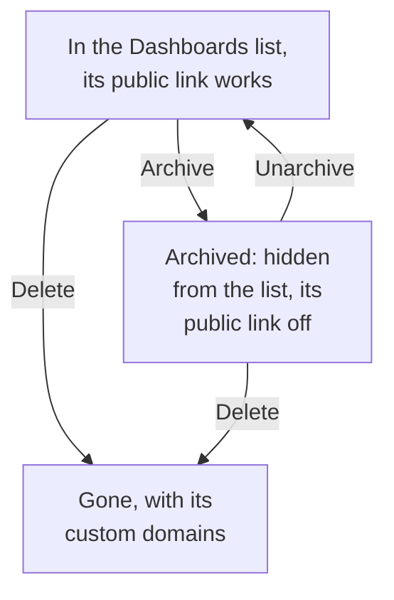

# Dashboard Configuration & Permissions

Once you have a dashboard worth keeping, this page covers who may read and change it, how owners and labels organize your dashboards, and how to copy, export, archive and delete one.

:::cards
- [Who may do what](#who-may-do-what): The permissions behind each action, and who holds them.
- [Owners](#owners): The users and teams a dashboard belongs to.
- [Duplicating a dashboard](#duplicating-a-dashboard): A safe copy, numbered for you.
- [Archiving a dashboard](#archiving-a-dashboard): Put a dashboard away without deleting it.
:::

## Who may do what

Dashboards follow your project's [permissions](/docs/permissions/index). Each action takes one of these, held through a team:

| To | It takes |
| --- | --- |
| Read dashboards | `ReadDashboard`, or a project role: Project Owner, Project Admin, Project Member, Viewer, or a Settings role |
| Create dashboards | `CreateDashboard`, Project Owner or Project Admin |
| Change a dashboard: its widgets, variables, sharing, branding, and archiving it | `EditDashboard`, Project Owner or Project Admin |
| Delete a dashboard | `DeleteDashboard`, Project Owner or Project Admin |
| Add and remove owners | The dashboard owner permissions, Project Owner, Project Admin or Project Member |
| Add and change custom domains | The dashboard domain permissions, Project Owner, Project Admin, Project Member, Settings Admin or Settings Member |
| Create owner rules and label rules | The rule permissions, Project Owner or Project Admin |

So a Project Member reads every dashboard but needs `CreateDashboard` and `EditDashboard` to build them. Read, edit and delete can each be limited to the dashboards a team owns, or to dashboards carrying some labels: see [Scope: how far an allow permission reaches](/docs/permissions/index#scope-how-far-an-allow-permission-reaches).

Assign them on a team's **Permissions** page: open **Products → Teams** and pick the team.

Who can view a dashboard outside the project is a separate question, answered on its **Sharing** page: see [Access for public dashboards](#access-for-public-dashboards).

## Owners

A dashboard's **owners** are the users and teams it belongs to. Add them on the dashboard's **Owners** page, or select several dashboards in the **Dashboards** list and add owners to all of them at once.

Owners narrow access when you ask them to: a team permission scoped to dashboards the team owns reaches only the dashboards that list that team, or the person acting, as an owner. Ownership on its own grants nothing.

The **Dashboards** list shows each dashboard's owners, and its **Owner** filter finds the dashboards a person or a team owns.

## Labels

Labels are tags for organizing dashboards. Add them on the dashboard's **Overview** page, where you edit its name and description too, or to several dashboards at once from the **Dashboards** list.

Common patterns:

- **By team**: `team:platform`, `team:checkout`, `team:growth`.
- **By environment**: `env:prod`, `env:staging`.
- **By purpose**: `purpose:oncall`, `purpose:exec`, `purpose:investigation`.

The **Labels** filter on the **Dashboards** list is the fastest way to find a dashboard in a project that has accumulated a lot of them. Labels also limit permissions: a team permission restricted to some labels reaches only the dashboards that carry one of them.

## Owner and label rules

Instead of adding owners and labels by hand, let rules do it. Under **Settings** in the **Dashboards** side menu, **Owner Rules** add owners and **Label Rules** add labels to every new dashboard that matches them: by the labels it already carries, or by a pattern in its name or description. [Label and Owner Rules](/docs/configuration/label-and-owner-rules) explains how rules match, and how to run one on the dashboards you already have.

## Access for public dashboards

Who can view a dashboard outside the project is one choice on its **Sharing** page (also **⋯ → Share** on the dashboard itself; see [Sharing & Public Dashboards](/docs/dashboards/sharing)):

1. **Only people in this project** (the default) — the dashboard has no public link; its public address shows a not-found page.
2. **Anyone with the link** — anyone who has the public link can see it, without signing in.
3. **Anyone with the link and a password** — visitors enter a password before the dashboard appears.

Under **More settings** on the same page, the **IP Allowlist** (Scale plan) rejects requests to the public link from any IP address that is not on it. The most locked-down public setup is **Anyone with the link and a password** with an IP allowlist — useful for partner portals where you want both layers.

## Duplicating a dashboard

To copy a dashboard, open it, go to its **Settings** page and click **Duplicate Dashboard**. The copy's name is filled in for you: the dashboard's name, numbered past the names the project already has ("Checkout API" is copied as "Checkout API 2", and a copy of that one as "Checkout API 3"). Change it if you like, confirm with **Duplicate Dashboard**, and the copy opens. It has the dashboard's widgets, variables, description and labels. Branding and custom domains stay with the original, and public sharing always starts off, so you can decide whether to turn it on.

This is the right move when you want to fork a template (like "our on-call dashboard") into a service-specific copy.

## Exporting and importing

A dashboard travels as JSON:

- **Export Dashboard**, on the dashboard's **Settings** page, downloads it as a JSON file. To export several, select them in the **Dashboards** list and choose **Export JSON**.
- **Import JSON**, above the **Dashboards** list, creates dashboards from such a file, in this project or another one.

An export holds the dashboard's own settings, its widgets and variables among them. Its owners and labels are left out, and widgets that point at this project's resources, such as an SLO or a data source, may need them picked again in another project.

## Archiving a dashboard

Archive a dashboard you don't use any more but want to keep. An archived dashboard leaves the **Dashboards** list and, if it is public, its public link stops working — its URL and custom domains answer "Dashboard not found". Its widgets, variables, branding, domains and public settings are all kept, so unarchiving it puts it back exactly as it was, public link included.

To archive one dashboard, open it, go to its **Settings** page and click **Archive**. To archive several, select them in the **Dashboards** list and choose **Archive**. To bring one back, open **Dashboards → Advanced → Archived**, select it and choose **Unarchive**, or open it and click **Unarchive** on the banner at the top of its pages.

Archiving is the reversible alternative to deleting: reach for it first when you're not sure.

## Deleting a dashboard

Open the dashboard's **Delete** page. Deleting can't be undone: the dashboard, its widgets and variables, and any custom domains attached to it are removed. Your telemetry is not touched.

If the dashboard is public on a custom domain, the address stops answering as soon as you delete it. To keep serving the address, add the domain to another dashboard after deleting this one: a domain belongs to one dashboard at a time.

## Audit logs

The dashboard's **Audit Logs** page lists every change made to the dashboard, and who made it. Audit logs are part of the Enterprise plan and the [Enterprise Edition](/docs/self-hosted/enterprise).

## Data retention and backups

Dashboards themselves don't expire. The data they show follows your project's retention settings: with the time range set to the past 3 months, a project that keeps its logs for 15 days shows the last 15 days of them.

If you self-host OneUptime, a regular database backup is enough: a dashboard's configuration is stored with the rest of your project. On OneUptime Cloud, backups are handled for you. For a copy of your own, export the dashboard as JSON, or read it through the [OneUptime API](/docs/api-reference/api-reference).

## Next steps

:::cards
- [Sharing & Public Dashboards](/docs/dashboards/sharing): Public links, passwords, IP allowlists and custom domains.
- [Users, Teams & Permissions](/docs/permissions/index): Teams, roles, scopes and blocks.
- [Dashboard Variables & Filters](/docs/dashboards/variables): One dashboard for every service.
- [Dashboards Overview](/docs/dashboards/index): The big picture.
:::
