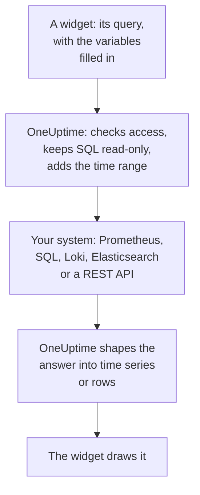

# External Data Sources

An external data source connects a system outside OneUptime, such as Prometheus, a SQL database, ClickHouse, Loki, Elasticsearch or a REST API, so your dashboards can chart its data beside your own. You connect the system once; each widget then runs a read-only query in that system's own language.

:::cards
- [Connect a data source](#connect-a-data-source): Pick the type, then say where it is and how to sign in.
- [Write a query](#write-a-query): PromQL, SQL, LogQL, Query DSL or a request.
- [Limits](#limits): The time-outs and caps that protect both sides.
- [Keeping it safe](#keeping-it-safe): Read-only queries and write-only credentials.
:::

## How a query runs

The widget sends its query to OneUptime, with the variables already filled in. OneUptime checks that you may read the data source, fills in the time range, and asks your system with the credentials it keeps. It shapes the answer into time series or rows for the widget to draw.



## Before you begin

- **A plan that includes it.** On OneUptime Cloud, creating and changing data sources needs the **Growth** plan. Deleting one works on every plan.
- **A permission to add them.** Project owners and admins can add data sources; anyone else needs `CreateDataSource`, with `EditDataSource` and `DeleteDataSource` to change and remove them. Everyone who can read the project's data sources, members and viewers included, sees their widgets' data.
- **A read-only account.** Dashboards only ever read. Connect databases with an account that can only read, and HTTP sources with a token that can only query.
- **A way in.** OneUptime's API server connects to your system, so it must be able to reach it: see [Keeping it safe](#keeping-it-safe) for the addresses that are refused.

## Supported systems

| Type | Query language | Works with |
| --- | --- | --- |
| Prometheus | PromQL | Prometheus, Thanos, Cortex, Mimir, VictoriaMetrics |
| PostgreSQL | SQL | PostgreSQL, TimescaleDB, CockroachDB |
| MySQL | SQL | MySQL, MariaDB |
| Microsoft SQL Server | T-SQL | SQL Server, Azure SQL |
| ClickHouse | SQL | ClickHouse, over its HTTP interface |
| Grafana Loki | LogQL | Loki and Loki-compatible endpoints |
| Elasticsearch | Query DSL (JSON) | Elasticsearch, OpenSearch |
| REST API | Request (JSON) | Any HTTP(S) API that answers with JSON |

## Connect a data source

:::steps
### Open Data Sources

Open **Products → Dashboards**, expand **Settings** in the side menu and click **Data Sources**.

### Pick the type

Click **Create Data Source**. The **Choose a Data Source Type** dialog groups the types by what they hold: metrics, logs, databases, search and APIs. Click one.

### Name it

Under **Basic Info**, give it a **Name**, such as "Production Prometheus", and a **Description** if you like.

### Say where it is

Under **Connection**, an HTTP source takes the **URL** it answers at. A database takes its **Database Host**, its **Database Port** (leave it empty for 5432, 3306, 1433 or 8123), and its **Database Name**.

### Say how to sign in

Under **Authentication**, enter a **Username** and **Password**, or, for an HTTP source, an **API Token**, sent as a bearer token. **More fields** holds **Custom HTTP Headers**, such as `{ "X-Scope-OrgID": "tenant-1" }`, and **Additional Options**: `sslEnabled` and `sslRejectUnauthorized` for databases, `elasticsearchIndex` for Elasticsearch, which reads every index (`*`) without it.

### Test it

Click **Create Data Source**, then **Test** on its row. OneUptime connects with the details you gave, and says whether it worked or what went wrong.
:::

To change a data source later, open it from the list. **Edit** on **Data Source Details** changes everything but its secrets; **Update Credentials** replaces the password, the token or the headers, and leaves the fields you keep empty as they were; **Test** checks it again.

## Use it in a widget

Edit a dashboard, click **Add Widget** and pick a widget of the External Data Sources group: a **Chart**, a **Value**, a **Gauge** or a **Table**. In its settings:

- Pick the **Data Source** and write the **Query**. The editor names the query language and shows an example for the type.
- On a chart, **Add Query** overlays more queries on the same axes, and **Legend (optional)** names each series from its labels: `{{instance}} — errors` writes the series' `instance` label in front.
- On a value or a gauge, **Reduce** turns the points into one number: the last value (the default), the first, the average, the sum, the minimum or the maximum. **Unit** adds a suffix, and scales the known ones: `Bytes` reads as 1.5 MB, `ms` as 2.4 sec.
- On a table, any read-only query works, and its rows show as they come back.

## Write a query

Each type takes its own language, with the same rules for what comes back:

- **Charts, values and gauges need time series.** A SQL query returns a time column named `time`, `timestamp`, `date` or `ts`, and a numeric `value` column (or its first numeric column); every other column becomes a series label. Elasticsearch needs a `date_histogram` aggregation, and Loki a metric query such as `rate()` or `count_over_time()`.
- **Tables show rows** as the query returns them: SQL rows, Prometheus series, Loki log lines, Elasticsearch hits, or the objects at a REST API's `rowsPath`.

:::tabs
@tab Prometheus
```text title="PromQL"
sum by (job) (rate(http_requests_total{job=~"{{job}}"}[5m]))
```
@tab SQL
```sql title="SQL"
SELECT date_trunc('minute', created_at) AS time, COUNT(*) AS value
FROM orders
WHERE created_at BETWEEN $__startTime AND $__endTime
GROUP BY 1
ORDER BY 1
```
@tab Loki
```text title="LogQL"
sum by (app) (rate({app="api"} |= "error" [5m]))
```
@tab Elasticsearch
```json title="Query DSL"
{
  "query": { "range": { "@timestamp": { "gte": "$__startTime", "lte": "$__endTime" } } },
  "aggs": {
    "over_time": {
      "date_histogram": { "field": "@timestamp", "fixed_interval": "1m" }
    }
  }
}
```
@tab REST API
```json title="Request"
{
  "path": "/api/stats?from=$__startTimeMs&to=$__endTimeMs",
  "method": "GET",
  "rowsPath": "data.items",
  "timestampField": "time",
  "valueField": "count",
  "seriesField": "service"
}
```
:::

### Time macros

Prometheus and Loki receive the dashboard's time range with every request, so their queries need nothing more. The other types place the time range where you write a macro:

| Macro | Becomes | In |
| --- | --- | --- |
| `$__startTime`, `$__endTime` | The range's start and end, in UTC: `'2026-10-13 09:00:00'` in SQL, ISO 8601 elsewhere | SQL, Elasticsearch, REST API |
| `$__startTimeMs`, `$__endTimeMs` | The same, as milliseconds since 1970 | SQL, Elasticsearch, REST API |
| `$__rangeSeconds` | The range's length, in seconds | SQL |

SQL macros are written in UTC, so run your database sessions in UTC, or convert in the query.

### Dashboard variables

Write `{{name}}` anywhere in a query, and the widget puts the variable's value there before it sends the query. Several values of a multi-select variable are joined with `|`, which is what a PromQL or LogQL regular expression matcher needs: `job=~"{{job}}"`. A variable with nothing picked leaves the placeholder as written, so the error names it. [Dashboard Variables & Filters](/docs/dashboards/variables) shows how to add one.

## Limits

Every query is bounded, so that a dashboard of twenty widgets refreshing every minute cannot overload OneUptime or your system:

| Limit | Value |
| --- | --- |
| Connecting | 10 seconds |
| Running a query | 30 seconds |
| Points in a time series answer | 11,000 |
| Rows in a table | 1,000 |
| Series in one answer | 100 |
| Answer from an HTTP source | 20 MB |

Prometheus and Loki range queries ask for about 250 points across the time range, no closer than 10 seconds and no further apart than a day.

## Keeping it safe

- **SQL stays read-only.** A query must be one statement that starts with `SELECT`, `WITH`, `SHOW`, `EXPLAIN`, `DESCRIBE` or `DESC`. Words that write or change a session, such as `INSERT`, `UPDATE`, `DELETE`, `DROP`, `INTO` or `SET`, are refused anywhere outside strings and quoted names, so quote a column named after one. Write a quote inside a string as two quotes (`''`): a backslash before a quote is refused. PostgreSQL, MySQL and ClickHouse sessions are read-only as well. SQL Server has no read-only session, so connect it with a read-only login.
- **Credentials are write-only.** **Password**, **API Token** and **Custom HTTP Headers** are encrypted at rest, and the API never returns them, not even to you.
- **Addresses are checked.** Loopback, link-local (where cloud metadata lives) and other reserved addresses are refused everywhere. Private addresses are refused on OneUptime Cloud, and allowed on a self-hosted installation unless `DATA_SOURCE_BLOCK_PRIVATE_ADDRESSES` is `true`: see [Private Network Access](/docs/self-hosted/private-network-access).
- **Public dashboards never run them.** The External Data Sources widgets are left out of a [public dashboard](/docs/dashboards/sharing), queries and all.

## Troubleshooting

:::details Test says it cannot connect
Check the URL, or the host and port, from where OneUptime runs: a firewall, a private address on OneUptime Cloud, or a database that only listens on its own machine all look the same from here. For a database that needs TLS, add `{ "sslEnabled": true }` under **Additional Options**.
:::

:::details "Only read-only queries are allowed"
The query does not start with `SELECT`, `WITH`, `SHOW`, `EXPLAIN`, `DESCRIBE` or `DESC`. Send one statement that only reads: a second statement after a `;` is refused too, as "Only a single SQL statement is allowed per query."
:::

:::details "Query contains a keyword that is not allowed"
A word that writes appears outside a string, often as a column name, such as `delete` or `set`. Quote it as the database does: `"delete"` in PostgreSQL, `[delete]` in SQL Server, and in backticks in MySQL and ClickHouse.
:::

:::details The chart stays empty, but the table shows rows
The query returns rows, but no time series. Name the time column `time` and the number `value` in SQL, add a `date_histogram` aggregation in Elasticsearch, or turn a Loki log query into a metric query with `rate()` or `count_over_time()`.
:::

:::details Some data is missing
The answer reached a [limit](#limits). Narrow the time range, filter the query, or aggregate it into fewer series.
:::

## Next steps

:::cards
- [Dashboard Widgets](/docs/dashboards/widgets): Every widget, the External Data Sources group included.
- [Dashboard Variables & Filters](/docs/dashboards/variables): Variables to use in your queries.
- [Private Network Access](/docs/self-hosted/private-network-access): Reach systems on a private network from a self-hosted installation.
- [Dashboard Configuration & Permissions](/docs/dashboards/configuration): Who may add data sources, and who reads them.
:::
