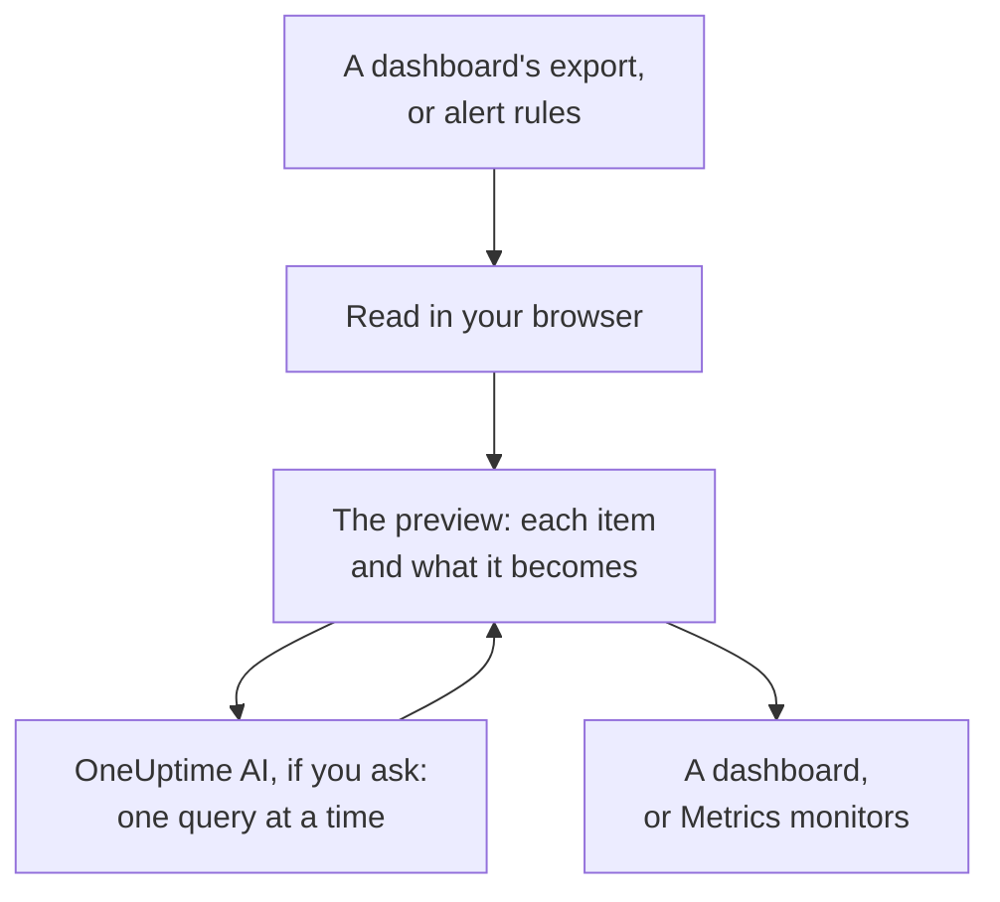

# Import from Grafana and Datadog

Bring a dashboard you built in Grafana or Datadog, or the alert rules you wrote for Prometheus, Grafana or Datadog, into OneUptime. You paste or upload the file, see what each panel and rule becomes, and only then create the dashboard or the monitors.

:::cards
- [Import a dashboard](#import-a-dashboard): A Grafana dashboard's JSON model, or a Datadog dashboard's export.
- [Import alert rules](#import-alert-rules): Prometheus rule files, Grafana alert rules and Datadog monitors.
- [How each item converts](#how-each-item-converts): Exactly, approximately, or not at all, and why.
- [Convert a query with OneUptime AI](#convert-a-query-with-oneuptime-ai): For a query no rule converts.
:::

## How an import works

OneUptime reads the file in your browser and converts each panel, widget, variable and rule on its own. The preview lists every one of them with what it becomes. Nothing is created until you choose to create it, and then it is created with your own permissions, as the dashboard and monitor forms create it.

## Before you begin

- The imported widgets and monitors read this project's own metrics with PromQL. Send them with Prometheus remote write, OpenTelemetry or the Datadog Agent, and they keep the names they have there.
- Importing a dashboard takes a role that can create dashboards, and importing alert rules a role that can create monitors.
- A file can be up to 10 MB, and up to 500 of its panels or rules are read.

## Import a dashboard

:::steps
### Open the dashboard import

Open **Products → Dashboards**, then **More options → Import from Grafana or Datadog**.

### Paste the dashboard

In Grafana, copy the JSON model from the dashboard's settings. In Datadog, export the dashboard's JSON. Paste it, or choose **Upload a File**, then choose **Preview**.

### Create the dashboard

Check what each panel and variable becomes, give the dashboard a name, and choose **Create Dashboard**. The new dashboard opens.
:::

Grafana's PromQL is kept as written: OneUptime fills in `$__interval`, `$__rate_interval` and `$__range` as Grafana does, and a variable on All matches every value. A Datadog query becomes PromQL over the metrics the Datadog Agent sent: `avg:system.cpu.user{host:web-1}` reads `system_cpu_user{host="web-1"}`.

## Import alert rules

:::steps
### Open the alerts import

Open **Products → Monitors**, then **More options → Import Alerts**.

### Paste the rules

Paste a Prometheus rule file or PrometheusRule resource, Grafana's export of its alert rules, or Datadog monitors exported as JSON, then choose **Preview**.

### Create the monitors

Untick any rule you do not want, pick what a firing rule opens under **When a rule fires**, and choose **Create Monitors**.
:::

Each rule becomes a Metrics monitor with one PromQL query, the rule's condition and its window. It opens an alert, or an incident, for each series that breaches, and resolves it when the series recovers. Its title and description come from the rule's summary or message, with the series' labels filled in.

## How each item converts

| Status | What it means |
| --- | --- |
| **Converted exactly** | It reads the same data and shows it the same way. |
| **Converted approximately** | It is created, and its notes say what differs. |
| **Not converted** | Nothing is created for it, and its notes say why. |

Recording rules, alert rules over logs, Datadog widgets that read logs, traces or events, and Datadog's anomaly, outlier and forecast monitors are not converted.

## Convert a query with OneUptime AI

A query that no rule converts shows **Convert with OneUptime AI**, which needs AI to be on for the project. Only that query, with the names of the dashboard's variables, goes to your project's [LLM provider](/docs/ai/llm-provider). Its answer is checked as any query is, and shown to you: choose **Use This Query** to use it. Nothing is created until you create the dashboard or the monitors.

## Next steps

:::cards
- [Dashboard Widgets](/docs/dashboards/widgets): Change what an imported widget shows.
- [Dashboard Variables & Filters](/docs/dashboards/variables): The variables an import made.
- [Metrics Monitor](/docs/monitor/metrics-monitor): The monitors an import made.
- [PromQL](/docs/telemetry/promql): The language the imported widgets and monitors read.
:::
