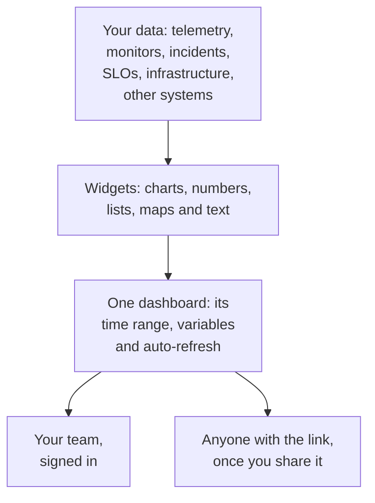

# Dashboards Overview

A dashboard is one page of widgets that you arrange yourself: charts of your metrics, logs and traces, lists of incidents, alerts and monitors, your SLOs and your infrastructure, even data from systems outside OneUptime. Build one for the on-call screen, a team's morning check or a page for your customers, and share it with your project or with anyone who has the link.

:::cards
- [How a dashboard works](#how-a-dashboard-works): Where its data comes from, and who sees it.
- [Find your dashboards](#find-your-dashboards): The Dashboards list and each dashboard's own pages.
- [Build your first dashboard](#build-your-first-dashboard): From a template to a shared page in five steps.
- [An example: an on-call dashboard](#an-example-an-on-call-dashboard): One page that works for every service.
:::

## How a dashboard works

Every widget reads from one source, inside the dashboard's time range and filtered by its variables. Everyone who opens the dashboard sees the same widgets: your team when they sign in, and visitors through its public link once you share it.

| Term | What it means |
| --- | --- |
| Dashboard | One page: a name, a grid of widgets, a time range, variables and an auto-refresh setting. |
| Widget | One tile on the grid: a chart, a number, a list, a map, a clock or a block of text. |
| Variable | A picker in the toolbar that narrows every widget that supports it to one service, host or customer. |
| Time range | The window every chart and number reads. A dashboard opens on its default, the past hour unless an editor sets another, and each viewer can pick their own. |
| Auto-refresh | How often the widgets read their data again: off, or every 5 seconds to 15 minutes. |
| View and edit | A dashboard opens for reading. Editing it is a separate step that ends with saving or discarding your changes. |

## What dashboards are good for

- **An "is everything OK?" page** for the on-call engineer, a team standup or a screen on the wall.
- **Seeing connections**: a CPU spike next to a latency rise and an open incident is plain on one page, and easy to miss across three.
- **Investigating**: put the charts you keep reopening side by side, and drag across a spike to read every widget at that moment.
- **Sharing outside the team**: a performance page for a customer or a partner, protected by a password or an IP allowlist if you like.

## Find your dashboards

Open **Products → Dashboards**. The **Dashboards** list shows the project's dashboards with their descriptions, labels and owners. Search by name or description, narrow the list with the **Owner** and **Labels** filters, or select several dashboards to change their labels or owners, archive them or export them as JSON.

The list's side menu has the pages that look after all of your dashboards:

| Page | What you do there |
| --- | --- |
| **Dashboards** | The project's dashboards. Create one, or bring dashboards in with **Import JSON**. |
| **Dashboards → Playlists** | [Show dashboards one after another](/docs/dashboards/playlists) on a screen, such as a NOC wall. |
| **Settings → Owner Rules** | Add owners to new dashboards automatically. |
| **Settings → Label Rules** | Add labels to new dashboards automatically. |
| **Settings → Data Sources** | Connect Prometheus, SQL databases, ClickHouse, Loki, Elasticsearch or a REST API. |
| **Advanced → Archived** | Dashboards you archived. Unarchive them from here. |

Open a dashboard and its own side menu has these pages. Every section but **Basic** starts folded: click its title to open it.

| Page | What you do there |
| --- | --- |
| **Dashboard** | The dashboard itself. Read it, or edit it from its **⋯** menu. |
| **Overview** | Its name, description and labels. |
| **Sharing** | Who can view it, its public link, and an IP allowlist under More settings. |
| **Owners** | The users and teams who own it. |
| **Branding** | Page title, description, logo, theme and favicon of the public dashboard. |
| **Custom Domains** | Host the public dashboard on your own domain. |
| **Settings** | Duplicate, export, or archive the dashboard. |
| **Audit Logs** | Every change made to the dashboard, and who made it. |
| **Delete** | Delete the dashboard for good. |

## Build your first dashboard

:::steps
1. **Create** — pick a template, or **Start from scratch**. A template fills in the name and opens with its widgets; a dashboard from scratch opens empty, with **Add Widget** on its canvas.
2. **Add widgets** — choose a widget from the catalog, set what it reads in its settings, then drag it into place and resize it.
3. **Add variables, if you need them** — a `service` variable, for example, lets one dashboard show any service.
4. **Save** — click **Save Changes**. Nothing you change while editing is kept until you do.
5. **(Optional) Share publicly** — pick **⋯ → Share** on the dashboard and choose who can view it: anyone with the link, or anyone with the link and a password.
:::

[Authoring a Dashboard](/docs/dashboards/authoring) walks through each step.

## An example: an on-call dashboard

The goal: one page for the checkout service, with its latency, its error rate, its open incidents and its latest logs, that works for every other service too.

1. Click **Create Dashboard**, choose **Start from scratch**, and name the dashboard "Checkout on-call."
2. Click **Add Widget** and add a **Chart** of your request latency metric, aggregated as P95.
3. Next to it, add a **Value** of your error rate, with a warning threshold of 1 and a critical threshold of 5.
4. Below them, add an **Incident List** filtered to unresolved incidents, and a **Log Stream** of the service's logs.
5. Open **Variables**, add a variable named `service` with the source Telemetry Attribute and the attribute key `service.name`, and give it the default `checkout`.
6. Click **Save Changes**. Pick `payments` in the toolbar's `service` picker: the chart, the value and the log stream switch to the payments service, and the incident list keeps showing every unresolved incident.

## How dashboards fit with the rest of OneUptime

- **Monitors and telemetry** are where the data comes from. Every metric, log and trace you send can go on a widget.
- **Incidents and alerts** appear in the **Incident List** and **Alert List** widgets. A dashboard only shows them: you work on them on their own pages.
- **Status pages** tell your customers whether your service is up. Dashboards show how it behaves in detail. The two work side by side.
- **Workflows** act on what happens. Dashboards are where you read it.

## Next steps

:::cards
- [Authoring a Dashboard](/docs/dashboards/authoring): Create a dashboard, edit it and save your changes.
- [Dashboard Widgets](/docs/dashboards/widgets): Every widget, and which one to pick.
- [Dashboard Variables & Filters](/docs/dashboards/variables): One dashboard for every service, host or customer.
- [Sharing & Public Dashboards](/docs/dashboards/sharing): Public links, passwords, IP allowlists and custom domains.
:::
