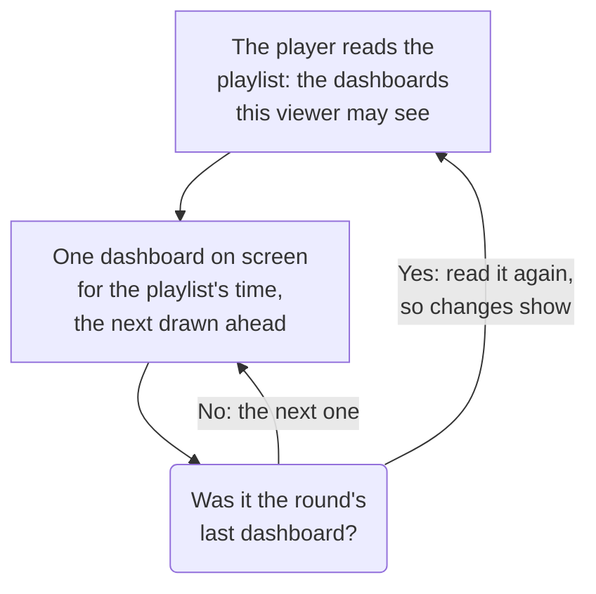

# Dashboard Playlists

A playlist shows a set of dashboards one after another on a screen that nobody touches, such as a NOC wall or a team's TV: each dashboard for the time you pick, round and round, until someone pauses it. Make the playlist once, open its player on the screen, and leave it running.

:::cards
- [How a playlist plays](#how-a-playlist-plays): The order, the turns, and what each dashboard shows.
- [Create a playlist](#create-a-playlist): A name, its dashboards in order, and how long each is shown.
- [Play it on a screen](#play-it-on-a-screen): The player's bar, its buttons and its keys.
- [Who sees what](#who-sees-what): The permissions, and the dashboards a viewer may not read.
:::

## How a playlist plays

The player shows the playlist's first dashboard, then the next one when its time is up, and starts again from the first after the last. Each dashboard opens as its editors saved it: on its own default time range, auto-refresh and variables, whatever the player's address says. While one dashboard is on screen, the player draws the next one out of sight, so the screen never goes blank between two of them.

A playlist names its dashboards and never copies them: a change an editor saves to a dashboard is on the screen the next time it comes round. The player reads the playlist again before each round, so a dashboard added, moved or removed shows within a round, without reloading the screen; if that read fails, the screen plays the round it has again.

## Create a playlist

:::steps
### Open Playlists
Open **Products → Dashboards**, then **Playlists** in the side menu. The list shows how many dashboards each playlist has and how long each is shown, with **Play** on every row.

### Name it
Click **Create Playlist**, and give it a **Name** that says where it plays, such as "NOC wall".

### Add its dashboards
Under **Dashboards**, pick each one from **Add a dashboard**, in the order the screen shows them. The buttons on a dashboard's row move it up or down, or remove it. Archived dashboards are not offered.

### Pick how long each is shown
**Show each dashboard for** starts at a minute; pick a time from 15 seconds to an hour. Click **Create Playlist**.
:::

The playlist's page lists its dashboards in order, how long each is shown and the **Player link**. **Edit Playlist** changes the name, the dashboards, their order and the time. **Delete Dashboard Playlist**, at the foot of the page, deletes the playlist and never its dashboards.

Through the API and Terraform, a playlist is a `name`, its `dashboards` as a list like `[{"dashboardId": "<id>"}]` in the order they are shown, at most 100, and `intervalInSeconds`, any whole number of seconds from 10 to 86400 (a day). A value outside these is refused, with what is wrong.

## Play it on a screen

Click **Play** on the playlist's row or on its page. The player fills the browser window, over the rest of OneUptime; **Full screen** fills the whole screen. To start a screen on its own, open the **Player link** on it and bookmark it: the link opens the player at once.

The player's bar names the dashboard on screen, the playlist, where the round is ("2 of 5") and the dashboard that comes next. A line under the bar fills while a dashboard has its turn. The bar's buttons go to the previous dashboard, pause or play, and go to the next one; on a computer, these keys do the same:

| Keys | What it does |
| --- | --- |
| `Space` | **Pause or play**. Paused, the dashboard stays on screen and the bar says **Paused**. |
| `Right Arrow` | **Next dashboard**. |
| `Left Arrow` | **Previous dashboard**. |
| `F` | **Full screen**, or back out of it. |
| `Esc` | **Exit the player**, back to the playlist's page. In full screen, the first `Esc` only leaves full screen. |
| `?` | **Show keyboard shortcuts**. |

A dashboard you go to, the next or the previous one, gets a whole turn. On a page read right to left, such as Persian, the arrows swap: `Left Arrow` goes to the next dashboard. While it plays, the player keeps the screen from going to sleep, where the browser allows it.

## Who sees what

Playlists have their own permissions, held through a team as the dashboards' own are:

| To | It takes |
| --- | --- |
| See and play playlists | `ReadDashboardPlaylist`, or a project role: Project Owner, Project Admin, Project Member, Viewer, or a Settings role |
| Create playlists | `CreateDashboardPlaylist`, Project Owner or Project Admin |
| Change a playlist: its name, dashboards and time | `EditDashboardPlaylist`, Project Owner or Project Admin |
| Delete a playlist | `DeleteDashboardPlaylist`, Project Owner or Project Admin |

A playlist never shows anyone a dashboard they may not read. The player plays only the dashboards that the person signed in at the screen may read and that are not archived, and skips the rest: a deleted dashboard, an archived one, or one their permissions keep from them. The playlist's page says why it skips each one. Saving a playlist keeps the dashboards in it that the editor cannot see, so nothing someone else put there is lost.

| When the player finds | It shows |
| --- | --- |
| Dashboards it may show | Each in turn. |
| No dashboard it may show | **Nothing to show yet**, and it looks again every minute. |
| The playlist deleted, or not the viewer's to read | **Playlist not found**. |
| A read that failed | **Could not load this playlist**, and it tries again every minute, or on **Try again**. |

> [!NOTE]
> The player is for someone signed in to OneUptime. To run a playlist on a screen, sign in on that screen with an account that may read the playlist and its dashboards, such as a team member with the Viewer role.

## Next steps

:::cards
- [Authoring a Dashboard](/docs/dashboards/authoring): Build the dashboards a playlist shows.
- [Dashboard Variables & Filters](/docs/dashboards/variables): The saved selection each dashboard opens on.
- [Sharing & Public Dashboards](/docs/dashboards/sharing): Show one dashboard to people who do not sign in.
- [Dashboard Configuration & Permissions](/docs/dashboards/configuration): Owners, labels and who may read a dashboard.
:::
