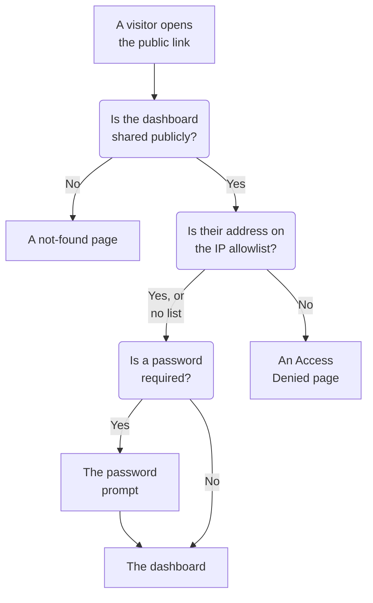

# Sharing & Public Dashboards

By default, a dashboard is private to your project: only people who sign in to your project can see it. You can also share it through a public link, protect that link with a password, limit it to certain IP addresses, and host it on your own domain. This page covers all four.

:::cards
- [Who can view a dashboard](#who-can-view-a-dashboard): One choice of three, with the plan each needs.
- [Sharing with a password](#sharing-with-a-password): Share the link, then the password, with the people who should see it.
- [IP allowlist](#ip-allowlist): Open the public link to your office or VPN only.
- [Custom domains](#custom-domains): Serve the dashboard on your own domain, with a free certificate.
:::

## What a visitor goes through

A visitor who opens a dashboard's public link meets each of these checks in turn. Project members who sign in to OneUptime see the dashboard inside the product, whatever you choose here.



## Who can view a dashboard

Open the dashboard and pick **⋯ → Share**, or open **Sharing** in the dashboard's side menu. The **Who can view this dashboard** card is one choice:

- **Only people in this project** (the default): members see the dashboard when they sign in to OneUptime. It has no public link: its public address shows the same not-found page as an address no dashboard has, and nothing about the dashboard, not even its name.
- **Anyone with the link**: the dashboard is public. Anyone who has its link can see it, without signing in.
- **Anyone with the link and a password**: visitors open the link, then enter one password that you share with them. Nobody needs an account.

Picking a choice asks you to confirm, saying what changes for visitors, then applies at once. Picking **Anyone with the link and a password** asks for the password in the same dialog when the dashboard has none; while it is the choice, **Change Password** replaces it. While the dashboard is public, the addresses visitors open it at sit under the choice: its custom domains first, then its public link, each with **Copy link**. A custom domain that is not live yet is marked **Not live yet**, with why.

Within the project, owners and labels control who sees what — see [Dashboard Configuration & Permissions](/docs/dashboards/configuration). Someone who can see the dashboard but not edit it sees the choice, and can copy the public link, but can't change it.

On OneUptime Cloud, sharing a dashboard needs the **Growth** plan: on a lower plan the two public choices show the plan they need and can't be picked. Making a dashboard private again — **Only people in this project** — works on every plan, so a dashboard left public when a trial ended, or after a move to a lower plan, can always stop being shared; the dialog says that sharing it again needs **Growth**. Moving between **Anyone with the link** and **Anyone with the link and a password**, and changing the password, works on every plan. A dashboard created through the API or Terraform is held to the same plans: created public it needs **Growth**, and created with an IP allowlist **Scale**.

The choice is stored in three columns, which the API and Terraform read and write as before: `isPublicDashboard`, `enableMasterPassword` and `masterPassword`. Only a public dashboard has a public link, and its visitors are asked for the password whenever `enableMasterPassword` is on. A public dashboard with `enableMasterPassword` on but no password set lets nobody in through its public link: the **Sharing** page shows it as **Anyone with the link and a password**, says that nobody can open the link yet, and offers **Set Password**. Picking **Only people in this project** also turns `enableMasterPassword` off, and keeps the password, so sharing with a password again can reuse it.

## Public dashboards

A public dashboard:

- Always opens for reading. Visitors can't edit it, and never see its edit controls.
- Includes the variables you've added. Visitors pick from the same pickers your team uses, and can change the time range, zoom, turn on auto-refresh and go full screen. It opens on the dashboard's default time range and auto-refresh, and each visitor's browser remembers their own picks.
- Lets visitors [sort its lists and tables](/docs/dashboards/widgets#sorting-lists-and-tables) by clicking a column header, as your team does. Each visitor's browser remembers their own sort, and OneUptime sorts the whole list itself, only ever by one of the widget's own columns.
- Uses the branding you set on the dashboard's **Branding** page: page title, description, logo, theme, favicon.
- Lets each visitor switch between the light and the dark dashboard, with a sun or moon button in its toolbar; [Theme](#theme) says how.

Treat sharing a dashboard like publishing a webpage. Every widget on it becomes readable by anyone with the link. Look at what's on the canvas before you share it.

Each widget publishes only what it draws, and only for the resources it was pointed at. An SLO widget, for instance, publishes that SLO's headline numbers but never its definition — see [SLO](/docs/dashboards/widgets#slo). External **Data Source** widgets are the exception: they are dropped from a public dashboard entirely rather than rendered, because their configuration is the query itself. A few more widgets cannot be shown without a signed-in session, and say so in their place: [On a public dashboard](/docs/dashboards/widgets#on-a-public-dashboard) lists them.

## Sharing with a password

Pick **Anyone with the link and a password** and enter the password in the dialog. Visitors see a password prompt before the dashboard appears. The prompt shows the dashboard's name, page title and favicon, in the dashboard's theme, and nothing else: its description, logo and widgets appear once the password is entered. The password is stored as a hash — nobody can read it back. A new password works at once; people who entered the old one can keep viewing the dashboard for up to 7 days.

Use a password when:

- You want to share with a partner or customer but don't want the URL to be useful if it leaks.
- The dashboard is "semi-public" — open enough that you don't want to invite every viewer as a team member, but not open enough to put on the open internet.

For stronger gating (separate accounts per viewer, an audit trail of who viewed what), keep the dashboard to **Only people in this project** and invite viewers as read-only team members instead.

## IP allowlist

Under **More settings** on the **Sharing** page, the **IP Allowlist** section (the `ipWhitelist` column) limits the public link to the IP addresses or IPv4 ranges you list, one per line, for example `203.0.113.7` or `10.0.0.0/8`. It applies with or without the password; project members who sign in are not affected. Leave it empty to allow every address. It saves on its own, apart from the choice, and changing it needs the **Scale** plan on OneUptime Cloud; emptying it works on every plan. While a list is in force, the folded **More settings** header shows **IP Allowlist** with the number of entries it holds. Self-hosted, changing it is part of the Enterprise Edition: on the Community Edition, a list already set keeps applying and can only be removed.

Use this when:

- The dashboard should only be reachable from your office or VPN.
- A vendor portal should only be reachable from their known IPs.
- You want extra protection on top of a password.

Requests from any other IP are rejected with an **Access Denied** page that shows nothing about the dashboard: not its name, not its branding, and not its password prompt. A line that is not an IP address or an IPv4 range is refused when you save, because the server would skip it.

## Custom domains

Out of the box, a public dashboard is served at its public link, on OneUptime's own address. To host it on your own subdomain like `dashboard.acme.com`, open **Branding → Custom Domains** in the dashboard's side menu. It works exactly like a status page's **Custom Domains** page.

The card is titled **Custom Domains** and says what to do: point each domain's CNAME record to your installation's dashboard CNAME record, and OneUptime issues the domain's SSL certificate and renews it for you. The table has two columns, **Domain** and **Status**.

Putting the dashboard on your own domain takes three steps, and only the first two are yours:

1. **Add the domain**: a subdomain and one of your verified domains.
2. **Add its CNAME record** at your DNS provider. The **DNS Setup** dialog opens with the record as soon as you add the domain.
3. **The free SSL certificate is issued automatically** once the record is found. There is no button to press.

Once verified, the dashboard is reachable on both your custom domain and the original URL.

### Adding the domain

Click **Create Dashboard Domain**. The dialog is one page:

- **Subdomain**: the label only, placeholder `dashboard (leave blank for root)`. Enter just `dashboard`, not the whole hostname. Leave it blank or enter `@` to use the root/apex domain.
- **Domain**: the domains verified under **Project Settings → Advanced → Domains**, where you prove you own a domain with a TXT record. A domain you have not verified is not listed, because it would be refused. The **Add a domain** link beside the field opens that page in a new tab.
- **More fields**: folded. While folded, its header says which certificate the domain will use: "We issue a free SSL certificate for this domain and renew it automatically." Open it only to use a certificate of your own (see below).

Click **Create Dashboard Domain**. The dialog closes and the new domain's **DNS Setup** opens. A domain's full name is fixed when you add it, so **Edit** changes only its certificate. To use a different subdomain, add that domain and delete the old one.

### DNS Setup and Check now

The **DNS Setup** dialog shows the record to add at your DNS provider, one field per row, each with a copy button: **Type** `CNAME`, **Name** the full domain you added, and **Value** your installation's dashboard CNAME record. For a root domain, one without a subdomain, the dialog adds a note: many DNS providers do not allow a CNAME record there, so use your provider's ALIAS, ANAME or CNAME flattening record with the same value instead.

OneUptime checks every unverified domain every 15 minutes, and when the check finds the record it orders the domain's free Let's Encrypt certificate in the same check, whether or not you come back. To check right away, click **Check now**:

- **The record is not found yet.** The dialog stays open and says which record it looked for. A new DNS record can take a while to show up. Click **Check now** again later, or leave it to the 15-minute check.
- **The record is found.** The dialog says "Your CNAME record is verified." and what happens to the certificate next. The free certificate is ordered at that moment, and is usually live within 15 minutes.

Until a domain is verified and its certificate is in place, its row has a **DNS Setup** action that opens the same dialog. On a verified domain whose certificate order keeps failing, or whose certificate has expired, **Check now** there orders again and shows why the last order failed. It orders at most once per domain every 15 minutes; between those, OneUptime keeps retrying on its own, waiting a little longer after each failure in a row. Renewal is automatic, well before the certificate expires, and a failed DNS check never removes a certificate that is still valid.

### Reading the Status column

The **Status** column says where each domain is on its way to HTTPS, in one of eight states, the same as on status pages. When an order failed, the reason is on the line below.

| What the Status column says | What it means |
| --- | --- |
| Waiting for DNS: add the CNAME record. | The CNAME record is not found yet. Open **DNS Setup** for the record, add it at your DNS provider, then click **Check now** or wait for the 15-minute check. |
| Issuing a free certificate, usually within 15 minutes. | The record is verified, and the certificate is being ordered or written out. Nothing to do. |
| Could not issue a free certificate yet. We keep trying. | The record is verified, but ordering its certificate failed, for the reason on the line below. Fix the cause, then open **DNS Setup** and click **Check now** to order again now. |
| Certificate expired. We keep trying to renew it. | The domain's certificate has expired because its renewals failed. Open **DNS Setup** and click **Check now** to renew it now and see why. |
| Certificate issued, renews automatically. | Done. The domain serves its certificate over HTTPS, and OneUptime renews it. |
| Certificate issued, but renewing it failed. We keep trying. | The domain still serves a valid certificate, but its last renewal failed, for the reason on the line below. OneUptime tries again well before the certificate expires. |
| Uses your uploaded certificate. | The record is verified, and the domain is served with the certificate you uploaded. |
| Verified. Uses your own proxy's HTTPS. | On a self-hosted installation without a Let's Encrypt account key, the record is verified and the domain is live. Its HTTPS is up to your own proxy, unless you upload a certificate. |

If an order fails, the usual causes are a CAA record on your domain that does not allow `letsencrypt.org` and, on a self-hosted install, a server that Let's Encrypt cannot reach on port 80.

### Your own certificate, and reissuing

To use your own certificate instead, open **More fields** when you add the domain, switch on **Upload Custom Certificate**, and paste the **Certificate** and its **Certificate Private Key**. OneUptime serves it within 15 minutes instead of ordering a Let's Encrypt certificate, and it takes the place of any Let's Encrypt certificate the domain had before. Renewing an uploaded certificate is up to you: edit the domain and paste the new one. If the domain had a free certificate before, OneUptime keeps renewing it while yours is in use, so switching back is instant.

Once a free certificate has been ordered for a domain, the row shows **Reissue SSL**, which asks Let's Encrypt for a brand new certificate when you want one before the automatic renewal. Each domain can be reissued once every 24 hours.

On a self-hosted installation, dashboard custom domains are switched on by the `DASHBOARD_CNAME_RECORD` environment variable (`dashboard.cnameRecord` in the Helm chart), which is the target your CNAME records point to. Without it, the card and the **DNS Setup** dialog say "Custom Domains not enabled for this OneUptime installation" instead of showing a record, and OneUptime does not verify domains or order certificates for dashboards. An installation without a Let's Encrypt account key (`LETS_ENCRYPT_ACCOUNT_KEY`, `letsEncrypt.accountKey` in the Helm chart) orders no certificates: a dashboard domain is live as soon as its record is verified, served with your own proxy's HTTPS or a certificate you upload.

### Who can check and reissue

**Check now**, ordering a domain's certificate and **Reissue SSL** change the domain, so they need permission to edit it: **Edit Dashboard Domain**, or a role that includes it (Project Owner, Project Admin, Project Member, Settings Admin or Settings Member).

Someone who can only read the domain, such as a Viewer or a Settings Viewer, still sees the **Status** column and the record to add in **DNS Setup**. For them **Check now** and **Reissue SSL** are locked, and say which permission they need. OneUptime keeps checking every domain and ordering its certificate on its own either way.

The same goes for API keys. A key that can only read dashboard domains can't call `verify-cname`, `order-ssl` or `reissue-ssl` on `/dashboard-domain`. Give it **Read Dashboard Domain** and **Edit Dashboard Domain** if it needs to.

A domain belongs to one dashboard of the project at a time. You can attach more than one custom domain to a single dashboard if you serve the same content to several audiences: a customer-facing dashboard on your own brand, a co-branded partner dashboard, or a public health page with its own URL.

## Branding

On the dashboard's **Branding** page, you can configure:

- **Page Title** — what shows in the browser tab and at the top of the page.
- **Page Description** — the description used by search engines and social previews.
- **Logo** — an image shown in the public dashboard's header.
- **Dark Theme Logo** — a logo made for a dark background, shown instead of the logo wherever the public dashboard is dark.
- **Theme** — light, dark, or as each visitor's device is set; see [Theme](#theme).
- **Favicon** — the small icon in the browser tab.

The logo, the dark theme logo and the favicon are files uploaded in the dashboard's own project, and that is checked whenever one is saved — from the dashboard, the API, Terraform or a workflow. A file uploaded in another project is refused with the words a file that no longer exists gets: "The logo's file could not be found. Upload the logo again.", "The dark theme logo's file could not be found. Upload the dark theme logo again." or "The favicon's file could not be found. Upload the favicon again." The public dashboard shows only images of its own project.

The page title and description also head the dashboard's toolbar for your team, in place of its name and description. The logos, the theme and the favicon apply only to the public dashboard.

Visitors see the branding only once they may view the dashboard. Before the password is entered, a dashboard shared with a password shows only its page title, favicon and theme, and search engines and link previews see its page title but not its page description. A dashboard with an IP allowlist shows its branding only to the addresses on the list, and search engines and link previews see none of it.

### Theme

The **Theme** card, right under the logo, sets how the public dashboard looks to its visitors. Pick one of its three choices and it is saved at once; there is no **Edit** button.

| Choice | What visitors see |
| ------ | ----------------- |
| **Light** | The light dashboard, whatever their device is set to. Dashboards made before the setting existed are **Light**, so they look as they always have. |
| **Dark** | The dark dashboard, whatever their device is set to. |
| **Match each visitor's device** | Light or dark, as their device is set, changing with it while the dashboard is open. |

Whichever you pick, a sun or moon button in the dashboard's toolbar lets each visitor switch to the light or the dark dashboard, or back to the theme you set, and their browser remembers the pick for every public dashboard at that address. On the dark dashboard the dark theme logo is shown instead of the logo; without one, the logo sits on a light backdrop, so a logo made for a white page still reads.

A dashboard made from now on starts with **Match each visitor's device**. Through the API and Terraform the field is `theme`, one of `Light`, `Dark` or `System` (**Match each visitor's device**), written exactly so; any other value is refused. A Terraform configuration that sets no `theme` gets `Light`, so a configuration written before the setting never plans a change on a dashboard it manages.

The theme is in the dashboard's HTML, so the dashboard is drawn in it from the start: a dark dashboard does not flash white while it loads, and its password prompt is drawn in it too. Every widget follows it; an HTML widget's own code can style the dark one, as [HTML](/docs/dashboards/widgets#html) says. The **Access Denied** and not-found pages show nothing of a dashboard, so they follow the visitor: their own pick, else their device.

## Embedding

You can embed a public dashboard in your own site with an iframe, at its public link or at one of its custom domains:

```html title="embed.html"
<iframe
  src="https://dashboard.acme.com"
  width="100%"
  height="800"
  frameborder="0"
></iframe>
```

If the dashboard is shared with a password, visitors will see the password prompt inside the iframe.

To give an embedded dashboard your site's look, add `?theme=light` or `?theme=dark` to its address, as in `https://dashboard.acme.com/?theme=dark`: the dashboard is drawn in that theme for everyone who opens that address, whatever its own theme and the visitor's pick, and its toolbar has no theme button. `?theme=system` follows each visitor's device. The theme stays through the password prompt.

## Sending a link

The public link opens the dashboard on its saved defaults. To send a link that opens on a particular value, add the variable to it as `?var-<name>=<value>`, as the address bar does when a visitor picks a value; several values are separated by commas. To open it on a time range or an auto-refresh of its own, add `range` and `refresh` the same way: `?range=1d&refresh=1m` opens on the past day, refreshing every minute, as a wall screen might. `range` takes `5m`, `15m`, `30m`, `1h`, `2h`, `3h`, `1d`, `2d`, `7d`, `14d`, `1mo` or `3mo`, and `refresh` takes `off`, `5s`, `10s`, `30s`, `1m`, `5m` or `15m`. They win over the dashboard's defaults and the visitor's own picks, and visitors can still change them. To open the dashboard in a theme, add `theme=light`, `theme=dark` or `theme=system`, as [Embedding](#embedding) describes.

## Next steps

:::cards
- [Dashboard Configuration & Permissions](/docs/dashboards/configuration): Owners, labels and who may change the sharing.
- [Dashboard Variables & Filters](/docs/dashboards/variables): The pickers visitors use, and links that keep a selection.
- [Dashboard Widgets](/docs/dashboards/widgets): What each widget publishes on a public dashboard.
- [Status Pages Overview](/docs/status-pages/index): Tell customers whether your service is up.
:::
