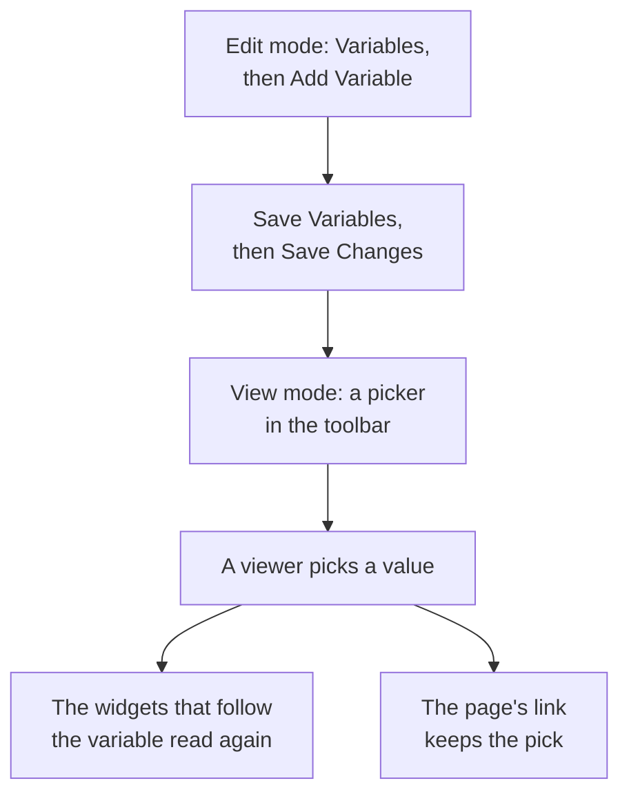

# Dashboard Variables & Filters

A variable is a picker in the dashboard's toolbar. Add a `service` variable and the same charts show `checkout`, `payments` or `search`: viewers pick from the toolbar instead of you building three near-identical dashboards.

:::cards
- [Add a variable](#add-a-variable): Name it, choose where its values come from, save.
- [Variable sources](#variable-sources): Telemetry Attribute, Project Labels, Custom List and Text Input.
- [How widgets use a variable](#how-widgets-use-a-variable): Which widgets follow which variables.
- [Links that keep the selection](#links-that-keep-the-selection): Send a link that opens on the same service.
:::

## How a variable works

You define variables while you edit the dashboard, and they are saved with it. In view mode, each one is a picker in the toolbar. When a viewer picks a value, every widget that follows the variable reads its data again, and the page's link keeps the pick.



## Add a variable

:::steps
### Open the variables dialog

Open the dashboard, pick **⋯ → Edit Dashboard**, and click **Variables** in the toolbar. The **Dashboard Variables** dialog lists the dashboard's variables; the button in the toolbar counts them.

### Add one

Click **Add Variable**. A new variable reads a telemetry attribute; choose another **Source** if you need one.

### Fill it in

Give it a **Name**, which widgets and links use, such as `service`: letters, digits and underscores, starting with a letter or an underscore, and different from the dashboard's other names. Add a **Label** for the toolbar if you like, a **Default** to start on, and tick **Allow multi-select** to let viewers pick several values.

### Save it

Click **Save Variables**, then **Save Changes** in the toolbar. The variable's picker appears in the toolbar once the dashboard is back in view mode.
:::

To change or remove a variable later, open the dialog again: change its fields, or click the bin beside it.

## Variable sources

The **Source** decides where a variable's values come from, and which widgets follow it.

| Source | Where its values come from | Multi-select |
| --- | --- | --- |
| Telemetry Attribute | The values of one attribute key in your metrics, such as `service.name` | Yes |
| Project Labels | The project labels you allow, from 1 to 1,000 | Yes |
| Custom List | Values you type, separated by commas, such as `prod, staging` | Yes |
| Text Input | Whatever the viewer types | No |

### Telemetry Attribute

Set the **Attribute Key**, such as `service.name`, `host.name` or `k8s.namespace.name`; the field suggests the keys your telemetry carries. The picker offers up to 100 values of that key, read from your metrics of the past day, so a new service shows up in it without you editing the dashboard.

This is the most common source, because it needs no list of its own: the values are the ones you already send.

### Project Labels

Choose existing project labels to offer as a dashboard dropdown. For example, create a variable named `UNIT`, set its source to **Project Labels**, and choose the labels `0660` and `0661`.

The dashboard saves the chosen label IDs and display names. Filtering uses IDs, so renaming a project label does not break its binding. Display names are saved with the dashboard; reselect a renamed label in the variable editor to update its displayed name. Public dashboards show these same saved choices.

In a **Monitor List** widget, open **Filters → Label Variable** and select `UNIT`. Selecting `0660` now shows monitors carrying that label. Other widgets are unaffected unless they explicitly support and bind the variable: the **SLO List** has the same **Label Variable** setting.

Fixed widget filters remain in effect. For example, with a fixed `network` label and `UNIT` set to `0660`, a monitor must carry both labels. Multiple selected units match any selected unit. Choosing **All** removes only the variable condition, keeping fixed label, status, and monitor-type filters.

A missing variable or a selection outside its configured choices shows an error. A selected label with no matching monitors shows the empty list. Remove the widget binding explicitly when it is no longer needed.

### Custom List and Text Input

A Custom List offers the values you type, separated by commas. A Text Input lets the viewer type any value, such as an IP address or a request ID. Neither filters a widget by itself: their values go where you write `{{name}}` (see below).

A Query variable from an older dashboard is kept, and shows a text box in the toolbar: OneUptime no longer loads its values from a query.

## Multi-select and defaults

With **Allow multi-select** ticked, viewers pick one or more values, and the widgets show any of them. An empty selection means **All**, and a multi-select variable always starts on **All**, so its **Default** is greyed out.

A single-select variable starts on its **Default**, or on **All** when it has none. **All** removes the variable's filter, so the widgets show everything.

Use multi-select to compare "checkout and payments together" without leaving the dashboard. Avoid it where the numbers do not add up across values, such as an average of averages.

## How widgets use a variable

Each source reaches the widgets its own way:

- **Telemetry Attribute** variables filter widgets with nothing to set on them: every metric chart, value, gauge and table; the **Log Chart**, the **Log Stream**, the **Trace Chart** and the **Trace Table**; and the infrastructure lists whose resources carry the attribute, such as `host.name` on host lists and `k8s.namespace.name` on Kubernetes lists. A chart of a metric without the attribute shows no data while a value is picked: pick **All** to see it again. The **Trace List** and the incident and alert lists do not follow them.
- **Project Labels** variables filter a **Monitor List** or an **SLO List** whose **Label Variable** names them.
- **Any variable** can be written into text as `{{name}}`: in an [HTML widget](/docs/dashboards/widgets#html), in the query of an [external data source](/docs/dashboards/data-sources), and in the title of a **Monitor List** or an **SLO List**. A title such as `{{UNIT}} NETWORK` shows `0660 NETWORK`, `0660, 0661 NETWORK`, or `All NETWORK`. A title controls displayed text; configure **Label Variable** to filter the monitor query.

The [SLO widget](/docs/dashboards/widgets#slo) can follow a Telemetry Attribute variable on the `sloName` key, so viewers pick which SLO it shows.

## Links that keep the selection

The page's link carries each variable's pick as `?var-<name>=<value>`, several values separated by commas, so a link you copy opens with the same selection, and an explicit **All** too. A link like this one opens on the payments service:

```text title="A dashboard link with a variable"
https://oneuptime.com/dashboard/<project-id>/dashboards/<dashboard-id>?var-service=payments
```

The link carries only the variables. The time range starts at the past hour on every visit, so tell the people you send it to which stretch to look at, or zoom in once they open it.

## An example: one dashboard for every service

A service dashboard usually has:

1. A `service` variable, source Telemetry Attribute, attribute key `service.name`, defaulting to your busiest service. Leave multi-select off, so the charts show one service at a time.
2. A `namespace` variable, source Telemetry Attribute, attribute key `k8s.namespace.name`, with multi-select on to compare namespaces.
3. An `environment` variable, source Custom List, values `prod, staging`, used as `{{environment}}` in a data source query.
4. Widgets that read those attributes: charts and values of the service's metrics, a log stream, and a Kubernetes pod list.

The result: one dashboard for every service, with three pickers at the top.

## Next steps

:::cards
- [Dashboard Widgets](/docs/dashboards/widgets): Which widgets follow which variables.
- [External Data Sources](/docs/dashboards/data-sources): Put a variable into a PromQL or SQL query.
- [Sharing & Public Dashboards](/docs/dashboards/sharing): Variables on a public dashboard.
- [Authoring a Dashboard](/docs/dashboards/authoring): Edit mode, saving and the time range.
:::
