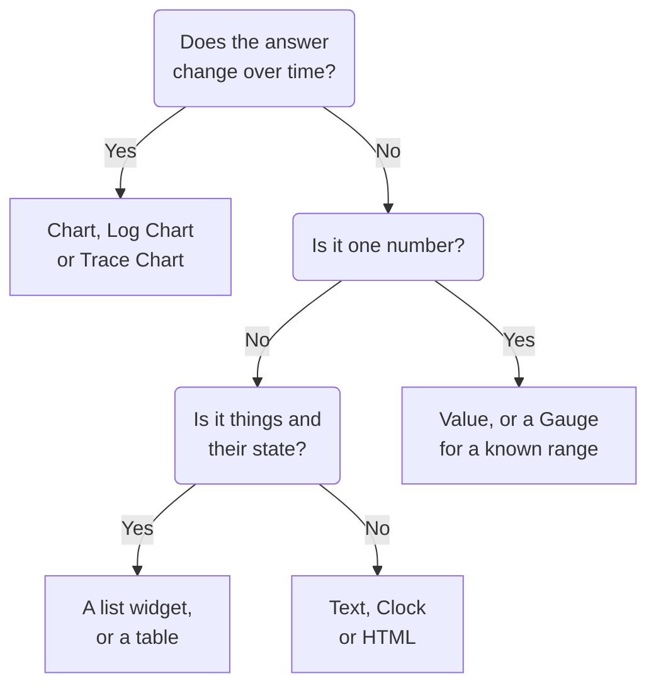

# Dashboard Widgets

A widget is one tile on a dashboard. This page lists every widget of the **Add Widget** catalog, what it shows and the settings that matter, in the catalog's own groups. To place widgets on the grid and save them, see [Authoring a Dashboard](/docs/dashboards/authoring).

:::cards
- [Which widget should I use?](#which-widget-should-i-use): Pick by the question the tile answers.
- [Charts and numbers](#charts-and-numbers): Chart, Value, Gauge and Table, from a metric query.
- [Logs, traces and security](#logs-traces-and-security): Volume charts, live streams and lists.
- [Sorting lists and tables](#sorting-lists-and-tables): Sort by a column, and set the order everyone sees.
- [When a widget can't be shown](#when-a-widget-cant-be-shown): What a broken widget shows, and how to fix it.
:::

## Which widget should I use?

Start from the question the tile has to answer:

| The question | The widget |
| --- | --- |
| How has a metric changed over time? | **Chart** |
| How many logs, of which severity, over time? | **Log Chart** |
| How fast are requests, and how many fail, over time? | **Trace Chart** |
| What is one number right now? | **Value**, or **Gauge** when it has a known range |
| Which hosts, services or endpoints stand out? | **Table** or **Trace Table** |
| What is happening right now? | **Log Stream**, **Trace List**, **Incident List** or **Alert List** |
| Are all our sites up? | **Monitor List** |
| Are we keeping the reliability we promised? | **SLO** or **SLO List** |
| What state are our clusters and hosts in? | A widget of the Infrastructure group |
| Where in the world is our network, and what is down? | **Network Map** |
| A heading, a note, the time in another office? | **Text** or **Clock** |
| Data kept outside OneUptime? | A widget of the External Data Sources group |
| Something no widget covers? | **HTML**, once you are sure no other widget does it |



Most dashboards mix a few: a chart at the top, a value or two beside it, a text heading, and a list or two below.

## Charts and numbers

These four widgets read a metric query, built the way the metric explorer builds one: pick a metric and an aggregation, add attribute filters, and group by an attribute to get one series per value.

### Chart

A time series of one or more metric queries over the dashboard's time range. **Chart Type** draws it as a line, bar, area, stacked area or pie chart. **Additional Queries** overlay more metrics on the same axes, and **Formulas** combine them with `+`, `-`, `*`, `/`, `%`, `^` and parentheses, as in `(1 - a) * 100`. Each query's display settings add a legend and unit, a color, warning and critical lines, and a per-second rate for counters that only ever grow.

Use it when the shape of the line tells the story: latency, errors, throughput or queue depth.

### Value

One big number with a sparkline: the query's value over the whole time range, summed for a sum or a count, the highest for a max, the lowest for a min, and the mean otherwise. An arrow compares the second half of the range with the first, each half worked out the same way, colored by **Trend Direction**: whether a higher value is better or worse, or read from the metric's name. Point at the arrow to see both halves' values, and at the sparkline to read any point's value and time. **Warning Threshold** turns the background yellow and **Critical Threshold** red once the value reaches them.

Use it when one number answers the question: the error rate, P95 latency, or requests served today.

### Gauge

A dial between a minimum and a maximum, 0 and 100 unless you set them, with a yellow zone from **Warning Threshold** and a red zone from **Critical Threshold**.

Use it when the value lives in a known range: CPU or disk use in percent, or a queue's capacity.

### Table

Metric values as rows. **Group By Attributes** gives one row per value, such as one per `host.name`; without it, each row is a time bucket. **Metrics & Columns** sets the columns: metrics, and formulas over them, such as availability in percent. When you group, **Reduce across time** turns each row's series into one value: the last value, the average, the sum, the minimum or the maximum.

Turn on **Color by thresholds** in a column to color its values: a value that reaches **Warning at** turns amber, with a triangle, and one that reaches **Critical at** turns red and bold, with a circle. A percent column starts at 80 and 90. For a column where low values are the problem, such as free disk space, pick **Lower is worse** under **Direction**.

Thresholds read the number the table shows, so a usage metric sent as a fraction of 1, such as `system.cpu.utilization`, shows and compares as a percent. Under **Threshold colors**, **Colored background** fills the whole cell instead of coloring the number.

Use it for a breakdown instead of a trend: the noisiest hosts, the errors per service, the requests per endpoint.

## Text, clock and HTML

These widgets need no data source.

### Text

A line or a block of text, for a heading, a note or links to your runbooks. Turn on **Markdown** to draw headings, links, lists, code and tables; otherwise the text shows as typed, in bold, italic or underlined if you like.

### Clock

The current time in any time zone, as digits or an analog dial, with a label such as "Sydney Office". Left without a time zone, it shows each viewer's own. Add one per office to see who is awake.

### HTML

Your own HTML, CSS and JavaScript, drawn as a widget. Its settings are the HTML body, an optional stylesheet, an optional script and three permission switches.

Use it when you need something no built-in widget covers: an embedded third-party badge, a table pulled from an internal API, a custom legend, or a set of styled links into your own tools.

#### What it can and cannot do

The widget renders in a sandboxed frame on its own isolated origin. Inside that frame your code can do more or less anything: build DOM, run timers, fetch from any URL, draw on a canvas.

What it cannot do is reach the OneUptime page around it. It has no access to the dashboard's DOM, cookies, local storage, or API session, and it cannot navigate the browser tab away. That holds whether the dashboard is private or shared publicly.

Two consequences worth knowing before you paste something in:

- A `fetch` from the widget is a cross-origin request from an opaque origin, so the server you call has to allow it with CORS. Calling the OneUptime API from here is not supported.
- The widget starts transparent. Set a background on `body` in your CSS if you want it to fill the card. In the dark theme its text starts light, and its `<html>` element has the `dark` class: start a CSS rule with `html.dark` to style only the dark theme.

#### Using dashboard variables

Write `{{variableName}}` anywhere in the HTML, CSS, or JavaScript and it is replaced with that variable's current value before the widget renders. Picking a new value re-renders the widget. A placeholder naming a variable that does not exist is left as-is.

Scripts get the same values, plus the dashboard's time range, on `window.ONEUPTIME`:

```javascript title="window.ONEUPTIME"
window.ONEUPTIME.variables.environment; // current value, or "" if unset
window.ONEUPTIME.startDate; // ISO 8601 string, start of the dashboard's time range
window.ONEUPTIME.endDate; // ISO 8601 string, end of it
```

The widget reloads whenever the dashboard refreshes, so a widget that fetches its own data keeps up with the refresh interval.

#### Permissions

**Run JavaScript** (on by default) runs your script. Turn it off to render markup and styles only — the script is then left out of the widget entirely rather than merely blocked.

**Open links in a new tab** (on by default) lets links and `window.open` open a browser tab. Links always open in a new tab; the widget can never navigate the dashboard itself.

**Allow forms to submit** (off by default) lets a `<form>` inside the widget submit.

Anyone who can edit the dashboard decides what this widget runs, and everyone who views the dashboard runs it — on a public dashboard, that includes anonymous visitors. Treat edit access to a dashboard carrying an HTML widget the way you would treat access to any other code you ship.

## Logs, traces and security

| Widget | What it shows | Settings that matter |
| --- | --- | --- |
| **Log Chart** | Log volume over time, one series per severity, as bars, lines or areas. | Severities, text the body contains, attribute filters. |
| **Log Stream** | The latest log lines that match a filter. | Severity, text the body contains, attribute filters such as `@service.name:checkout`, how many rows. |
| **Trace Chart** | Request count, error count or response time (average, minimum, maximum, P50 to P99) over time. | The metric, which spans to count, and an attribute to split the series by. |
| **Trace List** | The latest traces, with their duration and status. | Status, how many rows. |
| **Trace Table** | The top span names, statuses or attribute values by request count, with median, average, minimum and maximum response times. | What to group the rows by, and which spans to count. |
| **Security Events** | The latest security events, with severity, event class and host. | Severities, event classes, text the message contains. |
| **Security Events Flow** | A flow of security events from their source, through their event class, to their severity. | Severities, how many events. |

The trace widgets count root spans only, as the traces explorer does, unless you include child spans in their settings. A common pattern is a latency chart at the top with a list of slow traces below it.

## Incidents, alerts and monitors

| Widget | What it shows | Filters |
| --- | --- | --- |
| **Incident List** | Incidents with their state and severity. | Unresolved, acknowledged or resolved; severity, state, monitors and labels. |
| **Alert List** | Alerts with their state and severity. | Unresolved, acknowledged or resolved; severity, state, monitors and labels. |
| **Monitor List** | Monitors with their current status. | Operational or not, status, monitor type and labels, or a **Label Variable** that viewers pick in the toolbar. |

Like most list widgets, these three can draw a honeycomb of cells colored by status instead of a table: pick it under **View Mode**. They show the current state, whatever the dashboard's time range.

## Service level objectives

### SLO

One Service Level Objective, drawn either as a single number or as a line over time.

**Settings**: which SLO, or the SLO picked in a dashboard variable; which of its three numbers (SLI, Error Budget Remaining, or Burn Rate); Tile or Chart display; and an optional title.

- **Tile** prints the current number, plus a second line where there is one — the target under the SLI, minutes remaining under the error budget. A status pill colors the whole thing.
- **Chart** draws the same number over the dashboard's time range, with the target marked as a dashed line on the SLI series. History is written every few minutes by the evaluation worker, so a brand-new SLO charts as empty until it has been evaluated for the first time.

Use it when the dashboard is answering "are we meeting what we promised?" rather than "what is happening right now".

The SLO widget works on [public dashboards](/docs/dashboards/sharing). What gets published is the SLO's headline numbers — its name, target, current SLI, error budget remaining, burn rate, and status — regardless of which one of them the widget happens to draw. Its definition stays private: the monitors it watches, its labels, its description, its query, and its evaluation schedule are never sent to a public viewer. A Tile widget publishes only those current numbers; a Chart widget also publishes the history of the one series it charts, and nothing else.

### SLO List

Every SLO with its status, SLI, error budget and burn rate, the least budget left first. Filter it by status or labels, or by a **Label Variable** that viewers pick in the toolbar. [SLO Metrics and Dashboards](/docs/slo/metrics) shows both SLO widgets at work.

## Infrastructure

Each of these lists the resources that an agent or a collector reports to OneUptime. Narrow them by cluster, host or namespace in their filters, and show them as a list or as a honeycomb.

| Group | Widgets | Filled in by |
| --- | --- | --- |
| **Hosts** | **Hosts**, with their connection status, OS, CPU and memory | Any OpenTelemetry collector that sends `host.name` |
| **Kubernetes** | **Pods**, **Nodes**, **Namespaces**, **Deployments**, **StatefulSets**, **DaemonSets**, **Jobs**, **CronJobs** | The [Kubernetes Agent](/docs/monitor/kubernetes-agent) |
| **Docker** | **Hosts**, **Containers**, **Images**, **Networks**, **Volumes** | The Docker Agent |
| **Docker Swarm** | **Nodes**, **Services** | The Docker Swarm Agent |
| **Podman** | **Hosts**, **Containers**, **Images**, **Networks**, **Volumes** | The Podman Agent |
| **Proxmox** | **Nodes**, **Guests** | The Proxmox Agent |
| **VMware** | **Hosts**, **Virtual Machines** | The VMware Agent, or a vCenter you connect |
| **Ceph** | **OSDs**, as a wall colored by state, and **Pools** | The Ceph Agent |
| **Storage Arrays** | **Volumes**, and **Hardware** as a wall colored by status | The Storage Array Agent |

Use them for one page that mixes the state of your infrastructure with the telemetry of the workloads on it.

### Network Map

Your network sites drawn on the world map, each pinned at its own latitude and longitude and colored by the monitor status rolled up onto it. Sites close together share a marker with the count printed inside it; a marker that stands for exactly one site opens that site when you click it.

The map frames itself to the sites it drew — an estate inside one country fills the frame with that country, one spread across continents opens on the world. There are no zoom or pan controls: a dashboard tile is a picture, and the Network Map page under Network is where you walk the hierarchy.

Above the map it prints how many sites are down, because a two-pixel red dot among two hundred green ones is not something anyone reads at dashboard distance. Below it, a coverage line says what the map is not showing: sites with no coordinates, and whether the row cap was hit.

**Settings**: title, map or list view, maximum sites drawn, whether to print site names, and filters by site type and by status. Site names come off automatically when the map gets too busy for them to be readable; the tooltip still names every marker.

A site only appears if it has coordinates. Add latitude and longitude on the site (or import them from CSV) to pin it.

## External data sources

The External Data Sources group draws a **Chart**, a **Value**, a **Gauge** or a **Table** from a system that OneUptime does not own: Prometheus, PostgreSQL, MySQL, SQL Server, ClickHouse, Loki, Elasticsearch or any REST API. You connect the system once, then write each widget's query in that system's own language. [External Data Sources](/docs/dashboards/data-sources) shows how.

## Sorting lists and tables

Click a column's header to sort a list or a table by it: a first click sorts it as the table below says, the next click the other way, and the one after puts the widget back in its own order. On the column the widget is already sorted by, a click turns it the other way. An arrow marks the column the rows are sorted by.

| Column | First click | Next click |
| --- | --- | --- |
| A status, state or severity | Worst first | Best first |
| A time | Newest first | Oldest first |
| A number | Highest first | Lowest first |
| Text | A to Z | Z to A |

Worst follows your project's own order: a monitor status by its priority, an incident's or alert's severity and state by the order you keep them in, and a resource that is down, not ready or powered off before a healthy one. A pod's phase sorts Failed, then Unknown, then Pending, then Running and Succeeded. An SLO's SLI and error budget, and a Proxmox guest's VMID, sort lowest first.

The whole list is sorted, not only the rows on screen: a list that shows 25 rows, sorted worst first, shows the 25 worst of all of them. Rows that tie keep the widget's own order. A column a list can't be sorted by as a whole, such as a security event's message, has no sort.

### Your own sort

Your sort is yours alone: your browser remembers it for that widget on that dashboard, so a refresh or a wall screen's reboot keeps it, and nobody else sees it. The click that puts the widget back in its own order forgets your sort, and the widget then follows its own order, even when an editor changes it later.

### The order everyone sees

To set the order a widget opens in for everyone, edit it and pick the order under **Sort**, or click a column header in its **Live Preview**, then click **Save Changes**. You see the new order at once; a viewer who sorted the widget their own way keeps their sort.

The dashboard templates open their lists of hosts, nodes, pods, Swarm services and network devices worst first.

Through the API and Terraform, the order is the widget's `arguments.sort`: a column and a direction, such as `status:desc`. A list widget refuses a column it doesn't have, and the error lists the sorts it has.

## On a public dashboard

A [public dashboard](/docs/dashboards/sharing) draws most widgets for its visitors, each showing only what it was set up to show. A few cannot be shown without a signed-in session:

- **Log Chart**, **Trace Chart**, **Trace Table**, **Security Events** and **Security Events Flow** say in their place that they are not available on public dashboards.
- The External Data Sources widgets are left out of a public dashboard altogether, because their settings are the query itself.

## When a widget can't be shown

A widget that cannot be drawn shows **This widget could not be shown** in its own place, and the rest of the dashboard keeps working. That happens when OneUptime has no widget of its type (one that was removed, misspelt when the dashboard was written through the API, or added by a newer version), or when the widget fails while it is drawn, for example because its saved settings are incomplete.

If you can edit the dashboard, click **Edit widget** on it. The dashboard switches to edit mode with that widget's settings open: fix them, or click **Delete Widget**, then **Save Changes**. A widget that failed while it was drawn also offers **Try again**, and is drawn again at the next auto-refresh or when you change the time range.

Visitors to a public dashboard are only told that the widget could not be shown.

## Next steps

:::cards
- [Dashboard Variables & Filters](/docs/dashboards/variables): Let viewers point the widgets at a service, a host or a customer.
- [External Data Sources](/docs/dashboards/data-sources): Chart Prometheus, SQL, Loki and more beside your own data.
- [Authoring a Dashboard](/docs/dashboards/authoring): Add, arrange and save widgets.
- [Sharing & Public Dashboards](/docs/dashboards/sharing): Share the dashboard outside your team.
:::
