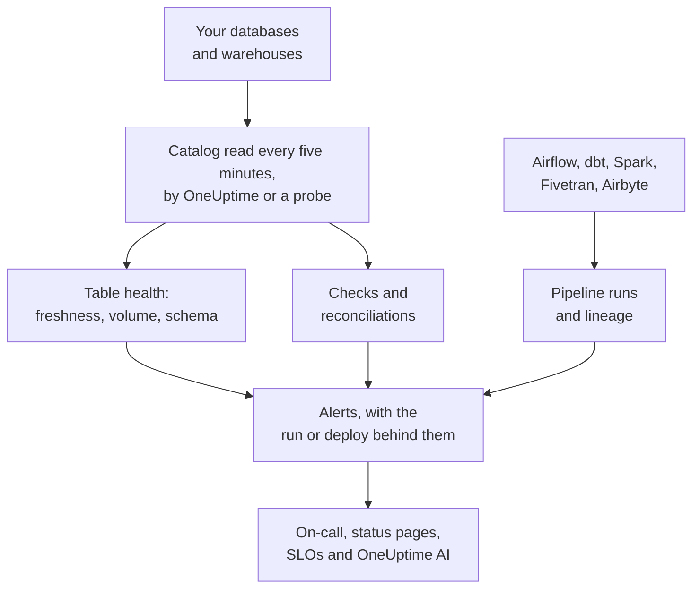

# Data Observability

Data Observability watches the tables your company relies on, in PostgreSQL, MySQL, SQL Server, Oracle, MongoDB, Redshift, Snowflake, BigQuery, ClickHouse, Databricks and Athena, and tells you when their data is late, missing, wrong or broken, before the people who use it notice. It learns each table's rhythm on its own, reads each database's catalog so that no value leaves it, and ties every data problem to the pipeline run, the deploy or the upstream table behind it.

It answers four questions:

:::cards
- [Is the data fresh?](/docs/data-observability/table-health): Every table's last change, rows, size and columns, read every five minutes, with alerts when a table is late, shrinks or changes shape.
- [Is the data right?](/docs/data-observability/checks): Checks on what a table holds, reconciliations between a table and its copy, and dbt's tests, alerting when they fail.
- [Where does it come from, and what does it feed?](/docs/data-observability/lineage-and-pipelines): Lineage from your pipelines, dbt, Fivetran, Airbyte, views and the databases' own query history, so one problem opens one issue.
- [Can the people who use it rely on it?](/docs/data-observability/data-products): Data products with a freshness SLA, on status pages and tracked as an SLO, with a "data as of" badge.
:::

## How it works

1. **Connect a database** with a read-only login. A database Data Security already knows is watched with nothing to do, and so is every BigQuery dataset your Google Cloud connection found. A database in a private network is read by a probe you run there.
2. **Every five minutes** OneUptime reads each database's catalog and statistics: every table and view, its columns, rows and size, and when it last changed. No table is scanned, and on MongoDB only the field names of its newest documents are read. A path in a bucket can be watched the same way.
3. **Each table's rhythm is learned**: how often it usually changes. A table that misses its rhythm is late; one whose rows drop, or whose columns change, says so.
4. **Recommended alerts** turn each of those into a monitor you choose to have, and checks you add read what a table holds.
5. **Lineage** says which tables feed which, so an alert on a table whose source broke first is that source's consequence: one issue, not ten.

## How it is different

- **It is part of the rest of OneUptime.** A data alert is an ordinary alert: it pages through on-call, opens incidents, shows on status pages and counts against SLOs. The services your traces show writing a table, and their deploys, are next to every table alert.
- **Nothing to configure per table.** Rhythms, schedules and usual run times are learned from what each table and pipeline does, and a monitor recommended for a database covers every table in it, including ones created later.
- **One issue per cause.** An alert whose upstream table, pipeline or database already has an alert open joins that alert as its consequence, already acknowledged, so a broken load pages once.
- **Every alert explains itself.** It ranks the likely cause, says what depends on the table and who owns it, and learns from what you say about it: mark one **Not an Issue** and the same thing stays quiet next time.
- **OneUptime AI knows your data.** Investigations of data alerts start from the table's writers, runs and upstream tables; Ask AI, Slack, Microsoft Teams and AI agents can ask whether a table is fresh; and a check can be written from a sentence. See [OneUptime AI and the API](/docs/data-observability/ai-and-api).

## Before you begin

- **A role that can set it up.** Project Owners, Project Admins and Telemetry Admins connect databases. Anyone who may edit data assets adds checks, reconciliations and data products; Viewers read what it found. See [Permission Reference](/docs/permissions/reference).
- **A read-only login on each database.** [Connect a Database](/docs/data-observability/connect) lists the least each engine needs. OneUptime suggests the databases your traces, cloud accounts and Database Monitoring already know of.

## Quick start

:::steps
### Connect a database

Open **Data Observability**, go to **Databases** and choose **Connect a Database**. Pick the engine, and give a read-only connection string, or the name of the environment variable your probe reads it from. [Connect a Database](/docs/data-observability/connect) shows each engine's login.

### See its tables

Within five minutes its tables appear under **Tables**, each with its rows, size and when it last changed. Its freshness is known once a table has changed twice: **Fresh** while it keeps its rhythm, **Late** once it misses it.

### Add the recommended alerts

On **Databases**, choose **Recommended Alerts** for the database, and add the ones you want: a table that is late, one whose rows fall sharply or run unusually low, one whose columns change, and a database that stops reporting. Each is an ordinary monitor: on-call, owners, maintenance windows and status pages work as for any other.
:::

## Next steps

:::cards
- [Connect a Database](/docs/data-observability/connect): Each engine's least-privilege login, and probes for private networks.
- [Table Health](/docs/data-observability/table-health): Freshness, volume, schema changes, unused tables and the metrics every table writes.
- [Checks and Reconciliations](/docs/data-observability/checks): Rules on a table's values, comparing a table with its copy, and dbt's tests.
- [Lineage and Pipelines](/docs/data-observability/lineage-and-pipelines): OpenLineage, dbt, Fivetran and Airbyte, and one issue per cause.
- [Data Products](/docs/data-observability/data-products): Freshness SLAs for the people who use data, on status pages and as SLOs.
- [OneUptime AI and the API](/docs/data-observability/ai-and-api): Investigations, a check from a sentence, freshness for AI agents, and every endpoint.
:::
