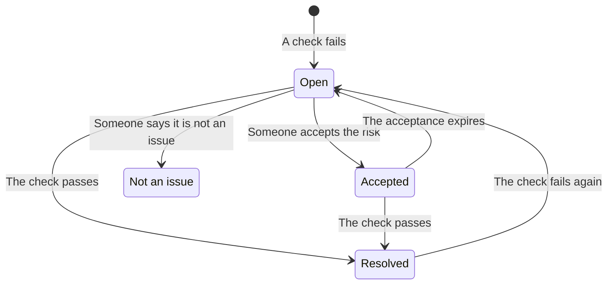

# Data Security Checks and Issues

Data Security runs 32 checks on every store, in nine groups. A check reads what is known about one store - how it is configured, what was found in it, who can reach it, where it lives - and passes, fails or cannot tell. A failing check opens one issue on that store, and the issue closes by itself once the check passes. This page lists every check, how an issue's severity and risk score are worked out, and what happens to an issue over its life.

:::cards
- [How a check decides](#how-a-check-decides): Pass, fail or cannot tell, and how bad a failure is.
- [Every check](#every-check): All 32, with what each one checks and how to fix it.
- [Risk score](#risk-score): How issues are ordered inside a severity.
- [What happens to an issue](#what-happens-to-an-issue): Open, resolved, accepted, not an issue.
- [Fix it from here](#fix-it-from-here): Block a public bucket, or stop sharing a snapshot, in one click.
:::

## How a check decides

Each check reads facts about a store and answers one of four ways:

| Answer | What it means | What happens to the issue |
| --- | --- | --- |
| Pass | The check finds nothing wrong. | An open or accepted issue is resolved. |
| Fail | The check finds the problem, and says what it saw in one sentence: the issue's evidence. | An issue opens, or the open one is brought up to date. |
| Cannot tell | A fact could not be read: a permission the role does not have, a call that failed. | Nothing changes: an open issue stays open, because nobody may conclude a problem is fixed when OneUptime could not look. |
| Does not apply | The store's kind has no such setting. | An open issue is resolved. |

### Severity follows the data

The same problem matters more on more sensitive data. Every check gives a severity for each level of sensitivity, and an issue takes the one for its store: a public bucket of card numbers is Critical, a public bucket of website images only Low. A dash means no issue at all. A store's sensitivity comes from its findings (see [Sensitive Data Types](/docs/data-security/data-types#sensitivity)), so content samples make severities right.

A few checks set the severity from what they saw instead. **Secrets are stored in it** is High on any store, and Critical on a store that is public or shared with other accounts.

## Every check

Severity is given for Restricted, Confidential, Internal and Public data, in that order. Each issue's page shows the full fix for its own store - the console steps, the CLI command and, where one fits, the Terraform - with the store's name and region filled in.

### Exposure

| Check | Runs on | What it checks | Severity | How to fix |
| --- | --- | --- | --- | --- |
| Anyone on the internet can read it (`public-read`) | Object storage, Warehouse, Search | The store's policy, ACL or IAM bindings let anyone read its data without signing in. | Critical / Critical / High / Low | Remove every grant to anonymous or all-authenticated principals. Files that must be public belong in a store marked **Public By Design** that holds nothing else. |
| Anyone on the internet can change it (`public-write`) | Object storage, Warehouse, Search | The store's policy, ACL or IAM bindings let anyone write or delete its data. | Critical / Critical / Critical / High | Remove every write or delete grant to anonymous or all-authenticated principals. |
| Public access is not blocked (`public-access-not-blocked`) | AWS S3 Bucket | S3 Block Public Access is not fully on for the bucket or its account, so one policy change can make it public. | High / Medium / Low / — | Turn on all four Block Public Access settings for the bucket. |
| The database accepts connections from the internet (`internet-reachable`) | Database, Warehouse, Search, Cache | The database has a public endpoint or public network access turned on. | High / High / Medium / Low | Turn off the public endpoint, and reach the database through a private network or a bastion. |
| Its firewall lets in every address (`open-to-all-addresses`) | Database, Warehouse, Search, Cache | A firewall rule or authorized network allows 0.0.0.0/0 or the whole address range. | Critical / Critical / High / Medium | Replace the allow-everything rule with the addresses or networks that need access. |
| A snapshot of it can be restored by anyone (`snapshot-public`) | Database, Snapshot | A database snapshot is shared publicly, so any cloud account can restore a full copy. | Critical / Critical / Critical / High | Make the snapshot private. |
| A snapshot of it is shared with other accounts (`snapshot-shared-externally`) | Database, Snapshot | A database snapshot is shared with accounts outside your connected ones. | High / High / Medium / Low | Stop sharing the snapshot with the accounts that should not have it. |
| Accounts outside your organization can reach it (`shared-with-external-accounts`) | Every store but telemetry | The store's policy grants access to accounts, tenants or projects that are not connected to OneUptime. | High / High / Medium / Low | Review each outside principal, and remove the ones that do not need access. |

### Encryption

| Check | Runs on | What it checks | Severity | How to fix |
| --- | --- | --- | --- | --- |
| Its data is not encrypted at rest (`not-encrypted-at-rest`) | Every store but telemetry | Storage encryption is turned off. | High / Medium / Low / — | Turn on encryption at rest. An RDS instance cannot be encrypted in place: restore an encrypted copy of its snapshot. |
| Restricted data is not under your own key (`no-customer-managed-key`) | Every store but telemetry | The store holds Restricted data but is encrypted with the provider's default key, not a customer-managed one. | Medium / — / — / — | Encrypt the store with a key you manage in your key service. |
| Unencrypted connections are allowed (`encryption-in-transit-not-enforced`) | Every store but telemetry | The store accepts connections that do not use TLS. | High / Medium / Low / — | Require TLS for every connection. On S3, deny every request where `aws:SecureTransport` is false. |
| It accepts TLS older than 1.2 (`weak-tls`) | Every store but telemetry | The minimum TLS version is 1.0 or 1.1. | Medium / Medium / Low / — | Set the minimum TLS version to 1.2 or later. |

### Recovery

| Check | Runs on | What it checks | Severity | How to fix |
| --- | --- | --- | --- | --- |
| It has no backups, or keeps them under 7 days (`no-backups`) | Database, Warehouse | Automated backups are off, or kept for fewer than 7 days. | High / Medium / Low / — | Turn on automated backups, and keep them for at least 7 days. |
| Point-in-time recovery is off (`no-point-in-time-recovery`) | AWS DynamoDB Table, Azure Cosmos DB Account | The table or database cannot be restored to a moment before a mistake. | Medium / Low / — / — | Turn on point-in-time recovery. |
| It can be deleted in one step (`deletion-protection-off`) | Database, Warehouse | Deletion protection is off. | Medium / Low / — / — | Turn on deletion protection. |
| Deleted or overwritten files cannot be recovered (`deleted-data-not-recoverable`) | Object storage | Versioning and soft delete are both off. | Medium / Low / — / — | Turn on versioning or soft delete. |

### Visibility

| Check | Runs on | What it checks | Severity | How to fix |
| --- | --- | --- | --- | --- |
| Nobody would know who read it (`access-not-logged`) | Every store but telemetry | Reads of the store are not logged: no access logs, no data-access audit logs. | High / Medium / Low / — | Turn on access or audit logging for reads: S3 server access logs or CloudTrail data events, Azure StorageRead diagnostic logs, Cloud Storage Data Access audit logs. |

### Access

| Check | Runs on | What it checks | Severity | How to fix |
| --- | --- | --- | --- | --- |
| Anyone with the account key can read everything (`shared-key-access`) | Azure Storage Account | The storage account allows shared key access, which bypasses Microsoft Entra ID and leaves no per-person audit trail. | Medium / Low / — / — | Move applications to Microsoft Entra ID, then turn off storage account key access. |
| Objects can carry their own access rules (`object-acls-enabled`) | AWS S3 Bucket, Google Cloud Storage Bucket | Object ACLs are on, so one object can be made public while the bucket looks private. | Low / Low / — / — | On S3, set Object Ownership to Bucket owner enforced. On Cloud Storage, turn on uniform bucket-level access. |
| More than 25 identities can read Restricted data (`many-readers`) | Every store but telemetry | More identities than most teams can review hold read access to the store. | Medium / — / — / — | Open the store's **Who Can Reach It** page, and remove the access that is unused or broader than needed. |

### Data hygiene

| Check | Runs on | What it checks | Severity | How to fix |
| --- | --- | --- | --- | --- |
| Secrets are stored in it (`secrets-stored`) | Every store but telemetry | Passwords, API keys, tokens or private keys were found in the store's data. | High / High / High / High | Rotate every secret found, as leaked. Move secrets to a secret manager and delete them from the store. |
| Card security codes are stored (`card-security-codes-stored`) | Every store but telemetry | CVV or CVC codes were found. PCI DSS forbids keeping them after a payment is authorised, encrypted or not. | Critical / Critical / Critical / Critical | Stop the code that writes them, delete the stored codes, and check that none remain in backups. |
| Card numbers are stored readable (`card-numbers-readable`) | Every store but telemetry | Full card numbers were found in readable form. PCI DSS requires them to be unreadable wherever they are stored. | High / High / High / High | Tokenize card numbers with your payment provider, or encrypt them at the field level, and delete the readable copies. |
| Passwords are stored in plain text (`plaintext-passwords`) | Every store but telemetry | A password field holds values that are not password hashes (bcrypt, argon2, scrypt or PBKDF2). | Critical / Critical / Critical / Critical | Hash passwords with bcrypt, scrypt or argon2, migrate the stored ones, and make every account reset its password. |
| Production data was copied into a non-production store (`production-data-in-non-production`) | Every store but telemetry | Values found in a production store were also found here, in a development, test or staging store. | High / Medium / — / — | Replace the copy with masked or synthetic data, and delete the real data from the non-production store. |
| Sensitive data nobody has used in 90 days (`stale-sensitive-data`) | Every store but telemetry | The store holds sensitive data and has had no reads or writes for 90 days. | Medium / Low / — / — | Confirm the data is no longer needed, then archive it with a retention date, or delete it. |
| Nobody owns this sensitive store (`no-owner`) | Every store | The store holds sensitive data and has no owner. | Medium / Low / — / — | Add an owner on the store's **Owners** page, or an owner rule that matches its tags. |

### Telemetry

| Check | Runs on | What it checks | Severity | How to fix |
| --- | --- | --- | --- | --- |
| Sensitive data is reaching your telemetry (`sensitive-data-in-telemetry`) | Telemetry | Logs, traces, exceptions, replays or AI conversations carry sensitive data that no scrub rule masks. | High / Medium / Low / — | Press **Scrub It** on each finding to mask the data at ingest, then fix the code that writes it. |
| Secrets are reaching your telemetry (`secrets-in-telemetry`) | Telemetry | Passwords, API keys or tokens appear in logs, traces, exceptions or AI conversations. | Critical / Critical / Critical / Critical | Rotate the secret first, then press **Scrub It** and fix the code that writes it. |

### Residency

| Check | Runs on | What it checks | Severity | How to fix |
| --- | --- | --- | --- | --- |
| Data is stored outside the regions it may live in (`residency-violation`) | Every store but telemetry | The store's region, or a region its data is replicated to, breaks a residency rule. | High / High / Medium / — | Move the data to an allowed region, or stop copying it to the other one. If the transfer is lawful, accept the issue and record why. |

### AI

| Check | Runs on | What it checks | Severity | How to fix |
| --- | --- | --- | --- | --- |
| Sensitive data is being sent to an AI provider (`sensitive-data-to-ai`) | AI Conversations | AI conversations recorded in OneUptime carry sensitive data to a model provider. | Critical / High / Low / — | Redact sensitive values before prompts are sent, or send these calls to a model you host. |
| Restricted data is in a store used for AI (`sensitive-data-in-ai-store`) | Every store but telemetry | A store tagged as AI training or retrieval data holds Restricted data. | High / Medium / — / — | Remove or mask the Restricted data before it is used to train or ground a model. |

## Risk score

Severity says how bad an issue is. The risk score, from 0 to 100, orders the issues of one severity, from what makes the same problem worse:

```text
risk = severity + 10 × exposure + 6 × volume + 5 × activity + 4 × production, at most 100
```

| Factor | Points |
| --- | --- |
| Severity | 75 for Critical, 50 for High, 25 for Medium, 0 for Low |
| Exposure | 10 for Public, 8 for Other accounts, 6 for Internet reachable, 3 for Unknown, 0 for Private |
| Volume | Up to 6, by the store's estimated sensitive records on a log scale: 1 for 10 records, 3 for 1,000, 5 for a million, 6 for ten million or more |
| Activity | 5 when Security Operations saw detections on the store in the last week |
| Production | 4 for a store in production |

The extras add at most 25 points, so an issue never scores below an issue of a lower severity. A public production bucket with a million records of Restricted data scores 75 + 10 + 5 + 4 = 94 for a Critical issue. Each issue lists the factors that added to its score, with their points, and the store shows the score of its worst open issue.

A store's environment - Production, Staging, Development, Test or Unknown - comes from its tags (`env`, `environment`, `stage`, `tier` and the like) or, without one, from the words in its name, such as `prod`, `staging`, `dev` or `qa`. Set it on the store when neither says.

## What happens to an issue



OneUptime opens, updates and resolves issues as the checks run. What a person does to an issue is decide what happens next:

| Status | How it gets there | What follows |
| --- | --- | --- |
| **Open** | Its check fails on the store now. | It counts on the Overview, in the store's summary and in compliance, until the check passes. |
| **Resolved** | Its check passed on a later run, no longer applies or was turned off, or its store was archived. A person may choose **Mark Resolved** too: the store is checked again at once. | It opens again if the check fails again, and the issue counts how often it reopened. |
| **Accepted** | A person chose **Accept Risk**, with a **Reason** and a date in **Accepted Until**, at most a year away. | It stays closed until that date, then opens again if the check still fails. Accept it again then if the reason still holds. |
| **Not an issue** | A person chose **Not an Issue**: the finding was wrong. | It stays closed, even while the check fails. **Reopen** puts it back to Open. |

Security Members, Security Admins, Project Admins and Project Owners can change an issue's status, and **Assign** it to a person or a team. Every change is written to the issue's **Timeline**: when it opened, each change of severity, each status change and who made it, the re-checks asked for, and what the integrations did.

An issue that opens again keeps its history. Accepted risks are looked at again every day, so one expires on time even when nothing was scanned.

## Fix it from here

An open issue about a public bucket or a shared snapshot can be fixed from its page. Above the console steps, **Fix it from here** offers the change that fixes it:

| The issue | Its store | The button | What it changes |
| --- | --- | --- | --- |
| `public-read`, `public-write` or `public-access-not-blocked` | An S3 bucket, an Azure storage account or a Cloud Storage bucket | **Block Public Access** | Turns on the bucket's four Block Public Access settings, turns off the storage account's anonymous blob access, or enforces the bucket's public access prevention |
| `snapshot-public` or `snapshot-shared-externally` | An RDS snapshot, an RDS database, or an Aurora or DocumentDB cluster | **Revoke Sharing** | Stops sharing the snapshot, or each shared manual snapshot of the database, with everyone and with accounts outside the ones you connected |

It asks first, saying what changes and what stops working. It changes how the store is shared, never its data, and changes nothing that is already closed. A store marked **Public By Design** is never blocked.

It acts through the store's cloud connection, so the connection needs **Data security response** turned on and its setup command run again (see [Set Up Data Security](/docs/data-security/setup#let-data-security-close-an-exposure)). Until then the panel says what to turn on. The store is checked again right after, and the issue resolves on its own once its check passes. The issue's **Timeline** and the store's **Timeline** say what was done, and who did it.

## Check settings

**Data Security → Settings → Checks** lists every check by group, with what it looks for and the severity a failure gets for each sensitivity. Each check can be tuned for the project, and each change saves at once:

- **Its switch** turns the check off, when it does not fit how you work. Its open and accepted issues are resolved, and say that the check no longer runs.
- **Its severity** is **By sensitivity** as it ships, or one severity that every failure of the check gets, whatever its store holds.

To silence a check on one store only, accept the risk on that store's issue, or mark the issue as not an issue. For a finding that is wrong rather than a problem that does not matter, mark the finding as not sensitive instead (see [Sensitive Data Types](/docs/data-security/data-types#not-sensitive-and-never-sensitive)).

**Check Now** on a store reads its configuration again and runs its checks. **Scan Now** samples its content, and its checks run when the scan ends.

## Next steps

:::cards
- [Data Security Integrations](/docs/data-security/integrations): Security cases, alerts and owner emails when an issue opens.
- [Data Flows, Access and Residency](/docs/data-security/flows-access-residency): The access, copies and regions several checks read.
- [Data Security Compliance](/docs/data-security/compliance): The framework requirements each check is evidence for.
:::
