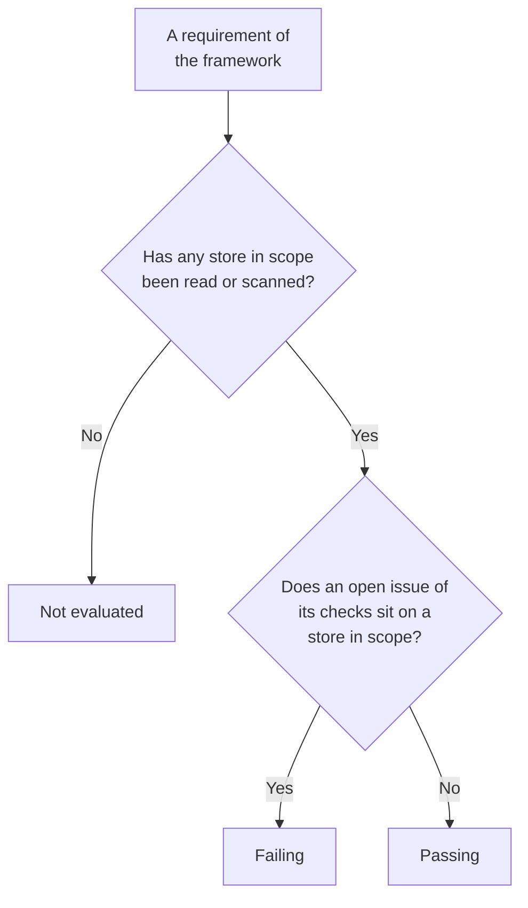

# Data Security Compliance

Data Security scores nine frameworks from what its scans found. Each framework covers the stores its rules are about - GDPR the stores holding personal data, PCI DSS the stores where card data was found, SOC 2 every store - and each of its requirements is met or failed by the checks that are evidence for it. **Data Security → Compliance** shows each framework's score, how many stores it covers, and every requirement with how many open issues fail it. A score is evidence for an audit, not a certificate: it says what OneUptime can see of the stores it reads.

:::cards
- [The frameworks](#the-frameworks): The nine, and which stores each one covers.
- [How a framework is scored](#how-a-framework-is-scored): Passing, failing and not evaluated requirements.
- [Requirements and their checks](#requirements-and-their-checks): Every requirement, and the checks that are evidence for it.
- [Record of processing](#record-of-processing): GDPR Article 30, written from your stores.
:::

## The frameworks

| Framework | Full name | Stores in scope |
| --- | --- | --- |
| GDPR | EU General Data Protection Regulation | Stores that hold personal data. |
| CCPA | California Consumer Privacy Act, as amended by the CPRA | Stores that hold personal information. |
| HIPAA | HIPAA Security Rule | Stores that hold health data. |
| PCI DSS | PCI DSS v4.0 | Stores where card numbers were found. |
| SOC 2 | SOC 2 Trust Services Criteria | Every data store. |
| ISO 27001 | ISO/IEC 27001:2022 | Every data store. |
| NIST CSF | NIST Cybersecurity Framework 2.0 | Every data store. |
| LGPD | Brazil's General Data Protection Law | Stores that hold personal data of people in Brazil. |
| DPDP | India's Digital Personal Data Protection Act, 2023 | Stores that hold personal data of people in India. |

## Which stores a framework covers

A store's scope comes from the data found in it, so it changes as the scans find more:

- **SOC 2, ISO 27001 and NIST CSF** are security frameworks: they cover every store, whatever it holds.
- **GDPR, CCPA, HIPAA and PCI DSS** cover the stores that hold a data type they protect. Personal data brings in GDPR and CCPA, health data HIPAA too, and card numbers, card security codes and card expiry dates PCI DSS. A store holding only secrets or business documents is in none of them.
- **LGPD and DPDP** are countries' own laws: they cover the stores holding personal data of people in Brazil or in India, read from data types that belong to that country, such as a Brazilian CPF or an Indian Aadhaar number.

[Sensitive Data Types](/docs/data-security/data-types#built-in-data-types) lists every data type, with its country.

## How a framework is scored

- **A requirement passes** when no open issue of the checks mapped to it sits on a store in the framework's scope, and **fails** when one does.
- **It is not evaluated** while no store in scope has had its configuration read or its content scanned.
- **Two requirements are met by Data Security itself**: GDPR Article 30, records of processing activities, and ISO 27001 A.5.12, classification of information. They pass once every store in scope has been read or scanned, and fail while one has not.
- **The score** is the share of a framework's evaluated requirements that pass, as a whole percentage. A framework with nothing evaluated has no score.

Only open issues count. An issue whose risk is accepted, or that is not an issue, does not fail its requirements, so an accepted risk is a decision your audit can see on the issue: who accepted it, why, and until when.

## Requirements and their checks

### GDPR

| Requirement | What it asks | Checks |
| --- | --- | --- |
| Art. 5(1)(c) | Data minimisation | `production-data-in-non-production`, `stale-sensitive-data`, `sensitive-data-in-telemetry`, `sensitive-data-to-ai`, `sensitive-data-in-ai-store` |
| Art. 5(1)(e) | Storage limitation | `stale-sensitive-data` |
| Art. 25 | Data protection by design and by default | `production-data-in-non-production`, `stale-sensitive-data`, `sensitive-data-in-telemetry`, `sensitive-data-to-ai`, `sensitive-data-in-ai-store` |
| Art. 28 | Processors | `sensitive-data-to-ai` |
| Art. 30 | Records of processing activities | Met by Data Security itself |
| Art. 32 | Security of processing | `public-read`, `public-write`, `public-access-not-blocked`, `internet-reachable`, `open-to-all-addresses`, `snapshot-public`, `snapshot-shared-externally`, `shared-with-external-accounts`, `not-encrypted-at-rest`, `no-customer-managed-key`, `encryption-in-transit-not-enforced`, `weak-tls`, `no-backups`, `no-point-in-time-recovery`, `deletion-protection-off`, `deleted-data-not-recoverable`, `access-not-logged`, `shared-key-access`, `object-acls-enabled`, `many-readers`, `secrets-stored`, `plaintext-passwords`, `secrets-in-telemetry` |
| Arts. 44-49 | Transfers to third countries | `residency-violation` |

### CCPA

| Requirement | What it asks | Checks |
| --- | --- | --- |
| 1798.100(c) | Collection limited to what is necessary | `production-data-in-non-production`, `stale-sensitive-data`, `sensitive-data-in-telemetry`, `sensitive-data-to-ai`, `sensitive-data-in-ai-store` |
| 1798.150 | Reasonable security procedures | `public-read`, `public-write`, `public-access-not-blocked`, `internet-reachable`, `open-to-all-addresses`, `snapshot-public`, `snapshot-shared-externally`, `shared-with-external-accounts`, `shared-key-access`, `object-acls-enabled`, `many-readers` |

### HIPAA

| Requirement | What it asks | Checks |
| --- | --- | --- |
| 164.308(a)(7) | Contingency plan | `no-backups`, `no-point-in-time-recovery`, `deletion-protection-off`, `deleted-data-not-recoverable` |
| 164.312(a)(1) | Access control | `public-read`, `public-write`, `public-access-not-blocked`, `internet-reachable`, `open-to-all-addresses`, `snapshot-public`, `snapshot-shared-externally`, `shared-with-external-accounts`, `shared-key-access`, `object-acls-enabled`, `many-readers` |
| 164.312(a)(2)(iv) | Encryption and decryption | `not-encrypted-at-rest`, `no-customer-managed-key` |
| 164.312(b) | Audit controls | `access-not-logged` |
| 164.312(e)(1) | Transmission security | `encryption-in-transit-not-enforced`, `weak-tls` |

### PCI DSS

| Requirement | What it asks | Checks |
| --- | --- | --- |
| 3.3.1 | Sensitive authentication data is not kept after authorisation | `card-security-codes-stored` |
| 3.4.1 | Card numbers are masked when displayed | `card-numbers-readable`, `sensitive-data-in-telemetry` |
| 3.5.1 | Card numbers are unreadable wherever they are stored | `not-encrypted-at-rest`, `no-customer-managed-key`, `card-numbers-readable` |
| 4.2.1 | Strong cryptography protects card data in transit | `encryption-in-transit-not-enforced`, `weak-tls` |
| 7.2 | Access is defined and assigned by need | `public-read`, `public-write`, `public-access-not-blocked`, `internet-reachable`, `open-to-all-addresses`, `snapshot-public`, `snapshot-shared-externally`, `shared-with-external-accounts`, `shared-key-access`, `object-acls-enabled`, `many-readers` |
| 8.3.2 | Authentication factors are unreadable when stored | `plaintext-passwords` |
| 10.2 | Audit logs record access to card data | `access-not-logged` |

### SOC 2

| Requirement | What it asks | Checks |
| --- | --- | --- |
| A1.2 | Backup and recovery | `no-backups`, `no-point-in-time-recovery`, `deletion-protection-off`, `deleted-data-not-recoverable` |
| CC6.1 | Logical access security | `public-read`, `public-write`, `public-access-not-blocked`, `internet-reachable`, `open-to-all-addresses`, `snapshot-public`, `snapshot-shared-externally`, `shared-with-external-accounts`, `not-encrypted-at-rest`, `no-customer-managed-key`, `shared-key-access`, `object-acls-enabled`, `many-readers`, `secrets-stored`, `plaintext-passwords`, `secrets-in-telemetry` |
| CC6.7 | Transmission of information | `encryption-in-transit-not-enforced`, `weak-tls` |
| CC7.2 | Monitoring of system components | `access-not-logged` |

### ISO 27001

| Requirement | What it asks | Checks |
| --- | --- | --- |
| A.5.9 | Inventory of information and other associated assets | `no-owner` |
| A.5.12 | Classification of information | Met by Data Security itself |
| A.5.15 | Access control | `public-read`, `public-write`, `public-access-not-blocked`, `internet-reachable`, `open-to-all-addresses`, `snapshot-public`, `snapshot-shared-externally`, `shared-with-external-accounts`, `shared-key-access`, `object-acls-enabled`, `many-readers` |
| A.5.34 | Privacy and protection of PII | `production-data-in-non-production`, `stale-sensitive-data`, `sensitive-data-in-telemetry`, `sensitive-data-to-ai`, `sensitive-data-in-ai-store` |
| A.8.11 | Data masking | `production-data-in-non-production`, `stale-sensitive-data`, `sensitive-data-in-telemetry`, `sensitive-data-to-ai`, `sensitive-data-in-ai-store` |
| A.8.12 | Data leakage prevention | `secrets-stored`, `secrets-in-telemetry` |
| A.8.13 | Information backup | `no-backups`, `no-point-in-time-recovery`, `deletion-protection-off`, `deleted-data-not-recoverable` |
| A.8.15 | Logging | `access-not-logged` |
| A.8.24 | Use of cryptography | `not-encrypted-at-rest`, `no-customer-managed-key`, `encryption-in-transit-not-enforced`, `weak-tls`, `plaintext-passwords` |

### NIST CSF

| Requirement | What it asks | Checks |
| --- | --- | --- |
| ID.AM-07 | Inventories of data and metadata are maintained | `no-owner` |
| PR.AA-05 | Access permissions are managed | `public-read`, `public-write`, `public-access-not-blocked`, `internet-reachable`, `open-to-all-addresses`, `snapshot-public`, `snapshot-shared-externally`, `shared-with-external-accounts`, `shared-key-access`, `object-acls-enabled`, `many-readers` |
| PR.DS-01 | Data at rest is protected | `not-encrypted-at-rest`, `no-customer-managed-key`, `secrets-stored`, `secrets-in-telemetry` |
| PR.DS-02 | Data in transit is protected | `encryption-in-transit-not-enforced`, `weak-tls` |
| PR.DS-11 | Backups of data are kept and tested | `no-backups`, `no-point-in-time-recovery`, `deletion-protection-off`, `deleted-data-not-recoverable` |
| DE.CM-09 | Data and its use are monitored | `access-not-logged` |

### LGPD

| Requirement | What it asks | Checks |
| --- | --- | --- |
| Art. 6 | Necessity and purpose limitation | `production-data-in-non-production`, `stale-sensitive-data`, `sensitive-data-in-telemetry`, `sensitive-data-to-ai`, `sensitive-data-in-ai-store` |
| Art. 33 | International transfer of data | `residency-violation` |
| Art. 46 | Security measures | `public-read`, `public-write`, `public-access-not-blocked`, `internet-reachable`, `open-to-all-addresses`, `snapshot-public`, `snapshot-shared-externally`, `shared-with-external-accounts`, `not-encrypted-at-rest`, `no-customer-managed-key`, `shared-key-access`, `object-acls-enabled`, `many-readers` |

### DPDP

| Requirement | What it asks | Checks |
| --- | --- | --- |
| Sec. 8(5) | Reasonable security safeguards | `public-read`, `public-write`, `public-access-not-blocked`, `internet-reachable`, `open-to-all-addresses`, `snapshot-public`, `snapshot-shared-externally`, `shared-with-external-accounts`, `not-encrypted-at-rest`, `no-customer-managed-key`, `shared-key-access`, `object-acls-enabled`, `many-readers` |
| Sec. 8(7) | Erasure when the purpose is served | `production-data-in-non-production`, `stale-sensitive-data`, `sensitive-data-in-telemetry`, `sensitive-data-to-ai`, `sensitive-data-in-ai-store` |
| Sec. 16 | Transfer outside India | `residency-violation` |

## Record of processing

GDPR Article 30 asks you to keep a record of your processing activities. Data Security writes the part of it that is about where personal data is kept: one row for each store that holds personal data.

| Column | Where it comes from |
| --- | --- |
| Store, kind, provider and region | Discovery |
| Environment | The store's tags or name, or what you set |
| Sensitivity, categories and data types | What the scans found, or the sensitivity you set |
| Owners | The store's owners, people and the members of its teams |
| Purpose | What you write in the store's **Purpose**: why it holds personal data |
| Retention | What you write in the store's **Retention**: how long data is kept in it |
| Frameworks | The frameworks its data types bring into scope |

Fill in **Purpose** and **Retention** in each store's **Settings**: they are the two things no scan can know. The record and the scores are also answered by Data Security's API, at `/data-security/record-of-processing` and `/data-security/compliance`, for anyone who may read data stores (see [Data Security Integrations](/docs/data-security/integrations#api-terraform-and-mcp)).

## Next steps

:::cards
- [Data Security Checks and Issues](/docs/data-security/checks-and-issues): The checks behind every requirement, and how to fix them.
- [Data Flows, Access and Residency](/docs/data-security/flows-access-residency): Residency rules, for GDPR, LGPD and DPDP transfers.
- [Sensitive Data Types](/docs/data-security/data-types): The data types that bring a store into a framework's scope.
:::
