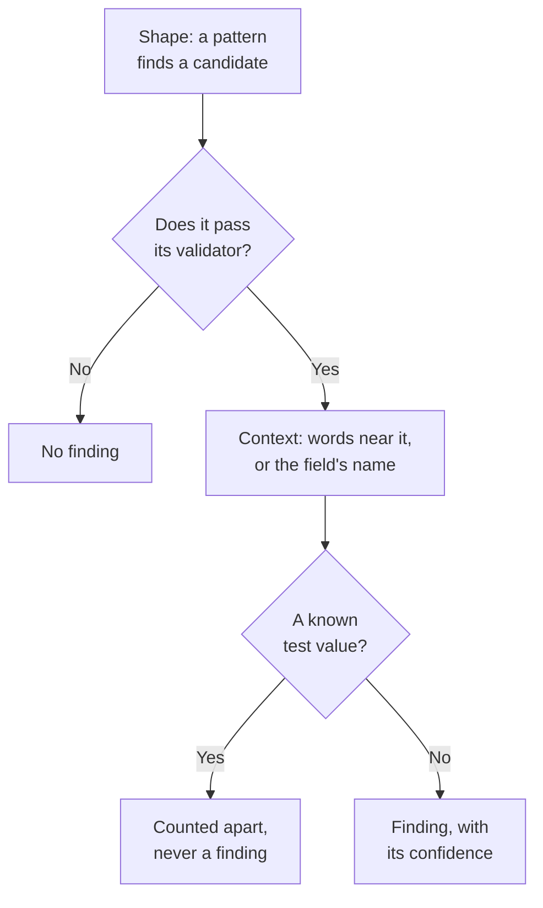

# Sensitive Data Types

Data Security knows 143 kinds of sensitive data: card numbers, bank accounts, national IDs of 43 countries, health identifiers, API keys and tokens, and the special categories of personal data. Each has a category, a sensitivity and, when it belongs to one country, that country. This page says how a value is found, and lists every data type, so you can tell why something was found and decide what to do about it.

:::cards
- [How a value is found](#how-a-value-is-found): Shape, validator, context, test values, confidence.
- [Fields and columns](#fields-and-columns): How a whole column or attribute is judged.
- [Every data type](#built-in-data-types): All 143, by category.
- [Your own data types](#your-own-data-types): Employee IDs, policy numbers, and the Test It box.
:::

## How a value is found

Every scan - a log line, a CSV cell, a database row, the first bytes of an object - runs the same steps:

1. **Shape.** Each data type has patterns that find candidates: sixteen digits, `AKIA` and sixteen letters, a word, an `@` and a domain. A pattern never matches inside a longer token, so a card number is not found inside a longer run of digits.
2. **Validator.** A candidate must pass its type's own rules: a checksum (Luhn for cards, mod 97 for IBANs, Verhoeff for Aadhaar numbers, the check digit of most national IDs), a real date, a known prefix, enough randomness for a secret. A candidate that fails is no finding at all. Placeholders such as `000000000` and `123456789` fail every numeric type.
3. **Context.** Words near a candidate - by default up to 64 characters before it and 32 after it - that say what it is raise its confidence one level, and so does a field whose name points at the type. Words that say it is something else, such as an order or tracking number, lower it one level. A number with no checksum and a common shape, such as a passport number or a bank account, counts only next to words that name it.
4. **Known test values.** Published test card numbers (such as Stripe's `4242 4242 4242 4242`), example IBANs, addresses at `example.com` and other reserved domains, documentation IP addresses, the sample IDs government documentation prints, test-mode keys such as `sk_test_` and placeholder keys are counted apart. They never make a finding, so a store full of them reads as a test environment, not a breach.
5. **Confidence.** What is left is a finding, as sure as its evidence allows.

| Confidence | What it means |
| --- | --- |
| **High** | The value passed its validator, and words around it or the field it sits in say what it is - or, for a field, most of its values are that type. |
| **Medium** | The value passed its validator with nothing around it to confirm it, or the field's name says what it holds and some values agree. |
| **Low** | The shape matches, but nothing confirms it. |

Only High and Medium findings count: they make a store sensitive and can open an issue. Low findings are listed on the store, folded away, for a person to judge.

When two data types claim the same characters, the surer finding wins: the higher confidence, then the detector whose own rules prove more, then the longer match.

A long value is read in windows of 64 KB that overlap by 4 KB, so a value is found whole wherever it sits, and at most 4 MB of one value is read.

## Fields and columns

A column, a JSON field or a log attribute is judged as a whole. Its name hints at a data type, and its sampled values prove one. The share of its values that hold the type decides how sure the finding is:

| Values that hold the type | Confidence |
| --- | --- |
| 60% or more | High |
| 25% or more | High when the field's name points at the type, Medium otherwise |
| Fewer | Medium when the field's name points at the type, Low otherwise: a few emails in a column of something else |

A field whose values average more than 80 characters is free text - notes, messages, descriptions - and is not expected to hold one type. Its findings keep the confidence each match earned on its own, and say they were found in free text. Up to 1,000 values of a field are classified, and up to 16 KB of each.

A field's name is split into words - `customerEmail`, `customer_email` and `customer-email` are all "customer email" - and a type's name hint matches when its words appear in that order, next to each other: "date of birth" matches `customer_date_of_birth`, not `birth_city`. Only the last part of a dotted path is the field's own name, with the part before it when the last is a generic word such as `number`, `id` or `value`: `customer.address.city` is not a street address, and `card.number` is still a card number.

Some data types cannot be told by their values: no pattern tells a person's name from a street, or a religion from any other word. These are found from the field's name alone, when the field has values: Person name, Username, Gender, Nationality, Health information, Racial or ethnic origin, Religious belief, Sexual orientation, Political opinion, Trade union membership, Biometric data, Genetic data and Criminal record. A name, a username, a gender or a nationality is then High when 60% or more of the values look like one, and Medium otherwise.

A field whose name says it holds a password - `password`, `passwordHash`, `pwd`, not `password_changed_at` - should hold a hash: bcrypt, argon2, scrypt, PBKDF2 or another scheme a store is likely to use. Empty values, placeholders such as `********` and encrypted values are set aside. When more of the rest are not hashes than are, the field holds the passwords themselves, which no pattern can see, and the store fails [Passwords are stored in plain text](/docs/data-security/checks-and-issues#data-hygiene).

## Sensitivity

| Sensitivity | What it means |
| --- | --- |
| **Restricted** | Harm follows if it leaks: secrets, card numbers, health records, government IDs. |
| **Confidential** | Personal data, and documents marked confidential. |
| **Internal** | The business's own data, not meant for outsiders. |
| **Public** | Nothing sensitive was found. |

A store is as sensitive as the most sensitive data type found in it with at least Medium confidence. Test values and findings marked as not sensitive count for nothing, and a store where nothing was found is Public. To treat a store as more or less sensitive than its findings say, set its sensitivity yourself in the store's **Settings**: the checks then use that.

## Categories

| Category | What it covers | Personal data |
| --- | --- | --- |
| Secrets and credentials | Passwords, API keys, tokens and private keys that unlock other systems. | No |
| Financial | Card numbers, bank accounts, IBANs and crypto wallets. | Yes |
| Health | Medical record numbers, health identifiers, diagnoses and prescriptions. | Yes |
| Government ID | National identity, tax, passport and social security numbers. | Yes |
| Special category | What GDPR Article 9 protects most: ethnicity, religion, sexual orientation, politics, union membership, biometric and genetic data. | Yes |
| Contact and identity | Who someone is and how to reach them: email, phone, address, date of birth, IP address. | Yes |
| Business confidential | Documents marked confidential, internal only or privileged. | No |

Personal data is data about a person, as GDPR, CCPA, LGPD and DPDP mean it. A store that holds only secrets and business documents is out of a privacy framework's scope, never out of a security one's (see [Data Security Compliance](/docs/data-security/compliance)).

## Built-in data types

A data type that belongs to one country names it, as an ISO 3166-1 code: residency rules and the country-bound frameworks read it (see [Residency](/docs/data-security/flows-access-residency#residency-rules)). The ID is what the API and findings name the type by.

### Contact and identity

| Data type | ID | What it is | Sensitivity | Country |
| --- | --- | --- | --- | --- |
| Email address | `email-address` | A person's email address. | Confidential | — |
| Phone number | `phone-number` | A phone number in international or national format. | Confidential | — |
| Person name | `person-name` | A person's first, last or full name, found from the field's name. | Confidential | — |
| Street address | `postal-address` | A street address: a number, a street name and a street type. | Confidential | — |
| Postal code | `postal-code` | A postal code. On its own it narrows where someone lives. | Internal | — |
| Date of birth | `date-of-birth` | A date next to words that say it is someone's birth date. | Confidential | — |
| IP address | `ip-address` | A public IPv4 or IPv6 address, which GDPR treats as personal data. | Confidential | — |
| MAC address | `mac-address` | A network card's hardware address, which identifies a device. | Confidential | — |
| Advertising ID | `advertising-id` | A mobile advertising ID (IDFA, GAID, AAID) that tracks one device. | Confidential | — |
| Precise location | `geolocation` | A latitude and longitude precise enough to find a building. | Confidential | — |
| Username | `username` | A person's sign-in or account name, found from the field's name. | Confidential | — |
| Gender | `gender` | A person's gender or sex, found from the field's name. | Confidential | — |
| Nationality | `nationality` | A person's nationality or citizenship, found from the field's name. | Confidential | — |
| Vehicle identification number | `vehicle-identification-number` | A 17-character VIN with a valid check digit. | Confidential | — |

### Government ID

| Data type | ID | What it is | Sensitivity | Country |
| --- | --- | --- | --- | --- |
| US Social Security number | `us-ssn` | A US Social Security number. | Restricted | US |
| US taxpayer ID (ITIN) | `us-itin` | A US Individual Taxpayer Identification Number. | Restricted | US |
| US employer ID (EIN) | `us-ein` | A US Employer Identification Number, next to words that say so. | Confidential | US |
| US passport number | `us-passport` | A US passport number, next to words that say so. | Restricted | US |
| US driver's license number | `us-drivers-license` | A US driver's license number, next to words that say so. | Restricted | US |
| UK National Insurance number | `uk-nino` | A UK National Insurance number. | Restricted | GB |
| UK passport number | `uk-passport` | A UK passport number, next to words that say so. | Restricted | GB |
| UK driving licence number | `uk-driving-licence` | A 16-character UK driving licence number. | Restricted | GB |
| Canada Social Insurance number | `ca-sin` | A Canadian Social Insurance Number with a valid check digit. | Restricted | CA |
| Mexico CURP | `mx-curp` | A Mexican Clave Única de Registro de Población. | Restricted | MX |
| Mexico RFC | `mx-rfc` | A Mexican Registro Federal de Contribuyentes tax ID. | Restricted | MX |
| Brazil CPF | `br-cpf` | A Brazilian Cadastro de Pessoas Físicas number. | Restricted | BR |
| Brazil CNPJ | `br-cnpj` | A Brazilian company registration number (CNPJ). | Confidential | BR |
| Argentina CUIT / CUIL | `ar-cuit` | An Argentine tax or labour identification code. | Restricted | AR |
| Chile RUT | `cl-rut` | A Chilean Rol Único Tributario with a valid check digit. | Restricted | CL |
| Spain DNI | `es-dni` | A Spanish national identity document number with its check letter. | Restricted | ES |
| Spain NIE | `es-nie` | A Spanish foreigner identity number with its check letter. | Restricted | ES |
| Portugal NIF | `pt-nif` | A Portuguese tax identification number. | Restricted | PT |
| France social security number (NIR) | `fr-nir` | A French INSEE number with its two-digit key. | Restricted | FR |
| Germany tax ID | `de-tax-id` | A German Steuerliche Identifikationsnummer. | Restricted | DE |
| Italy codice fiscale | `it-codice-fiscale` | An Italian fiscal code with a valid check character. | Restricted | IT |
| Netherlands BSN | `nl-bsn` | A Dutch citizen service number that passes the eleven test. | Restricted | NL |
| Belgium national number | `be-national-number` | A Belgian national register number. | Restricted | BE |
| Poland PESEL | `pl-pesel` | A Polish national identification number. | Restricted | PL |
| Sweden personal identity number | `se-personnummer` | A Swedish personnummer with a valid check digit. | Restricted | SE |
| Norway national identity number | `no-fodselsnummer` | A Norwegian fødselsnummer with both check digits. | Restricted | NO |
| Denmark CPR number | `dk-cpr` | A Danish civil registration number, next to words that say so. | Restricted | DK |
| Finland personal identity code | `fi-hetu` | A Finnish henkilötunnus with its check character. | Restricted | FI |
| Ireland PPS number | `ie-ppsn` | An Irish Personal Public Service Number. | Restricted | IE |
| Switzerland AHV number | `ch-ahv` | A Swiss social security number (AHV / AVS). | Restricted | CH |
| Romania CNP | `ro-cnp` | A Romanian personal numeric code. | Restricted | RO |
| Bulgaria EGN | `bg-egn` | A Bulgarian uniform civil number. | Restricted | BG |
| Croatia OIB | `hr-oib` | A Croatian personal identification number. | Restricted | HR |
| Greece AMKA | `gr-amka` | A Greek social security number. | Restricted | GR |
| Turkey identity number | `tr-tckn` | A Turkish T.C. Kimlik number. | Restricted | TR |
| Israel identity number | `il-teudat-zehut` | An Israeli Teudat Zehut number. | Restricted | IL |
| South Africa ID number | `za-id` | A South African identity number with a valid date and check digit. | Restricted | ZA |
| UAE Emirates ID | `ae-emirates-id` | A United Arab Emirates identity card number. | Restricted | AE |
| Saudi Arabia national ID | `sa-national-id` | A Saudi national ID or iqama number. | Restricted | SA |
| India Aadhaar number | `in-aadhaar` | A 12-digit Aadhaar number that passes the Verhoeff check. | Restricted | IN |
| India PAN | `in-pan` | An Indian Permanent Account Number. | Restricted | IN |
| China resident identity number | `cn-resident-id` | An 18-character Chinese resident identity card number. | Restricted | CN |
| Japan My Number | `jp-my-number` | A Japanese individual number with a valid check digit. | Restricted | JP |
| South Korea resident registration number | `kr-rrn` | A Korean resident registration number. | Restricted | KR |
| Singapore NRIC / FIN | `sg-nric` | A Singapore identity card or foreign identification number. | Restricted | SG |
| Hong Kong identity card number | `hk-hkid` | A Hong Kong identity card number with its check digit. | Restricted | HK |
| Taiwan national ID | `tw-national-id` | A Taiwanese national identification number. | Restricted | TW |
| Thailand national ID | `th-national-id` | A Thai citizen identification number. | Restricted | TH |
| Malaysia MyKad number | `my-mykad` | A Malaysian identity card number. | Restricted | MY |
| Indonesia NIK | `id-nik` | An Indonesian population identity number. | Restricted | ID |
| Australia tax file number | `au-tfn` | An Australian tax file number with a valid check. | Restricted | AU |
| New Zealand IRD number | `nz-ird` | A New Zealand Inland Revenue number with a valid check digit. | Restricted | NZ |
| Russia SNILS | `ru-snils` | A Russian insurance account number with its check number. | Restricted | RU |
| Russia INN | `ru-inn` | A Russian taxpayer identification number. | Restricted | RU |
| Passport number | `passport-number` | A passport number from any country, next to words that say so. | Restricted | — |

### Financial

| Data type | ID | What it is | Sensitivity | Country |
| --- | --- | --- | --- | --- |
| Card number | `credit-card-number` | A payment card number that passes the Luhn check and belongs to a card brand. | Restricted | — |
| Card security code | `card-verification-code` | A CVV or CVC, which PCI DSS forbids keeping after a payment is authorised. | Restricted | — |
| Card expiry date | `card-expiration-date` | A card's expiry date, next to words that say so. | Confidential | — |
| IBAN | `iban` | An international bank account number that passes the mod-97 check. | Restricted | — |
| Bank account number | `bank-account-number` | A bank account number, next to words that say so. | Restricted | — |
| SWIFT / BIC code | `swift-bic` | A bank's SWIFT or BIC code, next to words that say so. | Internal | — |
| US bank routing number | `us-bank-routing-number` | An ABA routing number with a valid checksum, next to words that say so. | Internal | US |
| UK sort code | `uk-sort-code` | A UK bank sort code, next to words that say so. | Internal | GB |
| India IFSC | `in-ifsc` | An Indian Financial System Code that names a bank branch. | Internal | IN |
| Australia BSB | `au-bsb` | An Australian bank-state-branch number, next to words that say so. | Internal | AU |
| Bitcoin address | `bitcoin-address` | A Bitcoin address with a valid checksum. | Confidential | — |
| Ethereum address | `ethereum-address` | An Ethereum address, next to words that say so. | Confidential | — |

### Health

| Data type | ID | What it is | Sensitivity | Country |
| --- | --- | --- | --- | --- |
| UK NHS number | `uk-nhs-number` | A UK National Health Service number with a valid check digit. | Restricted | GB |
| US Medicare beneficiary ID | `us-medicare-mbi` | A US Medicare Beneficiary Identifier. | Restricted | US |
| Australia Medicare number | `au-medicare-number` | An Australian Medicare card number with a valid check digit. | Restricted | AU |
| Germany health insurance number | `de-health-insurance-number` | A German Krankenversichertennummer with a valid check digit. | Restricted | DE |
| Medical record number | `medical-record-number` | A patient's medical record number, next to words that say so. | Restricted | — |
| Health plan member ID | `health-plan-id` | A health insurance member or policy number, next to words that say so. | Restricted | — |
| Diagnosis code (ICD-10) | `diagnosis-code` | An ICD-10 diagnosis code, next to words that say so. | Restricted | — |
| Drug code (NDC) | `drug-code` | A US National Drug Code, next to words that say so. | Confidential | — |
| US DEA number | `us-dea-number` | A prescriber's Drug Enforcement Administration number with a valid check digit. | Confidential | US |
| US provider ID (NPI) | `us-npi` | A National Provider Identifier. It names a care provider, not a patient. | Internal | US |
| Health information | `health-information` | Diagnoses, conditions, medications and other health details, found from the field's name. | Restricted | — |

### Secrets and credentials

| Data type | ID | What it is | Sensitivity | Country |
| --- | --- | --- | --- | --- |
| AWS access key ID | `aws-access-key-id` | The public half of an AWS access key. With its secret it signs AWS requests. | Restricted | — |
| AWS secret access key | `aws-secret-access-key` | The secret half of an AWS access key, next to words that say so. | Restricted | — |
| Google API key | `google-api-key` | A Google Cloud or Maps API key. | Restricted | — |
| Google service account key | `google-service-account-key` | A Google Cloud service account key file with its private key. | Restricted | — |
| Google OAuth client secret | `google-oauth-client-secret` | A Google OAuth client secret. | Restricted | — |
| Azure storage account key | `azure-storage-account-key` | An Azure storage account key or a connection string carrying one. | Restricted | — |
| Azure SAS token | `azure-sas-token` | An Azure shared access signature, which grants access without a sign-in. | Restricted | — |
| Azure client secret | `azure-client-secret` | A Microsoft Entra ID application client secret. | Restricted | — |
| GitHub token | `github-token` | A GitHub personal access, OAuth, app or fine-grained token. | Restricted | — |
| GitLab token | `gitlab-token` | A GitLab personal access token. | Restricted | — |
| Slack token | `slack-token` | A Slack bot, user or app token. | Restricted | — |
| Slack webhook URL | `slack-webhook-url` | A Slack incoming webhook, which lets anyone post to a channel. | Restricted | — |
| Stripe secret key | `stripe-secret-key` | A Stripe live secret or restricted key, which can move money. | Restricted | — |
| Twilio API key | `twilio-api-key` | A Twilio API key SID with secret. | Restricted | — |
| SendGrid API key | `sendgrid-api-key` | A SendGrid API key. | Restricted | — |
| Mailgun API key | `mailgun-api-key` | A Mailgun API key. | Restricted | — |
| Mailchimp API key | `mailchimp-api-key` | A Mailchimp API key. | Restricted | — |
| OpenAI API key | `openai-api-key` | An OpenAI API key, which spends the account's credit. | Restricted | — |
| Anthropic API key | `anthropic-api-key` | An Anthropic API key. | Restricted | — |
| Hugging Face token | `huggingface-token` | A Hugging Face token. | Restricted | — |
| npm token | `npm-token` | An npm access token, which can publish packages. | Restricted | — |
| PyPI token | `pypi-token` | A PyPI upload token. | Restricted | — |
| Docker Hub token | `docker-hub-token` | A Docker Hub personal access token. | Restricted | — |
| Shopify token | `shopify-token` | A Shopify access or app token. | Restricted | — |
| Square token | `square-token` | A Square access token or secret. | Restricted | — |
| Braintree access token | `braintree-access-token` | A Braintree production access token. | Restricted | — |
| DigitalOcean token | `digitalocean-token` | A DigitalOcean personal access token. | Restricted | — |
| New Relic API key | `new-relic-api-key` | A New Relic user API key. | Restricted | — |
| Datadog API key | `datadog-api-key` | A Datadog API or application key, next to words that say so. | Restricted | — |
| HashiCorp Vault token | `vault-token` | A HashiCorp Vault service token. | Restricted | — |
| Terraform Cloud token | `terraform-cloud-token` | A Terraform Cloud or Enterprise API token. | Restricted | — |
| Atlassian API token | `atlassian-api-token` | An Atlassian API token. | Restricted | — |
| Linear API key | `linear-api-key` | A Linear API key. | Restricted | — |
| JSON web token | `json-web-token` | A signed JWT, often a session or access token. | Restricted | — |
| Private key | `private-key` | A PEM, OpenSSH or PGP private key block. | Restricted | — |
| Password in a URL | `password-in-url` | A URL that carries a user name and password, such as a database connection string. | Restricted | — |
| Password in a connection string | `connection-string-password` | A Password= or Pwd= value in a connection string. | Restricted | — |
| Authorization header | `authorization-header` | A Basic or Bearer credential copied from an HTTP Authorization header. | Restricted | — |
| Password or secret | `generic-secret` | A value assigned to a password, secret, API key or token, that looks random enough to be real. | Restricted | — |
| Bitcoin private key | `bitcoin-private-key` | A Bitcoin private key in wallet import format, with a valid checksum. | Restricted | — |

### Special category

| Data type | ID | What it is | Sensitivity | Country |
| --- | --- | --- | --- | --- |
| Racial or ethnic origin | `racial-or-ethnic-origin` | Race or ethnicity, found from the field's name. | Restricted | — |
| Religious belief | `religious-belief` | Religion or belief, found from the field's name. | Restricted | — |
| Sexual orientation | `sexual-orientation` | Sexual orientation, found from the field's name. | Restricted | — |
| Political opinion | `political-opinion` | Political opinions or party membership, found from the field's name. | Restricted | — |
| Trade union membership | `trade-union-membership` | Trade union membership, found from the field's name. | Restricted | — |
| Biometric data | `biometric-data` | Fingerprints, face templates, voice prints and other biometrics, found from the field's name. | Restricted | — |
| Genetic data | `genetic-data` | DNA and genome data, found from the field's name. | Restricted | — |
| Criminal record | `criminal-record` | Criminal convictions and offences (GDPR Article 10), found from the field's name. | Restricted | — |

### Business confidential

| Data type | ID | What it is | Sensitivity | Country |
| --- | --- | --- | --- | --- |
| Legally privileged document | `privileged-document` | A document marked attorney-client privileged or legally privileged. | Restricted | — |
| Document marked confidential | `confidential-document` | A document marked confidential, strictly confidential or a trade secret. | Confidential | — |
| Document marked internal | `internal-document` | A document marked internal use only or not for distribution. | Internal | — |

## Your own data types

Add a data type for what only your company has: an employee ID, a policy number, a project code. Go to **Data Security → Settings → Data Types** and add it under **Your Data Types**. It is scanned exactly like the built-in ones, in buckets, databases and telemetry, from the next scan on.

:::steps
### Say what it is

Give it a **Name**, such as Employee ID, a **Category** and a **Sensitivity**: how sensitive a store that holds it is. A **Description** says what it is, for whoever reads a finding of it.

### Say how it is found

Enter a **Pattern**: a JavaScript regular expression for one value, such as `EMP-\d{6}`. Add the **Field Names** that hold it, such as `employee id`, and the **Keywords** that, near a value, confirm it is this type. Leave the pattern empty to find the type from field names alone.

### Test it

Paste sample text into **Test It** to see what your data type finds in it. It runs the scanner's own code on the text, in your browser: the text is never sent to OneUptime, and only its first 64 KB is tested.
:::

Under **More fields**, **Ignore Case** matches the pattern whatever the case of its letters, **Requires A Keyword** counts a value only when a keyword is near it or the field's name says it is this type, and **Checksum** asks a value to pass a check: **None**, **Luhn** (the check digit card numbers carry), **Mod97** (the check digits of an IBAN) or **Verhoeff** (the check digit of an Aadhaar number).

A pattern is checked when you save it: it must compile, match no empty text and run in time in line with the text. It is run by a matcher that never backtracks, so no pattern can hold a scan, however it is written. A type takes at most 50 keywords and 50 field names.

A value of your type is Medium on its own and High with a keyword near it when it passes a checksum, and Low on its own and Medium with a keyword when it has none. In a column, the share of values that match decides, as for every type.

## Not sensitive, and never sensitive

A scan can find something that is not what it looks like: a column of order numbers that pass the Luhn check, your own support address in every log line. Tell OneUptime so, and it stops counting:

- **Mark the finding as not sensitive.** On the store's **What's Inside** page, choose **Mark as Not Sensitive** on the finding and say why. It no longer counts toward the store's sensitivity or its checks, and the store is checked again at once. The finding stays on the store, marked, with your reason, so the next person sees what was decided.
- **Add the value to Never Sensitive**, in Data Security's settings, for a value that is never a finding anywhere, such as `support@yourcompany.com`. Values are compared after the scanner has normalized them, ignoring case.
- **Turn a built-in data type off.** Under **Built-in Data Types**, on **Data Security → Settings → Data Types**, every data type has a switch, which saves the moment it is flipped. No scan of the project looks for a type that is off.

## Next steps

:::cards
- [Data Security Checks and Issues](/docs/data-security/checks-and-issues): What a store's sensitivity changes about its issues.
- [Sensitive Data in Telemetry](/docs/data-security/telemetry): The data types found in your logs, traces and prompts.
- [Data Security Compliance](/docs/data-security/compliance): The frameworks each data type brings into scope.
:::
