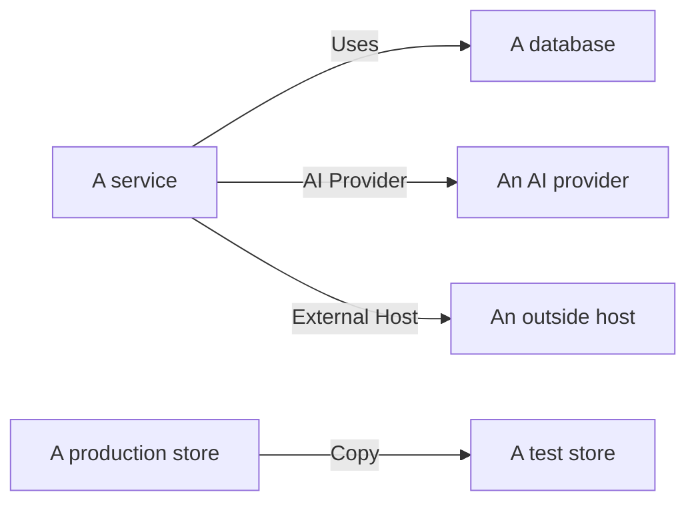

# Data Flows, Access and Residency

Knowing what a store holds is half of it. Data Security also works out where that data goes - which services use the store, which AI providers and outside hosts the data reaches, and where it was copied - who can reach each store, and whether it lives in the regions it may. All of it comes from evidence OneUptime already has: your traces, your cloud's own access settings, and fingerprints of what the scans found.

:::cards
- [Data flows](#data-flows): Services, AI providers, outside hosts and copies.
- [Who can reach a store](#who-can-reach-a-store): Every grant your cloud reports, and how exposed the store is.
- [Residency rules](#residency-rules): The regions each kind of data may live in.
:::

## Data flows

| Flow | What it means | Where it comes from |
| --- | --- | --- |
| **Uses** | A service talks to a store. | The service map, which OneUptime works out from your services' client spans every ten minutes. Each database on it is tied to its store by name, address or endpoint, so a database no other source lists becomes a store of its own. |
| **AI Provider** | A service sends data to an AI provider. | The AI calls in the service's traces of the last 7 days, which name the provider they reach. |
| **External Host** | A service calls a host outside your systems. | The service map's remote services, by the address they are called at. |
| **Copy** | One store holds values of another. | Fingerprints of the values each scan found: two stores share data when their fingerprints of one data type overlap by half or more. |

A flow carries the data types its source holds, and their sensitivity. A flow is confirmed when a scan proved the data is there, not only that there is a path to it: a copy always is, and an AI provider flow is when the service's AI conversations hold Confidential or Restricted data. A flow not seen again for 30 days is dropped.

Two checks read the flows. [Production data was copied into a non-production store](/docs/data-security/checks-and-issues#data-hygiene) fails on the destination of a copy. A copy runs from the production store when only one of the two is in production, and otherwise from the store OneUptime found first. [Sensitive data is being sent to an AI provider](/docs/data-security/checks-and-issues#ai) fails on a service's AI conversations when they hold sensitive data, and names the providers they reached.

### How fingerprints stay private

A copy is found without either store's values. For each data type a scan finds with High confidence, it sketches the values it read as a MinHash: 128 slots, each the smallest of one hash function over the values, of which only the low 16 bits are kept. Two sketches agree on about as many slots as their two sets of values overlap, so comparing sketches estimates how much of one store is in the other.

- **The values are hashed with a key of the project's own** (HMAC-SHA256), so nobody without the key can test a known value against a sketch, and two projects' sketches can never be compared.
- **Only 16 bits of each minimum leave the scan.** No value, and no hash of one, can be read back from a sketch.
- **A sketch is about a data type, not a field.** A store has one for each data type found in it with High confidence, and nothing more.

## Who can reach a store

The configuration read turns each cloud's own access settings - bucket policies and ACLs, Azure role assignments, Google Cloud IAM bindings, snapshot shares - into one list of who can reach the store, on its **Who Can Reach It** page:

| Column | What it says |
| --- | --- |
| **Principal** | Who or what has access, as the cloud names it: `*`, an account id, an ARN, an email, a service account. |
| **Principal Type** | Public, Account, Role, User, Group, Service Principal, Service Account or Service. |
| **Access Level** | Read, Write or Admin. |
| **Granted Via** | What grants it: a bucket policy, an ACL, a role assignment, an IAM binding or a snapshot share. |
| **External** | The principal is outside the accounts, subscriptions and projects connected to OneUptime. |
| **Public** | The principal is anyone on the internet. |

The list is read again with every configuration read, and a grant the cloud no longer reports is removed. [More than 25 identities can read Restricted data](/docs/data-security/checks-and-issues#access) counts the readers on it. The services that use a store are its **Uses** flows.

From what it reads, every store gets an exposure:

| Exposure | What it means |
| --- | --- |
| **Public** | Anyone on the internet can read it. |
| **Other accounts** | Accounts outside your connected ones can reach it. |
| **Internet reachable** | Its network endpoint accepts connections from the internet. |
| **Private** | Only your own accounts and networks reach it. |
| **Unknown** | OneUptime could not read enough of its configuration to tell. |

Public beats shared, and shared beats reachable: a public bucket that is also shared with another account is Public. Exposure adds to an issue's [risk score](/docs/data-security/checks-and-issues#risk-score).

## Residency rules

A residency rule says where a kind of data may live. Add one in **Data Security → Settings → Residency Rules**:

| Field | What it does |
| --- | --- |
| **Name** | What the rule is, such as EU personal data stays in the EU. |
| **Allowed Regions** | The regions that data may be stored and copied in, written the way your cloud names them. A rule with none checks nothing. |
| **Data Categories** | The categories of data it covers. Empty covers every kind of personal data. |
| **Data About People In** | Only data about people in these countries, as ISO 3166-1 codes such as `DE` or `IN`. Empty covers data about people anywhere. |
| **Description** | What the rule is for, such as our EU customers' data is stored in the EU only. |
| **Enabled** | Whether stores are checked against the rule. |

A store breaks a rule when it holds data the rule covers, and its own region, or a region its data is copied to, matches none of the allowed regions. Copies are the regions a store's data is replicated to: S3 replication, a storage account's geo-redundant copy, a database's replicas. The store then fails [Data is stored outside the regions it may live in](/docs/data-security/checks-and-issues#residency), with the region and the rule it broke.

### Regions and wildcards

A `*` in an allowed region stands for any characters, upper and lower case are the same, and the pattern must match the whole region:

| Allowed region | Matches | Does not match |
| --- | --- | --- |
| `eu-*` (AWS) | `eu-west-1`, `eu-central-1` | `us-east-1`, `us-eu-1` |
| `europe-*` (Google Cloud) | `europe-west1`, `europe-north1` | `us-central1` |
| `westeurope` (Azure) | `westeurope` | `northeurope` |

List one pattern for each cloud you use: `eu-*`, `europe-*`, `westeurope` and `northeurope` together keep data in Europe on all three.

### Whose data a store holds

OneUptime reads whose data a store holds from the data itself. A data type that belongs to one country says its people are in that country: a German tax ID says `DE`, an Indian Aadhaar number `IN`, a UK NHS number `GB`. The store lists those countries as its data subject countries, and a rule limited to people in some countries covers only the stores that hold their data. [Sensitive Data Types](/docs/data-security/data-types#built-in-data-types) names the country of every data type that has one.

## Next steps

:::cards
- [Data Security Checks and Issues](/docs/data-security/checks-and-issues): Every check these flows, grants and rules feed.
- [Data Security Compliance](/docs/data-security/compliance): How residency and access count toward GDPR, LGPD and DPDP.
- [Topology](/docs/telemetry/topology): The service map the flows come from.
:::
