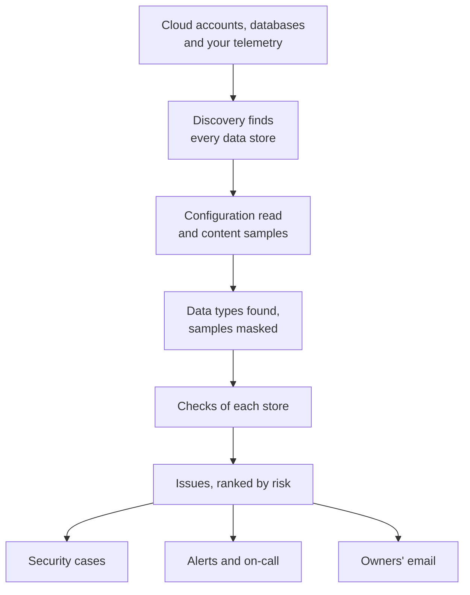

# Data Security

Data Security finds the sensitive data your company keeps - in cloud buckets, databases and warehouses, and in the telemetry you send OneUptime - and tells you what is wrong with how it is kept. It finds the stores on its own, reads how each one is set up, samples what it holds, and opens an issue for each problem, ranked by risk.

It answers four questions:

:::cards
- [Where is our sensitive data?](/docs/data-security/data-types): 143 data types, from card numbers and national IDs to API keys, found in buckets, tables and telemetry.
- [Is it exposed?](/docs/data-security/checks-and-issues): 32 checks of each store: public access, encryption, backups, logging, secrets and copies.
- [Who can reach it, and where does it go?](/docs/data-security/flows-access-residency): Who can read each store, which services use it, and which AI providers and hosts its data reaches.
- [Does it meet our rules?](/docs/data-security/compliance): Residency rules, and nine frameworks scored from what the scans found.
:::

## How it works

1. **Discovery** finds the stores OneUptime already knows of: your cloud inventory, the databases the Database product monitors, the databases your services talk to on the service map, and each service's telemetry. You add a store by hand only when no source lists it.
2. **The configuration read** asks each cloud how every store is set up: who can reach it, how it is encrypted, backed up and logged. It reads settings, never data.
3. **Content samples** read a little of what a store holds, where you allow it: a few objects of each kind in a bucket, some rows of each table, the newest records of each service's telemetry.
4. **Classification** finds sensitive values in the samples, and keeps counts and masked samples, never a value.
5. **Checks** decide what is wrong with each store, and how bad it is for the data it holds. Each failing check opens an issue, which closes by itself once the check passes.

## How it is different

- **Your telemetry is a data store.** Each service's logs, traces, exceptions, session replays and AI conversations are checked like a bucket, every hour. An email address in a log line is a finding, and **Scrub It** masks it at ingest from then on. See [Sensitive Data in Telemetry](/docs/data-security/telemetry).
- **Flows come from real traffic.** The service map says which service uses which database, AI calls name the provider they reach, and copies of production data are found by comparing fingerprints. See [Data Flows, Access and Residency](/docs/data-security/flows-access-residency).
- **Evidence is masked, always.** A finding keeps counts and at most three masked samples, such as `j***@e******.com`, masked inside the scanner before anything leaves it. Turn samples off and it keeps counts only.
- **The scanner is open source.** Every data type's pattern, checksum, context words and test values are in OneUptime's source code, so you can read exactly what makes a finding. The same code runs on OneUptime's workers, on a probe, and in the **Test It** box.
- **It works with the rest of OneUptime.** A Critical issue opens a security case on the store, so [Security Operations](/docs/telemetry/security-cases) works it like any other threat. It can raise an alert that pages whoever is on call, and it emails the store's owners. See [Data Security Integrations](/docs/data-security/integrations).
- **OneUptime AI helps fix it.** **Explain** tells a store's owner what is wrong and how to fix it on their cloud, and **Fix with AI** opens a pull request in your infrastructure code.

## Before you begin

- **A role that can set it up.** Project Owners, Project Admins and Security Admins change Data Security's settings. Security Members work issues and scan stores, and Security Viewers read what it found. Other roles see none of it unless their team is given its permissions: which buckets hold card numbers is exactly what an attacker wants to know. See [Roles](/docs/permissions/reference#roles).
- **A cloud account to read, or a database.** Data Security reads a cloud account through a [cloud connection](/docs/telemetry/cloud-accounts), and a database you run through a read-only connection string. Telemetry needs nothing: it is scanned every hour.

## Quick start

:::steps
### Connect a cloud account

Go to **Cloud → Connect** and pick your cloud. If the account is connected already, choose **Edit** on its connection instead. [Connect a Cloud Account](/docs/telemetry/cloud-accounts) walks through each cloud.

### Choose the data security level

Under **More fields**, set **Data security** to **Configuration only** to check how every store is set up, or to **Configuration and content samples** to also find the sensitive data inside them. The command the form shows changes with your choice: run it in your cloud's shell, as the form says. [Set Up Data Security](/docs/data-security/setup) lists exactly what each level grants, and [Connect a Cloud Account](/docs/telemetry/cloud-accounts#data-security) shows each level's command.

### Review the issues

Open **Data Security**. Stores appear under **Data Stores** as discovery finds them, every 15 minutes, and a connection's configuration is read within the hour. Issues open under **Issues** as soon as a read or a scan finishes, each with its risk score, and the **Overview** shows the five riskiest. Each issue says what is wrong, why it matters and how to fix it, with the commands for your cloud.
:::

## What counts as a data store

| Where | Stores | Content samples |
| --- | --- | --- |
| AWS | AWS S3 Bucket, AWS RDS Instance, AWS Aurora Cluster, AWS RDS Snapshot, AWS DynamoDB Table, AWS Redshift Cluster, AWS DocumentDB Cluster, AWS OpenSearch Domain, AWS ElastiCache Cluster, AWS EFS File System | AWS S3 Bucket |
| Azure | Azure Storage Account, Azure SQL Database, Azure Cosmos DB Account, Azure PostgreSQL Server, Azure MySQL Server | Azure Storage Account |
| Google Cloud | Google Cloud Storage Bucket, Google Cloud SQL Instance, Google BigQuery Dataset, Google Firestore Database, Google Spanner Instance, Google Bigtable Instance | Google Cloud Storage Bucket, Google BigQuery Dataset |
| Databases you run | PostgreSQL, MySQL, MongoDB, SQL Server, Oracle, Redis, Elasticsearch | PostgreSQL, MySQL |
| OneUptime | Logs, Traces, Exceptions, Session Replays, AI Conversations | Logs, Traces, Exceptions, Session Replays, AI Conversations |

Every store gets the checks that apply to its kind. A store whose content cannot be sampled is still checked: a public bucket or an unencrypted database is a problem whatever it holds.

A store is archived, with its history, once its source no longer lists it: **Archived Stores**, at the end of Data Security's menu, keeps it. It comes back by itself if its source lists it again.

## How often it runs

| What | When |
| --- | --- |
| Find new stores | Every 15 minutes |
| Read a cloud connection's configuration | Once a day, and within the hour after CloudTrail records a change to an AWS store's access, encryption, backups or sharing |
| Sample a store's content | Every 24 hours, or as often as **Scan Every (Hours)** says |
| Sample each service's telemetry | Every hour, the last hour of it |
| Check every store again | After every read and scan, after you change anything a check depends on, and once a day |

**Scan Now** on a store samples its content at once, and **Check Now** reads its configuration again.

## Next steps

:::cards
- [Set Up Data Security](/docs/data-security/setup): The three levels, the permissions each one grants, and scanning your own databases.
- [Sensitive Data Types](/docs/data-security/data-types): How a value is found, and every data type Data Security knows.
- [Data Security Checks and Issues](/docs/data-security/checks-and-issues): Every check, the risk score and what happens to an issue.
- [Data Security Integrations](/docs/data-security/integrations): Security cases, alerts, owners, workflows and OneUptime AI.
:::
