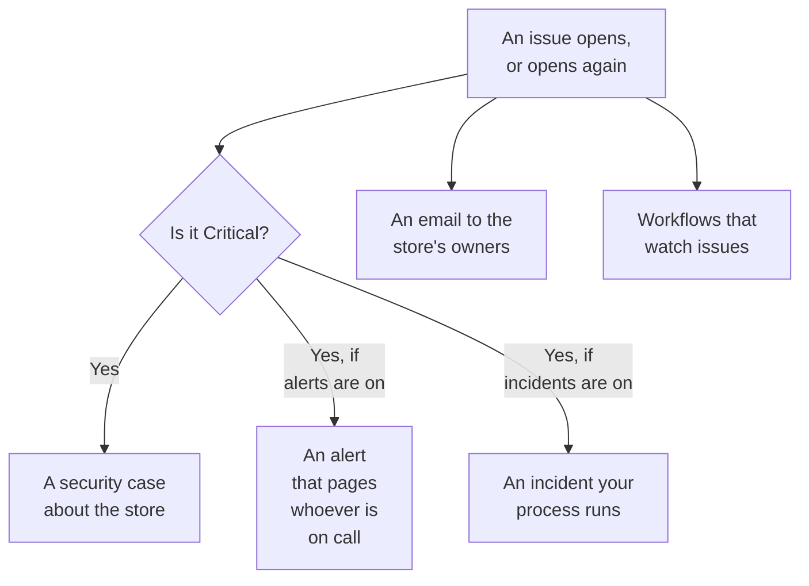

# Data Security Integrations

Data Security does not run a pager or a security queue of its own. It hands what it finds to the parts of OneUptime that already do: a Critical issue becomes a security case, it can page whoever is on call or declare an incident, and every new issue is emailed to the store's owners. Workflows, OneUptime AI, the API, Terraform and the MCP server reach everything it keeps.

:::cards
- [Security Operations](#security-operations): A security case for every store with a Critical issue.
- [Alerts and on-call](#alerts-and-on-call): Page whoever is on call when a Critical issue opens.
- [Incidents](#incidents): Declare an incident for a breach your incident process should run.
- [Owners](#owners): Who owns each store, set by hand or by rules, and the email they get.
- [OneUptime AI](#oneuptime-ai): Explain an issue, open a pull request that fixes it, or ask Ask AI about your data.
- [Close an exposure](#close-an-exposure): Block public access or stop sharing, from an issue or a playbook.
:::

## How it works

Each of these runs when an evaluation opens an issue, or opens one again. Each is best effort: the issue is open and on its timeline already, so an integration that fails is logged and skipped, never retried into a second case or a second page. What each one did is written to the issue's **Timeline**, and the issue's page links to the case, the alert and the incident it started.

| Setting | Default | What it does |
| --- | --- | --- |
| **Open Security Cases** | On | A Critical issue opens a security case, grouped by store. |
| **Raise Alerts** | Off | A Critical issue raises an alert, which pages whoever is on call. |
| **Alert Severity** | Empty | The severity of those alerts. Empty is the project's most severe. |
| **Declare Incidents** | Off | A Critical issue declares an incident, which your incident process runs. |
| **Incident Severity** | Empty | The severity of those incidents. Empty is the project's most severe. |
| **Notify Owners** | On | Every new issue is emailed to its store's owners. |

## Security Operations

Every store is an entity of its own in Security Operations, of the type **Data Store**. With **Open Security Cases** on, a Critical issue is sent to Security Operations as a detection about the store:

- its source is **Data Security**, and its rule is named after the check, such as `Data Security: public-read`;
- it is Critical, so the case it opens is at the project's Critical priority;
- it is grouped by the store: a second Critical issue on the same store joins the open case about it instead of opening another.

From there the case is worked like any other: assigned, noted, closed, and answered by the project's playbooks. The store's detections count toward its risk on [Entity Risk](/docs/telemetry/security-entity-risk), as any entity's do. See [Security Cases and Playbooks](/docs/telemetry/security-cases).

## Alerts and on-call

With **Raise Alerts** on, a Critical issue raises an alert, named "Data Security:" and the issue's title and store. The alert pages whoever is on call through its own rules, like any other alert (see [Alerts](/docs/alerts/index) and [On-Call](/docs/on-call/index)). An issue has at most one open alert at a time, however often it is evaluated. **Alert Severity** sets the alert's severity; left empty, it is the project's most severe.

An alert ends with its issue: once the issue is no longer open - its check passes, or a person marks it resolved, accepts its risk or says it is not an issue - the alert is resolved, and the issue's **Timeline** says so. An issue that opens again raises a new alert.

Alerts are off by default because a security case is where most teams want a data security finding first. Turn them on when a public bucket of card numbers should wake someone up.

## Incidents

With **Declare Incidents** on, a Critical issue declares an incident, named like its alert, for a breach your incident process should run: on-call, workspace channels, status pages and a postmortem (see [Incidents](/docs/incidents/index)). An issue has at most one open incident at a time. **Incident Severity** sets the incident's severity; left empty, it is the project's most severe.

Data Security never resolves an incident, even once its issue is resolved: an incident can carry a status page and a postmortem, so whoever runs it closes it. A security case is the other way to an incident: **Declare Incident** on the case opens one linked to it (see [Declare an incident](/docs/telemetry/security-cases#declare-an-incident)).

## Owners

A store's owners are people and teams, on the store's **Owners** page. They are who an issue is for: they get the email, and **Nobody owns this sensitive store** fails on a sensitive store that has none.

With **Notify Owners** on, each evaluation that opens issues on a store sends its owners one email - the people who own it, and the members of the teams that do, up to 50 - titled with how many new issues the store has, such as "Data Security: 2 new issues on orders-db". It lists each new issue's severity and title and the store's sensitivity, and links to the store. It never carries a sample.

### Owner rules and label rules

Rules set owners and labels for you, as stores are found:

| Rule | Where | What it does |
| --- | --- | --- |
| **Owner Rules** | **Data Security → Rules → Owner Rules** | Adds owner users and teams to every store that matches |
| **Label Rules** | **Data Security → Rules → Label Rules** | Adds labels to every store that matches |

A rule matches a store by its labels, by a pattern of its name or its description, or by **Cloud Tag Pattern**: a pattern matched against each of the store's cloud tags, written `key=value`. `^team=payments$` matches every store tagged `team=payments`, and `^env=` every store with an `env` tag. A new store gets the project's rules the moment it is found, and an owner rule's **Notify Owners** says whether the owners it adds are told. [Label and Owner Rules](/docs/configuration/label-and-owner-rules) says how every rule matches and when rules run.

## Workflows

**Data Store** and **Data Security Issue** are workflow triggers, each with **On Create**, **On Update**, **On Create or Update** and **On Delete**. Pick them in the **Add Trigger** panel, under **OneUptime resources**.

- **Data Security Issue → On Create** runs when an issue opens for the first time. Read its severity in an **If / Else** block, and post Critical ones to a channel or open a ticket in your tracker.
- **Data Security Issue → On Update**, with **Fields to watch** set to its status, runs when an issue is resolved, accepted or opens again.
- **Data Store → On Create** runs when discovery finds a store, for example to tell a team about every new bucket.

See [Workflow Triggers](/docs/workflows/triggers) for the fields each trigger passes on.

## OneUptime AI

Two actions on an issue ask OneUptime AI for help. Both send OneUptime AI the issue's title and severity, the store's name, kind, region and cloud id, its sensitivity and data types, the evidence, why the check matters and the fix for the store's cloud - never a finding's samples. Both run under the project's OneUptime AI switches and limits.

- **Explain with AI** writes, for the store's owner, what is wrong, what could happen and the exact steps to fix it on their cloud. The explanation is kept on the issue's **Timeline**. Anyone who can read Data Security can ask.
- **Fix with AI** asks OneUptime AI to fix the issue in your infrastructure code - Terraform, CloudFormation, Bicep or the like - with the smallest change that makes the check pass, and to open a pull request. It needs the repository that holds the store's infrastructure code connected under **Code**: choose it under **Repository** when the project has several. The pull request appears under **Code** (see [Code](/docs/ai/ai-agent)). Security Members and above can ask.

### Ask AI

**Ask AI** reads Data Security too. On any Data Security page, ask which stores hold card numbers, what to fix first, or which stores a role could reach if it leaked; on a store's or an issue's page it reads that record first. It answers with three read tools, run with your own permissions:

| Tool | What it reads |
| --- | --- |
| `query_data_stores` | The stores, riskiest first, by sensitivity, data type, exposure, provider or name - or one store with what was found where, who can reach it and its open issues |
| `query_data_security_issues` | The issues, riskiest first, by status, severity, store or check - or one issue with its evidence and the fix for its cloud |
| `query_data_store_access` | Who can reach a store, or every store one principal can reach |

They read data types, locations and counts, never a finding's samples, masked or not. Ask AI changes nothing in Data Security.

## Close an exposure

Two changes close a cloud store's exposure, each through the store's cloud connection with **Data security response** turned on (see [Set Up Data Security](/docs/data-security/setup#let-data-security-close-an-exposure)):

- **Block public access**, on an S3 bucket, an Azure storage account or a Cloud Storage bucket.
- **Revoke sharing**, on an RDS snapshot, or on the shared manual snapshots of an RDS database, an Aurora cluster or a DocumentDB cluster.

A person runs one from an open issue it fixes, with **Fix it from here** (see [Data Security Checks and Issues](/docs/data-security/checks-and-issues#fix-it-from-here)). A Security Operations playbook runs them as steps of the **Contain** category, **Block public access to data stores** and **Revoke data store sharing**: on every data store the case is about, at most 10, each a step that starts with **Needs Approval** on. A store marked **Public By Design** is never blocked. Either way the store's feed says what was done, and the store is checked again at once, so the issue resolves when the change took.

## API, Terraform and MCP

Everything Data Security keeps is a record of the OneUptime API, read with the same permissions as in the dashboard (see the [API Reference](/docs/api-reference/api-reference)):

| Records | API path |
| --- | --- |
| Data stores, their timelines, their findings and who can reach them | `/data-store`, `/data-store-feed`, `/data-store-finding`, `/data-store-access` |
| Issues, their timelines and data flows | `/data-security-issue`, `/data-security-issue-feed`, `/data-security-flow` |
| Scans | `/data-security-scan` |
| Custom data types, check settings and residency rules | `/data-security-custom-data-type`, `/data-security-check-setting`, `/data-security-residency-rule` |
| The project's settings | `/data-security-setting` |
| Owners, owner rules and label rules | `/data-store-owner-user`, `/data-store-owner-team`, `/data-store-owner-rule`, `/data-store-label-rule` |

A few answers are worked out on request rather than stored. Each is a `POST`:

| Path | What it does |
| --- | --- |
| `/data-security/overview` | The Overview's figures: stores by sensitivity and category, open issues by severity, the riskiest issues and the last 30 days of them |
| `/data-security/compliance` | Every framework's score and requirements |
| `/data-security/record-of-processing` | The GDPR record of processing, a row for each store that holds personal data |
| `/data-store/<id>/scan-now` | **Scan Now**: samples the store's content now |
| `/data-store/<id>/check-now` | **Check Now**: reads the store's configuration again and runs its checks |
| `/data-store-finding/<id>/scrub` | **Scrub It** on a telemetry finding |
| `/data-security-issue/<id>/explain` | **Explain with AI** on an issue |
| `/data-security-issue/<id>/fix-with-ai` | **Fix with AI** on an issue |
| `/data-store/<id>/response-actions` | Which response actions the store can take now, and why not |
| `/data-store/<id>/respond` | **Block Public Access** or **Revoke Sharing** on the store, with the issue it was run from |

The [Terraform provider](/docs/terraform/index) has a resource for each kind of record you create - data stores you add yourself, custom data types, check settings, residency rules, owner and label rules - named after the record, such as `oneuptime_residency_rule`.

The [MCP server](/docs/ai/mcp-server) has create, get, list, update, delete and count tools for these records: Data Store, Data Store Finding, Data Store Access Entry, Data Flow, Data Security Issue, Data Security Scan, Custom Data Type, Check Setting, Residency Rule and Data Security Setting. An AI assistant can then ask which stores hold card numbers, or what is open on a bucket, with your permissions.

## Next steps

:::cards
- [Security Cases and Playbooks (SOAR)](/docs/telemetry/security-cases): Work the cases Data Security opens.
- [Label and Owner Rules](/docs/configuration/label-and-owner-rules): How rules match, and when they run.
- [Workflow Triggers](/docs/workflows/triggers): Run a workflow when an issue opens or a store is found.
- [Data Security Checks and Issues](/docs/data-security/checks-and-issues): What every issue means, and how to fix it.
:::
