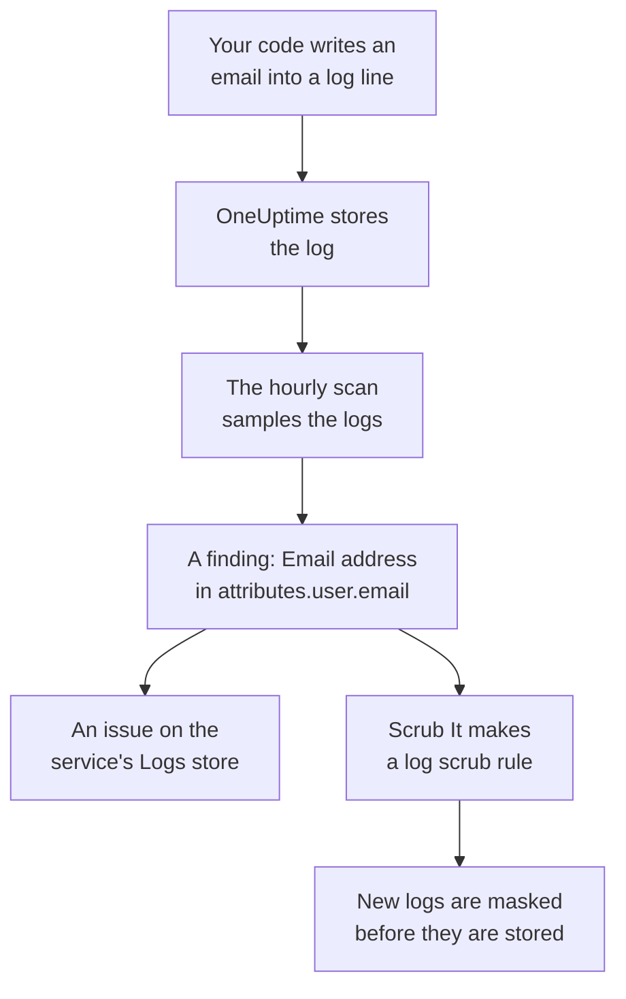

# Sensitive Data in Telemetry

Telemetry holds whatever your code writes: an email address in a log line, a card number in a span attribute, a token in a stack trace, a customer's question in a prompt, a user's IP address in a metric's label. Data Security treats each service's logs, traces, metrics, exceptions and AI conversations, and each RUM application's sessions, as data stores of their own. It samples them every hour, finds sensitive data in them as it does in a bucket, and **Scrub It** turns a finding into a rule that hides that data at ingest from then on, in the service it was found in.

There is nothing to set up: each service's telemetry is scanned every hour, unless **Scan Telemetry** is off in the project's settings. To leave one service's logs, traces or another of its signals out, turn **Scan Content** off in that store's **Settings**: from the next scan, none of it is read.

:::cards
- [What is read](#what-is-read): The attributes, bodies, messages and prompts of each signal.
- [How a scan samples](#how-a-scan-samples): The newest records of each service, every hour.
- [Scrub It](#scrub-it): Hide a finding at ingest, in the service it was found in.
- [Drop This Metric](#drop-this-metric): Stop storing the metrics whose names hold sensitive data.
- [What counts as scrubbed](#what-counts-as-scrubbed): When a scrub rule already covers a finding.
:::

## How it works

A finding a scrub rule covers is marked scrubbed: what is left of that data is old data waiting for its retention, not a leak still flowing. The two telemetry checks count only what no rule covers, so their issue resolves once every finding is scrubbed (see [Telemetry checks](/docs/data-security/checks-and-issues#telemetry)).

## What is read

| Store | What is read | Where a finding points |
| --- | --- | --- |
| Logs | Every attribute, and the body | `attributes.<key>`, `body` |
| Traces | Every span attribute, and every span event's attributes | `attributes.<key>`, `events.<event>.<key>` |
| Exceptions | The message, the stack trace and the attributes | `message`, `stackTrace`, `attributes.<key>` |
| AI Conversations | The prompts and answers of every AI call, under the keys the GenAI conventions put them in, and every other attribute | The key they are in, such as `gen_ai.input.messages` or `gen_ai.prompt[].content` |
| Session Replays | The attributes of a RUM application's spans and logs, its sessions' attributes, the traits `identify()` gave its users and the user reference it was told | `spans.attributes.<key>`, `logs.attributes.<key>`, `sessions.attributes.<key>`, `sessions.identifiedUserTraits.<key>`, `sessions.identifiedUserLabel` |
| Metrics | Every attribute of a data point, its resource's among them, and the metrics' names | `attributes.<key>`, `attributes.resource.<key>`, `name` |

Numbered keys are folded into one location: `gen_ai.prompt.3.content` is `gen_ai.prompt[].content`, so the twenty messages of a chat are one finding, not twenty. Attributes OneUptime adds itself, which start with `oneuptime.`, are not read.

### Metrics

A metric's attributes are its series' labels. They are the same on every data point of a series, so a metric that writes a thousand points a minute may hold three values, and a label that leaks a user's email adds a series, not a point. So a metric is sampled by its series, not by its points:

- **A point of each series.** Each metric is read at the newest minute it wrote in the last hour: one data point of each of up to 100 of that minute's series, however often the metric is sent, so a busy series never crowds out a quiet one. A value is classified once, however many series repeat it, so a finding counts the distinct values at its place.
- **New metrics first, then the rest in turn.** Which metrics a service wrote, and when each first wrote in the last day, comes from the per-minute rollup the metrics table keeps, never from its points. Each scan reads a service's busiest metrics, the likeliest to have many series. Then come the metrics it started writing in the last 2 hours, since new code is where a new leak usually comes from, and then the next of its other metrics, in a fixed order, from where the last scan stopped. New metrics take at most half of those turns, so the others always keep theirs.
- **Every metric within a set time.** A scan gives each service 10 of its reads, fewer when the project has more than 10 services. The reads a service leaves unused, because it has fewer metrics, go to the services that still have metrics waiting their turn, one at a time, so none is wasted and no service gets less than its share. A service's busiest 5 take 5 of its reads, and the rest read its other metrics in turn: a service of M metrics that gets r reads in turn has each of them read at least once every M ÷ r hours, rounded up. That is 60 hours for a service of 300 metrics that gets only its own 5, and 11 hours when two other services of 300 metrics share its project, as each then gets 28 or 29. While it keeps starting new metrics every hour, it is at most twice that.
- **Each metric's own range.** The metrics are read together, each by its own range of the table's primary key. A metric whose newest minute holds more than 16,384 points, such as one labeled with each user's email, is read on its own, and the read stops at its first points, so it costs no more than any other metric.

A finding names the attribute, such as `attributes.user.email`, or `name` for data in a metric's name. Its records are the data points it was found in: each shows its metric and the attribute's value, masked, and opens in **Metrics** on that metric, grouped by that attribute. Where a metric's name holds sensitive data, the name is masked too, and the record opens the service's metrics instead.

### Why a replay's recording is never read

A session replay's recording holds the text of the pages people saw. Watching it takes a permission of its own, and a finding read out of it would show masked page text to everyone who can read Data Security. So a replay is read by its attributes only: the spans, logs and session details beside the recording. The recorder already masks what it records in the browser, and log scrub rules run over recordings too (see [Session Replay](/docs/telemetry/session-replay)).

### AI conversations

An AI call's prompt carries the whole chat before the person's newest message, so up to 16,384 characters of each value of an AI call are read. When AI conversations hold sensitive data, two more things follow: the AI provider the calls went to is a flow of that data, and [Sensitive data is being sent to an AI provider](/docs/data-security/checks-and-issues#ai) fails on the store.

The conversations of a [company AI tool](/docs/telemetry/ai-company-tools) are left out. Only Project Owners and Project Admins may read them, and a finding lands where everyone who reads Data Security reads it, so those services' spans are never read, and their AI conversations are reported as not read.

## How a scan samples

Every hour, each signal's newest records of the last hour are read, and classified field by field as any other store's are (see [Fields and columns](/docs/data-security/data-types#fields-and-columns)):

| Limit | Value |
| --- | --- |
| Records of each service and signal | **Telemetry Sample Size**, 500 by default, never more than 1,000 |
| Services or RUM applications read per signal | The 200 busiest |
| Records in one read | 5,000, shared between the services; 500 for AI calls |
| Characters of a log body, an exception message or a stack trace | 8,192 |
| Characters of an attribute value | 4,096 |
| Characters of a value of an AI call | 16,384 |
| Attributes of one record | 128; 64 for an AI call |
| Events of one span, and attributes of one event | 16 and 32 |
| Locations of one store | 500 |
| Metrics read in one scan | 100 shared between the services, at least one of each; 10 of each service, half its busiest and half its new and other metrics in turn, and the reads a service leaves unused go to the others, in turn |
| A new metric | One whose first point of the last 24 hours came in the last 2 hours |
| Series of one metric | A data point of each, of its newest minute, at most 100 |

Every value is cut short in the database, so no long value leaves it, and each read stops after 30 seconds. A read that fails is a warning on the stores it was for; the scan goes on with the next one.

To leave something out, add it to the store's **Scan Exclusions**: a location named whole (`attributes.http.url`), everything under one (`attributes.http`), or an attribute key named bare (`http.url`).

## Scrub It

**Scrub It** on a finding makes the rule that hides that data type at that location from then on, or points at the enabled rule that already does:

:::steps
### Open the finding

Open the issue - **Where It Was Found** lists each finding behind it - or **Data Security > In Your Telemetry**, where **Show Records** opens the records a finding was found in beside the list.

### Press Scrub It

Click **Scrub It**. A dialog says what the rule would do before anything is made: whose records it changes, what it does with what it finds, and what reads the values it would hide. Click **Scrub It** in it to make the rule. OneUptime makes a log scrub rule for logs and a RUM application's logs, a trace scrub rule for spans, exceptions and AI calls, on the part of the record the finding is in, and a metric pipeline rule for a metric's attribute.

### Fix the code too

The rule hides new data before it is stored. Data already stored stays until its retention ends, so fix the code that writes it: the finding names the service and the attribute, and on the issue's page **Show the records it was seen in** shows the log lines, spans, exceptions, sessions or metric data points it was found in, the data highlighted in each (see [Where a telemetry issue's data was found](/docs/data-security/checks-and-issues#where-a-telemetry-issues-data-was-found)).
:::

The rule is named for what it hides, such as "Data Security: Email address in log attributes of checkout", and is listed with your other scrub rules (see [Drop Filters & Scrub Rules](/docs/telemetry/drop-filters-and-scrub-rules#scrub-sensitive-data)). It is one of these:

| Finding | Rule Scrub It makes |
| --- | --- |
| Email address, card number, US Social Security number, phone number or IP address | The built-in pattern of that type. Card numbers, Social Security numbers and phone numbers are masked, the rest redacted. |
| A value under a key that looks sensitive, such as `password` or `token` | A **Sensitive Attribute Keys** rule, which redacts the whole value of every such attribute |
| Any other data type a pattern can find | A **Custom Regex** rule made from the data type's own patterns, which redacts every value of its shape |
| Any data type in a metric's attribute | A **Redact Attribute** metric pipeline rule for the service, which replaces the attribute's values of the data type's shape with `[REDACTED]`, or every value of the attribute where no pattern finds the data type |

A log or trace rule is for the service the finding was found in: it scrubs that service's logs or spans, and other services' stay as they are, so nothing that reads theirs changes. The scrub rules list's **Scope** column says which service a rule is for. A finding in a RUM application's session replays makes a rule for every service and app of the project, since log rules scrub replays too, and the dialog says so. If the service no longer exists, **Scrub It** says so and makes no rule.

The dialog names, each as a link, the monitors, dashboards with their widgets, saved views, recording rules and SLOs that read the values the rule would hide, and what happens to them: a filter on a hidden value stops matching, and a group by one no longer shows the real values. It also says what [Security Events](/docs/telemetry/security-events) would lose when it reads those records: with IP addresses hidden, its events cannot name the address to block. What you cannot see is counted, never named. The dialog never stops the rule: it says, and you decide. The scrub rule forms show the same before a rule is saved or turned on.

Some findings cannot be scrubbed by a rule, and **Scrub It** says why. A metric's attribute always can be, since its rule can hide every value of the attribute:

- A data type found from field names alone, such as a person's name: no pattern can find it. Rename the attribute to a key a sensitive-keys rule hides, or stop sending it.
- A data type told apart from other values only by the words around it, such as a routing number: a rule would hide far more than that data type.
- A document marking: hiding the word would not hide the document.
- One of your own data types: add a custom scrub rule with its pattern yourself.
- A session's own details (`sessions.*`): session replay ingest runs no scrub rules.
- A metric's name (`name`): the code that creates the metric sets it, and a pipeline rule can only rename a metric whole. Rename the metric, and send what varies in its name as an attribute instead. Until then, **Drop This Metric** can stop storing those metrics.

**Scrub It** makes the rule as you, under your own permissions: Project Owners and Project Admins can press it, and so can a team that may create log scrub rules, trace scrub rules for spans, exceptions and AI calls, and metric pipeline rules for metrics.

## Drop This Metric

No rule takes the data out of a metric's name, so until the code that names the metric is fixed, the data keeps arriving. **Drop This Metric** on a finding in a metric's name stops storing the metrics whose names hold it, at the cost of their data, so it only happens when you ask for it:

- **One service's metrics.** It makes a **Drop** metric pipeline rule for the finding's service: every new data point of a metric whose name holds that data type is dropped before it is stored. Its filter is the pattern **Scrub It** uses for the type, so a type no pattern can find, such as a person's name, cannot be dropped, and the dialog says why.
- **Said before it is done.** The dialog says that those data points are lost for good, how many of the service's metrics written in the last day have such a name, what reads them and so gets no new data, that what is stored already stays until its retention ends, and how to undo it. Nothing is dropped until you tick that you understand.
- **What reads them, and what happens to it.** The dialog names, each as a link, every monitor, every dashboard with its widgets that read those metrics, every Metric SLO of the service and every metric recording rule that reads them. Monitors can no longer alert on their values, widgets show no new data, SLOs count no new events from them, and recording rules' output metrics no longer include them. Under each recording rule, it also names what reads the rule's output metric, and what reads theirs in turn, up to three output metrics down the chain. A widget's link opens its dashboard at that widget. What you cannot see is counted, never named.
- **As you, on the record.** The rule is made under your own permission to create metric pipeline rules: Project Owners and Project Admins can make it, and so can a team that may create metric pipeline rules. The audit log records who made it.
- **Undone by deleting the rule.** The rule is named for what it drops, such as "Data Security: drop metrics named with Email address", and listed with your other metric pipeline rules under **Metrics → Settings → Pipeline Rules**. Delete it or turn it off, and those metrics are stored again from then on. What was dropped meanwhile does not come back.

The finding is then marked **Dropped**, and counts as scrubbed: no more of that data is stored.

## What counts as scrubbed

A finding is marked scrubbed only when ingest would run an enabled rule over it and the rule would find its data type:

- **The right records.** Log rules cover logs and a RUM application's logs. Trace rules cover spans, exceptions and AI calls: an exception is a copy of its span's exception event, so the rules that scrub events scrub it.
- **The right part.** The rule's **Fields to Scrub** include the part of the record the finding is in, or the rule leaves them at their default.
- **The right service.** A log or trace rule for one service covers only that service's findings. A rule for no service covers every service's.
- **A pattern that finds the type.** A built-in **Pattern Type** finds its own data type: **Email Address** finds email addresses, **Credit Card Number** card numbers, **SSN (Social Security Number)** US Social Security numbers, **Phone Number** phone numbers and **IP Address** IP addresses. **Sensitive Attribute Keys** covers every value under a key that looks sensitive, whatever the value is.
- **Your own custom patterns never count.** A **Custom Regex** covers a finding only when it is exactly the pattern **Scrub It** makes for its type. A finding keeps only masked samples, which no pattern can be tried on, so OneUptime could not prove that your pattern hides the data, and a finding wrongly called scrubbed is a leak nobody looks at.
- **A metric's attribute.** A **Redact Attribute** or **Remove Attribute** metric pipeline rule of that attribute's key, for the finding's service or the whole project, covers it when it has no filter, or exactly the filter **Scrub It** makes. A filter you wrote never counts, for the same reason.
- **A metric's name.** A **Drop** metric pipeline rule for the finding's service or the whole project covers it when it has exactly the filter **Drop This Metric** makes, or no filter at all, which stores none of the service's metrics. Such a rule with no filter covers every finding in those metrics.

A rule that is turned off, or that scrubs nothing, never counts. Coverage is worked out again after every scan, so a rule you add or remove by hand changes what is marked scrubbed within the hour.

## Next steps

:::cards
- [Drop Filters & Scrub Rules](/docs/telemetry/drop-filters-and-scrub-rules): Every scrub rule option, and the rules you write yourself.
- [Data Security Checks and Issues](/docs/data-security/checks-and-issues): The two telemetry checks and the AI checks.
- [Data Flows, Access and Residency](/docs/data-security/flows-access-residency): The AI providers and hosts your services send data to.
:::
