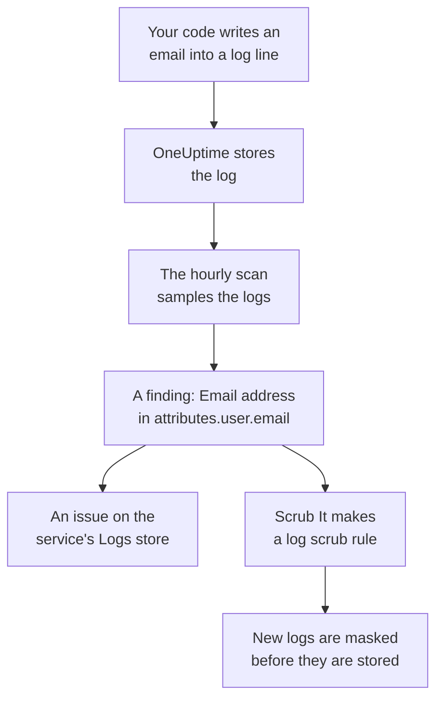

# Sensitive Data in Telemetry

Telemetry holds whatever your code writes: an email address in a log line, a card number in a span attribute, a token in a stack trace, a customer's question in a prompt. Data Security treats each service's logs, traces, exceptions and AI conversations, and each RUM application's sessions, as data stores of their own. It samples them every hour, finds sensitive data in them as it does in a bucket, and **Scrub It** turns a finding into a scrub rule that masks that data at ingest from then on.

There is nothing to set up: each service's telemetry is scanned every hour, unless **Scan Telemetry** is off in the project's settings.

:::cards
- [What is read](#what-is-read): The attributes, bodies, messages and prompts of each signal.
- [How a scan samples](#how-a-scan-samples): The newest records of each service, every hour.
- [Scrub It](#scrub-it): Mask a finding at ingest, with one click.
- [What counts as scrubbed](#what-counts-as-scrubbed): When a scrub rule already covers a finding.
:::

## How it works

A finding a scrub rule covers is marked scrubbed: what is left of that data is old data waiting for its retention, not a leak still flowing. The two telemetry checks count only what no rule covers, so their issue resolves once every finding is scrubbed (see [Telemetry checks](/docs/data-security/checks-and-issues#telemetry)).

## What is read

| Store | What is read | Where a finding points |
| --- | --- | --- |
| Logs | Every attribute, and the body | `attributes.<key>`, `body` |
| Traces | Every span attribute, and every span event's attributes | `attributes.<key>`, `events.<event>.<key>` |
| Exceptions | The message, the stack trace and the attributes | `message`, `stackTrace`, `attributes.<key>` |
| AI Conversations | The prompts and answers of every AI call, under the keys the GenAI conventions put them in, and every other attribute | The key they are in, such as `gen_ai.input.messages` or `gen_ai.prompt[].content` |
| Session Replays | The attributes of a RUM application's spans and logs, its sessions' attributes, the traits `identify()` gave its users and the user reference it was told | `spans.attributes.<key>`, `logs.attributes.<key>`, `sessions.attributes.<key>`, `sessions.identifiedUserTraits.<key>`, `sessions.identifiedUserLabel` |

Numbered keys are folded into one location: `gen_ai.prompt.3.content` is `gen_ai.prompt[].content`, so the twenty messages of a chat are one finding, not twenty. Attributes OneUptime adds itself, which start with `oneuptime.`, are not read.

### Why a replay's recording is never read

A session replay's recording holds the text of the pages people saw. Watching it takes a permission of its own, and a finding read out of it would show masked page text to everyone who can read Data Security. So a replay is read by its attributes only: the spans, logs and session details beside the recording. The recorder already masks what it records in the browser, and log scrub rules run over recordings too (see [Session Replay](/docs/telemetry/session-replay)).

### AI conversations

An AI call's prompt carries the whole chat before the person's newest message, so up to 16,384 characters of each value of an AI call are read. When AI conversations hold sensitive data, two more things follow: the AI provider the calls went to is a flow of that data, and [Sensitive data is being sent to an AI provider](/docs/data-security/checks-and-issues#ai) fails on the store.

The conversations of a [company AI tool](/docs/telemetry/ai-company-tools) are left out. Only Project Owners and Project Admins may read them, and a finding lands where everyone who reads Data Security reads it, so those services' spans are never read, and their AI conversations are reported as not read.

## How a scan samples

Every hour, each signal's newest records of the last hour are read, and classified field by field as any other store's are (see [Fields and columns](/docs/data-security/data-types#fields-and-columns)):

| Limit | Value |
| --- | --- |
| Records of each service and signal | **Telemetry Sample Size**, 500 by default, never more than 1,000 |
| Services or RUM applications read per signal | The 200 busiest |
| Records in one read | 5,000, shared between the services; 500 for AI calls |
| Characters of a log body, an exception message or a stack trace | 8,192 |
| Characters of an attribute value | 4,096 |
| Characters of a value of an AI call | 16,384 |
| Attributes of one record | 128; 64 for an AI call |
| Events of one span, and attributes of one event | 16 and 32 |
| Locations of one store | 500 |

Every value is cut short in the database, so no long value leaves it, and each read stops after 30 seconds. A read that fails is a warning on the stores it was for; the scan goes on with the next one.

To leave something out, add it to the store's **Scan Exclusions**: a location named whole (`attributes.http.url`), everything under one (`attributes.http`), or an attribute key named bare (`http.url`).

## Scrub It

**Scrub It** on a finding makes the scrub rule that hides that data type at that location from then on, or points at the enabled rule that already does:

:::steps
### Open the finding

Open the telemetry store - a service's **Logs**, for example - and the finding.

### Press Scrub It

Click **Scrub It**. OneUptime makes a log scrub rule for logs and a RUM application's logs, and a trace scrub rule for spans, exceptions and AI calls, on the part of the record the finding is in.

### Fix the code too

The rule masks new data before it is stored. Data already stored stays until its retention ends, so fix the code that writes it: the finding names the service and the attribute.
:::

The rule is named for what it hides, such as "Data Security: Email address in attributes.user.email", and is listed with your other scrub rules (see [Drop Filters & Scrub Rules](/docs/telemetry/drop-filters-and-scrub-rules#scrub-sensitive-data)). It is one of these:

| Finding | Rule Scrub It makes |
| --- | --- |
| Email address, card number, US Social Security number, phone number or IP address | The built-in pattern of that type. Card numbers, Social Security numbers and phone numbers are masked, the rest redacted. |
| A value under a key that looks sensitive, such as `password` or `token` | A **Sensitive Attribute Keys** rule, which redacts the whole value of every such attribute |
| Any other data type a pattern can find | A **Custom Regex** rule made from the data type's own patterns, which redacts every value of its shape |

Some findings cannot be scrubbed by a rule, and **Scrub It** says why:

- A data type found from field names alone, such as a person's name: no pattern can find it. Rename the attribute to a key a sensitive-keys rule hides, or stop sending it.
- A data type told apart from other values only by the words around it, such as a routing number: a rule would hide far more than that data type.
- A document marking: hiding the word would not hide the document.
- One of your own data types: add a custom scrub rule with its pattern yourself.
- A session's own details (`sessions.*`): session replay ingest runs no scrub rules.

**Scrub It** makes the rule as you, under your own permissions: Project Owners and Project Admins can press it, and so can a team that may create log scrub rules, and trace scrub rules for spans, exceptions and AI calls.

## What counts as scrubbed

A finding is marked scrubbed only when ingest would run an enabled rule over it and the rule would find its data type:

- **The right records.** Log rules cover logs and a RUM application's logs. Trace rules cover spans, exceptions and AI calls: an exception is a copy of its span's exception event, so the rules that scrub events scrub it.
- **The right part.** The rule's **Fields to Scrub** include the part of the record the finding is in, or the rule leaves them at their default.
- **A pattern that finds the type.** A built-in **Pattern Type** finds its own data type: **Email Address** finds email addresses, **Credit Card Number** card numbers, **SSN (Social Security Number)** US Social Security numbers, **Phone Number** phone numbers and **IP Address** IP addresses. **Sensitive Attribute Keys** covers every value under a key that looks sensitive, whatever the value is.
- **Your own custom patterns never count.** A **Custom Regex** covers a finding only when it is exactly the pattern **Scrub It** makes for its type. A finding keeps only masked samples, which no pattern can be tried on, so OneUptime could not prove that your pattern hides the data, and a finding wrongly called scrubbed is a leak nobody looks at.

A rule that is turned off, or that scrubs nothing, never counts. Coverage is worked out again after every scan, so a rule you add or remove by hand changes what is marked scrubbed within the hour.

## Next steps

:::cards
- [Drop Filters & Scrub Rules](/docs/telemetry/drop-filters-and-scrub-rules): Every scrub rule option, and the rules you write yourself.
- [Data Security Checks and Issues](/docs/data-security/checks-and-issues): The two telemetry checks and the AI checks.
- [Data Flows, Access and Residency](/docs/data-security/flows-access-residency): The AI providers and hosts your services send data to.
:::
