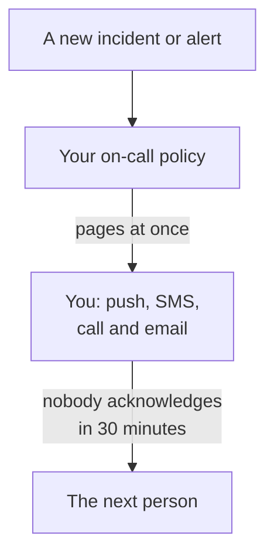

# Get Paged by Phone, SMS or Push

At the end of this guide, every new incident and alert in your project pages you on your phone, by push notification, text message or phone call, the next person is paged if nobody acknowledges within 30 minutes, and a test page you acknowledged shows that it works. It follows the guided setup **Page the right person when something breaks**, and takes about 10 minutes.

## What you need

- A project you own: turning SMS and calls on takes its owner, and an on-call policy its owner or an admin.
- Your mobile phone.
- The teammates you want paged, as members of the project: [Inviting People](/docs/permissions/inviting-people) shows how.

:::tabs
@tab OneUptime Cloud
Push notifications are free on every plan. Text messages and calls are paid from the project's balance, which starts at 0.00 USD, and adding a phone number sends a text, so the balance must be above 1.00 USD first. Adding balance charges the project's card. The Free plan holds one person and one escalation rule: only you are paged, and the page repeats instead of reaching someone else.
@tab Self-hosted
Your server must be able to send email, text messages and calls. Its master admin sets them up at `/admin/setup`, with a test for each, as the [Self-Hosting Guide](/docs/installation/self-hosting-guide) shows. Push notifications reach the app through OneUptime's push relay, with nothing to set up.
:::

## Steps

:::steps
### Open the guided setup

On your project's **Home**, click **Set up an on-call policy** in the **Welcome to OneUptime 👋** checklist. A new project's Home first asks **What do you want to do first?**: tick **Page the right person when something breaks** and click **Continue**. If the step is missing or already done, press `Ctrl+K` (`Cmd+K` on a Mac), type `get paged` and choose **Page the right person when something breaks**.

### Get the app on your phone

Install OneUptime On-Call from the App Store or Google Play and sign in: it registers your phone for push notifications. Back in the setup, click **Recheck**: **Mobile app or browser** under **How should we reach you?** now lists your phone.

### Turn on text messages and calls

New projects start with SMS and phone calls off. If you own the project, click **Turn on SMS and phone calls**; anyone else is told who can. On OneUptime Cloud, if the balance is 1.00 USD or less, click **Add balance**, enter 20 to 1,000 USD under **Amount (USD)** and click **Recharge**.

### Add your phone number

Type your mobile number with its country code in **Your phone number**, such as `+15551234567`, and click **Text me a code**. Enter the code from the text message and click **Verify**: the same number is called for pages too. Click **Continue**. To be paged by the app and email only, leave the number out and click **Continue** straight away.

### Choose who else is paged

Under **Who else is on call?**, you are already in **Paged first**. Click **Add teammates** to page others with you, then click **Save and continue**. In a project with no on-call policy yet, this creates `Default on-call policy`, which pages them for every new incident and alert. In a project that has one, pick it under **On-call policy**, and add people under **Add to the first escalation rule** instead. If someone cannot be reached yet, the step stays open on **Can a page reach them?**: click **Send setup reminder** for them, then **Continue**.

### Decide what happens if nobody answers

Under **What if nobody answers?**, keep **Page someone else**, pick who under **Paged next**, and leave **Minutes to wait** at `30` or change it. Click **Save and continue**. On the Free plan, the step offers **Page the same people again** instead, with **Times to page again** at `2`.

### Send a test page

Under **Send a test page**, click **Test this policy**. Pick a **Severity** and click **Send test page**. The policy's first escalation rule is paged the way a real incident would page it, and every message says TEST. No incident is created, and no status page or subscriber is told.

### Acknowledge the test page

Open the link in the text message or the email and acknowledge the page there, or press 1 during the phone call. The app shows that the page arrived, but cannot acknowledge a test. Then click **Done** in the dialog, and **Continue**.
:::

## Check that it worked

- The test step says who acknowledged the page, how and how fast.
- The setup ends on **Paging is set up**, read from the records: **Who is paged**, **If nobody answers** and **Tested**. A problem with the policy itself, such as someone it cannot reach, is listed under **Needs attention**.
- On **Home**, the checklist marks **Set up an on-call policy** as done. When it was the last step, the checklist is gone.

If the policy pages someone else, you can watch the escalation too: click **Open the on-call policy** in the summary, then **Test this policy**. Turn on **Walk every escalation level**, send it, and do not acknowledge the first page: the next person is paged up to 2 minutes later.

## What can go wrong

:::details There is no Text me a code button
SMS is off, or cannot be sent, and the step says why. Only a project owner, or someone who manages billing, sees **Turn on SMS and phone calls**. On OneUptime Cloud, a balance of 1.00 USD or less hides the field. On a self-hosted server that cannot send SMS, its master admin sees **Set up SMS and calls**, which opens the Admin Dashboard to add Twilio, as [Twilio Integration](/docs/self-hosted/twilio-integration) shows.
:::

:::details Add balance says no payment method was found
Adding balance charges the project's card. Add one under **Project Settings → Billing and Invoices → Billing** with **Add Payment Method**, then add balance again. Until then, the app and email still page you.
:::

:::details Self-hosted: the number is refused because no Twilio account is set up
Only the master admin is warned in advance that the server cannot send SMS. Ask them to set up SMS and calls at `/admin/setup`. Meanwhile, click **Continue**: the app and email still page you.
:::

:::details The code or the test page never arrives
Check the number's country code first. After a test page, close the dialog with **Done** and click **I did not get it**: it says what to check, and **Open my notification methods** lists every way you can be reached. On a self-hosted server, send a test SMS from `/admin/setup`, and run `npm run doctor` on the server.
:::

## What to do next

:::cards
- [On-Call Schedules](/docs/on-call/schedules): Take turns, so each page goes to whoever is on call. On Cloud, from the Growth plan.
- [Escalation Rules](/docs/on-call/escalation-rules): Add levels, teams and schedules to the policy.
- [How to Reach Me](/docs/notifications/on-call-rules): Choose which method reaches you first, and when.
- [Publish a Status Page](/docs/guides/status-page): Tell your customers what is happening, on your own domain.
:::
