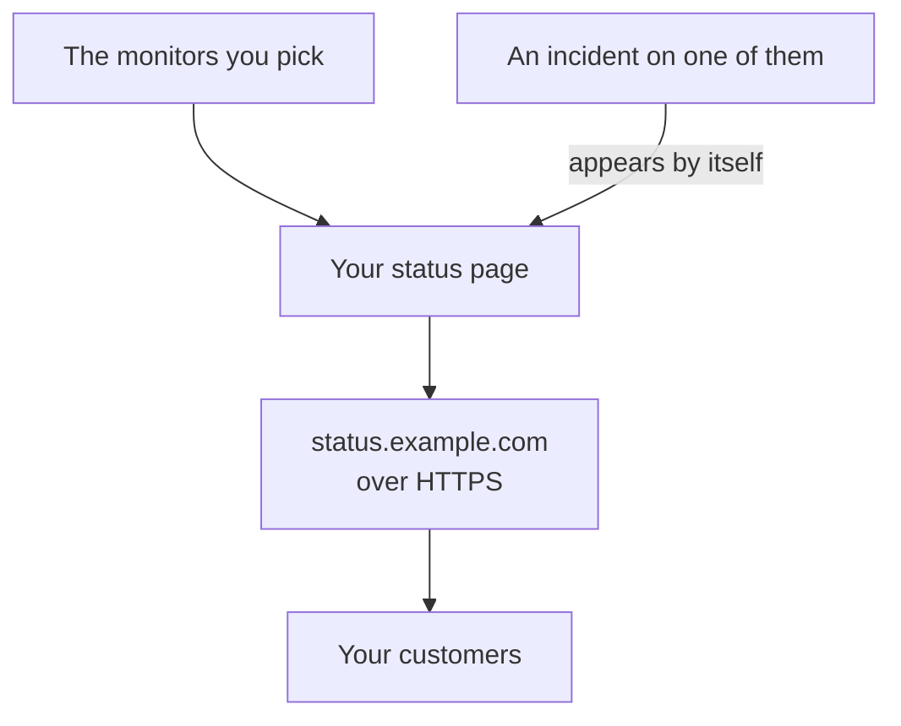

# Publish a Status Page

At the end of this guide, your customers open a status page at an address of your own, such as `status.example.com`, over HTTPS. It shows the monitors you pick with their status and uptime, and an incident on one of them appears there by itself. The guide follows the guided setup **Publish a status page**, then adds your domain on the page's **Custom Domains**: about 15 minutes, plus the time your DNS provider takes.

## What you need

- At least one monitor: a status page shows monitors. With none yet, the guided setup offers **Set up a monitor** first.
- A project owner or admin's role: the page needs permission to create status pages, and your domain needs permission to add and verify the project's domains.
- A domain you control, and access to its DNS records at your DNS provider.

:::tabs
@tab OneUptime Cloud
A custom domain and its free SSL certificate come with every plan. The Free plan has one status page per project: if you already have one, open its **Custom Domains** and start at the step that adds your domain. A new status page is public; making it private needs the Growth plan.
@tab Self-hosted
Your server needs a hostname of its own with an A record that points at it, such as `oneuptime.example.com`, answering on ports 80 and 443. Set it as `STATUS_PAGE_CNAME_RECORD` in `config.env` (`statusPage.cnameRecord` in the Helm chart), in place of the example value there. Free certificates also need `LETS_ENCRYPT_ACCOUNT_KEY` (`letsEncrypt.accountKey`): a private key made with openssl and encoded in base64. Restart OneUptime after changing them. **Add Custom Domain** checks the server first, and lists what is still missing.
:::

## Steps

:::steps
### Open the guided setup

On your project's **Home**, click **Publish a status page** in the **Welcome to OneUptime 👋** checklist. A new project's Home first asks **What do you want to do first?**: tick **Tell my customers with a status page** and click **Continue**. If the step is missing or already done, press `Ctrl+K` (`Cmd+K` on a Mac), type `status page` and choose **Publish a status page**.

### Name it and pick what it shows

Under **Name it, and pick what it shows**, keep the **Status page name** it suggests or type your own. Under **What it shows**, tick the monitors your customers should see, or click **Select all**. Click **Create the status page**. The page is public at its link from this moment, showing only the monitors you ticked.

### Look at what your customers see

Under **This is what your customers see**, open the address under **Public link**: your monitors are listed with their status. Back in the setup, click **Looks good**.

### Open Custom Domains

The setup ends on a summary. Under **Make it yours (optional)**, click **Your own domain**. The status page's **Custom Domains** opens.

### Add your domain

Click **Add Custom Domain**. In **Domain**, type the address your customers will open, such as `status.example.com`, and click **Continue**. **DNS Setup** opens with the records to add.

### Add the DNS records

At your DNS provider, add each record **DNS Setup** lists, with its **Type**, **Name** and **Value**: a CNAME record that points the address to OneUptime and, the first time the project uses this domain, a TXT record that shows the project owns it. If your provider adds the domain to each name by itself, type only the part before it, such as `status`, and `@` for the domain itself.

### Check the records

Keep **DNS Setup** open and click **Check now**. Under each record, it says what it looked up and what came back. A TXT record comes first: until it is found, the domain is not added, so click **Check now** again until it is. Once the CNAME record is found, the dialog says **Your CNAME record is verified.**, and a free SSL certificate is issued, usually within 15 minutes.
:::

## Check that it worked

- Open `https://status.example.com`, with your own address: your status page opens with no certificate warning.
- On **Custom Domains**, the domain's **Status** says **Certificate issued, renews automatically.** It can read **Issuing a free certificate, usually within 15 minutes.** for a while after the page already opens.
- On **Home**, the checklist marks **Publish a status page** as done: it is done once a status page shows a monitor. When it was the last step, the checklist is gone.

Nothing else is needed: OneUptime renews the certificate by itself. Once the domain is listed, OneUptime checks its CNAME record every 15 minutes, and verifies it when the record is live, even if you close **DNS Setup**.

## What can go wrong

:::details The domain is not in the list after closing DNS Setup
**DNS Setup** was closed before its TXT record was found, so the domain was never added. Click **Add Custom Domain**, type the same address, click **Continue**, then **Check now** until the dialog finds both records.
:::

:::details The domain stays on Waiting for DNS
Open **DNS Setup** from the domain's row and click **Check now**: it says what it found. Check that the record's name is the whole address, such as `status.example.com`, and that its value is the one **DNS Setup** shows. If the name answers with an address, it has an A record, or your DNS provider proxies it: replace the A record, or set the name to DNS only. For a root domain, such as `example.com`, use your provider's ALIAS, ANAME or flattened CNAME record.
:::

:::details The Status says it could not issue a free certificate
A CAA record on your domain that leaves out `letsencrypt.org` blocks the certificate. On a self-hosted server, Let's Encrypt must reach the server on port 80. Fix the cause: OneUptime keeps trying by itself, and **Check now** in **DNS Setup** orders again, at most once every 15 minutes per domain.
:::

:::details Self-hosted: the server is not ready for custom domains
**Add Custom Domain** says **This server is not ready for custom domains yet**, with a line for each thing still missing and what to change: the settings in [What you need](#what-you-need). Without `LETS_ENCRYPT_ACCOUNT_KEY`, a verified domain says **Verified. Uses your own proxy's HTTPS.**: serve its HTTPS from your own proxy. [Status Page Branding & Domains](/docs/status-pages/branding-and-domains#before-you-start) has the detail.
:::

## What to do next

:::cards
- [Status Page Branding & Domains](/docs/status-pages/branding-and-domains): Your logo, colors, header links and footer.
- [Subscribers & Announcements](/docs/status-pages/subscribers): Let customers subscribe, and post announcements.
- [Scheduled Maintenance](/docs/scheduled-maintenance/index): Tell customers about planned work before it starts.
- [Get Paged by Phone, SMS or Push](/docs/guides/paging): Be paged when one of those monitors goes down.
:::
