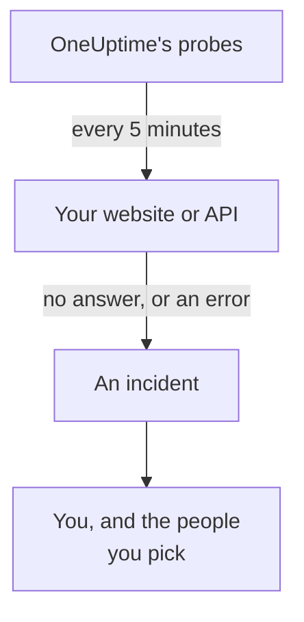

# Know When Your Website or API Is Down

At the end of this guide, OneUptime checks your website or API every 5 minutes, opens an incident when it stops answering or answers with an error, and tells you, and a test page you acknowledged shows that the message reaches you. It follows the guided setup **Know when my website or API is down**, and takes about 5 minutes.

## What you need

- A OneUptime project in which you may create monitors: an owner, admin or member may. To make an account and a project, follow the first part of the [Quickstart](/docs/introduction/quickstart#create-a-project).
- The address to check, such as `https://example.com`. For an API, pick an endpoint that answers a plain `GET` with no key, such as a health check: an answer like `401` counts as down.

:::tabs
@tab OneUptime Cloud
Probes in several regions check the address, so it must be reachable from the internet. The Free plan has 10 active monitors.
@tab Self-hosted
The address is checked from your server's own probe, so it must be reachable from there. To be emailed, the server must be able to send email: its master admin sets that up at `/admin/setup`, as the [Self-Hosting Guide](/docs/installation/self-hosting-guide) shows. The master admin is not made the owner of what they create, so they add themselves on the monitor's **Owners** page to be emailed.
:::

## Steps

:::steps
### Open the guided setup

A new project's **Home** first asks **What do you want to do first?**: tick **Know when my website or API is down** and click **Continue**. Then click **Create your first monitor** in the **Welcome to OneUptime 👋** checklist. If the checklist does not show it, press `Ctrl+K` (`Cmd+K` on a Mac), type `website down` and choose **Know when my website or API is down**.

### Enter the address

Under **What should we check?**, type the address in **Website or API address**. For an API endpoint, tick **This is an API endpoint**. Click **Start checking**: the probes check it at once, and a sentence says what they found. Click **Continue**.

### Choose who is told

Under **Who should be told?**, what you see depends on the project:

- With no on-call policy or on-call rule yet, you are already in **Who is paged**. Click **Add teammates** to add people who are already in the project, then click **Save and continue**. This creates `Default on-call policy`, which pages them for every new incident and alert in the project.
- With an on-call policy or rule, the project's own rules decide who is paged: click **Continue**.
- As a member, who may not set up paging, you are told you will be emailed as the monitor's owner: click **Continue**.

### Send yourself a test

Under **Send a test**, click **Send me a test page**. Pick a **Severity** and click **Send test page**. The test reaches you the way a real page would, and every message says TEST. No incident is created.

### Acknowledge the test page

Open the link in the email and acknowledge the page there. A verified phone number works too, once SMS and calls are turned on for the project: open the link in the text message, or press 1 during the call. Then click **Done** in the dialog, and **Continue**.
:::

## Check that it worked

- The setup ends on its summary, read from the records: **Checked**, **When it goes down**, **Who is told** and **Tested**.
- Click **Open the monitor**, then **Show the chain** on its **When this goes down** card: it shows the chain from the monitor to the people it reaches, and says **Nothing stops the chain.** when nothing would stop it.
- On **Home**, the checklist marks **Create your first monitor** as done once the first check comes in. When it was the last step, the checklist is gone.

To set up another address later, open the setup again and click **Check another address**.

## What can go wrong

:::details The first check never comes back
A sentence that says no location checks the address means the monitor has no probe; one that keeps saying it is checking means its probe is not connected. Open **Monitors → Settings → Probes** to see each probe's status. On a self-hosted server, the master admin checks the server's probe at `/admin/setup`. Then open the monitor, add a connected probe to it, and open the setup again.
:::

:::details The site works, but the monitor says it is down
The monitor counts no answer, or an answer outside 200 to 399, as down. A firewall that blocks the probes looks like no answer: on OneUptime Cloud, allow the addresses on [IP Addresses](/docs/configuration/ip-addresses); on a self-hosted server, allow the machine the probe runs on. To change the rule, see [Website Monitor](/docs/monitor/website-monitor) or [API Monitor](/docs/monitor/api-monitor).
:::

:::details The test page cannot be acknowledged
Nothing arrived to acknowledge it from, which on a self-hosted server usually means it cannot send email yet: the step says so, and its master admin sees **Set up email**. Set it up, then click **Send another test**, or click **Skip the test** and come back. After a test, close the dialog with **Done** and click **I did not get it**: it says what to check.
:::

## What to do next

:::cards
- [Get Paged by Phone, SMS or Push](/docs/guides/paging): Be paged on your phone, and page the next person if nobody answers.
- [Publish a Status Page](/docs/guides/status-page): Show the monitor to your customers, on your own domain.
- [Criteria & Statuses](/docs/monitor/criteria-and-statuses): Decide exactly when a monitor counts as down.
:::
