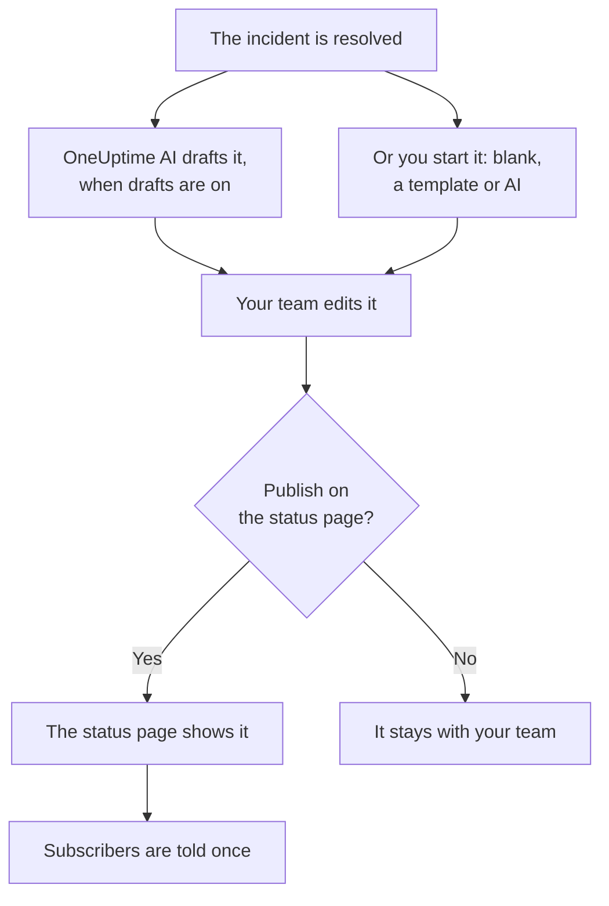

# Postmortems

A postmortem is the write-up after an incident: what happened, why, what it cost your users and what changes now. In OneUptime you write it on the incident itself. It can start from your own template or from a draft by OneUptime AI, and it can be published on your status page as the incident's closing update. Every postmortem has a status too, and **Incidents → Postmortems** lists every incident's postmortem, so you can see which are still owed.

:::cards
- [Write a postmortem](#write-a-postmortem): On the incident's Postmortem page, in five steps.
- [Start from a template or an AI draft](#start-from-a-template-or-an-ai-draft): Your outline, or one OneUptime AI fills in.
- [Publish it on your status page](#publish-it-on-your-status-page): Show it to customers, and tell subscribers once.
- [Track where each postmortem stands](#track-where-each-postmortem-stands): Not Started, Draft, Completed, or a status of your own.
- [See every postmortem](#see-every-postmortem): Filter by owner, severity and status to find the ones still owed.
- [Postmortems of episodes](#postmortems-of-episodes): One write-up for a group of incidents.
:::

## How a postmortem comes together

A postmortem has three parts, all on the incident: the note, written in Markdown; its attachments, such as screenshots and reports; and whether it is on your status page. They are on the incident's **Postmortem** page, under **Investigation** in its side menu. A postmortem also has a status, which says how far it has come, and owners: the incident's owners.

## Write a postmortem

:::steps
### Open the postmortem

Open the incident, then click **Postmortem** under **Investigation** in its side menu. The **Postmortem** card shows the postmortem's **Status** and **Owners**, the note, the attachments and whether the postmortem is on the status page. **Add owners**, beside the owners, makes one of your project's people or teams an owner of the incident right there.

### Click Write Postmortem

The **Write Postmortem** dialog opens on its first step, **Postmortem**. Once the postmortem is written, the card's button is **Edit Postmortem Note**, which opens the same steps.

### Write the note and attach files

Write the **Postmortem Note** in Markdown: what happened, the impact, how it was resolved and the follow-ups. Add screenshots, reports or timelines under **Postmortem Attachments**.

### Choose whether to publish

Click **Next**. On the **Status Page** step, **Publish on Status Page** starts off, so the postmortem stays with your team. To show it to customers, see [Publish it on your status page](#publish-it-on-your-status-page).

### Save the postmortem

Click **Save Changes**. The card shows the note and the attachments. The postmortem's status moves from **Not Started** to **Draft**: see [How a postmortem moves](#how-a-postmortem-moves).
:::

Every change to the note is recorded in the incident's feed, and posted to the incident's Slack or Microsoft Teams channel when it has one. While the postmortem is not published, no status page subscriber hears about it.

Writing a postmortem takes the Project Owner, Project Admin, Project Member, Incident Admin or Incident Member role, or a custom role with the Edit Incident permission. Anyone who can read the incident can read its postmortem.

## Start from a template or an AI draft

Two buttons fill the note in for you. While nothing is written, they are beside **Write Postmortem**: **Start from Template**, once the project has a postmortem template, and **Generate with AI**. Once the postmortem is written, they are in the **⋯** menu beside **Edit Postmortem Note**, as **Apply Template** and **Generate with AI**. Both open the same editor, with the note filled in and the rest of the postmortem as it was. Nothing is saved until you click **Save Changes**, so read the note and change it first.

### Apply a template

**Apply Template** appears once the project has a postmortem template. You make them under **Incidents → Settings → Postmortem Templates**: see [Postmortem templates](/docs/incidents/settings#postmortem-templates). On OneUptime Cloud, templates need the Growth plan.

Click **Start from Template**, or **Apply Template** in the **⋯** menu, pick one under **Select Template** in the **Apply Postmortem Template** dialog, and click **Apply Template**. A project with one template has it picked already.

### Generate it with AI

Click **Generate with AI**. The **Generate Postmortem with AI** dialog offers an outline under **Select Template**: **Standard Postmortem**, **Detailed Technical Postmortem** or **Brief Postmortem**, then your own postmortem templates. **Template Preview** shows the outline, and you can change it before you generate.

Click **Generate with AI** at the bottom of the dialog. OneUptime AI reads the incident (its description, root cause and remediation, its state timeline, its public and private notes, the messages in its Slack or Microsoft Teams channel, and what was said on [its calls](/docs/workspace-connections/video-calls#call-transcripts)) and writes the postmortem in your outline. The editor then opens on it.

Generating needs AI turned on for the project, under **Project Settings → AI → AI Features**, and an LLM provider: see [LLM Providers](/docs/ai/llm-provider). It also takes the Project Owner or Project Admin role, or a custom role with the Edit Incident permission: other roles can write the postmortem, but not generate it.

### Let OneUptime AI draft it when an incident resolves

With **Draft a postmortem when an incident resolves** on, OneUptime AI drafts the postmortem each time an incident is resolved, saves it as the note, and posts it to the incident's feed for your team to review. The switch is on **Incidents → AI → Settings**, and it is on for new projects.

- It never replaces a note that is already written.
- It never writes into a postmortem that is already published, where the draft would reach the status page unreviewed.
- It needs AI turned on for the project, and stops for the day once the project reaches its daily AI limits. See [Auto-postmortem](/docs/ai/ai-sre#auto-postmortem).
- When the transcript of the incident's call is still on its way as the incident resolves, it waits for OneUptime AI to read it, so the draft reads what was said on the call: up to six hours while the provider prepares the transcript. See [Record and transcribe every call](/docs/workspace-connections/video-calls#record-and-transcribe-every-call).

#### Choose which incidents get a draft, and its template

With no rule, every resolved incident gets a draft, in OneUptime AI's standard outline. **Postmortem rules**, under **More settings** on the same page, change that:

- A rule matches **All incidents**, or **Only incidents that match conditions** on monitors, severities, labels, monitor labels, title and description, as an AI rule does.
- Its **Templates** are the postmortem templates the draft may follow. With none, the draft follows the standard outline; with one, that template; with several, the one OneUptime AI finds fits the incident best. The draft's post in the feed names the template it followed.
- Its **LLM Provider**, under **More fields**, is the provider OneUptime AI writes the draft and picks its template with. With none picked, it is the project's default provider, else the global one. The draft's post in the feed names the provider a rule picked, or the one used instead and why. See [Which LLM provider a rule uses](/docs/ai/ai-sre#which-llm-provider-a-rule-uses).
- The first enabled rule that matches the incident decides, from the top of the list: drag a rule to change its place. An incident that no rule matches gets no draft, and so does every incident while the rules cannot be read.
- **Draft a postmortem when an incident resolves** stays the one switch that turns drafts off. Rules decide only the drafts OneUptime AI writes on its own: **Generate with AI** offers every outline, whatever they say.
- Creating, editing and reordering rules takes the Project Owner or Project Admin role. On OneUptime Cloud, templates need the Growth plan: below it, rules still decide which incidents get a draft, and every draft follows the standard outline.

## Publish it on your status page

A published postmortem is the incident's closing update for your customers: the status page shows the note, highlighted in the incident's timeline, with its attachments to download.

:::steps
### Open the Status Page step

Click **Edit Postmortem Note**, then **Next** to reach the **Status Page** step.

### Turn on Publish on Status Page

Turn on **Publish on Status Page**. Two more fields appear: **Notify Subscribers**, which is on, and **Postmortem Published At**, which is now.

### Decide who is told, and when it shows

Turn off **Notify Subscribers** to publish without telling subscribers. Change **Postmortem Published At** to show another time beside the postmortem.

### Publish it

Click **Save Changes**. The card now shows **Postmortem visible on Status Page?**, **Notify Subscribers**, **Subscriber Notification Status** and **Postmortem Published At**.
:::

What decides whether customers see it, and hear about it:

- **The incident must be on the status page.** A status page shows a postmortem only on an incident it shows: **Visible on Status Page** on, and the incident not private.
- **The note must say something.** A postmortem published with an empty note is not shown, and nobody is told.
- **Subscribers are told once**, the first time the status page shows the postmortem. Saving it again, or editing it while it is published, updates the page and tells nobody. Taking it off and publishing it again tells them again. One published while its incident is hidden is sent when the incident is made visible.
- **Notify Subscribers is read when the notification goes out.** Turning it on after the postmortem was published sends nothing.

**Subscriber Notification Status** shows whether the notification went out, and offers **Retry** when it failed. See [The postmortem](/docs/status-pages/subscribers#the-postmortem) for every case, and [Retry and Resend](/docs/status-pages/subscribers#retry-and-resend).

**Postmortem Published At** is also when the postmortem counts as published for the **Time to postmortem** measurement: see [Ready-made measurements](/docs/incidents/settings#ready-made-measurements).

## Track where each postmortem stands

Every incident's postmortem is in one of the project's postmortem statuses, shown under **Status** at the top of its **Postmortem** card. A new project has four. A postmortem in **Not Started** or **Draft** is still owed; one in **Completed** or **Not Needed** is not:

| Status | What it means | Still owed |
| --- | --- | --- |
| **Not Started** | Nobody has written this postmortem yet. | Yes |
| **Draft** | The postmortem is being written. | Yes |
| **Completed** | The postmortem is written and done. | No |
| **Not Needed** | This incident does not need a postmortem. | No |

### How a postmortem moves

OneUptime moves a postmortem on its own at three moments:

- A new incident's postmortem starts in **Not Started**, or in **Draft** when the incident is declared with a note, or in **Completed** when that note is published with it.
- The first note of a postmortem in **Not Started** moves it to **Draft**, whether someone writes it, applies a template or OneUptime AI drafts it.
- Publishing it on the status page moves it to **Completed**, unless it is done already.

It never moves back: clearing the note, or taking the postmortem off the status page, leaves its status where it is. A status someone picks in the same save always stands.

### Move it yourself

Click the status, on the incident's **Postmortem** page or on its row of the postmortems list, and pick one under **Move postmortem to**. The postmortem moves at once. Moving a postmortem takes the roles that write one, and anyone who can read the incident sees where its postmortem stands.

### Make the statuses your own

If your process has a step of its own, such as a review, add a status for it. Open **Incidents → Settings → Postmortem Statuses**, click **Create Postmortem Status**, and give it a name, such as **In Review**, a color and a description. A new status goes just above **Completed**; drag a status to change where it sits.

Where a status sits decides what it counts as, shown under **Counts as**: above **Draft**, **Not started**; from **Draft** down, **In progress**; from **Completed** down, **Done**, and no longer owed. **In Review**, between them, is still owed; **Not Needed**, below **Completed**, is not.

**Not Started**, **Draft** and **Completed** are built in, since OneUptime moves postmortems into them: you can rename and recolor them, but not delete or archive them, and they keep their order. Archive a status you no longer use from its row's **⋯** menu: nobody can move a postmortem to it again, the postmortems in it stay until someone moves them, and the list still filters by it. **Archived Postmortem Statuses**, folded under the table, lists them, with **Unarchive** to bring one back. Creating, editing and deleting statuses takes the Project Owner, Project Admin or Incident Admin role, or a custom role with the matching Postmortem Status permission.

## See every postmortem

**Incidents → Postmortems** lists the postmortem of every incident in the project, newest first, with the columns **Incident**, **Title**, **Postmortem Status**, **Severity**, **Owners** and **Declared**. **View** on a row opens the incident's **Postmortem** page.

Above the list, a tile per status counts the postmortems in it. Click a tile to list only those, and click it again to list them all.

Filter the list with the chips above it: **Owner**, a person or a team; **Severity**; **Postmortem Status**; **Incident State**; **Labels**; and **Affected Resources**. To see which postmortems a team still owes for your most severe incidents, pick the team under **Owner**, the severity under **Severity**, and **Not Started** and **Draft** under **Postmortem Status**. The filters are kept in the page's address, so you can bookmark the list or share it.

To change many at once, select them and open **Bulk Actions**: **Change Postmortem Status** moves them all to one status, such as **Not Needed** for incidents that need none, and **Add Owner** and **Remove Owner** change who owns them.

## Postmortems of episodes

An incident episode has a **Postmortem** page too, under **Investigation**: one write-up for every incident in the episode. Click **Edit Postmortem** to write it. **Apply Template** and **Generate with AI** work as on an incident, and the AI reads the episode and its member incidents.

An episode's postmortem is the note alone: it has no attachments, and no status page shows it. OneUptime AI does not draft one on its own when an episode resolves. Generating one takes the Project Owner or Project Admin role, or a custom role with the Edit Incident Episode permission. It has no status either, and the postmortems list leaves it out.

Alerts and scheduled maintenance events have no postmortem.

## Through the API

A postmortem is a set of fields on the incident, read and written through `/api/incident` like the rest of it:

| Field | What it is |
| --- | --- |
| `postmortemNote` | The note, in Markdown. |
| `showPostmortemOnStatusPage` | Whether the postmortem is published on your status pages. Starts `false`. |
| `notifySubscribersOnPostmortemPublished` | Whether subscribers are told when it is published. Starts `true`. |
| `postmortemPostedAt` | The time the status page shows beside it. |
| `postmortemStatusId` | The postmortem's status: one of the project's statuses, at `/api/incident-postmortem-status`. |

Writing `showPostmortemOnStatusPage` as `true` over a written `postmortemNote` publishes the postmortem, as the dialog does. It moves the postmortem to **Completed** as well, unless the same write sets `postmortemStatusId`.

## Troubleshooting

:::details Apply Template is not on the card
The project has no postmortem template yet, or your role cannot read them. Create one under **Incidents → Settings → Postmortem Templates**. On OneUptime Cloud, templates need the Growth plan.
:::

:::details Generate with AI says AI is off, or that you lack permission
Turn AI on under **Project Settings → AI → AI Features**. Generating takes the Project Owner or Project Admin role, or a custom role with the Edit Incident permission, even for someone who can edit the postmortem.
:::

:::details The postmortem is not on the status page
Check three things: **Publish on Status Page** is on, the note is not empty, and the incident is shown on the status page (**Visible on Status Page** on, and not private).
:::

:::details Subscribers were not told about the postmortem
**Notify Subscribers** was off when it was published, or the incident is hidden: then it is sent once the incident is made visible. **Subscriber Notification Status** on the card says which.
:::

:::details No AI draft appeared when the incident resolved
The incident already had a note, the postmortem was already published, no postmortem rule matched it, or **Draft a postmortem when an incident resolves** is off. AI must be on for the project, and the project must not have reached its daily AI limits. When the incident's call has a transcript on its way, the draft comes once OneUptime AI has read it.
:::

:::details A postmortem's status did not move when its note was written
Only a postmortem in **Not Started**, or in a status of yours above **Draft**, moves on its own, on its first note. One under way or done stays where it is, and so does a status someone picked in the same save. Move it yourself from its status: see [Move it yourself](#move-it-yourself).
:::

## Next steps

:::cards
- [Incidents Overview](/docs/incidents/index): The incident's other pages, from declaring to resolving.
- [Incident Settings & Automation](/docs/incidents/settings): Postmortem templates and the Time to postmortem measurement.
- [Subscribers & Announcements](/docs/status-pages/subscribers): Everything a status page tells its subscribers.
- [AI SRE](/docs/ai/ai-sre): What OneUptime AI does on its own after an incident.
:::
