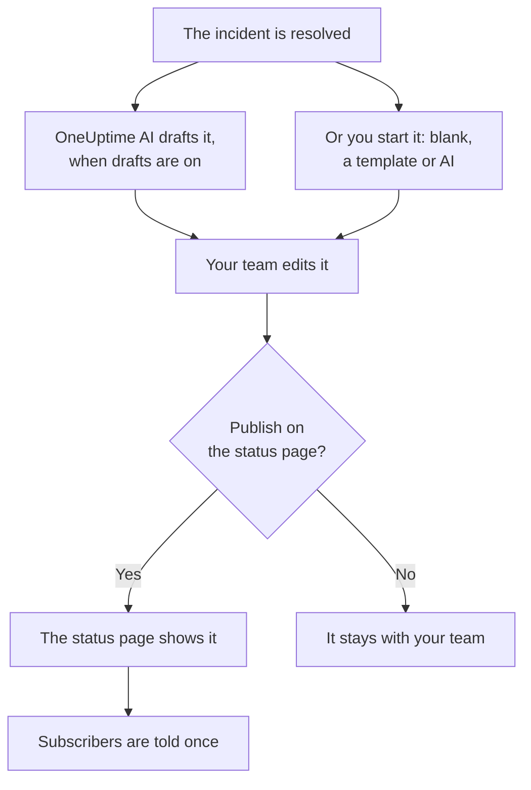

# Postmortems

A postmortem is the write-up after an incident: what happened, why, what it cost your users and what changes now. In OneUptime you write it on the incident itself. It can start from your own template or from a draft by OneUptime AI, and it can be published on your status page as the incident's closing update.

:::cards
- [Write a postmortem](#write-a-postmortem): On the incident's Postmortem page, in five steps.
- [Start from a template or an AI draft](#start-from-a-template-or-an-ai-draft): Your outline, or one OneUptime AI fills in.
- [Publish it on your status page](#publish-it-on-your-status-page): Show it to customers, and tell subscribers once.
- [Postmortems of episodes](#postmortems-of-episodes): One write-up for a group of incidents.
:::

## How a postmortem comes together

A postmortem has three parts, all on the incident: the note, written in Markdown; its attachments, such as screenshots and reports; and whether it is on your status page. They are on the incident's **Postmortem** page, under **Investigation** in its side menu.

## Write a postmortem

:::steps
### Open the postmortem

Open the incident, then click **Postmortem** under **Investigation** in its side menu. The **Postmortem Note** card shows the note, the attachments and whether the postmortem is on the status page.

### Click Edit Postmortem Note

The **Edit Postmortem Note** dialog opens on its first step, **Postmortem**.

### Write the note and attach files

Write the **Postmortem Note** in Markdown: what happened, the impact, how it was resolved and the follow-ups. Add screenshots, reports or timelines under **Postmortem Attachments**.

### Choose whether to publish

Click **Next**. On the **Status Page** step, **Publish on Status Page** starts off, so the postmortem stays with your team. To show it to customers, see [Publish it on your status page](#publish-it-on-your-status-page).

### Save the postmortem

Click **Save Changes**. The card shows the note and the attachments.
:::

Every change to the note is recorded in the incident's feed, and posted to the incident's Slack or Microsoft Teams channel when it has one. While the postmortem is not published, no status page subscriber hears about it.

Writing a postmortem takes the Project Owner, Project Admin, Project Member, Incident Admin or Incident Member role, or a custom role with the Edit Incident permission. Anyone who can read the incident can read its postmortem.

## Start from a template or an AI draft

Two buttons on the card fill the note in for you: **Generate with AI**, and **Apply Template** once the project has a postmortem template. Both open the same editor as **Edit Postmortem Note**, with the note filled in and the rest of the postmortem as it was. Nothing is saved until you click **Save Changes**, so read the note and change it first.

### Apply a template

**Apply Template** appears once the project has a postmortem template. You make them under **Incidents → Settings → Postmortem Templates**: see [Postmortem templates](/docs/incidents/settings#postmortem-templates). On OneUptime Cloud, templates need the Growth plan.

Click **Apply Template**, pick one under **Select Template** in the **Apply Postmortem Template** dialog, and click **Apply Template**. A project with one template has it picked already.

### Generate it with AI

Click **Generate with AI**. The **Generate Postmortem with AI** dialog offers an outline under **Select Template**: **Standard Postmortem**, **Detailed Technical Postmortem** or **Brief Postmortem**, then your own postmortem templates. **Template Preview** shows the outline, and you can change it before you generate.

Click **Generate with AI** at the bottom of the dialog. OneUptime AI reads the incident (its description, root cause and remediation, its state timeline, its public and private notes, the messages in its Slack or Microsoft Teams channel, and what was said on [its calls](/docs/workspace-connections/video-calls#call-transcripts)) and writes the postmortem in your outline. The editor then opens on it.

Generating needs AI turned on for the project, under **Project Settings → AI → AI Features**, and an LLM provider: see [LLM Providers](/docs/ai/llm-provider). It also takes the Project Owner or Project Admin role, or a custom role with the Edit Incident permission: other roles can write the postmortem, but not generate it.

### Let OneUptime AI draft it when an incident resolves

With **Draft a postmortem when an incident resolves** on, OneUptime AI drafts the postmortem each time an incident is resolved, saves it as the note, and posts it to the incident's feed for your team to review. The switch is on **Incidents → AI → Settings**, and it is on for new projects.

- It never replaces a note that is already written.
- It never writes into a postmortem that is already published, where the draft would reach the status page unreviewed.
- It needs AI turned on for the project, and stops for the day once the project reaches its daily AI limits. See [Auto-postmortem](/docs/ai/ai-sre#auto-postmortem).
- When the transcript of the incident's call is still on its way as the incident resolves, it waits for OneUptime AI to read it, so the draft reads what was said on the call: up to six hours while the provider prepares the transcript. See [Record and transcribe every call](/docs/workspace-connections/video-calls#record-and-transcribe-every-call).

#### Choose which incidents get a draft, and its template

With no rule, every resolved incident gets a draft, in OneUptime AI's standard outline. **Postmortem rules**, under **More settings** on the same page, change that:

- A rule matches **All incidents**, or **Only incidents that match conditions** on monitors, severities, labels, monitor labels, title and description, as an investigation rule does.
- Its **Templates** are the postmortem templates the draft may follow. With none, the draft follows the standard outline; with one, that template; with several, the one OneUptime AI finds fits the incident best. The draft's post in the feed names the template it followed.
- The first enabled rule that matches the incident decides, from the top of the list: drag a rule to change its place. An incident that no rule matches gets no draft, and so does every incident while the rules cannot be read.
- **Draft a postmortem when an incident resolves** stays the one switch that turns drafts off. Rules decide only the drafts OneUptime AI writes on its own: **Generate with AI** offers every outline, whatever they say.
- Creating, editing and reordering rules takes the Project Owner or Project Admin role. On OneUptime Cloud, templates need the Growth plan: below it, rules still decide which incidents get a draft, and every draft follows the standard outline.

## Publish it on your status page

A published postmortem is the incident's closing update for your customers: the status page shows the note, highlighted in the incident's timeline, with its attachments to download.

:::steps
### Open the Status Page step

Click **Edit Postmortem Note**, then **Next** to reach the **Status Page** step.

### Turn on Publish on Status Page

Turn on **Publish on Status Page**. Two more fields appear: **Notify Subscribers**, which is on, and **Postmortem Published At**, which is now.

### Decide who is told, and when it shows

Turn off **Notify Subscribers** to publish without telling subscribers. Change **Postmortem Published At** to show another time beside the postmortem.

### Publish it

Click **Save Changes**. The card now shows **Postmortem visible on Status Page?**, **Notify Subscribers**, **Subscriber Notification Status** and **Postmortem Published At**.
:::

What decides whether customers see it, and hear about it:

- **The incident must be on the status page.** A status page shows a postmortem only on an incident it shows: **Visible on Status Page** on, and the incident not private.
- **The note must say something.** A postmortem published with an empty note is not shown, and nobody is told.
- **Subscribers are told once**, the first time the status page shows the postmortem. Saving it again, or editing it while it is published, updates the page and tells nobody. Taking it off and publishing it again tells them again. One published while its incident is hidden is sent when the incident is made visible.
- **Notify Subscribers is read when the notification goes out.** Turning it on after the postmortem was published sends nothing.

**Subscriber Notification Status** shows whether the notification went out, and offers **Retry** when it failed. See [The postmortem](/docs/status-pages/subscribers#the-postmortem) for every case, and [Retry and Resend](/docs/status-pages/subscribers#retry-and-resend).

**Postmortem Published At** is also when the postmortem counts as published for the **Time to postmortem** measurement: see [Ready-made measurements](/docs/incidents/settings#ready-made-measurements).

## Postmortems of episodes

An incident episode has a **Postmortem** page too, under **Investigation**: one write-up for every incident in the episode. Click **Edit Postmortem** to write it. **Apply Template** and **Generate with AI** work as on an incident, and the AI reads the episode and its member incidents.

An episode's postmortem is the note alone: it has no attachments, and no status page shows it. OneUptime AI does not draft one on its own when an episode resolves. Generating one takes the Project Owner or Project Admin role, or a custom role with the Edit Incident Episode permission.

Alerts and scheduled maintenance events have no postmortem.

## Through the API

A postmortem is a set of fields on the incident, read and written through `/api/incident` like the rest of it:

| Field | What it is |
| --- | --- |
| `postmortemNote` | The note, in Markdown. |
| `showPostmortemOnStatusPage` | Whether the postmortem is published on your status pages. Starts `false`. |
| `notifySubscribersOnPostmortemPublished` | Whether subscribers are told when it is published. Starts `true`. |
| `postmortemPostedAt` | The time the status page shows beside it. |

Writing `showPostmortemOnStatusPage` as `true` over a written `postmortemNote` publishes the postmortem, as the dialog does.

## Troubleshooting

:::details Apply Template is not on the card
The project has no postmortem template yet, or your role cannot read them. Create one under **Incidents → Settings → Postmortem Templates**. On OneUptime Cloud, templates need the Growth plan.
:::

:::details Generate with AI says AI is off, or that you lack permission
Turn AI on under **Project Settings → AI → AI Features**. Generating takes the Project Owner or Project Admin role, or a custom role with the Edit Incident permission, even for someone who can edit the postmortem.
:::

:::details The postmortem is not on the status page
Check three things: **Publish on Status Page** is on, the note is not empty, and the incident is shown on the status page (**Visible on Status Page** on, and not private).
:::

:::details Subscribers were not told about the postmortem
**Notify Subscribers** was off when it was published, or the incident is hidden: then it is sent once the incident is made visible. **Subscriber Notification Status** on the card says which.
:::

:::details No AI draft appeared when the incident resolved
The incident already had a note, the postmortem was already published, no postmortem rule matched it, or **Draft a postmortem when an incident resolves** is off. AI must be on for the project, and the project must not have reached its daily AI limits. When the incident's call has a transcript on its way, the draft comes once OneUptime AI has read it.
:::

## Next steps

:::cards
- [Incidents Overview](/docs/incidents/index): The incident's other pages, from declaring to resolving.
- [Incident Settings & Automation](/docs/incidents/settings): Postmortem templates and the Time to postmortem measurement.
- [Subscribers & Announcements](/docs/status-pages/subscribers): Everything a status page tells its subscribers.
- [AI SRE](/docs/ai/ai-sre): What OneUptime AI does on its own after an incident.
:::
