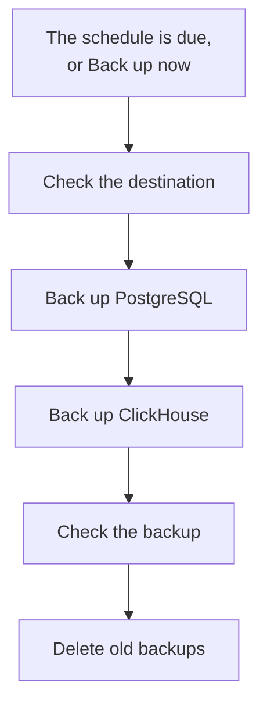

# Backups

Back up a self-hosted OneUptime to storage you own, on a schedule, and restore it from the Admin Dashboard. A backup holds PostgreSQL, with your projects, monitors, incidents, status pages and users, and ClickHouse, with your logs, traces and metrics. Backups are kept as many days as you choose, older ones are deleted for you, and any backup can be restored in place. Backups are part of the Enterprise Edition.

:::cards
- [Set up backups](#set-up-backups): Pick a destination, test it, choose a schedule.
- [Destinations](#destinations): What each recommended destination asks for.
- [Restore a backup](#restore-a-backup): What is replaced, and how the current data is kept safe.
- [Move to a new server](#move-to-a-new-server): Restore one installation's backups on another.
:::

## How a backup works



- **Consistent.** PostgreSQL is dumped in one transaction, so the dump is the database as it was at one moment, while OneUptime keeps running. ClickHouse backs up each table as it was when it read the table's parts.
- **Straight to the destination.** The output of `pg_dump` is streamed into the storage as it is written, and ClickHouse writes its own backup to the storage. Nothing is written to the server's disk, whatever the size of the data.
- **Checked.** Before a backup counts, `pg_restore` reads the dump back from the destination, and ClickHouse's record of its backup is found there. The dump's SHA-256 is kept with the backup, and a restore checks it before it replaces anything. A backup that fails or is cancelled deletes what it wrote, so the destination only holds whole backups.
- **Encrypted.** Backups travel to the storage over HTTPS, unless you enter an `http://` endpoint. Amazon S3, Google Cloud Storage, Azure Blob Storage and Cloudflare R2 encrypt everything they store; on other storage, turn on the bucket's encryption at rest. The destination's credentials are stored encrypted, and never shown again.
- **One at a time.** One backup or restore runs on the whole installation at a time. The others wait their turn.

Each backup is a folder of its own inside the destination's folder (`oneuptime/backups/` unless you choose another), named after the time it started, in UTC:

```text
oneuptime/backups/20261024T020000Z-3f2a9c1b/manifest.json
oneuptime/backups/20261024T020000Z-3f2a9c1b/postgres.dump
oneuptime/backups/20261024T020000Z-3f2a9c1b/clickhouse/
```

`manifest.json` is written last: it says what the backup holds, and which version of OneUptime made it.

## Before you begin

- **The Enterprise Edition**, with a license that includes backups. Backups run during the trial and the grace period. Without a license, no new backup is made, and restoring and deleting backups still work. See [Enterprise Edition](/docs/self-hosted/enterprise).
- **A master admin.** Backups are set up in the Admin Dashboard.
- **A bucket or container for backups only**, and credentials that may read, write, list and delete in it.
- **A destination ClickHouse reaches too.** ClickHouse writes its backup to the storage itself, so its network must reach the storage, as OneUptime's does.
- **To restore PostgreSQL, a database user that may create databases.** A restore writes into a new database beside the live one. The PostgreSQL that ships with OneUptime connects as a superuser, which may.

## Set up backups

:::steps
### Open the Backups page

In the Admin Dashboard, go to **Settings → Backups** and click **Set up backups**.

### Choose where backups go

Pick one of the recommended destinations. What each one asks for is in [Destinations](#destinations).

### Fill in the connection

Fill in what the destination asks for. A folder, a region and the settings most people leave as they are wait under **More fields**, and **Setup guide** opens the destination's section on this page.

### Test the destination

Click **Test the destination**. OneUptime writes, reads, lists and deletes a small test file, checks that `pg_dump` can back up your PostgreSQL, and asks ClickHouse to write a test backup of its tables' definitions. Nothing is saved, and a check that fails says what to change.

### Choose when backups run

Choose **How often** and the time in **At (UTC)**, and for weekly backups the **Day of the week**. **Keep backups for (days)** is 30 unless you change it. Turn off **Back up ClickHouse too** to back up PostgreSQL alone.

### Start backing up

Click **Start backing up**. The first backup runs at the next scheduled time, and **Back up now** starts one at once.
:::

The page then shows how backups are doing: when the last one ran, how big it was and how long it took, and when the next one runs. A backup in progress shows the step it is on, and **View steps** shows every step as it runs.

## Destinations

| Destination | Storage | Signs in with |
| --- | --- | --- |
| [Amazon S3](#amazon-s3) | Amazon S3 | An access key |
| [Cloudflare R2](#cloudflare-r2) | S3-compatible storage | An R2 API token |
| [Backblaze B2](#backblaze-b2) | S3-compatible storage | An application key |
| [Wasabi](#wasabi) | S3-compatible storage | An access key |
| [MinIO](#minio) | S3-compatible storage | An access key |
| [Google Cloud Storage](#google-cloud-storage) | Google Cloud Storage | An HMAC key |
| [Azure Blob Storage](#azure-blob-storage) | Azure Blob Storage | A SAS token or an access key |
| [Other S3-compatible storage](#other-s3-compatible-storage) | S3-compatible storage | An access key |

A key for Amazon S3 or another S3-compatible storage needs `s3:PutObject`, `s3:GetObject`, `s3:ListBucket`, `s3:DeleteObject` and `s3:AbortMultipartUpload` on the folder, and nothing else:

```json
{
  "Version": "2012-10-17",
  "Statement": [
    {
      "Effect": "Allow",
      "Action": "s3:ListBucket",
      "Resource": "arn:aws:s3:::my-backups"
    },
    {
      "Effect": "Allow",
      "Action": [
        "s3:PutObject",
        "s3:GetObject",
        "s3:DeleteObject",
        "s3:AbortMultipartUpload"
      ],
      "Resource": "arn:aws:s3:::my-backups/oneuptime/backups/*"
    }
  ]
}
```

### Amazon S3

| Field | What to enter |
| --- | --- |
| **Bucket** | The bucket backups are written to. Keep it for backups only. |
| **Region** | The bucket's region. It starts on `us-east-1`. |
| **Access key ID** | An access key with the permissions above. |
| **Secret access key** | The key's secret. |
| **Folder** | Under **More fields**. Left empty, backups go to `oneuptime/backups/`. |

Amazon S3 encrypts every file it stores, and OneUptime asks it to (SSE-S3) for every file it writes.

### Cloudflare R2

Enter your account's S3 API address as the **Endpoint**, `https://<account-id>.r2.cloudflarestorage.com`, from the bucket's settings in R2. Then enter the **Bucket**, and the **Access key ID** and **Secret access key** of an R2 API token that may read and write objects in it. Reading backups back from R2 costs nothing.

### Backblaze B2

Enter the bucket's S3 endpoint, shown on its Buckets page in Backblaze, such as `https://s3.us-west-004.backblazeb2.com`, as the **Endpoint**. Then enter the **Bucket**, and an application key's key ID and key as the **Access key ID** and **Secret access key**. The region is read from the endpoint.

### Wasabi

Enter the service URL of the bucket's region, such as `https://s3.us-east-1.wasabisys.com`, as the **Endpoint**, then the **Bucket** and an access key. The region is read from the endpoint.

### MinIO

Enter your MinIO server's S3 API address, such as `https://minio.example.com:9000`, as the **Endpoint**, then the **Bucket** and an access key whose policy may read, write, list and delete in it. OneUptime and ClickHouse must both reach the address.

### Google Cloud Storage

Enter the **Bucket**, and the **HMAC access key** and **HMAC secret** of a service account with the Storage Object Admin role on the bucket. Create the key in Cloud Storage's settings, on the Interoperability tab. OneUptime and ClickHouse reach the bucket through Cloud Storage's S3-compatible API.

### Azure Blob Storage

Enter the **Storage account** and the **Container**, and choose how to **Sign in with**: a **SAS token** with Read, Add, Create, Write, Delete and List permissions on the container, or an **Access key** of the storage account. A SAS token can be limited to the container, so it is the safer choice. **Cloud** and **Folder** wait under **More fields**.

### Other S3-compatible storage

For Ceph, DigitalOcean Spaces, Hetzner Object Storage and any storage with an S3 API, enter its S3 address as the **Endpoint**, then the **Bucket** and an access key. **Region**, under **More fields**, is needed only when the storage asks for one. Left empty, it is read from the endpoint, or is `us-east-1`.

## Schedule and retention

| Setting | What it does |
| --- | --- |
| **How often** | **Every hour**, **Every 6 hours**, **Every 12 hours**, **Every day** or **Every week**. Every day suits most installations. |
| **At (UTC)** | The hour backups start, in UTC, with your own time shown beside it. Every 6 or 12 hours counts from it: at `02:00`, backups every 6 hours run at 02:00, 08:00, 14:00 and 20:00. Backups every hour run on the hour. |
| **Day of the week** | The day weekly backups run. |
| **Keep backups for (days)** | From 1 to 3650 days. 30 unless you change it. |
| **Back up ClickHouse too** | On unless you turn it off. PostgreSQL is always backed up. |

After each backup, the backups that started more than **Keep backups for (days)** ago are deleted, at the destination and from the list, except the newest backup that succeeded, which is kept however old it is. Turning backups off, or a license that lapses, never leaves you without a backup to restore.

**Turn off scheduled backups**, in the status card's menu, stops the schedule. **Back up now** still works, and no backup is deleted. **Turn on** starts the schedule again.

## Restore a backup

:::warning What a restore replaces
A restore replaces the current data with the backup's. Everything changed since the backup was made is lost, unless you back up the current data first.
:::

:::steps
### Pick the backup

In the **Backups** table, click **Restore** on the backup to go back to. OneUptime checks the backup first: that its files are at the destination and unchanged, which version of OneUptime made it, and that this server can restore it.

### Choose what to restore

Tick **PostgreSQL: projects, monitors, incidents, users**, **ClickHouse: logs, traces, metrics** or both. The dialog shows how many projects, users and monitors the backup holds, and how many there are now.

### Keep the current data safe

**Back up the current data first** is ticked: the restore starts with a backup of the data it replaces, so you can go back to it. Untick it only if you have another copy, because without it the restore cannot be undone.

### Confirm

Type `restore` and click **Restore**.
:::

A restore runs step by step, and the page shows each one:

| Step | What happens |
| --- | --- |
| **Check the backup** | The backup's files are there, and this installation can restore it. |
| **Back up the current data** | A backup of the current data, unless you unticked it. |
| **Restore PostgreSQL** | The backup is restored into a new database beside the live one, and checked. |
| **Restore ClickHouse** | The live telemetry is set aside, and the backup's is restored in its place. |
| **Switch to the restored data** | The restored database takes the live one's name, in a moment. |
| **Bring the restored data up to date** | The database migrations of this version run on the restored data. |
| **Clean up** | What was set aside is removed. |

OneUptime keeps running on the current data until the switch, and nothing it uses changes before then. A restore that fails or is cancelled before the switch leaves everything as it was, and one that fails during the switch puts back what it set aside. Telemetry that arrives while ClickHouse is restored is not stored. After PostgreSQL is restored you may be signed out: sign in with an account that is in the backup.

:::details The restore says the backup was made with another ENCRYPTION_SECRET
The credentials OneUptime stores, such as a destination's key, are encrypted with `ENCRYPTION_SECRET`. Set the `ENCRYPTION_SECRET` the backup was made with before you restore, or those credentials cannot be read afterwards.
:::

## Move to a new server

:::steps
### Install OneUptime on the new server

Install the Enterprise Edition, at the version that made the backups or a newer one.

### Set up the same destination

In **Settings → Backups**, set up the destination your backups are in. The page finds the backups already there and lists them, ready to restore. **Find backups**, in the status card's menu, looks again.

### Restore the newest backup

Restore it as above. A backup made by an older version of OneUptime is brought up to this version. A backup made by a newer version can be restored once you update.
:::

## When a backup fails

The status card says **The last backup failed**, with the error, and **View steps** shows the step it stopped on and why. Every master admin also receives an email, at most once every 12 hours while backups keep failing. A failed restore is always emailed.

## Troubleshooting

:::details ClickHouse cannot reach the destination
ClickHouse connects to the storage itself. Let its network reach the destination's address, as OneUptime's does, then test the destination again.
:::

:::details pg_dump is missing or too old
The Enterprise image carries `pg_dump` and `pg_restore` 16, 17 and 18, which back up PostgreSQL 18 and every version before it. On another image, install the PostgreSQL client tools, or set `BACKUP_POSTGRES_BIN_DIR` to the directory that holds them. `pg_dump` must be at least as new as your PostgreSQL server.
:::

:::details Restoring PostgreSQL needs one change
A restore creates a database, which OneUptime's database user must be allowed to do. Run this on PostgreSQL as a superuser, with your `DATABASE_USERNAME` in place of `oneuptime`, then restore again:

```sql
ALTER USER oneuptime CREATEDB;
```
:::

:::details A backup is at a previous destination
After you change the destination, the backups made at the old one stay in the list, marked **At a previous destination**. Set that destination again to restore one, or delete it from the list: its files stay where they are.
:::

## Next steps

:::cards
- [Enterprise Edition](/docs/self-hosted/enterprise): Licenses, and what the Enterprise Edition adds.
- [Upgrading](/docs/installation/upgrading): Back up before every upgrade.
- [Docker Compose](/docs/installation/docker-compose): Run OneUptime on one server.
:::
