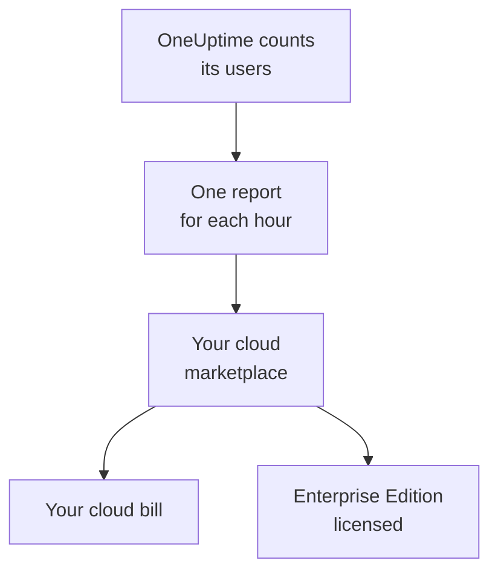

# Cloud Marketplaces

Run OneUptime Enterprise in your own Kubernetes cluster, bought on AWS Marketplace, Microsoft Marketplace or Google Cloud Marketplace. The marketplace bills every user of your installation by the hour on your cloud bill, and your subscription licenses the Enterprise Edition: there is no license key to activate.

:::cards
- [Install OneUptime](#install-oneuptime): On Amazon EKS, Azure Kubernetes Service or Google Kubernetes Engine.
- [How billing works](#how-billing-works): USD 0.10 per user per hour, reported every hour.
- [Upgrading](#upgrading): How a new release reaches your cluster.
- [Troubleshooting](#troubleshooting): When the edition label warns about the marketplace.
:::

## How it works

OneUptime counts its users every 15 minutes and reports each hour to the marketplace you bought it on, once, at the most users it saw in that hour. The marketplace adds the hour to your cloud bill. Each report it accepts also tells OneUptime that your subscription is active, and that keeps the Enterprise Edition licensed.



| | AWS | Microsoft | Google Cloud |
| --- | --- | --- | --- |
| Listing | Not public yet: [contact us](https://oneuptime.com/enterprise/demo) | [OneUptime Enterprise](https://marketplace.microsoft.com/en-us/product/oneupitme.oneuptime-enterprise) | Not public yet: [contact us](https://oneuptime.com/enterprise/demo) |
| Runs on | Amazon EKS | Azure Kubernetes Service (AKS) | Google Kubernetes Engine (GKE) |
| You install it with | Helm, from the listing's registry | The Azure portal | The Google Cloud console |
| OneUptime reports with | The IAM role of its Kubernetes service account | The managed identity Azure gives the installation | The reporting secret Google Cloud Marketplace creates for the deployment |
| New releases | You upgrade with Helm | Minor releases are installed for you | You upgrade by hand |

## Before you begin

- **A Kubernetes cluster** on the marketplace's cloud, with at least 3 nodes of 4 vCPUs and 16 GiB of memory, a default StorageClass and support for `LoadBalancer` services. OneUptime runs its own PostgreSQL, ClickHouse and Valkey in the cluster; size them with [Sizing & Capacity Planning](/docs/installation/sizing).
- **A domain name** for OneUptime, such as `oneuptime.example.com`, that you can point at the cluster's load balancer.
- **Outbound HTTPS** from the cluster to the marketplace, so OneUptime can report its users: `metering.marketplace.<region>.amazonaws.com` and `sts.<region>.amazonaws.com` on AWS, `marketplaceapi.microsoft.com` on Azure, `servicecontrol.googleapis.com` and `oauth2.googleapis.com` on Google Cloud.

## Install OneUptime

### AWS Marketplace

On AWS, OneUptime reports its users with an IAM role that EKS gives its Kubernetes service account (IAM roles for service accounts). AWS Marketplace takes usage from EKS only when it is signed this way.

:::steps
1. Subscribe to OneUptime Enterprise on AWS Marketplace, then choose **Continue to Configuration**, pick the version and choose **Continue to Launch**.
2. Give the cluster an IAM OIDC provider, if it does not have one yet, and create the `oneuptime` service account with an IAM role that has the `AWSMarketplaceMeteringFullAccess` policy, with the commands below. Run them in place of the `eksctl` command in step 1 of the launch page's **General launch instructions**: that command attaches a role you would have to create first.
3. Log Helm in to the listing's registry and install the chart with the commands in step 2 of the **General launch instructions**. In the `helm install` command, set `serviceAccount.name` to `oneuptime`, `host` to your domain name, and `httpProtocol` to `https` if a certificate is in front of OneUptime.
4. [Open OneUptime](#open-oneuptime).
:::

```bash
eksctl utils associate-iam-oidc-provider --cluster <cluster> --approve
eksctl create iamserviceaccount --name oneuptime --namespace oneuptime --cluster <cluster> \
  --attach-policy-arn arn:aws:iam::aws:policy/AWSMarketplaceMeteringFullAccess \
  --approve --override-existing-serviceaccounts
```

Keep the values of step 3 in a file, and pass it to every `helm upgrade`:

```yaml title="values.yaml"
host: oneuptime.example.com
httpProtocol: https
serviceAccount:
  name: oneuptime
```

### Microsoft Marketplace

On Azure, OneUptime is a Kubernetes application: AKS installs it as a cluster extension, and gives it the managed identity it reports its users with.

:::steps
1. Open OneUptime Enterprise on Microsoft Marketplace in the Azure portal, or open your AKS cluster and select **Extensions + applications** > **Add**, then choose the plan and select **Create**.
2. Choose the subscription and resource group, and whether to install on an existing AKS cluster or create a new one.
3. On the **OneUptime** step, enter a name for the installation, your domain name and its protocol.
4. Select **Review + create**, then **Create**. The installation takes a few minutes; it is done when **Extensions + applications** shows its provisioning state as **Succeeded**.
5. [Open OneUptime](#open-oneuptime).
:::

Custom meters work on AKS clusters, not on Azure Arc-enabled Kubernetes, so OneUptime Enterprise on Microsoft Marketplace installs on AKS only.

### Google Cloud Marketplace

On Google Cloud, Marketplace runs a deployer that installs OneUptime into the namespace you choose, together with a reporting secret OneUptime reports its users with.

:::steps
1. Open OneUptime Enterprise on Google Cloud Marketplace in the Google Cloud console and select **Configure**.
2. Choose the GKE cluster and the namespace, and enter a name for the installation, your domain name and its protocol.
3. Select **Deploy**. The deployment takes a few minutes; it is done when the application shows as ready under **Kubernetes Engine** > **Applications**.
4. [Open OneUptime](#open-oneuptime).
:::

## Open OneUptime

OneUptime starts by migrating its database, which takes a few minutes on a new installation. Then point your domain name at its load balancer:

```bash
kubectl get service --namespace <namespace>
```

The service whose name ends in `-nginx` has an `EXTERNAL-IP`: create a DNS record for your domain name that points at it. Open the domain name and sign up. The first account on a new installation becomes its master admin, who can open the Admin Dashboard at `/admin`.

Within the hour, the edition label shows the Enterprise Edition, licensed through your marketplace. Master admins see the edition label in the Admin Dashboard header and in the footer of the Dashboard.

## How billing works

| What | How it works |
| --- | --- |
| Price | USD 0.10 per user per hour, about USD 73 per user per month. |
| Who counts | Everyone with a OneUptime login on the installation. Status page subscribers and the people who sign in to a private status page do not count. |
| When | OneUptime counts its users every 15 minutes, and reports each hour once, at the most users it saw in that hour. An hour in which OneUptime was not running is not billed. |
| Where | On your AWS, Azure or Google Cloud bill, through the marketplace. |
| Not included | The cluster itself: your cloud bills its nodes, disks and load balancers as usual. |

Each installation is billed on its own, so a staging installation is billed too. For annual pricing, volume discounts or a price for non-production installations, ask [sales@oneuptime.com](mailto:sales@oneuptime.com) for a private offer, which you accept on the marketplace.

When a report cannot be sent, because of a network problem or a marketplace outage, OneUptime sends it again on its next run. Every report carries a key for its hour, so an hour is never billed twice.

## How licensing works

Your marketplace subscription is your license. Each report the marketplace accepts licenses every enterprise feature, for every user, for the next 72 hours. A license key from OneUptime works on the same installation too: the installation runs on whichever of the two is better.

| What happens | What the edition label shows |
| --- | --- |
| The marketplace accepts the hourly reports | The Enterprise Edition, licensed through your marketplace. |
| No report has been accepted for 72 hours | **Enterprise Edition (Marketplace Reports Failing)**: every enterprise feature keeps working for a 30-day grace period. |
| The marketplace says the installation is not subscribed, or the grace period ends | **Enterprise Edition (Marketplace Subscription Ended)**: the enterprise features stop, as they do when a [license lapses](/docs/self-hosted/enterprise#when-a-license-expires-or-is-missing). |

A cancelled or suspended subscription, or an installation that is not the one you bought, is what the marketplace refuses. Monitoring, alerts, incidents, on-call and status pages keep working in every case, and nothing is deleted. Subscribe again, and the next accepted report licenses the Enterprise Edition again, without a restart.

## Upgrading

| Marketplace | How a new release reaches your cluster |
| --- | --- |
| AWS Marketplace | Each release is a new version of the listing. Run `helm upgrade` with the chart from the listing's registry, the new version and your values file. |
| Microsoft Marketplace | AKS installs new minor and patch releases for you. A new major release waits until you accept it. You can turn automatic upgrades off on the installation's page in **Extensions + applications**. |
| Google Cloud Marketplace | Google Cloud Marketplace keeps a deployment on the version it installed, and never updates it. Contact [support](https://oneuptime.com/support) before you move a deployment to a new version. |

OneUptime migrates its database when the new release starts. Read the [upgrade notes](/docs/installation/upgrading) before you move to a new major release.

Upgrade through the marketplace. A marketplace installation does not compare itself with OneUptime's releases on GitHub: the versions your marketplace offers are the ones to upgrade to.

## Settings and scaling

Your bill does not change with scale: OneUptime is billed per user. More replicas or larger nodes change only what your cloud bills for the cluster.

| Marketplace | Where your settings live |
| --- | --- |
| AWS Marketplace | Your values file. Every setting of the [Helm chart](https://artifacthub.io/packages/helm/oneuptime/oneuptime) works, except the bundled operators. |
| Microsoft Marketplace | The installation's configuration settings, on its page in **Extensions + applications** or with `az k8s-extension update --configuration-settings`. Each setting is a chart value, such as `autoscaling.enabled=true`. |
| Google Cloud Marketplace | The fields of the deployment form. Change anything else with `kubectl`, on the deployment's own resources. |

- **Scale OneUptime** with the chart's replica and autoscaling settings (`deployment.replicaCount`, `autoscaling.enabled`, and each service's own overrides), and the nodes with your cluster's autoscaler.
- **Keep the marketplace settings as the listing sets them**: `enterpriseMarketplace` and, on AWS, `serviceAccount`. Without them, OneUptime cannot report, and the Enterprise Edition is not licensed.
- **The KEDA, CloudNativePG and Altinity ClickHouse operators are not included**, because a marketplace ships only the images on its listing. For highly available datastores, point OneUptime at managed services with `externalPostgres`, `externalRedis` and `externalClickhouse`.

Billing does not depend on how many replicas run: one run at a time reports, and each hour has one report.

## Troubleshooting

:::details The edition label shows Enterprise Edition (Marketplace Reports Failing)
OneUptime cannot report to the marketplace. Every line it logs about it starts with `OneUptime Enterprise marketplace billing`; a line that says usage "cannot be reported" names what is missing. The usual causes:

- **AWS:** the `oneuptime` service account has no IAM role, or the role does not have the `AWSMarketplaceMeteringFullAccess` policy (`AWSMarketplaceMeteringRegisterUsage` is not enough). Attach the policy to the role, or create the role with the `eksctl` command in [AWS Marketplace](#aws-marketplace) and then restart OneUptime's pods with `kubectl rollout restart deployment --namespace oneuptime`.
- **Azure:** the installation is not the Microsoft Marketplace application, for example because it was installed with Helm, so it has no identity or plan to report with. Install it from the Azure portal.
- **Google Cloud:** the reporting secret of the deployment was deleted or replaced.
- **Every marketplace:** a firewall or proxy blocks the outbound HTTPS in [Before you begin](#before-you-begin).

The usage is kept while you fix it, and billed once OneUptime can report again. Usage older than 30 days is not billed.
:::

:::details The edition label shows Enterprise Edition (Marketplace Subscription Ended)
The marketplace refused the installation: the subscription was cancelled or suspended, or the installation is not the one bought on the marketplace. Check the subscription on the marketplace and subscribe again; the next accepted report licenses the Enterprise Edition again. The same label shows when reports kept failing for the whole grace period.
:::

:::details The pods stay pending after the installation
OneUptime's databases need persistent volumes. Give the cluster a default StorageClass: on Amazon EKS, install the Amazon EBS CSI driver add-on.
:::

## Next steps

:::cards
- [Enterprise Edition](/docs/self-hosted/enterprise): What the Enterprise Edition adds, and what stops when a license lapses.
- [Upgrading](/docs/installation/upgrading): The upgrade notes for each release.
- [Sizing & Capacity Planning](/docs/installation/sizing): Size the datastores for your telemetry.
- [Architecture](/docs/self-hosted/architecture): What runs in your cluster.
- [Kubernetes Agent](/docs/telemetry/kubernetes-agent#install-as-an-amazon-eks-add-on): Free on AWS Marketplace too, as an Amazon EKS add-on, for clusters that send to OneUptime.
:::
